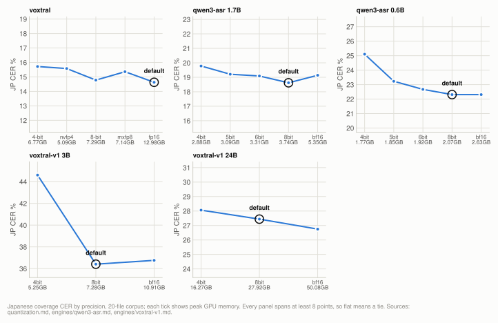
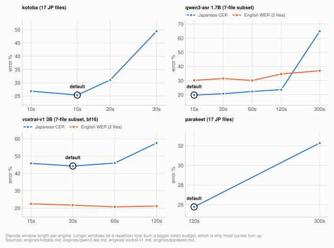

# Why the defaults are what they are

Each model family takes its own parameters, and some take many: `voxtral` has more than a
dozen. Good values for them are hard to guess, and they differ between models.

To compare models fairly, the benchmarks first look for each model's best settings on the
test corpus, then compare the models at those settings. Most parameters were swept one at a
time with the others held at their defaults; a few were swept together, such as Voxtral's
chunk length and batch size, and each size against each precision. The result is the best
value found for each parameter on this corpus, not a search over every combination.

Those settings are the defaults. Any parameter not passed on the command line takes the
value the benchmarks chose, for accuracy, for speed, or for a stated balance of the two.
`--model` can be omitted too: it then runs `voxtral`, the model the benchmarks favour
overall ([MODELS.md](MODELS.md) gives what that choice trades away).

This page lists, per family, each parameter whose default came from a benchmark, the
default, the reason, and the page holding the measurements. Every flag a family accepts is
in [MODELS.md](MODELS.md).

## How a variant is chosen

When `--size` and `--quantization` are not passed, the CLI tries the family's variants in
the priority order listed in [MODELS.md](MODELS.md#the-models) and loads the first whose
peak memory fits within 80% of the GPU working set, <!-- not-measured: a round rule, hardware.py USABLE_FRACTION --> the same budget that sizes Voxtral's batch
([decode-throughput.md](benchmarks/decode-throughput.md)).
The order is by accuracy on the corpus, with the larger variant first where two tie, since
the corpus cannot rule out a loss on audio it does not contain. Passing `--size` or
`--quantization` keeps only the matching variants; passing both names one variant, used as
given. If no matching variant fits, the smallest one runs, with a warning.

## Model and size

What a size is differs by family. `whisper` sizes are separate checkpoints from several
releases (`turbo` is `large-v3` with its decoder cut to 4 layers), each at one precision.
`qwen3-asr` and `voxtral-v1` sizes are parameter counts within one release, each at several
precisions. `voxtral` has one size and several precisions.

Size and precision are ranked in one list, so a larger model at low precision is compared
with a smaller model at high precision. On `qwen3-asr` the `1.7B` at every precision, 4bit
included, is more accurate than the `0.6B` at any precision. On `voxtral-v1` the `24B` at
4bit is more accurate than the `3B` on Japanese and ties it on English. So on both, every
variant of the larger model comes first.[^cross]

| model | parameter | default | reason | detail |
|---|---|---|---|---|
| all | `--model` | `voxtral` | on the M2 Ultra, the fastest multilingual model measured that writes subtitles; needs no `--language` and reruns byte-identically on one machine. Ties `whisper turbo` on Japanese. `voxtral-v1 24B` is more accurate on English, at a fraction of the speed and without subtitles | [engines.md](benchmarks/engines.md) |
| `whisper` | `--size` | `large-v3` | ties `turbo` on both languages; chosen as the larger decoder. `turbo` is next in priority, and is faster and smaller | [whisper.md](benchmarks/engines/whisper.md#experiment-every-whisper-size-at-its-default-config) |
| `qwen3-asr` | `--size` | `1.7B` | more accurate than `0.6B`. `0.6B` is faster | [qwen3-asr.md](benchmarks/engines/qwen3-asr.md) |
| `voxtral-v1` | `--size` | `24B` where it fits, else `3B` | `24B` is more accurate on Japanese, and by a smaller margin on English. `3B` fits a 16GB Mac at 8bit | [voxtral-v1.md](benchmarks/engines/voxtral-v1.md) |

## Precision

Each model's precision was measured on that model; no result was carried over from another
model, because they differ: 4bit costs least on `qwen3-asr 1.7B`, more on `qwen3-asr 0.6B`,
and most on `voxtral-v1 3B`.[^ladders]

<picture>
  <source media="(prefers-color-scheme: dark)" srcset="benchmarks/img/precision-dark.svg">
  
</picture>

| model | parameter | default | reason | detail |
|---|---|---|---|---|
| `voxtral` | `--quantization` | `fp16`, else `8bit`, else `4bit` | `fp16` ties `8bit`, and both are more accurate than `4bit`; `fp16` is chosen as the higher precision, although it is slower and needs more memory. A 16GB Mac runs `8bit`, quantized from the fp16 build on first use | [quantization.md](benchmarks/quantization.md) |
| `qwen3-asr` | `--quantization` on `1.7B` | `8bit` | ties `5bit` as the most accurate, and is chosen as the higher precision; `4bit`, `6bit` and `bf16` are less accurate | [qwen3-asr.md](benchmarks/engines/qwen3-asr.md) |
| `qwen3-asr` | `--quantization` on `0.6B` | `bf16`, else `8bit` | `bf16` ties `8bit`, and is chosen as the higher precision; `4bit` and `5bit` are less accurate | [qwen3-asr.md](benchmarks/engines/qwen3-asr.md) |
| `voxtral-v1` | `--quantization` on `3B` | `bf16`, else `8bit` | `bf16` ties `8bit` on both languages, and is chosen as the higher precision; a 16GB Mac runs `8bit`. `4bit` is less accurate on Japanese, on 15 of 16 files | [voxtral-v1.md](benchmarks/engines/voxtral-v1.md) |
| `voxtral-v1` | `--quantization` on `24B` | `bf16`, else `8bit` | `bf16` ties `8bit` on both languages, and is chosen as the higher precision. `4bit` is less accurate on English | [voxtral-v1.md](benchmarks/engines/voxtral-v1.md) |
| `reazon` | `--quantization` | `fp32` | more accurate than `int8`, which drops whole phrases mid-file on conversational audio, although the publisher reports it near parity on read speech. `int8` is faster | [reazon.md](benchmarks/engines/reazon.md) |
| `voxtral` | `--kv-bits` | `8` | ties an unquantized KV cache, and is faster | [quantization.md](benchmarks/quantization.md) |

## Chunking and windows

<picture>
  <source media="(prefers-color-scheme: dark)" srcset="benchmarks/img/windows-dark.svg">
  
</picture>

| model | parameter | default | reason | detail |
|---|---|---|---|---|
| `voxtral` | `--chunk-seconds` | `30` | 30s and 60s chunks tie; 30s is chosen because it is faster on both measured machines, and on the M4 it also has a lower peak than 60s at the same batch. Chips with no profile also run 30s | [chunking.md](benchmarks/chunking.md) |
| `voxtral` | `--max-batch` | from memory: `128` on a 128GB Mac, `32` on a 16GB Mac | batch size changes accuracy by less than the corpus resolves, and speed rises with it, so the default is the largest well-measured batch whose predicted peak fits. 2-11 are never chosen: 2-8 were slower per step than batch 1, and 9-11 were not measured. The M4 profile caps it at 32, the largest batch that ran reliably there | [decode-throughput.md](benchmarks/decode-throughput.md#how-the-default-is-chosen) |
| `voxtral` | `--overlap-seconds` | `0` | overlap helped on one clip; on the corpus it did not, and it was slower | [chunking.md](benchmarks/chunking.md) |
| `kotoba` | `--chunk-seconds` | `15` | more accurate and faster than a 10s window; 20s and 30s windows are less accurate than 10s. The best window depends on the material, so sweep it on your own recordings | [kotoba.md](benchmarks/engines/kotoba.md) |
| `voxtral-v1` | `--chunk-seconds` | `30` | most accurate on Japanese, which degrades sharply with windows above 60s. English is slightly better with a 60s window, on two files | [voxtral-v1.md](benchmarks/engines/voxtral-v1.md) |
| `qwen3-asr` | `--chunk-seconds` | `15` | ties 30s; chosen because it is faster and smaller. 60s and longer are less accurate, slower and larger, because a longer window gives a repetition loop more tokens to run. The library's own default of 1200s makes any file under 20 minutes a single window | [qwen3-asr.md](benchmarks/engines/qwen3-asr.md) |
| `parakeet` | `--chunk-seconds` | `120` | more accurate than a 300s window, and uses less memory. A 60s window drops content | [parakeet.md](benchmarks/engines/parakeet.md) |
| `reazon` | `--chunk-seconds` | `30` | not swept: the weights cannot decode a whole file (they are trained on short VAD segments), so a window is required; 30s matches the Voxtral rows to keep the front end the same | [reazon.md](benchmarks/engines/reazon.md) |

## Audio, prompt and decoding

| model | parameter | default | reason | detail |
|---|---|---|---|---|
| `voxtral` | `--delay-ms` | `2400` | the largest accuracy effect of any Voxtral parameter, at no speed cost. 2400 is the model's maximum | [delay.md](benchmarks/delay.md) |
| `voxtral` | `--gain` | `auto` | the mel front end clamps at a fixed floor, so quiet input loses detail. `auto` boosts only quiet audio, and output on normal-level input is byte-identical | [input-level.md](benchmarks/input-level.md) |
| `voxtral` | `--vad` | off | ties energy-based cut points; chosen because it avoids the `onnxruntime` dependency | [chunking.md](benchmarks/chunking.md) |
| `voxtral` | `--prompt` | empty | a prompt biases register rather than recalling vocabulary, an instruction in it lowers accuracy, and on English audio any prompt removes word spacing | [prompt.md](benchmarks/prompt.md) |
| `voxtral` | `--compact-silence` | off | ties at every precision tested and is slightly faster; off because it discards audio, which should be opted into | [chunking.md](benchmarks/chunking.md) |
| `whisper`, `kotoba` | `condition_on_previous_text` (not a flag) | `False` on `small` and larger | with `True`, a repetition loop in one 30s window carries into the next; `False` is more accurate on every model tested. `tiny` and `base` keep the library default, since they are not used for long-form transcription here | [whisper.md](benchmarks/engines/whisper.md#experiment-condition_on_previous_textfalse) |

## Subtitle cues

Voxtral returns a timestamp per token, and the CLI groups the tokens into subtitle cues: a
new cue starts at a pause of `--gap-seconds`, or when a cue reaches `--max-chars` characters
or `--max-dur-seconds`. The other engines return their own segments, so these flags are
Voxtral only. The sweeps scored how closely the cue breaks match 7 timed subtitle files,
all written by one editor.

| model | parameter | default | reason | detail |
|---|---|---|---|---|
| `voxtral` | `--gap-seconds` | `1.2` | a judgment call, not the best-scoring value. Shorter pauses match the reference files more closely, mostly by producing more and shorter cues, and with one editor's files a closer match may only mean closer to that editor's style. Kept until references from other editors exist | [cue-layout.md](benchmarks/cue-layout.md) |
| `voxtral` | `--max-chars` | `28` | the best-scoring value from 28 to 72 characters at the default gap | [cue-layout.md](benchmarks/cue-layout.md#experiment-max_chars-and-max_dur_s) |
| `voxtral` | `--max-dur-seconds` | `7.0` | the best-scoring value tested at the default gap and character limit | [cue-layout.md](benchmarks/cue-layout.md#experiment-max_chars-and-max_dur_s) |

[^cross]: [qwen3-asr.md](benchmarks/engines/qwen3-asr.md); [voxtral-v1.md](benchmarks/engines/voxtral-v1.md)
[^ladders]: [qwen3-asr.md](benchmarks/engines/qwen3-asr.md); [voxtral-v1.md](benchmarks/engines/voxtral-v1.md)
