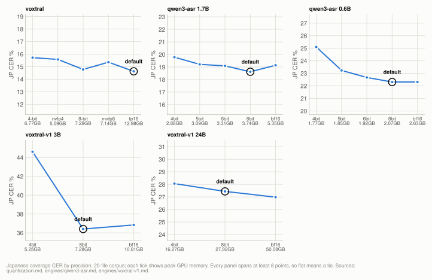
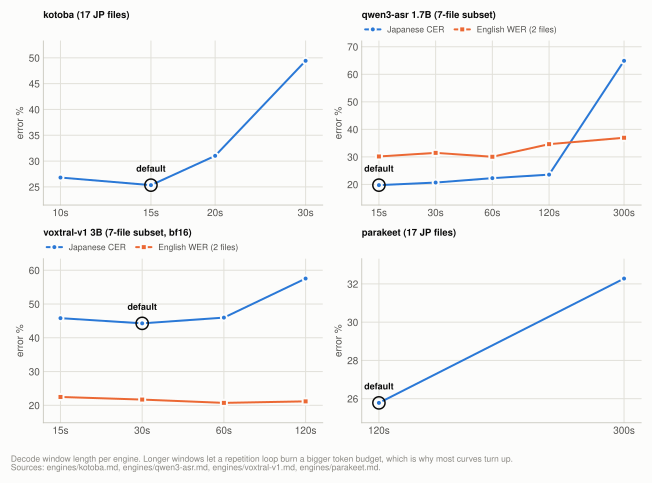

# Why the defaults are what they are

Every default in [MODELS.md](MODELS.md) and what decided it. Several went against the
obvious choice, which is why they are written down rather than left in the code. Each row
links to the document holding the numbers, the corpus and the method; nothing here restates
them, so that there is one place per finding to keep correct.

## How much to trust each row

The rows below do not rest on equal evidence, and the difference has bitten: `voxtral 4bit`
was justified for weeks by a single-clip tie that the corpus later contradicted. So each
default falls into one of five tiers.

| tier | what it means | rows |
|---|---|---|
| **decided by accuracy** | swept on the multi-file corpus, and the winner beat the alternatives by more than the corpus can confuse | `qwen3-asr --size`, `voxtral-v1 --size`, `voxtral-v1 --chunk-seconds`, `kotoba --chunk-seconds`, `--prompt` |
| **traded against accuracy** | swept on the corpus, an alternative is measurably more accurate, and the default gives that up for speed, memory or reproducibility | model choice |
| **decided by cost** | swept on the corpus, but the arms tie on accuracy, so the default was chosen on speed, memory or dependencies | `voxtral --chunk-seconds` and `--max-batch`, `qwen3-asr --chunk-seconds`, `--overlap-seconds`, `--delay-ms`, `--gain`, `--vad`, `--compact-silence`, `--kv-bits` |
| **decided by caution** | swept on the corpus and tied, but the cheaper arm gives up capacity the corpus is too small to clear, so the default takes the larger one where it fits ([How a variant is chosen](#how-a-variant-is-chosen)) | `whisper --size`, `voxtral` precision, `voxtral-v1` precision |
| **not yet on the corpus** | one recording only, or not measured at all, so unverified on the material this project targets | cue layout, which needs a second reference set that does not exist |

That last tier is where surprises come from, and it has emptied out considerably. `--vad`,
`--compact-silence` and `--kv-bits` all sat there until the corpus shrank their margins to
nothing, and Voxtral's precision default was outright *reversed* by moving off one clip. Not
one clip-only claim tested so far has survived intact. See
[benchmarks/reference/metrics.md](benchmarks/reference/metrics.md) for why a null result on one clip cannot be
used to argue an effect is small.

## How a variant is chosen

`--model` names a family; which size and precision of it runs is not fixed. Each family
with more than one variant has a priority list, ordered by measured accuracy on the
20-file corpus, with the larger variant first wherever two tie: a tie on 20 files says
nothing about audio the corpus lacks, and the smaller or lower-precision build is where
an untested loss would hide. Accuracy decides over speed, so a slower variant that ties
stays ahead. The lists, with each entry's peak memory, are the tables in
[MODELS.md](MODELS.md#the-models).

The CLI loads the first entry that fits this Mac's memory: its measured peak (Voxtral:
the peak the memory model predicts at a batch of 12 or more) within 78% of the GPU working <!-- not-measured: 78% and batch 12 are the batch-sizing constants of hardware.py -->
set, the same budget that sizes the batch. A tie the measurements cannot break is
therefore broken by the machine: a Mac with less memory gets the smaller variant of the
tie group, or the next rung down, and the CLI prints which one it chose and what did not
fit.

Pinning `--size` or `--quantization` drops every entry that does not match, and the rest
is chosen the same way: `--size 3B` on a large Mac runs the 3B at its best fitting
precision, `--quantization 4bit` the largest size at 4bit that fits. Pinning both names
one variant, which is used as given. If nothing that matches the pins fits, the smallest
matching entry runs, with a warning that it may swap or run out of memory; the CLI does not
replace a variant you named with one you did not.

## Model and size

| default | why | detail |
|---|---|---|
| `voxtral` as the model | the fastest multilingual engine measured that writes subtitles (23.86x on the M2 Ultra at its fp16 default, against turbo's 21.0x), needs no language flag, and reruns byte-identically on one machine. On Japanese it ties turbo (+1.03 points, CI [-0.11, +2.25]). On English `voxtral-v1 24B` is ahead (4.35 points, CI [+0.79, +5.58], on three files) at a tenth of the speed and with no subtitles, so this trades that accuracy for speed and subtitle output | [engines.md](benchmarks/engines.md) |
| `whisper --size large-v3` | **a tie broken toward capacity, deliberately.** It ties `turbo` on both languages at the shipped config, so the corpus cannot choose; with only 20 files from a few sources, the full 32-layer decoder is the safer bet on audio the corpus does not cover. `turbo` is next on the list and the speed option: 1.8x faster and 1.5GB less memory | [whisper.md](benchmarks/engines/whisper.md#experiment-every-whisper-size-at-its-default-config) |
| `qwen3-asr --size 1.7B` | clearly ahead of `0.6B` on accuracy (18.62% against 22.31%, paired +3.69 points, CI [+2.89, +4.43], at the 15s window). The `0.6B` is the speed option: 35.5x, ahead of Voxtral's 23.86x at its M2 Ultra default. The fastest engine measured is the Japanese-only `parakeet` (261.8x) | [qwen3-asr.md](benchmarks/engines/qwen3-asr.md) |
| `voxtral-v1 --size` by memory | 24B is 8.97 points better than 3B on Japanese (CI [+7.48, +10.50]) and a point on English, so it comes first, at 16-50GB of peak memory and 2-4x realtime; a Mac it does not fit runs the 3B, which fits a 16GB Mac at 8bit | [voxtral-v1.md](benchmarks/engines/voxtral-v1.md) |
| `parakeet --chunk-seconds 120` | clearly ahead of 300s on the corpus, and cheaper on memory. A one-file pre-check had shown a tie, which reversed at corpus scale. 60s is excluded because it drops content outright | [parakeet.md](benchmarks/engines/parakeet.md) |
| `reazon --chunk-seconds 30` | not a sweep: the weights cannot decode a whole file at all (they are trained on short VAD segments), so windows are mandatory, and 30s matches the Voxtral rows to hold the front end constant | [reazon.md](benchmarks/engines/reazon.md) |

Source: [ultra-whisper-sizes.json](../benchmarks/results/2026-10/ultra-whisper-sizes.json) runs `whisper_turbo_nocond`, `whisper_turbo_nocond_r2`, `whisper_turbo_nocond_r3`, `whisper_turbo_nocond_r4`, `whisper_turbo_nocond_r5`, `whisper_turbo_nocond_r6`, `whisper_large-v3_nocond`, `whisper_large-v3_nocond_r2`, `whisper_large-v3_nocond_r3`, `whisper_large-v3_nocond_r4`, `whisper_large-v3_nocond_r5`, `whisper_large-v3_nocond_r6`; [ultra-picker-speed.json](../benchmarks/results/2026-10/ultra-picker-speed.json) runs `pk_v1_3B_8bit_c30_s1`, `pk_v1_3B_8bit_c30_s2`, `pk_v1_3B_8bit_c30_s3`; [ultra-picker-speed-24b.json](../benchmarks/results/2026-10/ultra-picker-speed-24b.json) runs `pk_v1_24B_8bit_c30_s1`, `pk_v1_24B_8bit_c30_s2`, `pk_v1_24B_8bit_c30_s3`; [ultra-voxtral-v1.json](../benchmarks/results/2026-10/ultra-voxtral-v1.json) runs `3b_8bit_c30`, `24b_4bit_c30`, `24b_8bit_c30`, `24b_bf16_c30`; [ultra-picker-speed.json](../benchmarks/results/2026-10/ultra-picker-speed.json) runs `pk_qwen3_1.7B_8bit_c15_s1`, `pk_qwen3_1.7B_8bit_c15_s2`, `pk_qwen3_1.7B_8bit_c15_s3`, `pk_qwen3_0.6B_8bit_c15_s1`, `pk_qwen3_0.6B_8bit_c15_s2`, `pk_qwen3_0.6B_8bit_c15_s3`, `pk_parakeet_default_s1`, `pk_parakeet_default_s2`, `pk_parakeet_default_s3`; [ultra-voxtral-precision-default.json](../benchmarks/results/2026-10/ultra-voxtral-precision-default.json) runs `vox_wfp16_c30b128_kv8`, `vox_wfp16_c30b128_kv8_r2`, `vox_wfp16_c30b128_kv8_r3`; [ultra-parakeet-window.json](../benchmarks/results/2026-10/ultra-parakeet-window.json) runs `parakeet_c120`, `parakeet_c300`

## Precision

Chosen by memory within each family's priority list ([How a variant is chosen](#how-a-variant-is-chosen)):
the most accurate precision first, the larger one first within a tie. **Measured per model,
never inherited between them:** assuming one model's precision
behaviour carries to another is how the Voxtral default came to be justified wrongly for
weeks.

<picture>
  <source media="(prefers-color-scheme: dark)" srcset="benchmarks/img/precision-dark.svg">
  
</picture>

| default | why | detail |
|---|---|---|
| `voxtral` fp16, else 8bit, else 4bit | at the shipped 30s / B128 on the M2 Ultra, 8bit and fp16 both beat 4bit (15.09% and 15.20% against 15.79%, paired -0.71 points, CI [-1.27, -0.31], and -0.60, CI [-1.07, -0.25]) and tie each other (fp16 minus 8bit +0.11, CI [-0.01, +0.25]), so fp16 comes first where it fits, though it runs at 23.7x against 8bit's 33.5x and peaks at 17.14GB. A 16GB Mac cannot fit fp16 at a useful batch and runs 8bit, which is converted from the fp16 build on first use because no loadable 8bit build is published. 4bit is last | [quantization.md](benchmarks/quantization.md) |
| `qwen3-asr` 8bit | the full ladder is swept on both sizes at the 15s window, and 8bit is the most accurate rung on both: no rung beats it, and the resolved differences all favour it (`1.7B`: 4bit +1.16 points, 6bit +0.47, bf16 +0.52; `0.6B`: 4bit +2.79, 5bit +0.92) | [qwen3-asr.md](benchmarks/engines/qwen3-asr.md) |
| `voxtral-v1 --size 3B` bf16, else 8bit | bf16 ties 8bit on both languages (Japanese +0.42, CI [-0.50, +1.23]), so it comes first, at 10.91GB of peak memory against 7.28GB; a 16GB Mac runs 8bit. 4bit is not near-parity on this size: it loses 8 points on Japanese, on 15 of 16 files | [voxtral-v1.md](benchmarks/engines/voxtral-v1.md) |
| `voxtral-v1 --size 24B` bf16, else 8bit | bf16 ties 8bit on both languages (Japanese -0.46, CI [-1.60, +0.27]; English +0.00), so it comes first where its 50.08GB peak fits, else 8bit at 27.92GB. 4bit costs a point on English (+1.03, CI [+0.06, +2.87]) and comes last | [voxtral-v1.md](benchmarks/engines/voxtral-v1.md) |
| `reazon` fp32 | the publisher's table says int8 is near-parity, but on conversational material int8 drops whole phrases mid-file. Read-speech benchmarks and real audio disagree, and the corpus wins | [reazon.md](benchmarks/engines/reazon.md) |
| `--kv-bits 8` | a tie with unquantized on the corpus, and faster, so the speed is free | [quantization.md](benchmarks/quantization.md) |

Source: [ultra-voxtral-v1.json](../benchmarks/results/2026-10/ultra-voxtral-v1.json) runs `3b_4bit_c30`, `3b_8bit_c30`, `3b_bf16_c30`, `24b_4bit_c30`, `24b_8bit_c30`, `24b_bf16_c30`; [ultra-voxtral-precision.json](../benchmarks/results/2026-10/ultra-voxtral-precision.json) runs `vox_w4bit_c60b16_kv8`, `vox_wnvfp4_c60b16_kv8`, `vox_w8bit_c60b16_kv8`, `vox_wmxfp8_c60b16_kv8`, `vox_wfp16_c60b16_kv8`; [ultra-qwen3-precision-c15.json](../benchmarks/results/2026-10/ultra-qwen3-precision-c15.json) runs `qwen3_0.6B_4bit_c15`, `qwen3_0.6B_5bit_c15`, `qwen3_0.6B_6bit_c15`, `qwen3_0.6B_8bit_c15`, `qwen3_0.6B_bf16_c15`, `qwen3_1.7B_4bit_c15`, `qwen3_1.7B_5bit_c15`, `qwen3_1.7B_6bit_c15`, `qwen3_1.7B_8bit_c15`, `qwen3_1.7B_bf16_c15`; [ultra-picker-speed.json](../benchmarks/results/2026-10/ultra-picker-speed.json) runs `pk_reazon_fp32_default_s1`, `pk_reazon_fp32_default_s2`, `pk_reazon_fp32_default_s3`; [ultra-engines-jp-only.json](../benchmarks/results/2026-10/ultra-engines-jp-only.json) runs `jp_reazon_int8_c30_r1`, `jp_reazon_int8_c30_r2`, `jp_reazon_int8_c30_r3`; [ultra-voxtral-kv.json](../benchmarks/results/2026-10/ultra-voxtral-kv.json) runs `vox_kv0_c60b16_w4bit`, `vox_kv8_c60b16_w4bit`; [ultra-voxtral-precision-default.json](../benchmarks/results/2026-10/ultra-voxtral-precision-default.json) runs `vox_default_c30b128_kv8`, `vox_w8bit_c30b128_kv8`, `vox_wfp16_c30b128_kv8`

Going below a default is measured on every model that offers it, and the sizes disagree.
On `qwen3-asr` at its 15s window 4bit costs 1.16 points on the 1.7B and 2.79 on the 0.6B,[^d1]
and 5bit 0.92 on the 0.6B[^d1]; on `voxtral-v1 3B` 4bit
costs 8 points[^d2] ([qwen3-asr.md](benchmarks/engines/qwen3-asr.md),
[voxtral-v1.md](benchmarks/engines/voxtral-v1.md)). Small models are where low precision costs
here, so do not carry one model's ladder over to another.

## Chunking and windows

<picture>
  <source media="(prefers-color-scheme: dark)" srcset="benchmarks/img/windows-dark.svg">
  
</picture>

| default | why | detail |
|---|---|---|
| `voxtral --chunk-seconds` per chip | ties on accuracy (30s against 60s +0.10 points, CI [-1.92, +2.06]), so it is a throughput choice. 30s is faster on both measured machines, so both profiles ship it, and so do chips with no profile: on the M2 Ultra 30s/B32 runs 29.3x against 20.4x for 60s/B16 (means of 3 runs); on the 10-core M4 30s/B32 runs 6.37x (mean of 3 runs) against 4.66x for 60s/B16 and 5.80x for 60s/B32 (mean of 7 runs), at a lower peak than 60s/B32 (6.87GB against 8.08GB). The M4 once shipped 60s on the belief that short chunks are slower on a low-core GPU; its runs show the reverse | [chunking.md](benchmarks/chunking.md) |
| `voxtral --max-batch` from memory | batch is memory-bound: speed rises with it while accuracy shifts by about 0.1 point, unresolved on both machines, so the default is the largest well-measured batch whose predicted peak fits the memory budget (128 on 128GB, 32 on 16GB). Batch 2-11 is excluded: 2-8 measured slower per step than batch 1, and 9-11 were not measured. The M4 profile caps the batch at 32, the largest batch that ran there reliably: at 30s chunks the formula admits 64, which has not run on the M4 at 30s, and at 60s B64 completed the corpus (4 runs, 10.72GB peak, 6.07x mean against B32's 5.80x over 7 runs) but its worst-case padded file peaked at 11.87GB, 93% of the 12.7GB working set | [decode-throughput.md](benchmarks/decode-throughput.md#how-the-default-is-chosen) |
| `voxtral --overlap-seconds 0` | won on one clip at short chunks, then reversed sign on the corpus, where it cost both speed and accuracy. Zero on every profile | [chunking.md](benchmarks/chunking.md) |
| `kotoba --chunk-seconds 15` | this model's largest lever. 15s beat the previous 10s on the 20-file corpus (25.34% against 26.81%, paired -1.47 points, CI [-2.75, -0.13], 3 runs each) and ran faster (50.0x against 36.8x); 20s and 30s lose to 10s. Material-dependent, so sweep it on your own audio | [kotoba.md](benchmarks/engines/kotoba.md) |
| `voxtral-v1 --chunk-seconds 30` | best on Japanese, and Japanese collapses above 60s for the same reason as on qwen3-asr. English prefers 60s by about a point on two files, which does not pay for it | [voxtral-v1.md](benchmarks/engines/voxtral-v1.md) |
| `qwen3-asr --chunk-seconds 15` | shorter is better here, because a longer window gives a repetition loop a bigger token budget to burn: 60s and longer lose on accuracy, speed and memory. 15s, the shortest window swept, ties 30s on accuracy (19.73% against 20.67% on Japanese, paired -0.94 points, CI [-2.87, +0.76]) and is faster and smaller (22.4x against 18.1x; 3.73GB against 4.05GB), on the 7-file subset. On the 20-file corpus the one 15s run, on the 1.7B, ties 30s on Japanese (19.40%, paired +0.21 points, CI [-0.69, +0.92]); the other 20-file figures were measured at 30s | [qwen3-asr.md](benchmarks/engines/qwen3-asr.md) |

Source: [ultra-voxtral-batch.json](../benchmarks/results/2026-10/ultra-voxtral-batch.json) runs `c30b32`, `c30b32_r2`, `c30b32_r3`, `c30b128`; [ultra-kotoba-engines.json](../benchmarks/results/2026-10/ultra-kotoba-engines.json) runs `k20_mlx_c15_r1`, `k20_mlx_c15_r2`, `k20_mlx_c15_r3`; [m4-voxtral-batch.json](../benchmarks/results/2026-10/m4-voxtral-batch.json) runs `c60b16`, `c60b32`, `c60b32_r1`, `batch_m4_repeat_20261009__c60b32_r2`, `batch_m4_repeat_20261009__c60b32_r3`, `c60b32_r4`, `batch_m4_b64_20261010__c60b32_r2`, `batch_m4_b64_20261010__c60b32_r3`, `c60b48`, `c60b48_r1`, `c60b48_r2`, `c60b48_r3`, `c60b64`, `c60b64_r1`, `c60b64_r2`, `c60b64_r3`; [m4-voxtral-worstcase.json](../benchmarks/results/2026-10/m4-voxtral-worstcase.json) runs `worst64_c60b64`; [m4-synthetic-decode.json](../benchmarks/results/2026-10/m4-synthetic-decode.json) runs `synth_nvfp4_r1` (working set); [ultra-voxtral-kv.json](../benchmarks/results/2026-10/ultra-voxtral-kv.json) runs `vox_kv8_c60b16_w4bit`; [ultra-voxtral-v1-window.json](../benchmarks/results/2026-10/ultra-voxtral-v1-window.json) runs `sweep_3b_bf16_c60`; [ultra-voxtral-v1.json](../benchmarks/results/2026-10/ultra-voxtral-v1.json) runs `3b_bf16_c30`; [m4-voxtral-chunking.json](../benchmarks/results/2026-10/m4-voxtral-chunking.json) runs `c30b32`, `c30b32_r2`, `c30b32_r3`, `c60b16`; [ultra-voxtral-precision.json](../benchmarks/results/2026-10/ultra-voxtral-precision.json) runs `vox_w4bit_c60b16_kv8`, `vox_w4bit_c60b16_kv8_r2`; [ultra-voxtral-chunking.json](../benchmarks/results/2026-10/ultra-voxtral-chunking.json) runs `ch_c30b32_ov8`, `ch_c30b16_ov0`, `ch_c60b32_ov0`, `ch_c60b16_ov8`; [ultra-mincut-inputs.json](../benchmarks/results/2026-10/ultra-mincut-inputs.json) runs `mincut7_vox_c30b32_kv8`, `mincut7_vox_c30b32_kv8_ov8`; [ultra-kotoba-windows.json](../benchmarks/results/2026-10/ultra-kotoba-windows.json) runs `pk_kotoba_c10_s1`, `pk_kotoba_c10_s2`, `pk_kotoba_c10_s3`, `kw_kotoba_c20`, `kw_kotoba_c20_r2`, `kw_kotoba_c20_r3`, `kw_kotoba_c30`, `kw_kotoba_c30_r2`, `kw_kotoba_c30_r3`; [ultra-qwen3-window.json](../benchmarks/results/2026-10/ultra-qwen3-window.json) runs `qwen3w7_1.7B_8bit_c15`, `qwen3w7_1.7B_8bit_c30`, `qwen3w7_1.7B_8bit_c60`, `qwen3w7_1.7B_8bit_c120`, `qwen3w7_1.7B_8bit_c300`; [ultra-qwen3-batch.json](../benchmarks/results/2026-10/ultra-qwen3-batch.json) runs `qwen3batch_1.7B_8bit_c15_b1#batch 1`; [ultra-qwen3-precision.json](../benchmarks/results/2026-10/ultra-qwen3-precision.json) runs `qwen3_1.7B_8bit_c30` (voxtral-v1 and qwen3-asr windows: rows of the 7-file subset)

The library default for `qwen3-asr` is 1200s, <!-- not-measured: the library's configured default --> so anything shorter than 20 minutes becomes a
single window: one segment, and the batched path never engages.

## Audio and prompt

| default | why | detail |
|---|---|---|
| `--delay-ms 2400` | the largest accuracy lever here, and it costs no speed. Also the model's maximum | [delay.md](benchmarks/delay.md) |
| `--gain auto` | quiet input silently loses detail, because the mel front end clamps at an absolute floor. `auto` boosts only quiet audio, so it is byte-identical on healthy input | [input-level.md](benchmarks/input-level.md) |
| `--vad` off | a tie with energy cut points on the corpus, and it costs an `onnxruntime` dependency. The single-clip result that looked decisive did not reproduce | [chunking.md](benchmarks/chunking.md) |
| `--prompt` empty | it biases register rather than recalling vocabulary, an instruction there actively hurts, and on English audio any prompt wrecks word spacing | [prompt.md](benchmarks/prompt.md) |
| `--compact-silence` off | a tie on accuracy at every precision tested, and slightly faster. Off because it discards audio, which should be opted into rather than inherited, not because it costs accuracy | [chunking.md](benchmarks/chunking.md) |

## Whisper long-form stability

`condition_on_previous_text=False` on `small` and larger, not exposed as a flag.

Leaving it on lets a repetition loop feed itself across 30s windows, and it is by far the
largest artifact in this project's history: at library defaults `large-v3` scores badly
enough to read as a broken model rather than as a bad setting
([whisper.md](benchmarks/engines/whisper.md#experiment-condition_on_previous_textfalse) has both numbers).

`tiny` and `base` keep the library default, since they are not used for long-form work
here.

## Cue layout

`--gap-seconds 1.2`, `--max-chars 28`, `--max-dur-seconds 7.0`.

Deliberately **not** the optimum of either sweep that was run. Both sweeps optimised
agreement with one editor's subtitle conventions, and no second reference set exists to
check that against, so adopting their optimum would fit this corpus's house style rather
than anything general ([cue-layout.md](benchmarks/cue-layout.md)).

[^d1]: [ultra-qwen3-precision-c15.json](../benchmarks/results/2026-10/ultra-qwen3-precision-c15.json) runs `qwen3_1.7B_4bit_c15`, `qwen3_1.7B_8bit_c15`, `qwen3_0.6B_4bit_c15`, `qwen3_0.6B_5bit_c15`, `qwen3_0.6B_8bit_c15` (paired over the 17 Japanese files)
[^d2]: [ultra-voxtral-v1.json](../benchmarks/results/2026-10/ultra-voxtral-v1.json) runs `3b_4bit_c30`, `3b_8bit_c30`
