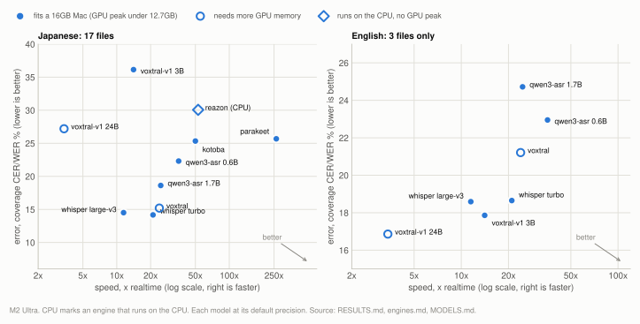

# Benchmarks: what was measured, and what it concluded

One document per **lever**: a thing you can change that might make the output better or
faster. Each states its corpus, its method, the experiments, and the conclusion, so a
number can be read without reconstructing the run that produced it.

Read [metrics.md](reference/metrics.md) and [corpus.md](reference/corpus.md) before quoting any figure. The
metrics here are unusual for a reason, and most of the material has editorial references
that make plain CER meaningless.

## Picking a model

<picture>
  <source media="(prefers-color-scheme: dark)" srcset="img/picker-dark.svg">
  
</picture>

Down and to the right is better: lower error, more speed. Filled points fit a 16GB Mac; the hollow one needs a large-memory machine. The two panels disagree, so pick on the language you transcribe: on Japanese the Whisper sizes and Voxtral lead, on English the voxtral-v1 models do, though English rests on three files. A point whose label carries a note after the model name has a speed measured under different conditions from the rest; [engines.md](engines.md) and [MODELS.md](../MODELS.md) carry the numbers behind every point.

## The levers, largest effect first

| document | lever | conclusion in one line |
|---|---|---|
| [delay.md](delay.md) | transcription delay | `2400` is worth 9 points and is free. The strongest result here. |
| [chunking.md](chunking.md) | chunk length, overlap, cut points | 30s vs 60s is indistinguishable at n=20, so it is a throughput choice. Overlap helps at short chunks on one clip but reversed on a corpus. VAD cut points and dropping silence both tie with the defaults. Throughput comes mostly from the batch. 30s/B32 is faster than 60s/B16 on both machines measured (49% on a 60-core GPU, 42% on a 10-core one), so 30s ships on both, and the composite `--fast` flag was removed. |
| [engines.md](engines.md) | which model | On the M2 Ultra, Whisper turbo + no-condition ties Voxtral's fp16 default on Japanese (+1.03 points, CI [-0.11, +2.25]); Voxtral is ~1.1x faster and reproducible, so it is the default. |
| [qwen3-asr.md](engines/qwen3-asr.md) | the Qwen3-ASR engine | The 1.7B is third of the eight engines on Japanese (18.62%); the 0.6B runs at 35.5x, ahead of Voxtral's 23.9x at fp16, and parakeet and reazon are faster still. Writes no subtitles (its timestamps are decode-window boundaries), and its library truncates long audio silently, which is why this project drives the chunk loop itself. Precision sensitivity differs by SIZE: the 1.7B ties across the whole ladder, the 0.6B does not. |
| [voxtral-v1.md](engines/voxtral-v1.md) | the Voxtral v1 engine (Mini 3B, Small 24B) | Behind every other multilingual engine on Japanese, which its card does not claim, largely through repetition loops; the 24B is the best English row measured. The variant selector runs the 24B at bf16 where it fits and the 3B at 8bit on 16GB Macs. Writes no subtitles. Leaving the language to the model switches Japanese windows into other languages, which coverage CER does not charge. |
| [decode-throughput.md](decode-throughput.md) | batch size | Not monotonic per step: batch 2-8 costs more per step than batch 1, though it still beats batch 1 in x realtime, and batch 12 and up beats both. The only lever anyone can reproduce without audio. |
| [qwen3-batch.md](qwen3-batch.md) | batch size on qwen3-asr | Batching whole chunks loses monotonically (2.7x slower by batch 8) for no accuracy gain, so `--max-batch` stays refused there. |
| [input-level.md](input-level.md) | `--gain` | Quiet input silently costs ~3.0 points. `auto` fixes it and is a no-op otherwise. |
| [prompt.md](prompt.md) | `--prompt` | No arm resolves a gain on either language; every arm costs English 2.0 to 75.9 WER points, and an *instruction* costs 6-14 points. |
| [quantization.md](quantization.md) | weight and KV precision | **Voxtral:** costs accuracy monotonically in bit width, reversing the earlier single-clip tie. 4-bit is last of five, 0.94 behind 8-bit and 1.09 behind fp16; 8-bit matches fp16 at 7.3GB and full speed, and the default loads fp16 where it fits and 8-bit on 16GB Macs. **`qwen3-asr`:** swept on the corpus at 15s windows; 8bit is the most accurate rung on both sizes, and 4bit costs 1.2 points on the 1.7B and 2.8 on the 0.6B. `--kv-bits 8` is close to free. |
| [timestamps.md](timestamps.md) | timestamp quality | Voxtral holds timing, Whisper places cues better. Different failure modes, reported separately. |
| [cue-layout.md](cue-layout.md) | subtitle grouping | Two sweeps run, neither adopted, on purpose. Costs 5.4 break-F1 points against the earlier published `0.7/32`. |

Source: [ultra-voxtral-delay.json](../../benchmarks/results/2026-10/ultra-voxtral-delay.json) runs `delay7_c30b32_d480`; [ultra-mincut-inputs.json](../../benchmarks/results/2026-10/ultra-mincut-inputs.json) runs `mincut7_vox_c30b32_kv8`; [ultra-voxtral-batch.json](../../benchmarks/results/2026-10/ultra-voxtral-batch.json) runs `c30b32`, `c30b32_r2`, `c30b32_r3`; [ultra-voxtral-precision.json](../../benchmarks/results/2026-10/ultra-voxtral-precision.json) runs `vox_w4bit_c60b16_kv8`, `vox_w8bit_c60b16_kv8`, `vox_wfp16_c60b16_kv8`; [ultra-voxtral-kv.json](../../benchmarks/results/2026-10/ultra-voxtral-kv.json) runs `vox_kv8_c60b16_w4bit`; [ultra-voxtral-precision-default.json](../../benchmarks/results/2026-10/ultra-voxtral-precision-default.json) runs `vox_wfp16_c30b128_kv8`, `vox_wfp16_c30b128_kv8_r2`, `vox_wfp16_c30b128_kv8_r3`; [ultra-whisper-sizes.json](../../benchmarks/results/2026-10/ultra-whisper-sizes.json) runs `whisper_turbo_nocond`, `whisper_turbo_nocond_r2`, `whisper_turbo_nocond_r3`, `whisper_turbo_nocond_r4`, `whisper_turbo_nocond_r5`, `whisper_turbo_nocond_r6`; [ultra-qwen3-batch.json](../../benchmarks/results/2026-10/ultra-qwen3-batch.json) runs `qwen3batch_1.7B_8bit_c15_b1#batch 1`, `qwen3batch_1.7B_8bit_c15_b8#batch 8`; [ultra-input-gain.json](../../benchmarks/results/2026-10/ultra-input-gain.json) runs `gain7_asrecorded_c30b32_kv8#mode 0`, `gain7_m12db_c30b32_kv8#mode -12`; [ultra-voxtral-prompt-trap.json](../../benchmarks/results/2026-10/ultra-voxtral-prompt-trap.json) runs `prompt_trap7_none`, `prompt_trap7_instruction`; [ultra-qwen3-precision-c15.json](../../benchmarks/results/2026-10/ultra-qwen3-precision-c15.json) runs `qwen3_1.7B_4bit_c15`, `qwen3_1.7B_8bit_c15`, `qwen3_0.6B_4bit_c15`, `qwen3_0.6B_8bit_c15`; [ultra-timestamps.json](../../benchmarks/results/2026-10/ultra-timestamps.json) runs `ts_0732#engine voxtral`, `ts_default_r1#engine voxtral`, `ts_default_r2#engine voxtral`, `ts_default_r3#engine voxtral`; [m4-voxtral-chunking.json](../../benchmarks/results/2026-10/m4-voxtral-chunking.json) runs `c30b32`, `c60b16`; [ultra-picker-speed.json](../../benchmarks/results/2026-10/ultra-picker-speed.json) runs `pk_qwen3_1.7B_8bit_c15_s1`, `pk_qwen3_1.7B_8bit_c15_s2`, `pk_qwen3_1.7B_8bit_c15_s3`, `pk_qwen3_0.6B_8bit_c15_s1`, `pk_qwen3_0.6B_8bit_c15_s2`, `pk_qwen3_0.6B_8bit_c15_s3`, `pk_parakeet_default_s1`, `pk_parakeet_default_s2`, `pk_parakeet_default_s3`, `pk_reazon_fp32_default_s1`, `pk_reazon_fp32_default_s2`, `pk_reazon_fp32_default_s3`; [m4-synthetic-decode.json](../../benchmarks/results/2026-10/m4-synthetic-decode.json) runs `synth_nvfp4_r1`, `synth_nvfp4_r2`, `synth_nvfp4_r3`; [ultra-synthetic-decode.json](../../benchmarks/results/2026-10/ultra-synthetic-decode.json) runs `synth_ultra_4bit_r1`, `synth_ultra_4bit_r2`, `synth_ultra_4bit_r3`; [ultra-voxtral-prompt.json](../../benchmarks/results/2026-10/ultra-voxtral-prompt.json) runs `prompt20_c30b32_kv8#none -`, `prompt20_c30b32_kv8#instruction en`, `prompt20_c30b32_kv8#instruction ja`, `prompt20_c30b32_kv8#description en`, `prompt20_c30b32_kv8#description ja`; [ultra-voxtral-prompt-derived.json](../../benchmarks/results/2026-10/ultra-voxtral-prompt-derived.json) runs `prompt20_derived_freq`, `prompt20_derived_names`

## Supporting documents

| document | what it covers |
|---|---|
| [corpus.md](reference/corpus.md) | what the test material is, in general terms, and how to build your own |
| [metrics.md](reference/metrics.md) | why coverage CER exists, which metric to trust, how to compare two configs |
| [determinism.md](reference/determinism.md) | what reproduces (one machine) and what does not (across machines, and Whisper at all) |
| [peak-memory.md](reference/peak-memory.md) | what each model costs in GPU memory, and why Whisper's figure depends on how long your audio is |

## Read this before quoting a number

**Every English figure measured before 2026-08-19 is superseded, and only the engine
comparison has been re-measured.** Reference lines were joined with no separator, so on the
word-level path the last word of each line fused to the first word of the next. Japanese was
never affected, because it has no word spaces and the scorer strips whitespace anyway. The
damage depended entirely on where a reference broke its lines: the two plain transcripts end
every line with punctuation and had **zero** fused words, while the one subtitle-shaped
reference had 131 and scored 20.09% where the truth is 3.29%[^b2].

Corrected where re-measured: Voxtral (4-bit) English 25.24% -> **21.50%**[^b1], Whisper turbo-nocond
22.81% -> **18.65%**[^b1] (see [engines.md](engines.md)). **Not** re-measured, so read the English
column of these as wrong by about as much as the re-measured engine rows moved, direction
intact:
[delay.md](delay.md), [input-level.md](input-level.md), [chunking.md](chunking.md),
[prompt.md](prompt.md), [determinism.md](reference/determinism.md).

Those are left rather than re-run because each would cost a full corpus pass per arm, and in
every case the English side is n=3 and was already labelled directional. The offset is
shared across arms within a comparison, so paired conclusions survive; absolute English
levels do not. Japanese figures throughout these documents are unaffected and stand.


**Between-file variance here is larger than most of the config effects being measured.**
Per-file coverage error spans 6-24%[^b3] for a single unchanged config, so a 1-point
difference between two configs is a tie unless a paired test says otherwise. The per-file
paired SD of Voxtral at 4-bit against Whisper turbo-nocond (6 runs) on the Japanese files is
2.75 points[^b4], so the resolution floor, the 95% half-width of a paired difference, depends on
how much audio a given experiment used: about **2.04 points at n=7** and **1.20 at n=20**.[^b4]

**The samples are small and uneven, and they differ between findings.** These findings use
all 20 files: the engine comparison in [engines.md](engines.md), the prompt language crossing
in [prompt.md](prompt.md), both precision ladders and the KV comparison in
[quantization.md](quantization.md), the batch sweep in [qwen3-batch.md](qwen3-batch.md), and in
[chunking.md](chunking.md) the 30s-versus-60s comparison, VAD cut points, silence
compaction, the `--fast` decomposition and both batch sweeps. **The rest of the lever
results here are n=7 or a single clip** ([delay.md](delay.md), [input-level.md](input-level.md),
the timing pages, the overlap and chunk-length sweeps), because those sweeps predate the
corpus growth and re-running one costs a full corpus pass per arm. So a finding marked "not resolvable" may mean "smaller than 2.04 points"[^b4] rather than "smaller
than 1.20".[^b4] Where that matters the doc says so. Of 20 files only 3 are English, and timing results are n=7 because
only those files have authored subtitle tracks. Several single-clip findings in this project
reversed sign when a real corpus arrived, which is why single-clip and corpus results are
always labelled as such.

**A significant result on one clip means "real on this clip", not "real".** Two different
methods answer two different questions; see the comparison section of
[metrics.md](reference/metrics.md).

**Speed numbers depend on the machine's state.** Check GPU and memory use before starting,
never run two benchmarks at once, and treat any x-realtime figure without a stated machine
state as unreliable.

`run_corpus.py` and `run_whisper.py` now read the machine before loading a model, print a
warning when it is not idle, and record chip, enclosure, load average, GPU memory already
in use, **power source, Low Power Mode, and the swapout rate** into their result JSON
(`scripts/benchmarks/machine_state.py`).

Two of those were added after they were needed. **Connect a laptop to mains before an
eval**: on battery, and in Low Power Mode, macOS caps sustained clocks, so the figure
describes a power policy rather than a config. And the **swapout rate** matters where the
resident swap total does not: a host was found swapping out heavily during a run while its
swap total looked no different from an idle machine's. Free memory was low during the run
and recovered after it. The rate is a
property of now; the total is a property of uptime.
`summarize_engines.py` marks such a run `(busy)` in the throughput column itself rather
than in a footnote, since the table is what gets pasted into a findings document. Only the
timing column is affected: greedy decoding does not depend on machine state, so the accuracy
columns of such a run remain valid. Resident swap deliberately does not trigger the
warning, because macOS never reclaims it and a host that paged days ago still reports
gigabytes while idle.

## Scope

This is a Japanese-first evaluation. 17 of the 20 corpus files are Japanese, the defaults
were chosen against Japanese audio, and the metrics are character-level with a leniency
rule for kanji/kana respelling. English is measured on 3 files and reported separately,
never averaged in. No other language is tested here.

## Reproducing

The scripts are in `scripts/benchmarks/`, the scorers in `scripts/metrics/`. Both need the eval extra:

```bash
uv sync --extra whisper --extra eval
```

Corpus-wide accuracy, one config:

```bash
uv run python scripts/benchmarks/run_corpus.py --corpus DIR --json out.json
uv run python scripts/benchmarks/run_whisper.py --corpus DIR \
    --model mlx-community/whisper-large-v3-turbo --no-condition --json out.json
uv run python scripts/benchmarks/summarize_engines.py out.json ...
```

Per-lever sweeps:

```bash
uv run python scripts/benchmarks/sweep_overlap.py  --audio A --reference R --overlaps 0,4,8
uv run python scripts/benchmarks/sweep_precision.py --audio A --reference R      # needs >=32GB
uv run python scripts/benchmarks/sweep_gain.py     --corpus DIR
uv run python scripts/benchmarks/sweep_cues.py     --corpus DIR   # timed references only
uv run python scripts/benchmarks/sweep_min_cut.py  --corpus DIR --hyp-dir bench_out/corpus
uv run python scripts/benchmarks/ab_prompt.py      --audio A --reference R --terms "a,b,c"
sh scripts/benchmarks/run_matrix.sh A R                            # chunk x batch x kv x silence
```

Timing quality, and every alias end to end:

```bash
uv run python scripts/benchmarks/run_timing_sweep.py --corpus DIR --json out.json
uv run python scripts/benchmarks/matrix_models.py --audio A --reference R --json out.json
```

Comparisons and significance:

```bash
uv run python scripts/benchmarks/compare_configs.py a.srt b.srt --reference R  # paired, one clip
uv run python scripts/benchmarks/compare_engines.py a.json b.json             # paired, over files
uv run python scripts/benchmarks/repeat_distribution.py --runs r*.json --baseline vox.json
uv run python scripts/benchmarks/rescore_all.py --reference R bench_out/*.srt
```

Plotting the evidence behind a comparison, since an interval in a sentence hides its
shape. Needs the `eval` extra for matplotlib; files are labelled by duration, never by
name:

```bash
uv run python scripts/benchmarks/plot_evidence.py paired A.json B.json --out p.png
uv run python scripts/benchmarks/plot_evidence.py bootstrap A.json B.json --out b.png
uv run python scripts/benchmarks/plot_evidence.py runs --baseline vox.json \
    --runs w1.json w2.json w3.json --out r.png
uv run python scripts/benchmarks/plot_evidence.py sensitivity --hyp-dir DIR \
    --corpus DIR --out s.png
```

`paired` is the one to reach for first: it shows whether an aggregate is broad agreement
or two files pulling against each other, which the point estimate cannot distinguish and
which decides whether more audio would help.

The charts embedded in these documents are drawn from the published tables, not from
result files: `scripts/docs/chart_data.py` holds the figures with the document each came
from, and `tests/test_charts.py` fails if a figure no longer appears in its document.
After changing a table, update the figure there and regenerate:

```bash
uv run --extra eval python scripts/docs/gen_charts.py
```

Decode throughput, **no audio needed**, and the basis of the contributed-profile flow:

```bash
uv run mlx-asr-bench
```

Lower-level probes (encoder batching, KV length, seam-error location, step breakdown,
batch reshaping, `mx.compile`) are in `scripts/benchmarks/probes/`. Most recorded a negative
result, which is why they are kept: check
[decode-throughput.md](decode-throughput.md) before proposing performance work.

[^b1]: [ultra-voxtral-headline.json](../../benchmarks/results/2026-10/ultra-voxtral-headline.json) runs `vox_default_c30b128_kv8`, `vox_default_c30b128_kv8_r2`, `vox_default_c30b128_kv8_r3`; [ultra-whisper-sizes.json](../../benchmarks/results/2026-10/ultra-whisper-sizes.json) runs `whisper_turbo_nocond`, `whisper_turbo_nocond_r2`, `whisper_turbo_nocond_r3`, `whisper_turbo_nocond_r4`, `whisper_turbo_nocond_r5`, `whisper_turbo_nocond_r6`
[^b2]: [ultra-voxtral-headline.json](../../benchmarks/results/2026-10/ultra-voxtral-headline.json) runs `vox_default_c30b128_kv8` (per-file row of the subtitle-shaped English reference)
[^b3]: [ultra-voxtral-headline.json](../../benchmarks/results/2026-10/ultra-voxtral-headline.json) runs `vox_default_c30b128_kv8` (Japanese per-file rows)
[^b4]: [ultra-resolution-floor.json](../../benchmarks/results/2026-10/ultra-resolution-floor.json) runs `resolution_floor`
