# Lever: how the audio is cut into chunks

Chunk length and overlap default per chip from `mlx_asr/profiles.json`, and batch from GPU
memory: 30s/B128 on the M2 Ultra 128GB and 30s/B32 on the M4 16GB, overlap 0 on both; chips with no profile also get 30s. On the 20-file corpus 60s versus 30s
is +0.10 points with a CI of [-1.92, +2.06],[^k1] so the pair is chosen on throughput. 30s/B32
is faster than 60s/B16 on both machines measured (4-bit weights throughout): 29.3x against 20.4x on the 60-core Ultra[^k2]
and 6.37x against 4.66x on the 10-core M4 (means of 3 runs where repeated),[^k28] so both profiles ship 30s chunks. At 30s chunks on the Ultra with 4-bit weights, end-to-end speed keeps rising up to
batch 128 (33.6x against 29.3x at B32, mean of 3 runs),[^k3] all of it on files longer than 32 chunks, while
accuracy moves by under 0.1 point (paired B128 against B32 is +0.07 points, CI [-0.01, +0.18]).[^k3] Prefix overlap won 1.0-1.5 points[^k4] at 30s chunks on a single
clip but reversed sign on a real corpus, so it defaults to zero; cut points default to
energy minima, which were never behind a VAD.

`--overlap-seconds`, `--vad` and `--compact-silence` apply to Voxtral only;
`--chunk-seconds` also applies to `kotoba`, where it sets the independent-window length. The
`whisper-*` driver's 30s window is fixed by the model's positional encoding. Passing a flag to
an engine that cannot honour it is an error, not a warning.

| setting | default | why |
|---|---|---|
| `--chunk-seconds` | per machine: 30s on M2 Ultra and on M4; 30s on chips with no profile | 30s and 60s are indistinguishable on the 20-file corpus, so throughput decides; 30s/B32 is the faster pair on both machines measured (Ultra: 29.3x against 20.4x for 60s/B16; M4: 6.37x against 4.66x for 60s/B16 and 5.80x for 60s/B32) |
| batch | from memory, not chip, with a per-profile cap: 128 on M2 Ultra 128GB, 32 on M4 16GB | the largest batch whose predicted peak fits the memory budget; larger batches only speed up files longer than one batch; accuracy shifts by about 0.1 point, unresolved on both machines ([decode-throughput.md](decode-throughput.md#how-the-default-is-chosen)). On the M4 at 30s chunks the formula admits B64, which has not run there, so the profile caps the batch at the measured 32. At 60s B48 and B64 completed the corpus 4 times each at 5.82x and 6.07x mean against B32's 5.80x, but B64 on a worst-case padded file peaked at 11.87GB, 93% of the 12.7GB working set, too close to the limit to call reliable |
| `--overlap-seconds` | 0 | won on one clip at 30s chunks, reversed sign on the 7-file corpus, and is the only arm slower than the old default |
| cut points | energy minima; `--vad` opt-in | energy is never behind; VAD ties on Japanese at n=17 and loses all 3 English files |
| `--compact-silence` | off | accuracy ties on all four precisions; the 4-7% speed gain does not justify silently discarding input |
| composite flag | none (`--fast` removed) | removed on the reading that the right chunk/batch pair reverses across hardware; the saved runs show 30s/B32 faster on both machines, so that reading does not hold; its 8s overlap cost speed on the Ultra; every lever is set independently |

Source: [ultra-voxtral-batch.json](../../benchmarks/results/2026-10/ultra-voxtral-batch.json) runs `c30b16`, `c30b32`, `c30b32_r2`, `c30b32_r3`, `c30b48`, `c30b64`, `c30b64_r2`, `c30b64_r3`, `c30b128`; [m4-voxtral-batch.json](../../benchmarks/results/2026-10/m4-voxtral-batch.json) runs `c60b16`, `c60b24`, `c60b24_r2`, `c60b24_r3`, `c60b24_r4`, `c60b32`, `c60b32_r1`, `batch_m4_repeat_20261009__c60b32_r2`, `batch_m4_b64_20261010__c60b32_r2`, `batch_m4_repeat_20261009__c60b32_r3`, `batch_m4_b64_20261010__c60b32_r3`, `c60b32_r4`, `c60b48`, `c60b48_r1`, `c60b48_r2`, `c60b48_r3`, `c60b64`, `c60b64_r1`, `c60b64_r2`, `c60b64_r3`; [m4-voxtral-chunking.json](../../benchmarks/results/2026-10/m4-voxtral-chunking.json) runs `c60b16`, `c30b32`, `c30b32_r2`, `c30b32_r3`; [m4-voxtral-worstcase.json](../../benchmarks/results/2026-10/m4-voxtral-worstcase.json) runs `worst64_c60b64`; [m4-synthetic-decode.json](../../benchmarks/results/2026-10/m4-synthetic-decode.json) runs `synth_nvfp4_r1` (the recorded GPU working set); [ultra-voxtral-kv.json](../../benchmarks/results/2026-10/ultra-voxtral-kv.json) runs `vox_kv8_c60b16_w4bit`; [ultra-voxtral-precision.json](../../benchmarks/results/2026-10/ultra-voxtral-precision.json) runs `vox_w4bit_c60b16_kv8`, `vox_w4bit_c60b16_kv8_r2`, `vox_w8bit_c60b16_kv8`, `vox_wmxfp8_c60b16_kv8`, `vox_wnvfp4_c60b16_kv8`; [ultra-voxtral-chunking.json](../../benchmarks/results/2026-10/ultra-voxtral-chunking.json) runs `ch_compact_c60b16_w4bit`, `ch_compact_c60b16_w8bit`, `ch_compact_c60b16_wmxfp8`, `ch_compact_c60b16_wnvfp4`, `ch_c30b32_ov8` (60s/B16 speeds on the M2 Ultra: the mean of vox_w4bit_c60b16_kv8, vox_w4bit_c60b16_kv8_r2 and vox_kv8_c60b16_w4bit, one command; M4 30s/B32: the mean of its 3 runs)

**Setup:** [one clip](reference/corpus.md#the-single-clip) scored by plain CER, and the
[7-file subset](reference/corpus.md#the-7-file-subset) and [20-file corpus](reference/corpus.md#the-20-file-corpus)
scored by [coverage CER/WER](reference/metrics.md#coverage-cer-and-why-it-had-to-exist); M2 Ultra 128GB
and M4 16GB as stated per experiment. The two kinds of material disagree, which is the main
lesson of this page. Single-clip differences are compared with a **paired** test over 40
regions of the same audio (`scripts/benchmarks/compare_configs.py`), so shared difficulty
cancels; absolute CER differences under about half a point are not resolvable on one clip.
Scripts: `scripts/benchmarks/sweep_overlap.py` (overlap), `scripts/benchmarks/run_matrix.sh`
(chunk length), `scripts/benchmarks/probes/probe_seam_errors.py` (seam analysis).

## Experiment: chunk length

**Basis:** [one clip](reference/corpus.md#the-single-clip), M2 Ultra 128GB, 4-bit, no overlap, KV cache unquantized at 20s and 30s and kv8 from 60s up; batch changes with chunk length.

<picture>
  <source media="(prefers-color-scheme: dark)" srcset="img/chunking-length-dark.svg">
  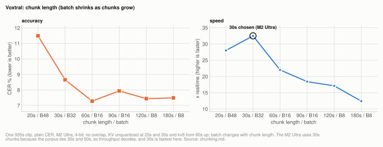
</picture>

**Table:** CER and speed by chunk length on one clip, M2 Ultra, with the batch each length runs at.

| chunk | batch | CER | x realtime |
|---|---|---|---|
| 20s | 48 | 11.49% | 28.0x |
| 30s | 32 | 8.66% | 32.5x |
| 60s | 16 | **7.28%** | 22.0x |
| 90s | 16 | 7.94% | 18.4x |
| 120s | 8 | 7.44% | 17.1x |
| 180s | 8 | 7.49% | 12.4x |

Source: [ultra-voxtral-clip.json](../../benchmarks/results/2026-10/ultra-voxtral-clip.json) runs `chunk_c20b48_kv0#overlap 0`, `chunk_c30b32_kv0#overlap 0`, `ov60_0s#overlap 0`, `chunk_c90b16_kv8#overlap 0`, `chunk_c120b8_kv8#overlap 0`, `chunk_c180b8_kv8#overlap 0` (plain CER and x realtime from each run's per-file row)

Accuracy improves up to 60s then flattens in the 7.4-7.9% band[^k6] while speed falls away
as the batch has to shrink to fit memory. The flattening was attributed to the encoder's
750-frame sliding window, but the probe prints ~1948 conv frames[^k26] already for a 30s chunk, so
every length here exceeds that window and it does not explain a break at 60s. At 20s the loss is <!-- not-measured: 20s is a chunk length setting -->
mostly deletions, as short rows end early and drop text. The mechanism behind the short-chunk
loss is in [How it works](#errors-concentrate-at-chunk-starts).

Paired testing is stricter than the point estimates suggest:

<picture>
  <source media="(prefers-color-scheme: dark)" srcset="img/chunking-length-paired-dark.svg">
  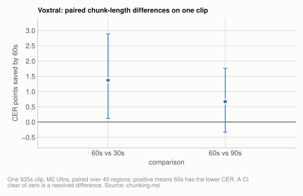
</picture>

**Table:** paired CER difference between chunk lengths on one clip, 40 regions, positive meaning 60s is better.

| comparison | diff | 95% CI | verdict |
|---|---|---|---|
| 60s beats 30s | 1.37 | [+0.12, +2.89] | significant |
| 60s beats 90s | 0.67 | [-0.33, +1.76] | **not supported** |

Source: [ultra-voxtral-clip-paired.json](../../benchmarks/results/2026-10/ultra-voxtral-clip-paired.json) runs `cmp_len_30v60`, `cmp_len_90v60` (30s at batch 32 with KV unquantized, 60s and 90s at batch 16 with kv8)

So on this clip **60s is the right choice because it is simultaneously the fastest of the <!-- not-measured: 60s is a chunk length setting -->
long options and never measurably worse**, which is a weaker justification than "longer
chunks are worse" but the one the data supports. An earlier version of these docs claimed the
stronger thing; that was a correction, not a new measurement.

Chunk length is still worth understanding, because it is the largest lever on *throughput*
and because it does drive accuracy on dense single-speaker narration. It is not a lever to
tune for accuracy on spontaneous conversational audio, as the next experiment shows.

## Experiment: 30s versus 60s chunks

**Basis:** [7-file subset](reference/corpus.md#the-7-file-subset), then the [20-file corpus](reference/corpus.md#the-20-file-corpus) on M4 16GB, sequential, `--delay-ms 2400`, kv8, 60s/B16 against 30s/B32.

On the **7-file** subset the 60s-versus-30s difference does not resolve <!-- not-measured: chunk length settings -->
(+1.67, CI [-1.20, +4.74]),[^k5] and 30s/batch 32 was nominally better on every axis including
speed. Between-file variance dwarfs the effect.

The corpus later grew to 20 files, lowering the resolution floor (the 95%[^k21] half-width of a
paired corpus difference, from the per-file Japanese spread of Voxtral at 4-bit, the default then, against Whisper
turbo-nocond over 6 runs, SD 2.75 points) from 2.04 points at n=7 to 1.20 at n=20.[^k21] A
+1.67-point effect[^k5] lies between the two, which made this the one small-corpus result that
more audio might plausibly turn into a decision. It did not.

Both arms re-run on one machine (M4 16GB, 20 files, sequential, `--delay-ms 2400`, kv8;
60s at batch 16 and 30s at batch 32, each machine's profile for that chunk length):

<picture>
  <source media="(prefers-color-scheme: dark)" srcset="img/chunking-30-60-dark.svg">
  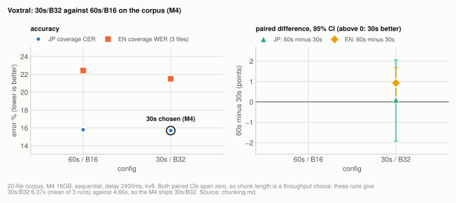
</picture>

**Table:** coverage error per arm on the 20-file corpus, M4 16GB, with the paired difference (60s minus 30s, positive meaning 30s is better) on the 30s row. <!-- not-measured: chunk length settings -->

| config | JP coverage CER, 17 files | EN coverage WER, 3 files | JP paired difference | JP 95% CI | EN paired difference | EN 95% CI |
|---|---|---|---|---|---|---|
| 60s / b16 | 15.79% | 22.43% | | | | |
| 30s / b32 | **15.70%** | **21.50%** | +0.10 | [-1.92, +2.06] | +0.93 | [-0.06, +1.69] |

Source: [m4-voxtral-chunking.json](../../benchmarks/results/2026-10/m4-voxtral-chunking.json) runs `c60b16`, `c30b32`

Not resolvable on either unit, and the Japanese point estimate fell from +1.76 at n=7[^k5] to
+0.10 at n=17:[^k1] the two chunk lengths are indistinguishable on this material. 30s won 6 of 17
Japanese files and 60s won 10, with a sign test at p=0.454.[^k1] Per file the spread is enormous
and two-sided (one file 18.25 points better at 30s, another 10.02 points better at 60s),[^k1]
which is the between-file variance that dominates every config effect in this project.

This is a settled negative: chunk length between 30s and 60s can be chosen purely on
throughput. That makes it a hardware decision, which is what `profiles.json` encodes. No
accuracy claim should be attached to either value. On throughput these same two runs favour
30s/B32, 6.37x (mean of 3 runs, 6.24x to 6.60x) against 4.66x,[^k28] so the M4 profile ships 30s chunks.

Accuracy does not depend on machine state, because decoding is greedy. The throughput
comparison for these two configs is in [decode-throughput.md](decode-throughput.md) and in the
`--fast` decomposition below.

## Experiment: prefix overlap

**Basis:** [one clip](reference/corpus.md#the-single-clip), M2 Ultra 128GB, 30s chunks, batch 32, kv8 (chart and first table); M4 16GB at 30s/B32 for the repeat; 60s chunks for the second table.

`--overlap-seconds N` prepends N seconds of the preceding audio to each chunk and discards
the tokens produced from it, so the model warms up before the region that is kept.

<picture>
  <source media="(prefers-color-scheme: dark)" srcset="img/chunking-overlap-dark.svg">
  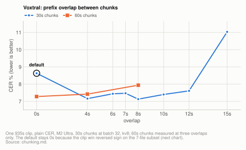
</picture>

**Table:** CER, speed and extra decoded audio by prefix overlap on one clip, M2 Ultra, 30s chunks, batch 32. <!-- not-measured: chunk length setting -->

| overlap | CER | delta | x realtime | extra audio decoded |
|---|---|---|---|---|
| 0s | 8.63% | - | 33.8x | 0s |
| 4s | 7.16% | -1.47 | 30.5x | +124s |
| 6s | 7.44% | -1.19 | 29.0x | +186s |
| 7s | 7.47% | -1.16 | 28.2x | +218s |
| 8s | **7.13%** | **-1.50** | 27.3x | +248s |
| 10s | 7.40% | -1.23 | 26.3x | +310s |
| 12s | 7.61% | -1.02 | 25.3x | +372s |
| 15s | 11.03% | +2.40 | 23.5x | +466s |

Source: [ultra-voxtral-clip.json](../../benchmarks/results/2026-10/ultra-voxtral-clip.json) runs `ov30_0s#overlap 0`, `ov30_4s#overlap 4`, `ov30_6s#overlap 6`, `ov30_7s#overlap 7`, `ov30_8s#overlap 8`, `ov30_10s#overlap 10`, `ov30_12s#overlap 12`, `ov30_15s#overlap 15` (per-file rows: plain CER, x realtime, extra audio decoded)

M4 16GB, 4-bit, 30s chunks, batch 32: 0s 8.63% -> 4s 7.11% -> 8s 7.13%, the same shape.[^k29]

Three things to read off this:

- **The win is real at short chunks and reproduces on both machines**, and it survives
  a paired test at 8s (+1.49, CI [+0.36, +2.96]) and at 4s (+1.47, CI [+0.29, +2.96]).[^k22]
- **The curve is noisy, not smooth.** Between 4s and 12s it wanders in the 7.13-7.61%[^k4]
  band[^k4] with no clean optimum, a spread smaller than the measurement noise. "4s or more
  helps by about 1.5 points"[^k4] is defensible; "8s is optimal" is not. 4s buys most of the
  gain for half the extra decode.
- **It collapses at 15s** on a 30s chunk, where the warm-up region is half the chunk and
  rows start hitting EOS inside it.

At 60s chunks it stops paying, because seams are sparse:

**Table:** CER by prefix overlap on one clip at 60s chunks (plotted as the second series of the overlap chart above).

| overlap | CER | delta |
|---|---|---|
| 0s | 7.28% | - |
| 4s | 7.42% | +0.14 |
| 8s | 7.94% | +0.66 |

Source: [ultra-voxtral-clip.json](../../benchmarks/results/2026-10/ultra-voxtral-clip.json) runs `ov60_0s#overlap 0`, `ov60_4s#overlap 4`, `ov60_8s#overlap 8`

Paired, that is -0.66 with CI [-1.44, +0.10],[^k23] so the supported claim is **"no benefit at
long chunks"** rather than "harmful". An earlier version said harmful; corrected.

## Experiment: prefix overlap, paired over files

**Basis:** [7-file subset](reference/corpus.md#the-7-file-subset), overlap against no overlap, scored by coverage CER/WER; the machine and overlap length for this run are not recorded on this page.

<picture>
  <source media="(prefers-color-scheme: dark)" srcset="img/chunking-overlap-paired-dark.svg">
  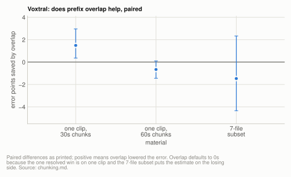
</picture>

**Table:** every paired overlap-against-none difference on this page, positive meaning overlap lowered the error; the clip rows are from the previous experiment.

| material | error points saved by overlap | 95% CI |
|---|---|---|
| one clip, 30s chunks | +1.49 | [+0.36, +2.96] |
| one clip, 60s chunks | -0.66 | [-1.44, +0.10] |
| 7-file subset | -1.47 | [-4.34, +2.33] |

Source: [ultra-mincut-inputs.json](../../benchmarks/results/2026-10/ultra-mincut-inputs.json) runs `mincut7_vox_c30b32_kv8_ov8`, `mincut7_vox_c30b32_kv8` (the 7-file row, pooled over Japanese CER and English WER); [ultra-voxtral-clip-paired.json](../../benchmarks/results/2026-10/ultra-voxtral-clip-paired.json) runs `cmp_ov30_0v8`, `cmp_ov60_0v8` (the two clip rows, 8s overlap, paired over 40 regions of one clip)

On the 7-file subset the effect **reversed sign**: -1.47 points, CI [-4.34, +2.33],[^k5] with
no-overlap nominally better on 5 files to 2. English was worse by 4 points[^k5]
(26.55% -> 30.77% coverage WER).[^k5] Two plausible mechanisms: these recordings contain long
stretches of non-reference material, so a warm-up window often carries content the
reference cut; and the seam-error enrichment in
[How it works](#errors-concentrate-at-chunk-starts) was measured on dense
narration and may not hold for conversational audio with frequent long pauses.

So overlap defaults to zero on every profile. It was for a while bundled into a `--fast`
flag, on the theory that halving the chunk creates the dense-seam condition where the clip
result applies; that turned out to be wrong twice over, and the direct measurement is in the
`--fast` experiment below. This is the clearest case in the project of a significant
single-clip result that did not generalize.

## Experiment: where to cut, energy versus VAD

**Basis:** [one clip](reference/corpus.md#the-single-clip), M2 Ultra 128GB, 4-bit, kv8; then the [20-file corpus](reference/corpus.md#the-20-file-corpus) on an M2 Ultra at 60s/B16 (run on or after 2026-10-11, since every run scored the 783.5s copy of 71bb5eba3baa). <!-- not-measured: config: chunk length and batch -->

`--vad` uses Silero VAD (ONNX, no torch) to cut in the middle of the longest non-speech
run near each target, instead of at the quietest 50ms window. It never removes audio, <!-- not-measured: design constant of the energy splitter -->
only chooses where to cut, so the chunks still cover the input exactly. VAD inference is
negligible: 2.9s for 935s of audio, 322.8x realtime.[^k24]

M2 Ultra 128GB, 4-bit, kv8, single clip:

<picture>
  <source media="(prefers-color-scheme: dark)" srcset="img/chunking-vad-clip-dark.svg">
  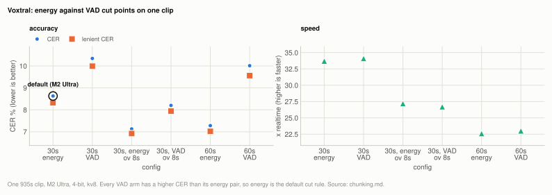
</picture>

**Table:** CER, lenient CER and speed for energy and VAD cut points on one clip, M2 Ultra.[^k7]

| config | CER | lenient CER | x realtime |
|---|---|---|---|
| 30s, energy | **8.63%** | 8.32% | 33.7x |
| 30s, VAD | 10.34% | 9.99% | 34.1x |
| 30s, energy, overlap 8s | **7.13%** | 6.92% | 27.2x |
| 30s, VAD, overlap 8s | 8.20% | 7.94% | 26.7x |
| 60s, energy | **7.28%** | 7.02% | 22.6x |
| 60s, VAD | 10.01% | 9.56% | 23.0x |

Source: [ultra-voxtral-clip.json](../../benchmarks/results/2026-10/ultra-voxtral-clip.json) runs `vad_c30b32_kv8_energy`, `vad_c30b32_kv8_vad`, `vad_c30b32_kv8_ov8_energy`, `vad_c30b32_kv8_ov8_vad`, `vad_c60b16_kv8_energy`, `vad_c60b16_kv8_vad` (CER and x realtime); [ultra-voxtral-clip-paired.json](../../benchmarks/results/2026-10/ultra-voxtral-clip-paired.json) runs `score_vad` (the lenient CER column, rescored from the same hypotheses)

VAD is behind by 1.1-2.7 points[^k7] in every pairing on this clip, and paired over 40
regions the gap resolves in two of the three. At 60s chunks energy beats VAD by 2.74 points,[^k25]
CI [+0.45, +5.71],[^k25] winning 18 regions to 12 with 10 ties (sign test p=0.362); at 30s with 8s
overlap by 1.07, CI [+0.02, +2.29];[^k25] at 30s without overlap the 1.72-point gap does not
resolve (CI [-1.49, +5.95]).[^k25]

**On the corpus the margin mostly evaporates.** Run across all 20 files at the config that
was the default then (60s/B16, the first row of the `--fast` table below; M2 Ultra, run on <!-- not-measured: config: chunk length and batch -->
or after 2026-10-11), energy still leads but not resolvably:

<picture>
  <source media="(prefers-color-scheme: dark)" srcset="img/chunking-vad-corpus-dark.svg">
  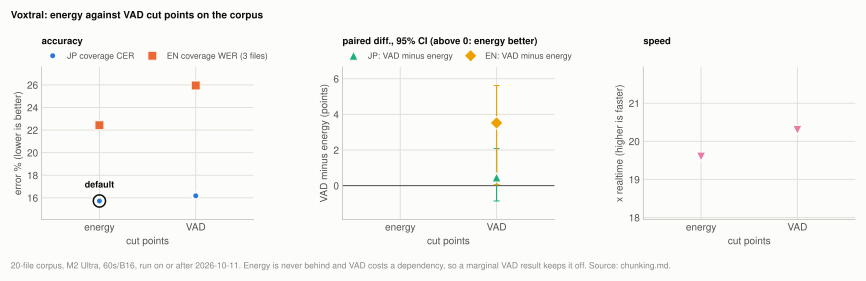
</picture>

**Table:** coverage error, speed and paired difference (VAD minus energy, positive meaning energy is better) on the 20-file corpus, M2 Ultra, 60s/B16. <!-- not-measured: chunk length setting -->

| cut points | JP coverage CER | EN coverage WER | x realtime | JP difference | JP 95% CI | EN difference | EN 95% CI |
|---|---|---|---|---|---|---|---|
| energy (default) | **15.72%** | **22.43%** | 19.6x | | | | |
| VAD | 16.18% | 25.95% | 20.3x | +0.46 | [-0.86, +2.09] | +3.52 | [+0.06, +5.62] |

Source: [ultra-voxtral-precision.json](../../benchmarks/results/2026-10/ultra-voxtral-precision.json) runs `vox_w4bit_c60b16_kv8`; [ultra-voxtral-chunking.json](../../benchmarks/results/2026-10/ultra-voxtral-chunking.json) runs `ch_vad_c60b16` (each row one run: energy is vox_w4bit_c60b16_kv8, VAD is ch_vad_c60b16)

    Japanese: +0.46 points, CI [-0.86, +2.09], VAD wins 10 of 17 files -> not resolvable [^k8]
    English:  +3.52 points, CI [+0.06, +5.62], VAD loses all 3 files -> resolved, but n=3 [^k8]

So the supported reading is narrower than the clip suggested. The 2.74-point Japanese margin[^k25]
does not reproduce, and VAD wins slightly more Japanese files than it loses; the aggregate
tips to energy on length weighting rather than on a consistent per-file advantage. The
English arm resolves against VAD, but n=3 cannot carry much
([metrics.md](reference/metrics.md#the-english-bootstrap-is-n3-and-that-is-worse-than-it-sounds)).

**Marginal, so it stays off.** Energy is never behind and VAD costs an `onnxruntime`
dependency. It does not cost speed: VAD ran slightly faster on the corpus (20.3x[^k8] against
19.6x)[^k8] and in two of the three clip pairings (34.1x against 33.7x at 30s, 23.0x against
22.6x at 60s; 26.7x against 27.2x with 8s overlap).[^k7] A flag that changes nothing measurable should not be the
default. What is no longer supported is the stronger claim that VAD cut points are worse.

The clip result is the opposite of what the VAD literature predicts, and the VAD cuts really
are cleaner by the obvious measure: mean speech probability in the 1s *after* a cut is 0.242[^k24]
for VAD against 0.404 for energy at 30s chunks (31 cuts each), and 0.248 against 0.512 at 60s
(15 cuts each).[^k24] These come from a cut-placement measure written for the rerun, whose
definition may differ from the one first used; under it no cut of either kind falls inside
speech, so it does not separate the two rules by that count.

The likely explanation ties back to overlap. The energy splitter picks the quietest
*instant*, which lands mid-pause and hands the next chunk a run of leading silence to
warm up on. VAD picks the middle of a non-speech *run*, often a short inter-word gap
that satisfies the detector but leaves almost no silence before speech resumes.
**Warm-up room matters more to this model than cut cleanliness.** Kept as an opt-in flag
for noisy material where energy minima may mislead.

## Experiment: carrying context across seams instead of overlapping

**Basis:** [one clip](reference/corpus.md#the-single-clip), M2 Ultra 128GB, 30s chunks, batch 32.

The Voxtral paper notes the decoder reuses KV state as audio is appended, so a chunk
boundary is where this tool discards context. Two ways to give it back, using the
existing per-chunk prompt mechanism. M2 Ultra 128GB, 30s chunks, batch 32, single clip:

<picture>
  <source media="(prefers-color-scheme: dark)" srcset="img/chunking-carry-dark.svg">
  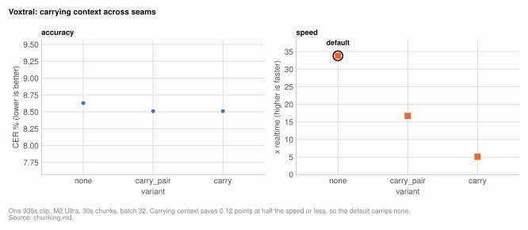
</picture>

**Table:** CER, wall clock and speed for each way of carrying context across seams, one clip, M2 Ultra.[^k9]

| variant | CER | delta | wall | x realtime | note |
|---|---|---|---|---|---|
| none | 8.63% | - | 27.7s | 33.8x | |
| carry_pair | 8.51% | -0.12 | 56.1s | 16.7x | 2 batched passes, pass 2 gets pass 1's tails |
| carry | 8.51% | -0.12 | 182.1s | 5.1x | strictly sequential, batch 1 |

Source: [ultra-voxtral-clip.json](../../benchmarks/results/2026-10/ultra-voxtral-clip.json) runs `carry_none#variant none`, `carry_pair#variant carry_pair`, `carry_seq#variant carry`

Carrying context recovers 0.12 points[^k9] against the ~1.5[^k4] that seams cost, and at best
doubles wall clock. Notably the strictly sequential version, which has true
left-to-right context, is **no better** than the cheap two-pass one, which says the
31-token prompt window is too small to carry meaningful context. Not worth it: longer
chunks recover the full amount for free.

## Experiment: dropping silence before decode

**Basis:** [one clip](reference/corpus.md#the-single-clip) for the cut-cleanliness measurement; [20-file corpus](reference/corpus.md#the-20-file-corpus), M2 Ultra, 4-bit (run on or after 2026-10-11) for accuracy and speed.

`--compact-silence` drops the middle of pauses longer than 400ms, keeping the first <!-- not-measured: design constants of --compact-silence -->
240ms. Since decode cost is one step per 80ms frame, removing silence removes steps <!-- not-measured: design constants -->
one-for-one; on the reference clip it removed 11.9% of the audio.[^k24] Timestamps are mapped
back to the original timeline. The chunk cuts are not measurably cleaner with it: the loudest
cut is -59.1dB with compaction against -57.5dB without at 30s chunks, -57.5dB for both at 60s,
and no cut in any of the four arms is above -50dB.[^k24] (This cut-loudness measure was written
for the rerun and may be defined differently from the original comparison.) The single-clip accuracy
result, which appeared to depend on quantization, did not reproduce and is under
[Superseded](#superseded).

On the corpus at the 4-bit config that was the default then (20 files, M2 Ultra, run on or
after 2026-10-11) it is slightly better rather than worse:

<picture>
  <source media="(prefers-color-scheme: dark)" srcset="img/chunking-silence-dark.svg">
  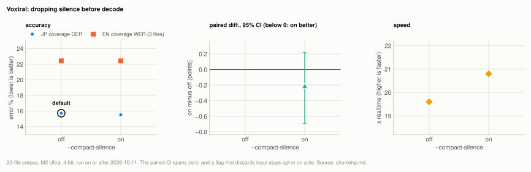
</picture>

**Table:** coverage error, speed and paired Japanese difference (on minus off) with and without silence compaction, 20-file corpus, M2 Ultra, 4-bit.

| | JP coverage CER | EN coverage WER | x realtime | JP difference | JP 95% CI |
|---|---|---|---|---|---|
| off (default) | 15.72% | 22.43% | 19.6x | | |
| `--compact-silence` | **15.51%** | 22.43% | **20.8x** | -0.21 | [-0.69, +0.22] |

Source: [ultra-voxtral-precision.json](../../benchmarks/results/2026-10/ultra-voxtral-precision.json) runs `vox_w4bit_c60b16_kv8`; [ultra-voxtral-chunking.json](../../benchmarks/results/2026-10/ultra-voxtral-chunking.json) runs `ch_compact_c60b16_w4bit` (each row one run: off is vox_w4bit_c60b16_kv8, on is ch_compact_c60b16_w4bit)

    -0.21 points, CI [-0.69, +0.22], better on 6 of 8 files that moved -> not resolvable [^k10]

It removed between 0% and 4.3% of the audio per corpus file (3.7% to 4.3% on the three[^k24]
highest, 2.2% or less on the rest),[^k24] less than the 11.9% on the narration clip, and the win is concentrated in three long files: the third-longest (-2.19), the
fifth-longest (-1.30) and the longest (-0.59 points).[^k10] The second-longest file went the
other way by +1.04.[^k10]

## Experiment: silence compaction across precisions

**Basis:** [20-file corpus](reference/corpus.md#the-20-file-corpus), M2 Ultra, `--compact-silence` off and on at 4-bit, 8-bit, mxfp8 and nvfp4.

That dependence was the reason the flag was off, so it was run on every precision available.
All four are ties on accuracy and all four are faster:

<picture>
  <source media="(prefers-color-scheme: dark)" srcset="img/chunking-silence-precision-dark.svg">
  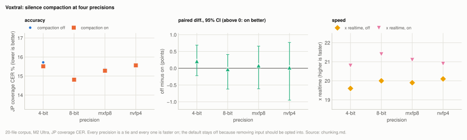
</picture>

**Table:** JP coverage CER and speed with silence compaction off and on at each precision, with the paired difference (off minus on), 20-file corpus, M2 Ultra.

| precision | off | on | difference | 95% CI | x realtime, off | x realtime, on |
|---|---|---|---|---|---|---|
| 4-bit | 15.72% | 15.51% | +0.21 | [-0.22, +0.69] | 19.6x | **20.8x** |
| 8-bit | 14.78% | 14.81% | -0.03 | [-0.62, +0.41] | 20.0x | **21.4x** |
| mxfp8 | 15.36% | 15.28% | +0.08 | [-0.61, +0.66] | 19.9x | **21.1x** |
| nvfp4 | 15.58% | 15.56% | +0.02 | [-0.95, +0.77] | 20.1x | **20.9x** |

Source: [ultra-voxtral-precision.json](../../benchmarks/results/2026-10/ultra-voxtral-precision.json) runs `vox_w4bit_c60b16_kv8`, `vox_w8bit_c60b16_kv8`, `vox_wmxfp8_c60b16_kv8`, `vox_wnvfp4_c60b16_kv8`; [ultra-voxtral-chunking.json](../../benchmarks/results/2026-10/ultra-voxtral-chunking.json) runs `ch_compact_c60b16_w4bit`, `ch_compact_c60b16_w8bit`, `ch_compact_c60b16_wmxfp8`, `ch_compact_c60b16_wnvfp4` (each cell one run: the off column is the vox_w*_c60b16_kv8 run of that precision, the on column the ch_compact_c60b16_w* run)

The 4-bit row is the previous experiment's comparison with the sign reversed (on minus off
there, -0.21, CI [-0.69, +0.22]),[^k10] so its interval is that one negated.

**nvfp4 is the headline**, because that is the arm the 4-point loss came from. On the corpus
it is +0.02 points[^k11] and splits 4 files to 4. Nothing survives of the effect, so the
quantization-dependence claim is **withdrawn**: it described one clip and one precision, and
the mechanism story built on it (that quantized weights lean harder on pauses for
segmentation) has no evidence behind it.

**It stays off anyway, and this is the uncomfortable part.** Accuracy is a tie on all four
precisions, so by the project's own rule (positive on, negative off, marginal off) the
accuracy case does not move the default. What is left is a consistent 4-7% throughput gain,[^k11]
which is real but is a speed argument for a flag that silently discards audio. Removing
input is a behaviour change users should opt into rather than inherit, so the flag keeps its
current default and its documentation now says the cost is unmeasurable rather than
quantization-dependent. Closes
[#6](https://github.com/prog893/mlx-asr/issues/6).

## Experiment: the composite flag

**Basis:** [20-file corpus](reference/corpus.md#the-20-file-corpus), M2 Ultra, JP coverage CER; the bundle measured as one config and then decomposed.

`--fast` set three levers at once (halve the chunk, double the batch, add 8s warm-up
overlap). Only its components had been measured separately, which is not enough to predict a
combination: overlap on its own won on a clip and then reversed sign on the corpus. Measured
as one config, and then decomposed, 20 files, M2 Ultra:

<picture>
  <source media="(prefers-color-scheme: dark)" srcset="img/chunking-composite-dark.svg">
  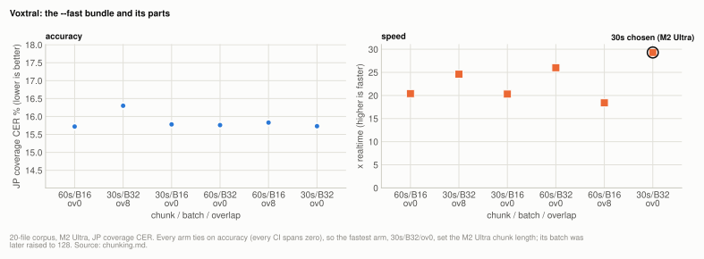
</picture>

**Table:** JP coverage CER and speed for the `--fast` bundle and each of its components, 20-file corpus, M2 Ultra.

| config | JP coverage CER | x realtime | isolates |
|---|---|---|---|
| 60s / B16 / ov0 (the old default) | 15.72% | 20.4x | |
| 30s / B32 / ov8 (what `--fast` did) | 16.30% | 24.6x | the bundle |
| 30s / B16 / ov0 | 15.78% | 20.3x | chunk alone |
| 60s / B32 / ov0 | 15.76% | 26.0x | batch alone |
| 60s / B16 / ov8 | 15.83% | 18.4x | overlap alone |
| **30s / B32 / ov0** | **15.73%** | **29.3x** | chunk + batch |

Source: [ultra-voxtral-precision.json](../../benchmarks/results/2026-10/ultra-voxtral-precision.json) runs `vox_w4bit_c60b16_kv8`; [ultra-voxtral-chunking.json](../../benchmarks/results/2026-10/ultra-voxtral-chunking.json) runs `ch_c30b32_ov8`, `ch_c30b16_ov0`, `ch_c60b32_ov0`, `ch_c60b16_ov8`; [ultra-voxtral-batch.json](../../benchmarks/results/2026-10/ultra-voxtral-batch.json) runs `c30b32`, `c30b32_r2`, `c30b32_r3`; [ultra-voxtral-precision.json](../../benchmarks/results/2026-10/ultra-voxtral-precision.json) runs `vox_w4bit_c60b16_kv8_r2`; [ultra-voxtral-kv.json](../../benchmarks/results/2026-10/ultra-voxtral-kv.json) runs `vox_kv8_c60b16_w4bit` (the 60s / B16 / ov0 and 30s / B32 / ov0 speeds are each the mean of 3 runs: vox_w4bit_c60b16_kv8, vox_w4bit_c60b16_kv8_r2, vox_kv8_c60b16_w4bit and the three c30b32 runs; every other row is one run)

Every arm is a tie on accuracy against the default (largest difference 0.58 points,[^k12] every
CI spanning zero), so this is entirely a throughput result.

Two things fall out, and the second corrects the obvious reading:

- **The bundle was holding back its own speedup.** Dropping the 8s overlap is worth another
  4.7x on top, and recovers the 0.58 CER points[^k12] the overlap had cost. Overlap measured alone
  is the only arm *slower* than the default (18.4x against 20.4x),[^k12] which is what a flag that
  decodes extra audio should be expected to do.
- **The batch does most of the work.** Halving the chunk alone leaves speed where it was (20.3x[^k12]
  against 20.4x);[^k12] doubling the batch alone gets 26.0x,[^k12] most of the total. The two together
  reach 29.3x,[^k12] so shorter chunks help only once the batch is wide enough to hold them in one
  pass. A flag called `--fast` bundling both obscured which half mattered.

## Experiment: chunk and batch across GPU core counts

**Basis:** M2 Ultra 128GB (60 GPU cores) and M4 16GB (10 GPU cores), 60s/B16 against 30s/B32, 4-bit, on the [20-file corpus](reference/corpus.md#the-20-file-corpus); the Ultra figures are from the previous experiment, the M4 figures from the 30s-versus-60s runs above. <!-- not-measured: chunk length settings -->

Same change, the two benchmarked machines:

<picture>
  <source media="(prefers-color-scheme: dark)" srcset="img/chunking-machines-dark.svg">
  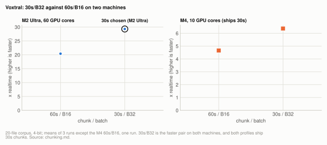
</picture>

**Table:** speed of the two chunk/batch pairs on each benchmarked machine, the faster pair per machine in bold.

| machine | GPU cores | 60s / B16 | 30s / B32 |
|---|---|---|---|
| M2 Ultra 128GB | 60 | 20.4x | **29.3x** |
| M4 16GB | 10 | 4.66x | **6.37x** |

Source: [ultra-voxtral-precision.json](../../benchmarks/results/2026-10/ultra-voxtral-precision.json) runs `vox_w4bit_c60b16_kv8`, `vox_w4bit_c60b16_kv8_r2`; [ultra-voxtral-kv.json](../../benchmarks/results/2026-10/ultra-voxtral-kv.json) runs `vox_kv8_c60b16_w4bit`; [ultra-voxtral-batch.json](../../benchmarks/results/2026-10/ultra-voxtral-batch.json) runs `c30b32`, `c30b32_r2`, `c30b32_r3`; [m4-voxtral-chunking.json](../../benchmarks/results/2026-10/m4-voxtral-chunking.json) runs `c60b16`, `c30b32`, `c30b32_r2`, `c30b32_r3` (every cell is the mean of 3 runs except the M4 60s / B16 cell, one run)

30s/B32 is the faster pair on both machines, by 44% on the Ultra and 37% on the M4.[^k2][^k28] The
expectation this experiment was set up to check was the reverse on the M4: halving the chunk
doubles the chunk count, each chunk pays fixed encoder cost, and with 10 cores the encoder
is already 35% of wall clock at 60s chunks on the clip (nvfp4).[^k30] On the corpus runs 30s/B32 came out faster on both machines, so both profiles ship 30s
chunks, and chips with no profile default to 30s whatever their core count. <!-- not-measured: 30s is the unprofiled chunk length setting -->
On the M4, 30s/B32 is the mean of 3 runs (6.24x to 6.60x) and 60s/B16 is one run.[^k28]

**The flag was removed rather than turned on.** It bundled an 8s overlap that cost speed on
the Ultra (24.6x for the bundle against 29.3x without it)[^k12] and three levers that are now
set independently in `profiles.json`, per machine. The removal was argued at the time on the
reading that the right chunk/batch pair reverses across hardware; the runs above do not show
that reversal. No composite flag replaced it.

Two claims died with it. The README said "faster, slightly less accurate", which was wrong in
its accuracy half (the accuracy cost is unresolvable), and this document said the bundled
overlap was justified by the short-chunk regime, which the third row above refutes.

## Experiment: batch size end to end

**Basis:** [20-file corpus](reference/corpus.md#the-20-file-corpus), M2 Ultra 128GB, 4-bit, 30s chunks, kv8, `--delay-ms 2400`, one run per batch, 2026-10-07; then M4 16GB at 60s chunks (the M4 profile's chunk length when it was run) on AC power, 2026-10-08.

The synthetic sweep in [decode-throughput.md](decode-throughput.md) measures decode steps
alone. This one runs the whole pipeline over real audio, with the batch as the only change:

<picture>
  <source media="(prefers-color-scheme: dark)" srcset="img/chunking-batch-dark.svg">
  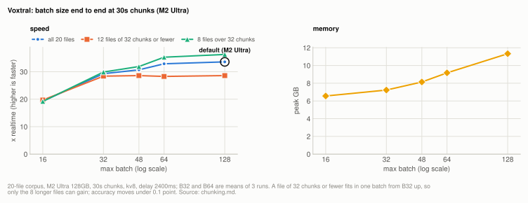
</picture>

**Table:** end-to-end speed by max batch over all files and split at 32 chunks (the files a batch of 32 already holds whole), with peak memory, 20-file corpus, M2 Ultra, 30s chunks; B32 and B64 are means of 3 runs.

| max batch | all 20 files | 12 files of 32 chunks or fewer (2.3h) | 8 files over 32 chunks (5.7h) | peak memory |
|---|---|---|---|---|
| 16 | 19.3x | 19.7x | 19.2x | 6.56GB |
| 32 | 29.3x | 28.4x | 29.9x | 7.23GB |
| 48 | 30.7x | 28.6x | 31.9x | 8.14GB |
| 64 | 32.9x | 28.3x | 35.3x | 9.17GB |
| **128** | **33.6x** | 28.6x | **36.3x** | 11.33GB |

Source: [ultra-voxtral-batch.json](../../benchmarks/results/2026-10/ultra-voxtral-batch.json) runs `c30b16`, `c30b32`, `c30b32_r2`, `c30b32_r3`, `c30b48`, `c30b64`, `c30b64_r2`, `c30b64_r3`, `c30b128` (all files: each run's x realtime; the split columns: total duration over total decode time of the valid per-file rows, with the supplement row for 71bb5eba3baa in place of the superseded one)

Accuracy barely moves with batch: JP coverage CER is 15.73% to 15.79% across all five arms[^k3]
and EN coverage WER is 21.50% in every one.[^k3] Paired over the 17 Japanese files, B128 against
B32 is 0.07 points worse, CI [-0.01, +0.18],[^k3] lower on 2 of 17 files: a cost too small to
resolve on this corpus, and an order of magnitude below the precision effects in
[quantization.md](quantization.md).

A file of 32 chunks or fewer is decoded in one batch from B32 up, so for those 12 files B32,
B48, B64 and B128 do identical work and their spread (28.3x to 28.6x)[^k3] is machine noise. The slowest files at every batch from B32 up are the two shortest, at 11.7x
to 12.6x and 17.2x to 18.8x, since a file of a few chunks cannot fill a batch.[^k3] The 8 longer files are where batch matters: B128 is faster
than B64 on 6 of them, by 0.2-6.5%, and reaches 40.1x on the 93-minute file against 30.0x at B32 (B64 and B32 as means of 3 runs).[^k3]

B128 is what the Ultra's memory resolves to. Its 11.33GB peak[^k3] is under 10% of the machine's
working set,[^k17] and the rule the default follows on every machine is the largest batch that fits: on the files a batch already holds whole it
costs nothing, and on longer files it is the fastest arm measured.

The same sweep on the M4, at 60s chunks:

<picture>
  <source media="(prefers-color-scheme: dark)" srcset="img/chunking-batch-m4-dark.svg">
  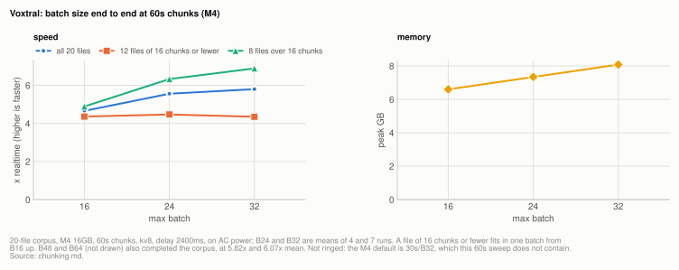
</picture>

**Table:** end-to-end speed by max batch over all files and split at 16 chunks (the files a batch of 16 already holds whole), with peak memory, 20-file corpus, M4 16GB, 60s chunks; B24 is the mean of 4 runs and B32 of 7.

| max batch | all 20 files | 12 files of 16 chunks or fewer (2.3h) | 8 files over 16 chunks (5.7h) | peak memory |
|---|---|---|---|---|
| 16 | 4.66x | 4.36x | 4.89x | 6.60GB |
| 24 | 5.56x | 4.47x | 6.33x | 7.34GB |
| **32** | 5.80x | 4.35x | 6.89x | 8.08GB |

Source: [m4-voxtral-batch.json](../../benchmarks/results/2026-10/m4-voxtral-batch.json) runs `c60b16`, `c60b24`, `c60b24_r2`, `c60b24_r3`, `c60b24_r4`, `c60b32`, `c60b32_r1`, `batch_m4_repeat_20261009__c60b32_r2`, `batch_m4_b64_20261010__c60b32_r2`, `batch_m4_repeat_20261009__c60b32_r3`, `batch_m4_b64_20261010__c60b32_r3`, `c60b32_r4` (all files: each run's x realtime; the split columns: total duration over total decode time of the valid per-file rows, with the supplement row for 71bb5eba3baa in place of the superseded one. Two pairs of B32 runs share the names c60b32_r2 and c60b32_r3; all seven B32 runs are included)

JP coverage CER is 15.79% at B16 and 15.68% at B24 and B32;[^k13] EN coverage WER is 22.43% in all
three.[^k13] Paired over the 17 Japanese files, B32 against B16 is -0.12 points, CI [-0.28, +0.00],[^k13]
with 2 files changed, both for the better: the opposite direction to the Ultra and, like it,
unresolved. The shape matches the Ultra: the 12 shorter files run at the same speed at every batch,
and the 8 longer ones gain about 30-41% from B16 to B24 or B32.[^k13] B24 (5.56x, mean of 4
runs) and B32 (5.80x, mean of 7) have overlapping run ranges, so they are not separated.[^k13]

At 60s chunks B32 is what the M4's memory budget resolves to: it completed the full corpus seven times with
no errors at an 8.08GB peak.[^k13] The budget excludes B48, but larger
batches were then run on the corpus and completed. B48 ran four times at 5.82x mean[^k19]
(5.56x to 6.07x) with peaks of 9.0 to 9.24GB, and B64 four times at 6.07x mean (5.71x to[^k19]
6.33x) at a 10.72GB peak; JP coverage CER is 15.68% and 15.66% against 15.68% at B32.[^k19]
Both means are above B32's 5.80x, with run ranges that overlap it (B32: 5.46x to 5.95x).[^k19]
A batch is padded to its longest row, and a file's last chunk can reach
90s at 60s chunks, so the corpus never hit B32's worst case. It was measured separately: a
32-minute cut of a corpus file whose 32 rows all pad to an 82.66s last chunk (91.9%[^k27] of the
90s theoretical worst; the chunk lengths were re-derived by running the splitter on that cut)[^k27] peaked at 8.31GB, 0.23GB above the corpus peak[^k14] and inside the budget. The
same worst case at B64 peaked at 11.87GB, 93% of the M4's 12.7GB GPU working set,[^k20] too
close to the limit to call B64 reliable. The M4 profile therefore caps the batch at 32
(`max_batch`), which also covers its 30s chunks: there the formula alone would admit B64
(9.36GB predicted against a 9.91GB budget), <!-- not-measured: outputs of the batch formula in mlx_asr/hardware.py --> and B64 has not been run at 30s on the M4.

## How it works

### Errors concentrate at chunk starts

Locating every edit operation relative to the nearest chunk boundary, 30s chunks, single clip:

<picture>
  <source media="(prefers-color-scheme: dark)" srcset="img/chunking-seams-dark.svg">
  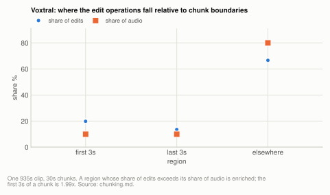
</picture>

**Table:** substitutions, insertions and deletions by position within a 30s chunk on one clip, with each region's share of edits, share of audio and enrichment. <!-- not-measured: chunk length setting -->

| region | subs | ins | del | total | share of edits | share of audio | enrichment |
|---|---|---|---|---|---|---|---|
| first 3s of a chunk | 31 | 20 | 21 | 72 | 19.8% | 9.9% | **1.99x** |
| last 3s of a chunk | 18 | 26 | 5 | 49 | 13.5% | 9.9% | 1.36x |
| elsewhere | 116 | 40 | 86 | 242 | 66.7% | 80.1% | 0.83x |

Source: [ultra-voxtral-clip-paired.json](../../benchmarks/results/2026-10/ultra-voxtral-clip-paired.json) runs `seam_c30` (30s / batch 32 / kv8, 3s window)

Errors concentrate at chunk *starts* rather than ends, which is what a causal model predicts:
at position 0 of a chunk it has no left context. This also says which direction of overlap
can help. Both encoder and decoder are causal, so appending audio *after* a chunk cannot
change tokens already emitted; prepending audio can. That is why `--overlap-seconds` is a
prefix, and why longer chunks, which have fewer starts, win on the single clip up to 60s.

## Superseded

### Silence compaction on one clip, split by quantization

Replaced by the 20-file corpus runs in
[Experiment: dropping silence before decode](#experiment-dropping-silence-before-decode) and
[Experiment: silence compaction across precisions](#experiment-silence-compaction-across-precisions),
where all four precisions tie. On the clip the accuracy result first appeared to split by
quantization, with nvfp4 on the M4 losing far more text under compaction than 4-bit. The M4
rows below are a later rerun of that comparison at both precisions; the table is kept as the
record of what was measured rather than as a finding:

**Table:** superseded single-clip CER and deletion counts with and without silence compaction, per machine, precision and chunk/batch pair, KV unquantized.[^k16][^k31]

| config | CER baseline | CER compacted | deletions |
|---|---|---|---|
| M4 16GB, nvfp4, 60s/B16 | 7.75% | 7.97% | 112 -> 123 |
| M4 16GB, nvfp4, 30s/B32 | 9.27% | 7.71% | 122 -> 110 |
| M4 16GB, 4bit affine, 60s/B16 | 7.40% | 8.30% | 108 -> 111 |
| M4 16GB, 4bit affine, 30s/B32 | 8.66% | 10.68% | 114 -> 171 |
| M2 Ultra 128GB, 4bit affine, 60s/B16 | 7.40% | 8.30% | 108 -> 111 |
| M2 Ultra 128GB, 4bit affine, 30s/B32 | 8.66% | 10.68% | 114 -> 171 |

Source: [m4-voxtral-clip.json](../../benchmarks/results/2026-10/m4-voxtral-clip.json) runs `m4_compact_c60b16_kv0_off_nvfp4`, `m4_compact_c60b16_kv0_on_nvfp4`, `m4_compact_c30b32_kv0_off_nvfp4`, `m4_compact_c30b32_kv0_on_nvfp4`, `m4_compact_c60b16_kv0_off_4bit`, `m4_compact_c60b16_kv0_on_4bit`, `m4_compact_c30b32_kv0_off_4bit`, `m4_compact_c30b32_kv0_on_4bit` (the four M4 rows); [ultra-voxtral-clip.json](../../benchmarks/results/2026-10/ultra-voxtral-clip.json) runs `compact_c60b16_kv0_off`, `compact_c60b16_kv0_on`, `compact_c30b32_kv0_off`, `compact_c30b32_kv0_on` (the two M2 Ultra rows)

The reading at the time was that the model leans on pauses for its own segmentation and that
more aggressively quantized weights tolerate their removal worse. The rerun does not show it:
on nvfp4, compaction cost 0.21 points at 60s/B16 and lowered CER by 1.57 points at 30s/B32,[^k31]
with deletions moving from 112 to 123 and from 122 to 110.[^k31] The 4-bit rows are where
compaction cost most, 0.90 and 2.02 points,[^k31] and they are identical on the two machines in
CER and in deletions.[^k16][^k31]

That reading is **withdrawn**. The nvfp4 rerun on the clip does not reproduce it, and the same
nvfp4 comparison over the corpus is a tie. Recorded rather than deleted because a plausible
mechanism story built on one recording is exactly the failure mode worth leaving visible.

## Related

[delay.md](delay.md) is a larger lever and free. [decode-throughput.md](decode-throughput.md)
explains why short chunks cost encoder time and why the batch that pairs with a chunk
length is not a free choice.

[^k1]: [m4-voxtral-chunking.json](../../benchmarks/results/2026-10/m4-voxtral-chunking.json) runs `c60b16`, `c30b32`
[^k2]: [ultra-voxtral-precision.json](../../benchmarks/results/2026-10/ultra-voxtral-precision.json) runs `vox_w4bit_c60b16_kv8`, `vox_w4bit_c60b16_kv8_r2`; [ultra-voxtral-kv.json](../../benchmarks/results/2026-10/ultra-voxtral-kv.json) runs `vox_kv8_c60b16_w4bit`; [ultra-voxtral-batch.json](../../benchmarks/results/2026-10/ultra-voxtral-batch.json) runs `c30b32`, `c30b32_r2`, `c30b32_r3`
[^k3]: [ultra-voxtral-batch.json](../../benchmarks/results/2026-10/ultra-voxtral-batch.json) runs `c30b16`, `c30b32`, `c30b32_r2`, `c30b32_r3`, `c30b48`, `c30b64`, `c30b64_r2`, `c30b64_r3`, `c30b128`
[^k4]: [ultra-voxtral-clip.json](../../benchmarks/results/2026-10/ultra-voxtral-clip.json) runs `ov30_0s#overlap 0`, `ov30_4s#overlap 4`, `ov30_6s#overlap 6`, `ov30_7s#overlap 7`, `ov30_8s#overlap 8`, `ov30_10s#overlap 10`, `ov30_12s#overlap 12`, `ov30_15s#overlap 15`
[^k5]: [ultra-mincut-inputs.json](../../benchmarks/results/2026-10/ultra-mincut-inputs.json) runs `mincut7_vox_c60b16_kv8`, `mincut7_vox_c30b32_kv8`, `mincut7_vox_c30b32_kv8_ov8` (paired differences pooled over Japanese CER and English WER, bootstrapped over the 7 files)
[^k6]: [ultra-voxtral-clip.json](../../benchmarks/results/2026-10/ultra-voxtral-clip.json) runs `chunk_c20b48_kv0#overlap 0`, `chunk_c30b32_kv0#overlap 0`, `ov60_0s#overlap 0`, `chunk_c90b16_kv8#overlap 0`, `chunk_c120b8_kv8#overlap 0`, `chunk_c180b8_kv8#overlap 0`
[^k7]: [ultra-voxtral-clip.json](../../benchmarks/results/2026-10/ultra-voxtral-clip.json) runs `vad_c30b32_kv8_energy`, `vad_c30b32_kv8_vad`, `vad_c30b32_kv8_ov8_energy`, `vad_c30b32_kv8_ov8_vad`, `vad_c60b16_kv8_energy`, `vad_c60b16_kv8_vad`
[^k8]: [ultra-voxtral-precision.json](../../benchmarks/results/2026-10/ultra-voxtral-precision.json) runs `vox_w4bit_c60b16_kv8`; [ultra-voxtral-chunking.json](../../benchmarks/results/2026-10/ultra-voxtral-chunking.json) runs `ch_vad_c60b16`
[^k9]: [ultra-voxtral-clip.json](../../benchmarks/results/2026-10/ultra-voxtral-clip.json) runs `carry_none#variant none`, `carry_pair#variant carry_pair`, `carry_seq#variant carry`
[^k10]: [ultra-voxtral-precision.json](../../benchmarks/results/2026-10/ultra-voxtral-precision.json) runs `vox_w4bit_c60b16_kv8`; [ultra-voxtral-chunking.json](../../benchmarks/results/2026-10/ultra-voxtral-chunking.json) runs `ch_compact_c60b16_w4bit`
[^k11]: [ultra-voxtral-precision.json](../../benchmarks/results/2026-10/ultra-voxtral-precision.json) runs `vox_w4bit_c60b16_kv8`, `vox_w8bit_c60b16_kv8`, `vox_wmxfp8_c60b16_kv8`, `vox_wnvfp4_c60b16_kv8`; [ultra-voxtral-chunking.json](../../benchmarks/results/2026-10/ultra-voxtral-chunking.json) runs `ch_compact_c60b16_w4bit`, `ch_compact_c60b16_w8bit`, `ch_compact_c60b16_wmxfp8`, `ch_compact_c60b16_wnvfp4`
[^k12]: [ultra-voxtral-precision.json](../../benchmarks/results/2026-10/ultra-voxtral-precision.json) runs `vox_w4bit_c60b16_kv8`, `vox_w4bit_c60b16_kv8_r2`; [ultra-voxtral-kv.json](../../benchmarks/results/2026-10/ultra-voxtral-kv.json) runs `vox_kv8_c60b16_w4bit`; [ultra-voxtral-chunking.json](../../benchmarks/results/2026-10/ultra-voxtral-chunking.json) runs `ch_c30b32_ov8`, `ch_c30b16_ov0`, `ch_c60b32_ov0`, `ch_c60b16_ov8`; [ultra-voxtral-batch.json](../../benchmarks/results/2026-10/ultra-voxtral-batch.json) runs `c30b32`, `c30b32_r2`, `c30b32_r3`
[^k13]: [m4-voxtral-batch.json](../../benchmarks/results/2026-10/m4-voxtral-batch.json) runs `c60b16`, `c60b24`, `c60b24_r2`, `c60b24_r3`, `c60b24_r4`, `c60b32`, `c60b32_r1`, `batch_m4_repeat_20261009__c60b32_r2`, `batch_m4_b64_20261010__c60b32_r2`, `batch_m4_repeat_20261009__c60b32_r3`, `batch_m4_b64_20261010__c60b32_r3`, `c60b32_r4`
[^k14]: [m4-voxtral-worstcase.json](../../benchmarks/results/2026-10/m4-voxtral-worstcase.json) runs `worst32_c60b32`; [m4-voxtral-batch.json](../../benchmarks/results/2026-10/m4-voxtral-batch.json) runs `c60b16`, `c60b24`, `c60b24_r2`, `c60b24_r3`, `c60b24_r4`, `c60b32`, `c60b32_r1`, `batch_m4_repeat_20261009__c60b32_r2`, `batch_m4_b64_20261010__c60b32_r2`, `batch_m4_repeat_20261009__c60b32_r3`, `batch_m4_b64_20261010__c60b32_r3`, `c60b32_r4`
[^k15]: [ultra-voxtral-clip.json](../../benchmarks/results/2026-10/ultra-voxtral-clip.json) runs `ov60_0s#overlap 0`, `ov60_4s#overlap 4`, `ov60_8s#overlap 8`
[^k16]: [ultra-voxtral-clip.json](../../benchmarks/results/2026-10/ultra-voxtral-clip.json) runs `compact_c60b16_kv0_off`, `compact_c60b16_kv0_on`, `compact_c30b32_kv0_off`, `compact_c30b32_kv0_on`
[^k17]: [ultra-synthetic-decode.json](../../benchmarks/results/2026-10/ultra-synthetic-decode.json) runs `synth_ultra_4bit_r1`, `synth_ultra_4bit_r2`, `synth_ultra_4bit_r3` (the machine's recorded GPU working set, 115.4GB)
[^k19]: [m4-voxtral-batch.json](../../benchmarks/results/2026-10/m4-voxtral-batch.json) runs `c60b32`, `c60b32_r1`, `batch_m4_repeat_20261009__c60b32_r2`, `batch_m4_b64_20261010__c60b32_r2`, `batch_m4_repeat_20261009__c60b32_r3`, `batch_m4_b64_20261010__c60b32_r3`, `c60b32_r4`, `c60b48`, `c60b48_r1`, `c60b48_r2`, `c60b48_r3`, `c60b64`, `c60b64_r1`, `c60b64_r2`, `c60b64_r3`
[^k20]: [m4-voxtral-worstcase.json](../../benchmarks/results/2026-10/m4-voxtral-worstcase.json) runs `worst64_c60b64`; [m4-synthetic-decode.json](../../benchmarks/results/2026-10/m4-synthetic-decode.json) runs `synth_nvfp4_r1` (the machine's recorded GPU working set)
[^k21]: [ultra-resolution-floor.json](../../benchmarks/results/2026-10/ultra-resolution-floor.json) runs `resolution_floor`
[^k22]: [ultra-voxtral-clip-paired.json](../../benchmarks/results/2026-10/ultra-voxtral-clip-paired.json) runs `cmp_ov30_0v8`, `cmp_ov30_0v4`
[^k23]: [ultra-voxtral-clip-paired.json](../../benchmarks/results/2026-10/ultra-voxtral-clip-paired.json) runs `cmp_ov60_0v8`
[^k24]: [ultra-derived-measures.json](../../benchmarks/results/2026-10/ultra-derived-measures.json) runs `derive_cuts`
[^k25]: [ultra-voxtral-clip-paired.json](../../benchmarks/results/2026-10/ultra-voxtral-clip-paired.json) runs `cmp_vad_60`, `cmp_vad_30ov8`, `cmp_vad_30`
[^k27]: [ultra-worstcase-split.json](../../benchmarks/results/2026-10/ultra-worstcase-split.json) runs `derive_worst32_chunks`; [m4-voxtral-worstcase.json](../../benchmarks/results/2026-10/m4-voxtral-worstcase.json) runs `worst32_c60b32`
[^k26]: [ultra-decode-probes.json](../../benchmarks/results/2026-10/ultra-decode-probes.json) runs `probe_encoder_batch_ultra_4bit` (the conv output length in its stdout)
[^k28]: [m4-voxtral-chunking.json](../../benchmarks/results/2026-10/m4-voxtral-chunking.json) runs `c60b16`, `c30b32`, `c30b32_r2`, `c30b32_r3` (30s/B32 speed is the mean of its 3 runs)
[^k29]: [m4-voxtral-clip.json](../../benchmarks/results/2026-10/m4-voxtral-clip.json) runs `m4_ov30_0s#overlap 0`, `m4_ov30_4s#overlap 4`, `m4_ov30_8s#overlap 8`
[^k30]: [m4-stage-timing.json](../../benchmarks/results/2026-10/m4-stage-timing.json) runs `m4_stages_nvfp4_c60b16_r1`, `m4_stages_nvfp4_c60b16_r2`, `m4_stages_nvfp4_c60b16_r3` (mean encode seconds over mean wall clock)
[^k31]: [m4-voxtral-clip.json](../../benchmarks/results/2026-10/m4-voxtral-clip.json) runs `m4_compact_c60b16_kv0_off_nvfp4`, `m4_compact_c60b16_kv0_on_nvfp4`, `m4_compact_c30b32_kv0_off_nvfp4`, `m4_compact_c30b32_kv0_on_nvfp4`, `m4_compact_c60b16_kv0_off_4bit`, `m4_compact_c60b16_kv0_on_4bit`, `m4_compact_c30b32_kv0_off_4bit`, `m4_compact_c30b32_kv0_on_4bit`
