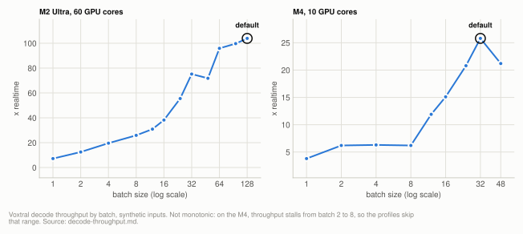
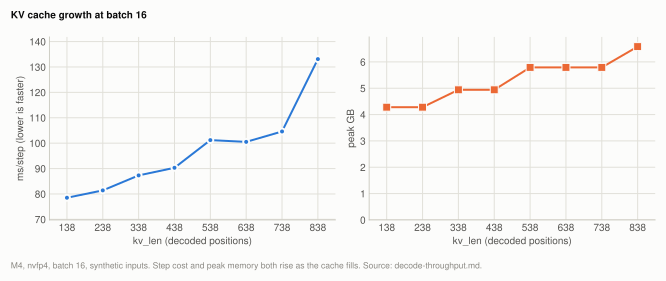
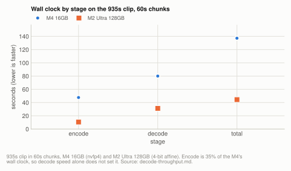
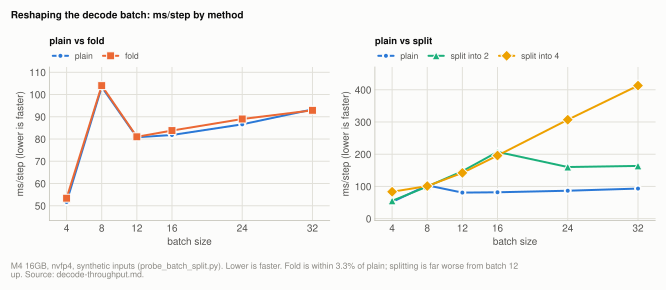
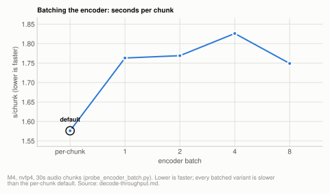
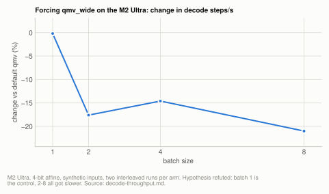

# Lever: batch size and decode throughput

**Voxtral only.** Multi-stream batching is what this project added; the other engines
decode one stream at a time and reject `--max-batch`. Batch size is the single largest
speed lever and it is **not monotonic**: on every machine measured, batch 2-8 is *slower
per step* than batch 1, and on the M4 batch 8 costs 5x batch 1 per step,[^d1] so although
batch 2-8 still beats batch 1 in x realtime, batch 12 and up beats both, and the default is
either 1 or 12 and up. Batch is memory-bound, so the default is the largest well-measured
batch that fits the machine's GPU memory, whatever the chip, capped where a machine's profile sets a lower measured limit (32 on the
M4 16GB, 128 on the M2 Ultra 128GB). The cause is upstream kernel dispatch in MLX, which reshaping the batch,
batching the encoder, `mx.compile` and forcing MLX's `qmv_wide` kernel all failed to work
around.

| setting | default | why |
|---|---|---|
| `--max-batch` | the largest of 1, 12, 16, 24, 32, 64, 96, 128 whose predicted peak fits 78% of the GPU working set, then capped by the machine profile's `max_batch` where it sets one: 32 on the M4 16GB, 128 on the M2 Ultra 128GB. With 4-bit weights the formula reaches B64 from 12.0GB of working set, B96 from 14.2GB and B128 from 16.4GB at 30s chunks (16.4GB, 20.9GB and 25.3GB at 60s) <!-- not-measured: the working-set thresholds are computed from the sizing constants in mlx_asr/hardware.py --> | batch is memory-bound: speed rises with batch while accuracy shifts by about 0.1 point, unresolved ([chunking.md](chunking.md#experiment-batch-size-end-to-end)); see [How the default is chosen](#how-the-default-is-chosen). The M4 cap is the largest batch measured reliable there: at its 30s chunks the formula admits B64, which has not run on the M4, and at 60s B48 and B64 completed the corpus at 5.82x and 6.07x mean against B32's 5.80x, but B64 on a worst-case padded file peaked at 11.87GB, 93% of the 12.7GB working set[^b48] |
| `--max-batch` given explicitly | used as given; a warning if its predicted peak exceeds the budget | an explicit value is respected, but a batch the machine cannot hold should not fail silently on long audio |
| `--kv-bits` | 8 | halves KV cache reads; no less accurate on both machines, and faster on the M4 clip but not on the M2 Ultra ([quantization.md](quantization.md)) |
| encoder | one chunk at a time | a batched encoder measured 0.86-0.90x |
| decode batch layout | plain `[B,1,d]`, no fold or split | fold is within 3.3% of plain at every batch and 0.4% faster at best; splitting is far worse from batch 12 up |
| `mx.compile` on the decode step | off | worse at batch 1 and 16; 2% faster at 32, where the uncompiled function form is as fast |

Source: [m4-voxtral-batch.json](../../benchmarks/results/2026-10/m4-voxtral-batch.json) runs `c60b32`, `c60b32_r1`, `batch_m4_repeat_20261009__c60b32_r2`, `batch_m4_b64_20261010__c60b32_r2`, `batch_m4_repeat_20261009__c60b32_r3`, `batch_m4_b64_20261010__c60b32_r3`, `c60b32_r4`, `c60b48`, `c60b48_r1`, `c60b48_r2`, `c60b48_r3`, `c60b64`, `c60b64_r1`, `c60b64_r2`, `c60b64_r3`; [m4-voxtral-worstcase.json](../../benchmarks/results/2026-10/m4-voxtral-worstcase.json) runs `worst64_c60b64`; [m4-synthetic-decode.json](../../benchmarks/results/2026-10/m4-synthetic-decode.json) runs `synth_nvfp4_r1` (the recorded GPU working set); [m4-decode-probes.json](../../benchmarks/results/2026-10/m4-decode-probes.json) runs `m4_probe_encoder_batch_nvfp4`, `m4_probe_batch_split_nvfp4`, `m4_probe_compile_nvfp4` (the encoder, batch layout and mx.compile rows, M4 16GB, nvfp4)

**Setup:** `mlx-asr-bench` driving the real decoder with random embeddings (no audio, no
reference, no corpus) on an M4 16GB (10 GPU cores, nvfp4) and an M2 Ultra 128GB (60 GPU
cores, 4-bit affine), mlx 0.32.0; the encoder probe and the wall-clock split use audio from
the 935s clip.[^c0] `x realtime = steps/s x batch x 0.08`, since each row advances 80ms per step;
`peak GB` is the MLX peak during the run.

## Experiment: batch size on two machines

**Basis:** synthetic inputs via `mlx-asr-bench` (random embeddings, no audio), M4 16GB (10 GPU
cores, nvfp4 weights) and M2 Ultra 128GB (60 GPU cores, 4-bit affine), mlx 0.32.0; one
table with a machine column.

400 steps per batch size, reported in four blocks so decay within a measurement is visible.

The per-machine batch default is chosen on end-to-end corpus runs
([chunking.md](chunking.md#experiment-batch-size-end-to-end)), not on this synthetic
decode-only throughput. On the M2 Ultra the two agree on 128. On the M4 they do not: the
synthetic sweep peaks at B32 and falls at B48 (25.8x to 21.2x),[^d1] while on the corpus B48 and
B64 completed and averaged 5.82x and 6.07x against 5.80x at B32,[^b48] with overlapping run
ranges.[^b48] The M4 batch stays 32 because B64's worst-case padded file peaked at 11.87GB,
93% of the working set,[^b48] too close to the limit to call reliable, and the M4 now runs
30s chunks, where B64 has not been run ([chunking.md](chunking.md#experiment-batch-size-end-to-end)).

<picture>
  <source media="(prefers-color-scheme: dark)" srcset="img/batch-dark.svg">
  
</picture>

**Table:** decode throughput and peak memory by batch size on each machine, synthetic inputs, mean of 3 runs per machine.

| machine | batch | steps/s | ms/step | x realtime | peak GB |
|---|---|---|---|---|---|
| M4 16GB | 1 | 47.06 | 21.3 | 3.8 | 2.79 |
| M4 16GB | 2 | 38.51 | 26.0 | 6.2 | 2.91 |
| M4 16GB | 4 | 19.66 | 50.9 | 6.3 | 3.25 |
| M4 16GB | 8 | 9.70 | **103.1** | 6.2 | 3.78 |
| M4 16GB | 12 | 12.36 | 80.9 | 11.9 | 4.45 |
| M4 16GB | 16 | 11.77 | 84.9 | 15.1 | 4.94 |
| M4 16GB | 24 | 10.82 | 92.4 | 20.8 | 5.92 |
| M4 16GB | 32 | 10.06 | 99.4 | **25.8** | 6.84 |
| M4 16GB | 48 | 5.52 | 181.1 | 21.2 | 8.42 |
| M2 Ultra 128GB | 1 | 90.34 | 11.0 | 7.2 | 5.15 |
| M2 Ultra 128GB | 2 | 77.80 | 12.9 | 12.5 | 5.32 |
| M2 Ultra 128GB | 4 | 61.33 | 16.3 | 19.6 | 5.65 |
| M2 Ultra 128GB | 8 | 40.54 | 24.7 | 25.9 | 6.28 |
| M2 Ultra 128GB | 12 | 32.23 | 31.0 | 30.9 | 6.75 |
| M2 Ultra 128GB | 16 | 29.81 | 33.5 | 38.2 | 7.43 |
| M2 Ultra 128GB | 24 | 28.87 | 34.6 | 55.5 | 8.38 |
| M2 Ultra 128GB | 32 | 29.38 | 34.0 | 75.2 | 9.06 |
| M2 Ultra 128GB | 48 | 18.71 | 53.5 | 71.8 | 10.73 |
| M2 Ultra 128GB | 64 | 18.72 | 53.4 | 95.9 | 12.41 |
| M2 Ultra 128GB | 96 | 12.98 | 77.1 | 99.7 | 16.16 |
| M2 Ultra 128GB | 128 | 10.15 | 98.6 | **103.9** | 19.61 |

Source: [m4-synthetic-decode.json](../../benchmarks/results/2026-10/m4-synthetic-decode.json) runs `synth_nvfp4_r1`, `synth_nvfp4_r2`, `synth_nvfp4_r3`; [ultra-synthetic-decode.json](../../benchmarks/results/2026-10/ultra-synthetic-decode.json) runs `synth_ultra_4bit_r1`, `synth_ultra_4bit_r2`, `synth_ultra_4bit_r3`

Read the M4 rows carefully: **batch 8 costs 5x more per step than batch 1**,[^d1] and
batch 12 is *cheaper* than batch 8. Batch 1 at 21.3ms[^d1] is close to 2.5GB / 120GB/s = 20.8ms, the <!-- not-measured: 2.5GB is the weight footprint and 120GB/s the nominal M4 memory bandwidth -->
bandwidth floor, so nothing is wrong at batch 1; the penalty from 2 upward is a
kernel-path effect. Per-step cost grows roughly linearly with batch in the 2-8 range,
as though the batched quantized matmul falls back to a per-row path and then recovers
once the batch is large enough to select a tiled kernel.

The Ultra shows the same shape, much shallower, plus a second regression at 48, where x
realtime falls from 75.2 at B32 to 71.8.[^d2] At 96 ms/step rises again but x realtime does
not fall: 95.9 at B64, 99.7 at B96, 103.9 at B128.[^d2]

Because throughput per row keeps rising even where ms/step rises, x-realtime is the
metric to optimize, not ms/step.

## Experiment: KV cache length

**Basis:** synthetic inputs (random embeddings, no audio) via
`scripts/benchmarks/probes/probe_kvlen.py`, M4 16GB (nvfp4 weights), mlx 0.32.0, batch 16.

steps/s decays as the cache fills at batch 16 on the M4, from 12.74 at kv_len 138 to 9.56 at 738 (25%) and 7.51 at 838 (41%):[^p1]

<picture>
  <source media="(prefers-color-scheme: dark)" srcset="img/decode-throughput-kvlen-dark.svg">
  
</picture>

**Table:** ms per step and peak memory at batch 16 as the KV cache grows, M4.

| kv_len | ms/step | peak GB |
|---|---|---|
| 138 | 78.5 | 4.28 |
| 238 | 81.4 | 4.28 |
| 338 | 87.3 | 4.94 |
| 438 | 90.3 | 4.94 |
| 538 | 101.2 | 5.79 |
| 638 | 100.5 | 5.79 |
| 738 | 104.6 | 5.79 |
| 838 | 133.1 | 6.58 |

Source: [m4-decode-probes.json](../../benchmarks/results/2026-10/m4-decode-probes.json) runs `m4_probe_kvlen_nvfp4_b16` (one run, the table in its stdout)

At batch 16 and 838 positions the cache is 1.43GB *read per step*, comparable to the <!-- not-measured: computed from the decoder shape -->
2.5GB of weights, so it stops being free. <!-- not-measured: the weight footprint mlx_asr assumes for 4-bit --> Shorter chunks bound `kv_len`, which is a
second reason short chunks can win on a memory-poor machine despite more encode work.

`--kv-bits 8` halves those cache reads and was no less accurate on both machines, and
faster on the M4 clip though not on the M2 Ultra, so it is on by default. See [quantization.md](quantization.md).

## Experiment: wall clock by stage

**Basis:** the 935s clip ([corpus.md](reference/corpus.md#the-single-clip)) in 60s chunks, M4 16GB
(nvfp4 weights) and M2 Ultra 128GB (4-bit affine), mlx 0.32.0.

Decode is not the whole story. Splitting wall clock on the 935s[^c0] clip, 60s chunks:

<picture>
  <source media="(prefers-color-scheme: dark)" srcset="img/decode-throughput-stages-dark.svg">
  
</picture>

**Table:** wall-clock seconds per stage on the 935s[^c0] clip in 60s chunks, per machine.

| stage | M4 16GB | M2 Ultra 128GB |
|---|---|---|
| encode (16 chunks) | 47.6s | 10.6s |
| decode (816 steps) | 80.0s | 31.2s |
| total | 137.2s (6.8x) | 44.4s (21.0x) |

Source: [m4-stage-timing.json](../../benchmarks/results/2026-10/m4-stage-timing.json) runs `m4_stages_nvfp4_c60b16_r1`, `m4_stages_nvfp4_c60b16_r2`, `m4_stages_nvfp4_c60b16_r3` (M4 column); [ultra-stage-timing.json](../../benchmarks/results/2026-10/ultra-stage-timing.json) runs `stages_ultra_4bit_c60b16_r1`, `stages_ultra_4bit_c60b16_r2`, `stages_ultra_4bit_c60b16_r3` (M2 Ultra column); each column the mean of 3 runs, no KV quantization

The encoder is 35% of the M4's wall clock at 60s chunks[^s1] and grows as chunks get shorter, since each chunk
pays its own conv stem and 32-layer causal pass. That caps the short-chunk strategy, though
it does not reverse it: on the same clip with the same nvfp4 weights and unquantized KV,
30s/B32 ran 8.2x against 6.7x for 60s/B16 on the M4.[^s2]

For calibration, [antirez/voxtral.c](https://github.com/antirez/voxtral.c), a hand-written C + Metal implementation with custom
attention/RoPE/KV kernels, reports 23.5-31.6 ms/step at batch 1 on an M3 Max. <!-- not-measured: third-party published figure from that project --> This
implementation does 21.3 ms/step[^d1] at batch 1 on the M4, so the single-stream path is
already at parity with hand-tuned native code. The gain here comes from batching rather
than kernel work.

## Experiment: reshaping the decode batch

**Basis:** synthetic inputs (random embeddings, no audio) via
`scripts/benchmarks/probes/probe_batch_split.py`, M4 16GB, nvfp4 weights, mlx 0.32.0.

`scripts/benchmarks/probes/probe_batch_split.py`, M4 16GB, nvfp4, ms/step. The aim was to
dodge the valley by changing the leading dimension each matmul sees.

<picture>
  <source media="(prefers-color-scheme: dark)" srcset="img/decode-throughput-reshape-dark.svg">
  
</picture>

**Table:** decode ms per step by batch layout and batch size, M4.

| batch | plain | fold `[B,1,d]`->`[1,B,d]` | split into 2 | split into 4 |
|---|---|---|---|---|
| 4 | 51.7 | 53.4 | 55.2 | 83.4 |
| 8 | 103.4 | 104.0 | 99.6 | 101.1 |
| 12 | 80.8 | 81.0 | 147.2 | 142.1 |
| 16 | 81.8 | 83.8 | 207.1 | 195.8 |
| 24 | 86.6 | 89.0 | 160.2 | 307.0 |
| 32 | 93.3 | 92.9 | 163.6 | 412.9 |

Source: [m4-decode-probes.json](../../benchmarks/results/2026-10/m4-decode-probes.json) runs `m4_probe_batch_split_nvfp4` (one run, the table in its stdout)

`fold` is numerically bit-exact (max absolute difference 0.000000)[^p2] and buys nothing: it is
0.4% faster than plain at batch 32 and 0.2% to 3.3% slower at every other batch.[^p2] Splitting
is far worse from batch 12 up, because each sub-batch pays full weight reads. Inside the
valley at batch 8, splitting into 2 is 3.7% faster than plain,[^p2] which still leaves it at
half the per-row throughput of plain batch 12.

## Experiment: batching the encoder

**Basis:** audio from the 935s[^c0] clip ([corpus.md](reference/corpus.md#the-single-clip)) via
`scripts/benchmarks/probes/probe_encoder_batch.py`, M4 16GB, mlx 0.32.0.

`scripts/benchmarks/probes/probe_encoder_batch.py`. mlx-audio's encoder attention is
batch-1 only, so giving it a batch axis is the obvious next move. It is 0.86-0.90x, i.e.
slightly slower:[^p3]

<picture>
  <source media="(prefers-color-scheme: dark)" srcset="img/decode-throughput-encoder-batch-dark.svg">
  
</picture>

**Table:** encoder seconds per chunk, per-chunk default against batched variants, M4.

| batch | s/chunk | vs per-chunk |
|---|---|---|
| per-chunk (stock) | 1.576 | 1.00x |
| 1 | 1.763 | 0.89x |
| 2 | 1.769 | 0.89x |
| 4 | 1.826 | 0.86x |
| 8 | 1.749 | 0.90x |

Source: [m4-decode-probes.json](../../benchmarks/results/2026-10/m4-decode-probes.json) runs `m4_probe_encoder_batch_nvfp4` (one run, nvfp4, 30s chunks, the values in its stdout)

Arithmetic intensity explains it. Batching amortizes *weight reads*, so it only pays
when a stage is bandwidth-bound, and the encoder is not:

**Table:** estimated arithmetic intensity of one encoder chunk and one decoder step.

| stage | FLOP per chunk/step | bytes read | FLOP/byte | bound by |
|---|---|---|---|---|
| encoder, one 30s chunk | ~3270 GFLOP | 0.66GB | ~4950 | compute |
| decoder, one step | ~5 GFLOP | 2.5GB | ~2 | bandwidth |

<!-- not-measured: estimates from the model shapes and weight footprints, not measurements -->

At ~3270 GFLOP against an M4 GPU peak near 4 TFLOP/s, one chunk needs ~817ms of pure <!-- not-measured: arithmetic, 3270 GFLOP over a nominal 4 TFLOP/s -->
math and measures 1.6s,[^p3] so the encoder already runs at roughly half theoretical peak.
Its share of wall clock is a hard floor on this hardware rather than an optimization
opportunity.

## Experiment: `mx.compile` on the decode step

**Basis:** synthetic inputs (random embeddings, no audio) via
`scripts/benchmarks/probes/probe_compile.py`, M4 16GB, nvfp4 weights, mlx 0.32.0, 150 steps per batch.

Compiling the FFN took 21.0 -> 22.0 ms/step at batch 1,[^p4] 83.4 -> 84.9 at batch 16 and
95.1 -> 92.9 at batch 32; compiling only the norm and ada-scale chain gave 22.4, 85.1 and 93.3.[^p4] The one gain,
2% at batch 32, is matched by the uncompiled function form of the FFN (93.1),[^p4] so it comes
from restructuring the step rather than from compilation. That is the expected result for a
bandwidth-bound loop rather than a launch-bound one.

## Experiment: the affine `qmv_wide` gate

**Basis:** synthetic decoder inputs (no audio), M2 Ultra 128GB (`applegpu_g14d`, 4-bit affine
weights), mlx 0.32.0.

A promising-looking lead, tested and closed. MLX dispatches small-batch quantized matvecs
to a kernel called `qmv_wide`, built specifically for M=2..8, which loads each weight group
once and reuses it across the vectors in a tile instead of re-streaming the whole weight
matrix per vector. That is exactly the amortization a bandwidth-bound decoder wants, and
exactly the batch range where this project measures a valley. But it is gated
(`mlx/backend/metal/quantized.cpp:299-301` at v0.32.0, verbatim):

```cpp
// affine qmv_wide only beats qmv on gen-15+; fp benefits on every gen.
inline bool use_qmv_wide(const std::string& mode, metal::Device& d) {
  return mode != "affine" || d.get_architecture_gen() >= 15;
}
```

The M2 Ultra reports `applegpu_g14d`, GPU generation 14, and the weights measured here are
4-bit **affine**, so at 4-bit this machine has never reached `qmv_wide`. The hypothesis was that the gate is
mistuned for an Ultra: it was justified upstream from an M2 Pro, and an Ultra has a very
different bandwidth-to-core ratio, which is the regime where amortizing weight reads should
pay more rather than less.

`MLX_METAL_GPU_ARCH=applegpu_g15d` flips only that gate (and the dense `gemv_wide` one),
which makes it a clean diagnostic even though it is a lie about the hardware and could never
be a default. Two interleaved runs of each arm, decode steps/s:

<picture>
  <source media="(prefers-color-scheme: dark)" srcset="img/decode-throughput-qmv-wide-dark.svg">
  
</picture>

**Table:** decode steps per second in two interleaved runs per arm, default `qmv` against forced `qmv_wide`, M2 Ultra.

| batch | affine `qmv` (default) | forced `qmv_wide` | change |
|---|---|---|---|
| 1 | 90.3 / 90.9 | 89.9 / 90.8 | -0.2% |
| 2 | 77.9 / 77.8 | 64.1 / 64.1 | **-17.6%** |
| 4 | 61.3 / 61.4 | 52.4 / 52.4 | **-14.6%** |
| 8 | 40.5 / 40.5 | 32.0 / 32.0 | **-21.0%** |

Source: [ultra-qmv-wide.json](../../benchmarks/results/2026-10/ultra-qmv-wide.json) runs `qmv_default_r1`, `qmv_default_r2`, `qmv_wide_r1`, `qmv_wide_r2`

**Refuted, and reproducibly so.** B=1 is the built-in control: the `M >= 2` guard means it
takes `qmv` under either setting, and it moved 0.2%,[^q1] which is the noise floor and confirms
the override changed nothing else. Every batch from 2 to 8 got materially *slower*.

So the gate is correctly tuned for this hardware, and the valley has a different cause. This
also settles a question earlier recorded as untestable: the `vector_limit` threshold is
compile-time C++, but the architecture generation feeding it is a runtime environment
variable, so the dispatch *can* be moved from Python. It just does not help.

What remains unexplained: `qmv_wide` reads fewer weight bytes per step by construction, and
it is still slower here, so at B=2..8 this decoder is not purely bandwidth-bound in the way
the B=1 figure suggests. Something else, most likely occupancy or scheduling at low thread
counts, dominates in that range. That is consistent with the other negative results on this
page (encoder batching, `mx.compile`, reshaping), and it is why `FAST_BATCHES` is an
empirical list rather than a formula; see [How the default is chosen](#how-the-default-is-chosen)
for what the list leaves out and what the measurements say about it.

## How it works

### Why batching is the lever

Voxtral Realtime is a streaming model: it consumes 80ms of audio per decoder position <!-- not-measured: a property of the model -->
and emits exactly one token per position. Two consequences set everything else.

- **Decode step count is fixed by audio duration**, not by how much speech there is.
  935s[^c0] of audio is ~11,700 steps whether it is dense narration or mostly silence.
  Faster hardware does not reduce the step count.
- **A single stream cannot exceed about 1x realtime by much**, on any machine, because <!-- not-measured: a bound stated in round numbers -->
  one step costs at least one full pass over the model weights. On the M4 that is 21ms[^d1]
  against an 80ms budget, so ~3.8x is the ceiling at batch 1.[^d1]

So this is a throughput problem rather than a latency one: split the audio, decode the
pieces in lockstep, and the per-step weight read amortizes across rows.

### Why the valley happens, and why it cannot be fixed here

MLX dispatches quantized matmuls to one of several Metal kernels based on the leading
dimension, and the maintainers state the cause directly:

> "The drop from 4 to 8 is that we switch from batched qmv to the qmm."
> ml-explore/mlx discussion #1593

The threshold is `vector_limit`, computed by `get_qmv_batch_limit`. It is compile-time
C++ and hardware-specific: 10 on an M4 Pro for K,N>4096, 14 on an M4 Max at size 4352,
different again on an M2 Ultra 128GB. A related open issue (mlx#3553) documents the same
discontinuity at M=3 and reports that manually lowering `vector_limit` made things
substantially worse, with no fix landed. The architecture generation that feeds the
dispatch can be overridden at runtime, but doing so made things slower (see the
`qmv_wide` experiment above). A newer MLX with better small-batch kernels is not an
option either: 0.32.0 was already the latest release.

### Measurement

`mlx-asr-bench` drives the real decoder with random embeddings, which measures the
quantity that actually sets wall clock (decode steps per second), and therefore needs
**no audio and no reference**. That also makes it the one measurement in this project
anyone can reproduce on their own hardware, which is why it is the basis of the
contributed-profile flow.

Machine state matters more than it looks. Check GPU and memory use before starting, run
one benchmark at a time, and treat any speed number without a stated machine state as
unreliable.

### How the default is chosen

In `mlx_asr/hardware.py`, from memory on every machine. Chunk length stays per chip
(`mlx_asr/profiles.json`), because it depends on how expensive the encoder is on a given
GPU, and chips with no profile get 30s; the batch depends on how much memory there is, <!-- not-measured: 30s is the unprofiled chunk length setting -->
with an optional per-profile cap at the largest batch measured reliable.

The batch is the largest of the sizes in `FAST_BATCHES` (1, 12, 16, 24, 32, 64, 96, 128)
whose predicted peak fits the budget, then capped by the profile's `max_batch` where one is
set. The list leaves out 48, where synthetic x realtime drops on both machines (Ultra 75.2 to
71.8, M4 25.8 to 21.2 from B32).[^d1][^d2] It includes 96, which shows no such drop on the Ultra
(99.7, between 95.9 at B64 and 103.9 at B128).[^d2]

- **predicted peak**: model weights + 3.4GB + 0.0018GB per row-second of chunk audio. <!-- not-measured: the constants of the batch model in mlx_asr/hardware.py -->
  The constants cover every peak measured on the 20-file corpus
  ([chunking.md](chunking.md#experiment-batch-size-end-to-end)); the tightest is the M2
  Ultra at 30s/B64, 9.36GB predicted against 9.17GB measured.[^b64]
- **budget**: 78% of the GPU working set. <!-- not-measured: a design constant --> That is fitted on the M4, the one machine
  where memory binds: at 60s chunks it admits B32 (8.08GB measured)[^b32] and excludes B48. That
  exclusion is a prediction: B48 and B64 both completed the corpus on the M4,
  peaking at 9.0 to 9.24GB and 10.72GB, and B64's worst-case file peaked at 11.87GB, 93%[^b48] of
  the 12.7GB working set.[^b48] At 30s chunks with 4-bit weights the same budget admits B64 on the M4 (9.36GB
  predicted against 9.91GB), <!-- not-measured: outputs of the batch formula --> which has not
  been run there, so the M4 profile caps the batch at the measured 32 (`max_batch`). Two
  machines is a thin fit, and a third RAM size would test it.

Anything landing in the 2-11 range falls back to 1 (2-8 measured slower per step than 1;
9-11 were not measured), because the real choice there is
"12 or more" versus "1", not a point on a smooth curve. Model weights enter the
prediction, so fp16 gets a smaller batch than 4-bit on the same machine.

Contributing a measured profile for a machine that is not listed is the most useful
contribution to this project (it sets chunk length, and its peak memory tests the batch
model), and needs no audio: see
[../../CONTRIBUTING.md](../../CONTRIBUTING.md).

## Related

- [quantization.md](quantization.md): `--kv-bits 8` and weight precision, the same
  bytes-per-step story.
- [chunking.md](chunking.md): chunk length, which bounds `kv_len` and sets the encoder's
  share of wall clock.
- [peak-memory.md](reference/peak-memory.md): peak memory per engine and size.

[^d1]: [m4-synthetic-decode.json](../../benchmarks/results/2026-10/m4-synthetic-decode.json) runs `synth_nvfp4_r1`, `synth_nvfp4_r2`, `synth_nvfp4_r3`
[^c0]: [corpus.json](../../benchmarks/results/corpus.json)
[^q1]: [ultra-qmv-wide.json](../../benchmarks/results/2026-10/ultra-qmv-wide.json) runs `qmv_default_r1`, `qmv_default_r2`, `qmv_wide_r1`, `qmv_wide_r2`
[^b64]: [ultra-voxtral-batch.json](../../benchmarks/results/2026-10/ultra-voxtral-batch.json) runs `c30b64`, `c30b64_r2`, `c30b64_r3`
[^b32]: [m4-voxtral-batch.json](../../benchmarks/results/2026-10/m4-voxtral-batch.json) runs `c60b32`, `c60b32_r1`
[^d2]: [ultra-synthetic-decode.json](../../benchmarks/results/2026-10/ultra-synthetic-decode.json) runs `synth_ultra_4bit_r1`, `synth_ultra_4bit_r2`, `synth_ultra_4bit_r3`
[^b48]: [m4-voxtral-batch.json](../../benchmarks/results/2026-10/m4-voxtral-batch.json) runs `c60b32`, `c60b32_r1`, `batch_m4_repeat_20261009__c60b32_r2`, `batch_m4_b64_20261010__c60b32_r2`, `batch_m4_repeat_20261009__c60b32_r3`, `batch_m4_b64_20261010__c60b32_r3`, `c60b32_r4`, `c60b48`, `c60b48_r1`, `c60b48_r2`, `c60b48_r3`, `c60b64`, `c60b64_r1`, `c60b64_r2`, `c60b64_r3`; [m4-voxtral-worstcase.json](../../benchmarks/results/2026-10/m4-voxtral-worstcase.json) runs `worst64_c60b64`; [m4-synthetic-decode.json](../../benchmarks/results/2026-10/m4-synthetic-decode.json) runs `synth_nvfp4_r1` (the recorded GPU working set)
[^p1]: [m4-decode-probes.json](../../benchmarks/results/2026-10/m4-decode-probes.json) runs `m4_probe_kvlen_nvfp4_b16`
[^p2]: [m4-decode-probes.json](../../benchmarks/results/2026-10/m4-decode-probes.json) runs `m4_probe_batch_split_nvfp4`
[^p3]: [m4-decode-probes.json](../../benchmarks/results/2026-10/m4-decode-probes.json) runs `m4_probe_encoder_batch_nvfp4`
[^p4]: [m4-decode-probes.json](../../benchmarks/results/2026-10/m4-decode-probes.json) runs `m4_probe_compile_nvfp4`
[^s1]: [m4-stage-timing.json](../../benchmarks/results/2026-10/m4-stage-timing.json) runs `m4_stages_nvfp4_c60b16_r1`, `m4_stages_nvfp4_c60b16_r2`, `m4_stages_nvfp4_c60b16_r3` (mean encode seconds over mean wall clock)
[^s2]: [m4-voxtral-clip.json](../../benchmarks/results/2026-10/m4-voxtral-clip.json) runs `m4_compact_c30b32_kv0_off_nvfp4`, `m4_compact_c60b16_kv0_off_nvfp4` (one run each, compaction off)
