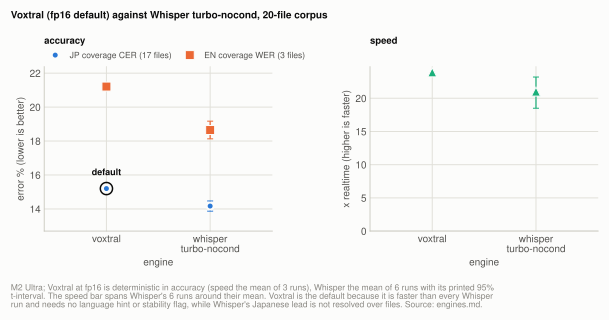
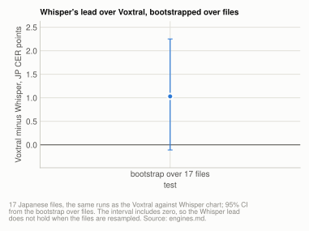
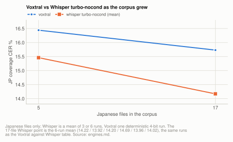
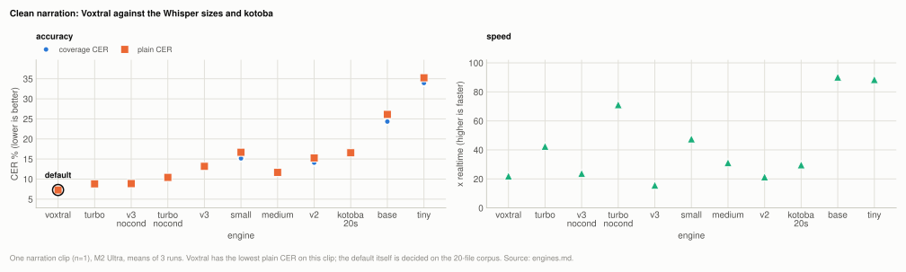
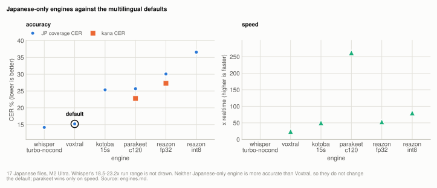

# Lever: which engine

`voxtral` is the default engine, and `large-v3` is Whisper's default size (since
2026-10-06; it ties turbo on the 20-file corpus and the tie goes to capacity). On the M2
Ultra, against Voxtral's fp16 default, Whisper with `condition_on_previous_text=False` is
about 1.0 point[^e1] ahead on Japanese. The rerun interval resolves that lead and neither
test over files does (bootstrap +1.03 points, CI [-0.11, +2.25][^e1]; 8 of 17 files won,
p=1.00)[^e1], so on Japanese the two engines tie. Against the 4-bit build Voxtral shipped
before, the bootstrap did resolve a 1.56-point lead[^e10]. That comparison was measured with large-v3-turbo, and since `large-v3` ties turbo,
the verdict is about the engine rather than one size. Voxtral is the default because it is
1.03-1.29x faster[^e1], needs no language hint and no long-form-stability flag, and reproduces
on a given machine. No "fastest on Apple Silicon" claim survives measurement.

Neither Japanese-specialized engine changes the default. Parakeet scores 25.68%[^e7]
coverage CER against turbo-nocond's 14.17%[^e1], losing on 16 of 17 files[^e7]; reazon-k2 fp32
scores 30.06%[^e7].

Settings and sweeps specific to one engine family are on that family's page:
[voxtral.md](engines/voxtral.md), [whisper.md](engines/whisper.md),
[kotoba.md](engines/kotoba.md), [qwen3-asr.md](engines/qwen3-asr.md),
[voxtral-v1.md](engines/voxtral-v1.md), [parakeet.md](engines/parakeet.md) and
[reazon.md](engines/reazon.md).

| setting | default | why |
|---|---|---|
| `--model` (engine family) | `voxtral` | 1.03-1.29x faster than turbo-nocond on the M2 Ultra, no language hint, no stability flag, deterministic on one machine; ties Whisper on Japanese over files (+1.03 points, CI [-0.11, +2.25]) |

Source: [ultra-voxtral-precision-default.json](../../benchmarks/results/2026-10/ultra-voxtral-precision-default.json) runs `vox_wfp16_c30b128_kv8`, `vox_wfp16_c30b128_kv8_r2`, `vox_wfp16_c30b128_kv8_r3`; [ultra-whisper-sizes.json](../../benchmarks/results/2026-10/ultra-whisper-sizes.json) runs `whisper_turbo_nocond`, `whisper_turbo_nocond_r2`, `whisper_turbo_nocond_r3`, `whisper_turbo_nocond_r4`, `whisper_turbo_nocond_r5`, `whisper_turbo_nocond_r6`

**Setup:** [20-file corpus](reference/corpus.md#the-20-file-corpus) (17 Japanese, 3 English, 8.01h[^e0]) for the comparisons, the [7-file subset](reference/corpus.md#the-7-file-subset) for the superseded tables, and [the single clip](reference/corpus.md#the-single-clip) for the narration comparison; M2 Ultra, scored by coverage CER/WER at `min_cut` 30/6 ([metrics.md](reference/metrics.md)).

## Experiment: Voxtral against Whisper

**Basis:** the [20-file corpus](reference/corpus.md#the-20-file-corpus), M2 Ultra, Voxtral at its shipped default there (fp16 weights, 30s b128 kv8, 3 runs) against Whisper `large-v3-turbo` with `condition_on_previous_text=False`, 6 Whisper runs.[^e1]

Measured on an `Apple M2 Ultra 128GB (Mac14,14)`. 20 recordings, 8.01h[^e0], 17 Japanese and
3 English. Voxtral at its default on that machine: fp16 weights, `--chunk-seconds 30
--max-batch 128 --kv-bits 8 --delay-ms 2400`; Whisper at `large-v3-turbo` with
`condition_on_previous_text=False` and the language taken per file from its reference.
Arms were run one at a time, never concurrently.

The Voxtral column replaces the 4-bit arm at 30s b32[^e10] that this table carried until the
default moved to fp16 on machines where it fits. That arm was measured 2026-08-06 and
re-measured 2026-08-19 after a reference-loading fix: 15.73% Japanese, 21.50% English,[^e10]
28.9x[^e10]. It is kept below where an experiment used it
([the Whisper margin as the corpus grew](#experiment-the-whisper-margin-as-the-corpus-grew),
[provenance](#provenance-of-the-voxtral-and-whisper-comparison)).

<picture>
  <source media="(prefers-color-scheme: dark)" srcset="img/engines-voxtral-whisper-dark.svg">
  
</picture>

**Table:** Voxtral against the six Whisper turbo-nocond runs on accuracy and speed, with the verdict per row.

| | Voxtral (deterministic) | turbo-nocond, 6 runs | verdict |
|---|---|---|---|
| JP coverage CER, 17 files | 15.20% | 14.22 / 13.92 / 14.20 / 14.69 / 13.96 / 14.02 -> **14.17% ±0.28** | CI [13.87, 14.47] entirely below -> **whisper** |
| EN coverage WER, 3 files | 21.21% | 18.62 / 18.34 / 18.18 / 19.31 / 19.20 / 18.25 -> **18.65% ±0.49** | CI [18.13, 19.17] entirely below -> **whisper** |
| x realtime | **23.9x** (mean of 3 runs, 23.7 to 24.0x) | 23.2 / 21.1 / 19.7 / 21.6 / 22.2 / 18.5x -> **21.0x** | **voxtral, ~1.1x** |

Source: [ultra-voxtral-precision-default.json](../../benchmarks/results/2026-10/ultra-voxtral-precision-default.json) runs `vox_wfp16_c30b128_kv8`, `vox_wfp16_c30b128_kv8_r2`, `vox_wfp16_c30b128_kv8_r3`; [ultra-whisper-sizes.json](../../benchmarks/results/2026-10/ultra-whisper-sizes.json) runs `whisper_turbo_nocond`, `whisper_turbo_nocond_r2`, `whisper_turbo_nocond_r3`, `whisper_turbo_nocond_r4`, `whisper_turbo_nocond_r5`, `whisper_turbo_nocond_r6`

Whisper wins accuracy on both units, in all 6 runs, with the whole interval below
Voxtral's fixed value. Voxtral is 1.03-1.29x faster depending on the Whisper run, since
Whisper's sampling ladder makes its own throughput vary by more than 20%[^e1]. Per file the
ordering is stable on three quarters of the corpus and not on the rest: Whisper wins 8 of
20 files in all 6 runs, loses 7 of 20 in all 6, and the other 5 change sign between
runs[^e1]. The aggregate lead therefore rests on 8 files, against 7 where Voxtral is ahead
in every run, which is why the tests over files below do not resolve it.

The method matters for the Whisper column. Its temperature-fallback ladder samples, so a
single run is a draw rather than a score; the interval above is a one-sample t-interval on
the Whisper mean with Voxtral as a constant, since only one side has sampling error
(`scripts/benchmarks/repeat_distribution.py`). Voxtral gets no error bar because greedy
decoding reproduces byte-identically on one machine: its three runs score identically, and
only their speed differs. See [determinism.md](reference/determinism.md).

Qwen3-ASR was added as a fourth engine on 2026-08-19 and is measured on the same 20 files
with the same scorers, at its 15s default window: 18.62% JP / 24.72% EN at 24.6x for the 1.7B, 22.31% / 22.95%[^e2] at
35.5x for the 0.6B (means of 3 runs).[^e2] Both are behind the two rows above on Japanese, so neither changes the
verdict here. Both are faster than Voxtral's fp16 default (23.9x)[^e1], the 1.7B narrowly; the 0.6B's three runs
span 33.8x to 36.5x[^e2]. Qwen3-ASR decodes
greedily, and it writes no subtitles. See [qwen3-asr.md](engines/qwen3-asr.md).

Voxtral v1 (Mini 3B and Small 24B, 2507) was added on 2026-09-25, same 20 files, same
scorers: 36.14% JP / 17.86% EN at 14.1x for the 3B at 8bit, 27.20% / 16.86%[^e3] at 3.4x for
the 24B at 8bit (means of 3 runs). Japanese is outside its card's eight languages and it is behind every
other multilingual row there; the 24B's English is the lowest measured, on three files. It
writes no subtitles. See [voxtral-v1.md](engines/voxtral-v1.md).

## Experiment: the generalization test over files

**Basis:** the 17 Japanese files of the [20-file corpus](reference/corpus.md#the-20-file-corpus), the same Voxtral runs and 6 Whisper runs as above, M2 Ultra.

The interval above answers "does this hold on a rerun", which is what
`repeat_distribution.py` is for. It contains no between-file uncertainty, so on its own it
cannot say whether the result would hold on different audio. That second question needs a
bootstrap over *files*. At Voxtral's fp16 default it does not resolve:

<picture>
  <source media="(prefers-color-scheme: dark)" srcset="img/engines-generalization-dark.svg">
  
</picture>

**Table:** four tests of whether Whisper's Japanese lead holds, from reruns to resampling over files, and the verdict of each.

| test | result | verdict |
|---|---|---|
| 6 repeat runs vs the fixed baseline | 6/6 beat it | whisper |
| run-distribution t-interval | [13.87, 14.47], below 15.20 | whisper |
| **bootstrap over 17 files** | **+1.03, CI [-0.11, +2.25]** (against the per-file mean of the 6 runs) | **tie** |
| sign test over files | 8 of 17 won, p=1.000 | tie |

Source: [ultra-voxtral-precision-default.json](../../benchmarks/results/2026-10/ultra-voxtral-precision-default.json) runs `vox_wfp16_c30b128_kv8`, `vox_wfp16_c30b128_kv8_r2`, `vox_wfp16_c30b128_kv8_r3`; [ultra-whisper-sizes.json](../../benchmarks/results/2026-10/ultra-whisper-sizes.json) runs `whisper_turbo_nocond`, `whisper_turbo_nocond_r2`, `whisper_turbo_nocond_r3`, `whisper_turbo_nocond_r4`, `whisper_turbo_nocond_r5`, `whisper_turbo_nocond_r6`

The two rerun tests resolve in Whisper's favour; the two tests over files do not: Voxtral
is ahead on 9 of the 17 files, and the bootstrap interval includes zero, its lower bound at
-0.11 points[^e1]. The file bootstrap is the test that answers the generalization question,
so at the fp16 default the Japanese result is a tie. Against the earlier 4-bit arm the same
bootstrap gave +1.56, CI [+0.24, +3.09][^e10], and the sign test 12 of 17 files, p=0.14[^e10]:
higher precision closed the resolved part of the gap.

## Experiment: the Whisper margin as the corpus grew

**Basis:** the Japanese files of the [7-file subset](reference/corpus.md#the-7-file-subset) (5) and the [20-file corpus](reference/corpus.md#the-20-file-corpus) (17), M2 Ultra, Voxtral at 4-bit, 30s b32 kv8 (the earlier default arm) against Whisper turbo-nocond (3 or 6 runs).[^e4]

<picture>
  <source media="(prefers-color-scheme: dark)" srcset="img/engines-corpus-size-dark.svg">
  
</picture>

**Table:** Japanese coverage CER for both engines at each corpus size, with the Whisper run spread and whether the gap is resolvable.

| corpus | JP files | voxtral | turbo-nocond | verdict |
|---|---|---|---|---|
| original | 5 | 16.44% | 15.46% ±0.73 (n=3) | not resolvable |
| final | 17 | 15.73% | 14.17% ±0.28 (n=6) | whisper better, and resolved over files |

Source: [ultra-mincut-inputs.json](../../benchmarks/results/2026-10/ultra-mincut-inputs.json) runs `mincut7_vox_c30b32_kv8`, `mincut7_whisper_turbo_nocond`; [ultra-whisper-condition.json](../../benchmarks/results/2026-10/ultra-whisper-condition.json) runs `cond7_whisper_turbo_nocond_r2`, `cond7_whisper_turbo_nocond_r3`; [ultra-voxtral-batch.json](../../benchmarks/results/2026-10/ultra-voxtral-batch.json) runs `c30b32`, `c30b32_r2`, `c30b32_r3`; [ultra-voxtral-headline.json](../../benchmarks/results/2026-10/ultra-voxtral-headline.json) runs `vox_default_c30b32_kv8`; [ultra-whisper-sizes.json](../../benchmarks/results/2026-10/ultra-whisper-sizes.json) runs `whisper_turbo_nocond`, `whisper_turbo_nocond_r2`, `whisper_turbo_nocond_r3`, `whisper_turbo_nocond_r4`, `whisper_turbo_nocond_r5`, `whisper_turbo_nocond_r6`

The ordering held at every corpus size and only became resolvable as n grew. Voxtral's own
number barely moved (16.44 -> 15.73)[^e4] while the corpus more than tripled, which
says the original 5 files were not unrepresentative. What changed is the *resolution*
rather than the estimate. That is the argument for more audio rather than more reruns.
This experiment used the 4-bit arm; at the fp16 default the 17-file gap is not resolved
over files ([above](#experiment-the-generalization-test-over-files)).

## Experiment: clean narration

**Basis:** [one clip](reference/corpus.md#the-single-clip), M2 Ultra, Voxtral at 60s b16 kv8 against the Whisper sizes and kotoba-whisper, 3 runs each.[^e5]

The same models on the single narration clip, where the reference is complete:

<picture>
  <source media="(prefers-color-scheme: dark)" srcset="img/engines-narration-dark.svg">
  
</picture>

**Table:** coverage CER, plain CER and speed of each engine on the single narration clip (means of 3 runs).

| engine | coverage CER | plain CER | x realtime |
|---|---|---|---|
| **voxtral (M2 Ultra 128GB, 60s b16 kv8)** | 7.28% | **7.28%** | 22.0x |
| whisper large-v3-turbo | 8.81% | 8.81% | 42.5x |
| whisper large-v3, no-condition | 8.87% | 8.87% | 23.8x |
| whisper large-v3-turbo, no-condition | 10.42% | 10.42% | 71.2x |
| whisper large-v3 | 13.17% | 13.17% | 15.7x |
| whisper small | 15.16% | 16.68% | 47.6x |
| whisper medium | 11.66% | 11.66% | 31.2x |
| whisper large-v2 | 14.09% | 15.26% | 21.4x |
| kotoba-whisper v2.2, chunk 20s | 16.55% | 16.55% | 29.7x |
| whisper base | 24.33% | 26.11% | 90.2x |
| whisper tiny | 33.94% | 35.25% | 88.5x |

Source: [ultra-engines-narration.json](../../benchmarks/results/2026-10/ultra-engines-narration.json) runs `clip_vox_c60b16_kv8_r1`, `clip_vox_c60b16_kv8_r2`, `clip_vox_c60b16_kv8_r3`, `clip_whisper_large-v3_nocond_r1`, `clip_whisper_large-v3_nocond_r2`, `clip_whisper_large-v3_nocond_r3`, `clip_whisper_turbo_nocond_r1`, `clip_whisper_turbo_nocond_r2`, `clip_whisper_turbo_nocond_r3`, `clip_whisper_small_libdef_r1`, `clip_whisper_small_libdef_r2`, `clip_whisper_small_libdef_r3`, `clip_whisper_medium_libdef_r1`, `clip_whisper_medium_libdef_r2`, `clip_whisper_medium_libdef_r3`, `clip_whisper_large-v2_libdef_r1`, `clip_whisper_large-v2_libdef_r2`, `clip_whisper_large-v2_libdef_r3`, `clip_whisper_base_libdef_r1`, `clip_whisper_base_libdef_r2`, `clip_whisper_base_libdef_r3`, `clip_whisper_tiny_libdef_r1`, `clip_whisper_tiny_libdef_r2`, `clip_whisper_tiny_libdef_r3`; [ultra-whisper-runners.json](../../benchmarks/results/2026-10/ultra-whisper-runners.json) runs `rn_mlx_turbo_r1`, `rn_mlx_turbo_r2`, `rn_mlx_turbo_r3`, `rn_mlx_large-v3_r1`, `rn_mlx_large-v3_r2`, `rn_mlx_large-v3_r3`; [ultra-kotoba-engines-clip.json](../../benchmarks/results/2026-10/ultra-kotoba-engines-clip.json) runs `kclip_hf22_c20_r1`, `kclip_hf22_c20_r2`, `kclip_hf22_c20_r3`

On clean narration Voxtral has the lowest CER: 7.28% against 8.81% for turbo at library defaults[^e5],
and turbo is faster on this clip. This is n=1. `--no-condition` moves the two
large Whisper models in opposite directions here: it raises turbo from 8.81% to 10.42%[^e5] and
lowers large-v3 from 13.17% to 8.87%[^e5]. On one clip that is not evidence about clean
audio in general; on the long spontaneous files the flag lowers both
([whisper.md](engines/whisper.md#experiment-condition_on_previous_textfalse)).

## Experiment: the Japanese-only engines against the multilingual defaults

**Basis:** the 17 Japanese files of the [20-file corpus](reference/corpus.md#the-20-file-corpus), M2 Ultra, the four arms below beside the multilingual rows from [Voxtral against Whisper](#experiment-voxtral-against-whisper) and [kotoba.md](engines/kotoba.md).

**Table:** the four Japanese-only arms, their weights and windows, and why each was run.

| arm | config | notes |
|---|---|---|
| `parakeet_c120` | `mlx-community/parakeet-tdt_ctc-0.6b-ja`, 120s windows, 2s overlap | the default window, and the measured winner ([parakeet.md](engines/parakeet.md)) |
| `parakeet_c300` | same weights, 300s windows | run to test the one-file tie; it reversed sign |
| `reazon fp32 c30` | authors' ONNX, fp32 encoder/decoder/joiner, 30s energy-minima windows | the default |
| `reazon int8 c30` | same, int8 files | measured to test the quantization ([reazon.md](engines/reazon.md)) |

<picture>
  <source media="(prefers-color-scheme: dark)" srcset="img/engines-japanese-only-dark.svg">
  
</picture>

**Table:** Japanese coverage CER, kana CER, speed and peak memory of the Japanese-only engines beside the multilingual rows.

| engine | JP coverage CER | kana CER | x realtime | peak |
|---|---|---|---|---|
| whisper-turbo no-cond (6-run mean) | **14.17%** | - | 18.5-23.2x | 5.53GB |
| voxtral | 15.20% | - | 23.9x | - |
| kotoba chunk15s | 25.34% | - | 50.0x | - |
| **parakeet c120** | 25.68% | 22.79% | **261.8x** | 4.77GB |
| **reazon-k2 fp32 c30** | 30.06% | 27.29% | 52.9x | 3.28GB RSS |
| reazon-k2 int8 c30 | 36.55% | - | 79.9x | 2.72GB RSS |

Source: [ultra-whisper-sizes.json](../../benchmarks/results/2026-10/ultra-whisper-sizes.json) runs `whisper_turbo_nocond`, `whisper_turbo_nocond_r2`, `whisper_turbo_nocond_r3`, `whisper_turbo_nocond_r4`, `whisper_turbo_nocond_r5`, `whisper_turbo_nocond_r6`; [ultra-voxtral-precision-default.json](../../benchmarks/results/2026-10/ultra-voxtral-precision-default.json) runs `vox_wfp16_c30b128_kv8`, `vox_wfp16_c30b128_kv8_r2`, `vox_wfp16_c30b128_kv8_r3`; [ultra-kotoba-engines.json](../../benchmarks/results/2026-10/ultra-kotoba-engines.json) runs `k20_mlx_c15_r1`, `k20_mlx_c15_r2`, `k20_mlx_c15_r3`; [ultra-picker-speed.json](../../benchmarks/results/2026-10/ultra-picker-speed.json) runs `pk_parakeet_default_s1`, `pk_parakeet_default_s2`, `pk_parakeet_default_s3`; [ultra-picker-speed.json](../../benchmarks/results/2026-10/ultra-picker-speed.json) runs `pk_reazon_fp32_default_s1`, `pk_reazon_fp32_default_s2`, `pk_reazon_fp32_default_s3`; [ultra-engines-jp-only.json](../../benchmarks/results/2026-10/ultra-engines-jp-only.json) runs `jp_reazon_int8_c30_r1`, `jp_reazon_int8_c30_r2`, `jp_reazon_int8_c30_r3`, `jp_reazon_fp32_c30_rss` (means of the runs; the separate fp32 RSS run peaked at 3.08GB)

Kana CER is reported beside coverage CER because both models' text style
(punctuation, numerals) differs from an editorial reference without the transcription
being wrong. Both engines decode greedily.

Per file against turbo (17 common files, per-file mean of the 6 runs): parakeet wins once, by 2.3 points[^e7] on the
prepared-narration-style `bb5cf5d5b247`, and loses everywhere else by 0.1 to 22.3 points[^e7]
(mean +10.0). Reazon wins none of the 17 and loses by 1.2 to 25.6 points (mean +14.1)[^e7].
The losses are not concentrated in one or two files that could be excluded as
pathological: they are the shape of the whole corpus.

Parakeet decodes 6.85h of audio in 94 seconds.[^e7] For a rough transcript of everything
as fast as possible, nothing measured here comes close. For subtitles worth
publishing, turbo remains the accuracy pick and parakeet is not close enough to trade.

## How it works

`scripts/benchmarks/run_whisper.py` scores with the *same* functions `run_corpus.py` uses,
on the *same* cached 16kHz files (verified byte-identical to what the Voxtral runs read),
so rows sit next to each other without an asterisk. Engine: `mlx-whisper` 0.4.3.

Whisper is run at library defaults (temperature ladder 0.0-1.0,
`condition_on_previous_text=True`) unless a row says otherwise, because that is what
`mlx_whisper.transcribe` gives a user. Paired comparisons bootstrap over files,
length-weighted, 20k resamples (`scripts/benchmarks/compare_engines.py`).

Whisper samples, so a single run is a draw from a distribution; see
[determinism.md](reference/determinism.md) for why the headline uses the mean of 6 runs.

### Provenance of the Voxtral and Whisper comparison

Both columns are re-measured and both result files record the machine and its state. This
closes the gap an earlier version of this page described: the numbers had come from a
single session with no surviving result file, and a re-run attempted earlier on 2026-08-06
was voided.

Two things the re-measurement establishes beyond the comparison itself. Voxtral's Japanese
accuracy (the 4-bit arm) reproduced the earlier session **exactly** (16.22% as recorded, which includes the superseded copy of one file; 15.73% over the valid rows)[^e8], across three separate sessions
and two reference-loader versions, which is evidence that the voided session's accuracy work
was sound even though its timings were not. Whisper's accuracy did not reproduce exactly,
and is not expected to: its Japanese mean moved between earlier sessions, and reads
13.92% to 14.69% across the six saved runs[^e10]. Run-to-run variation is the behaviour that requires several runs in the first place.

The English figures moved for a different and non-statistical reason: a reference-loading
defect fixed on 2026-08-19. Reference lines were joined with no separator, so on the
word-level path the last word of each line fused to the first of the next. One
subtitle-shaped reference carried 131 such fusions and scored far worse than its correct
3.29%[^e10]; with the fix the 4-bit Voxtral English aggregate reads 21.50%[^e10] and Whisper's
18.65%[^e10], both lower than before. Japanese could not be affected, having no word spaces. Every English
number published before that date is superseded; see [metrics.md](reference/metrics.md).

Throughput changed more than accuracy did. The 4-bit Voxtral arm measured 27.6-30.0x[^e10] and Whisper
18.5-23.2x[^e10], both faster than the earlier figures. The previous figures came from the
session with no recorded machine state, so the cause of the difference cannot be checked.
That is the argument for recording state automatically
rather than noting it by hand, which the runners now do.

### Why the default is Voxtral

`voxtral` is the default because, against Whisper's nominal 1.0-point Japanese lead that the
tests over files do not resolve[^e1], it is faster (1.03-1.29x on the M2 Ultra), needs no language hint, needs no stability flag, has better-behaved
timestamps ([timestamps.md](timestamps.md)), and reproduces on a given machine
([determinism.md](reference/determinism.md)). Whisper is one flag away for anyone who wants the
accuracy.

The two `qwen3-asr` aliases are available without displacing anything. On Japanese the 1.7B
is behind Whisper and Voxtral and ahead of the 0.6B and both Voxtral v1 sizes[^e2][^e3]; the 0.6B
runs at 35.5x in 2.07GB[^e2], faster than Voxtral's 23.9x at fp16[^e1] in far less memory, which is the case for
keeping it. Both refuse `-f srt`.

### Domain match and the Japanese-only engines

**Relation to the fine-tuning question.** These two engines are the strongest open
evidence this project has against the "just fine-tune on domain data" hypothesis from
the corpus side: parakeet-ja was trained on tens of thousands of hours of naturalistic
Japanese including spontaneous speech, which is exactly this corpus's material, and
still scores 11.5 points[^e7] behind a multilingual Whisper checkpoint in our harness. On
this corpus, domain match alone did not produce the more accurate engine; which other
properties account for the gap was not measured.

## Superseded

### The 7-file paired comparisons

Replaced by the [generalization test](#experiment-the-generalization-test-over-files) on 17 Japanese files.
Paired against Voxtral (the per-file mean where a config has several runs), positive meaning Whisper is worse:

**Table:** each Whisper configuration paired against Voxtral on the 7-file subset, as differences with 95% CIs (positive means Whisper is worse). <!-- not-measured: 95% is the confidence level of the intervals -->

| comparison | JP diff | 95% CI | EN diff | 95% CI |
|---|---|---|---|---|
| turbo-nocond | -0.98 | [-4.37, +1.18] | -3.98 | [-6.71, +2.38] |
| large-v3-nocond | +1.29 | [-2.14, +4.73] | -4.10 | [-7.34, +3.45] |
| turbo (defaults) | **+18.11** | [+4.42, +27.37] | **-2.77** | [-3.08, -2.06] |
| large-v2 | **+23.04** | [+13.47, +27.81] | +0.07 | [-0.38, +1.12] |
| large-v3 | **+16.95** | [+11.39, +24.07] | **+2.35** | [+1.10, +5.25] |
| medium | **+17.99** | [+12.46, +28.71] | **-1.35** | [-1.86, -0.17] |
| small | **+13.63** | [+6.55, +17.83] | -0.74 | [-2.54, +3.43] |
| base | **+17.24** | [+13.70, +19.44] | **+5.47** | [+3.28, +10.57] |
| tiny | **+35.35** | [+23.71, +47.14] | **+14.13** | [+9.21, +25.58] |
| turbo, autodetect | **+42.77** | [+28.33, +48.50] | -3.77 | [-6.23, +1.97] |

Source: [ultra-mincut-inputs.json](../../benchmarks/results/2026-10/ultra-mincut-inputs.json) runs `mincut7_vox_c30b32_kv8`, `mincut7_whisper_turbo_nocond`, `mincut7_whisper_large-v3_nocond`, `mincut7_whisper_turbo_libdef`, `mincut7_whisper_large-v3_libdef`, `mincut7_whisper_medium_libdef`; [ultra-whisper-condition.json](../../benchmarks/results/2026-10/ultra-whisper-condition.json) runs `cond7_whisper_turbo_nocond_r2`, `cond7_whisper_turbo_nocond_r3`, `cond7_whisper_large-v3_nocond_r2`, `cond7_whisper_large-v3_nocond_r3`, `cond7_whisper_turbo_libdef_r2`, `cond7_whisper_turbo_libdef_r3`, `cond7_whisper_large-v3_libdef_r2`, `cond7_whisper_large-v3_libdef_r3`; [ultra-whisper-language.json](../../benchmarks/results/2026-10/ultra-whisper-language.json) runs `lang7_turbo_autodetect_r1`, `lang7_turbo_autodetect_r2`, `lang7_turbo_autodetect_r3`; [ultra-whisper-sizes-7file.json](../../benchmarks/results/2026-10/ultra-whisper-sizes-7file.json) runs `w7_large-v2_libdef_r1`, `w7_large-v2_libdef_r2`, `w7_large-v2_libdef_r3`, `w7_small_libdef_r1`, `w7_small_libdef_r2`, `w7_small_libdef_r3`, `w7_base_libdef_r1`, `w7_base_libdef_r2`, `w7_base_libdef_r3`, `w7_tiny_libdef_r1`, `w7_tiny_libdef_r2`, `w7_tiny_libdef_r3`

**At library defaults, Voxtral is ahead of every Whisper size on Japanese**, each with a
CI clear of zero[^e6]. That is the
default-versus-default result, and it is mostly a statement about Whisper's defaults on
long-form audio (see [`condition_on_previous_text=False`](engines/whisper.md#experiment-condition_on_previous_textfalse)).

**On English the resolved rows put Voxtral behind** turbo at library defaults (2.77
points[^e6]) and medium (1.35 points[^e6], at 0.68x the speed). The two no-condition rows are
nominally further ahead of Voxtral (3.98 and 4.10 points[^e6]) but their intervals cross zero,
so they are not resolved. The English side is n=2 here, n=3 in the final corpus, so treat it
as a direction rather than a magnitude.

The 7-file size and engine table these comparisons were drawn from is on
[whisper.md](engines/whisper.md#the-7-file-size-and-engine-table).

## Not settled

The English side is n=3. The clean-narration comparison is n=1.

## Related

- [voxtral.md](engines/voxtral.md): the default engine, and the levers that apply to it
- [whisper.md](engines/whisper.md): every Whisper size, `condition_on_previous_text`, the language hint and the competing runners
- [kotoba.md](engines/kotoba.md): kotoba-whisper's driver and window length
- [qwen3-asr.md](engines/qwen3-asr.md) and [voxtral-v1.md](engines/voxtral-v1.md): the other multilingual engine families
- [parakeet.md](engines/parakeet.md) and [reazon.md](engines/reazon.md): the Japanese-only engines
- [corpus.md](reference/corpus.md): the 20-file corpus, the 7-file subset and the single clip
- [metrics.md](reference/metrics.md): coverage CER/WER and the 2026-08-19 reference-loader fix
- [determinism.md](reference/determinism.md): why Whisper needs 3 runs and Voxtral one
- [timestamps.md](timestamps.md): timestamp behaviour by engine

[^e0]: [corpus.json](../../benchmarks/results/corpus.json)
[^e1]: [ultra-voxtral-precision-default.json](../../benchmarks/results/2026-10/ultra-voxtral-precision-default.json) runs `vox_wfp16_c30b128_kv8`, `vox_wfp16_c30b128_kv8_r2`, `vox_wfp16_c30b128_kv8_r3`; [ultra-whisper-sizes.json](../../benchmarks/results/2026-10/ultra-whisper-sizes.json) runs `whisper_turbo_nocond`, `whisper_turbo_nocond_r2`, `whisper_turbo_nocond_r3`, `whisper_turbo_nocond_r4`, `whisper_turbo_nocond_r5`, `whisper_turbo_nocond_r6` (paired on the per-file mean of each side's runs, bootstrap over files, 20000 resamples, seed 0)
[^e2]: [ultra-picker-speed.json](../../benchmarks/results/2026-10/ultra-picker-speed.json) runs `pk_qwen3_1.7B_8bit_c15_s1`, `pk_qwen3_1.7B_8bit_c15_s2`, `pk_qwen3_1.7B_8bit_c15_s3`, `pk_qwen3_0.6B_8bit_c15_s1`, `pk_qwen3_0.6B_8bit_c15_s2`, `pk_qwen3_0.6B_8bit_c15_s3`
[^e3]: [ultra-picker-speed.json](../../benchmarks/results/2026-10/ultra-picker-speed.json) runs `pk_v1_3B_8bit_c30_s1`, `pk_v1_3B_8bit_c30_s2`, `pk_v1_3B_8bit_c30_s3`; [ultra-picker-speed-24b.json](../../benchmarks/results/2026-10/ultra-picker-speed-24b.json) runs `pk_v1_24B_8bit_c30_s1`, `pk_v1_24B_8bit_c30_s2`, `pk_v1_24B_8bit_c30_s3`
[^e4]: [ultra-mincut-inputs.json](../../benchmarks/results/2026-10/ultra-mincut-inputs.json) runs `mincut7_vox_c30b32_kv8`, `mincut7_whisper_turbo_nocond`; [ultra-whisper-condition.json](../../benchmarks/results/2026-10/ultra-whisper-condition.json) runs `cond7_whisper_turbo_nocond_r2`, `cond7_whisper_turbo_nocond_r3`; [ultra-voxtral-batch.json](../../benchmarks/results/2026-10/ultra-voxtral-batch.json) runs `c30b32`, `c30b32_r2`, `c30b32_r3`; [ultra-voxtral-headline.json](../../benchmarks/results/2026-10/ultra-voxtral-headline.json) runs `vox_default_c30b32_kv8`; [ultra-whisper-sizes.json](../../benchmarks/results/2026-10/ultra-whisper-sizes.json) runs `whisper_turbo_nocond`, `whisper_turbo_nocond_r2`, `whisper_turbo_nocond_r3`, `whisper_turbo_nocond_r4`, `whisper_turbo_nocond_r5`, `whisper_turbo_nocond_r6`
[^e5]: [ultra-engines-narration.json](../../benchmarks/results/2026-10/ultra-engines-narration.json) runs `clip_vox_c60b16_kv8_r1`, `clip_vox_c60b16_kv8_r2`, `clip_vox_c60b16_kv8_r3`, `clip_whisper_large-v3_nocond_r1`, `clip_whisper_large-v3_nocond_r2`, `clip_whisper_large-v3_nocond_r3`, `clip_whisper_turbo_nocond_r1`, `clip_whisper_turbo_nocond_r2`, `clip_whisper_turbo_nocond_r3`, `clip_whisper_small_libdef_r1`, `clip_whisper_small_libdef_r2`, `clip_whisper_small_libdef_r3`, `clip_whisper_medium_libdef_r1`, `clip_whisper_medium_libdef_r2`, `clip_whisper_medium_libdef_r3`, `clip_whisper_large-v2_libdef_r1`, `clip_whisper_large-v2_libdef_r2`, `clip_whisper_large-v2_libdef_r3`, `clip_whisper_base_libdef_r1`, `clip_whisper_base_libdef_r2`, `clip_whisper_base_libdef_r3`, `clip_whisper_tiny_libdef_r1`, `clip_whisper_tiny_libdef_r2`, `clip_whisper_tiny_libdef_r3`; [ultra-whisper-runners.json](../../benchmarks/results/2026-10/ultra-whisper-runners.json) runs `rn_mlx_turbo_r1`, `rn_mlx_turbo_r2`, `rn_mlx_turbo_r3`, `rn_mlx_large-v3_r1`, `rn_mlx_large-v3_r2`, `rn_mlx_large-v3_r3`; [ultra-kotoba-engines-clip.json](../../benchmarks/results/2026-10/ultra-kotoba-engines-clip.json) runs `kclip_hf22_c20_r1`, `kclip_hf22_c20_r2`, `kclip_hf22_c20_r3`
[^e6]: [ultra-mincut-inputs.json](../../benchmarks/results/2026-10/ultra-mincut-inputs.json) runs `mincut7_vox_c30b32_kv8`, `mincut7_whisper_turbo_nocond`, `mincut7_whisper_large-v3_nocond`, `mincut7_whisper_turbo_libdef`, `mincut7_whisper_large-v3_libdef`, `mincut7_whisper_medium_libdef`; [ultra-whisper-condition.json](../../benchmarks/results/2026-10/ultra-whisper-condition.json) runs `cond7_whisper_turbo_nocond_r2`, `cond7_whisper_turbo_nocond_r3`, `cond7_whisper_large-v3_nocond_r2`, `cond7_whisper_large-v3_nocond_r3`, `cond7_whisper_turbo_libdef_r2`, `cond7_whisper_turbo_libdef_r3`, `cond7_whisper_large-v3_libdef_r2`, `cond7_whisper_large-v3_libdef_r3`; [ultra-whisper-language.json](../../benchmarks/results/2026-10/ultra-whisper-language.json) runs `lang7_turbo_autodetect_r1`, `lang7_turbo_autodetect_r2`, `lang7_turbo_autodetect_r3`; [ultra-whisper-sizes-7file.json](../../benchmarks/results/2026-10/ultra-whisper-sizes-7file.json) runs `w7_large-v2_libdef_r1`, `w7_large-v2_libdef_r2`, `w7_large-v2_libdef_r3`, `w7_small_libdef_r1`, `w7_small_libdef_r2`, `w7_small_libdef_r3`, `w7_base_libdef_r1`, `w7_base_libdef_r2`, `w7_base_libdef_r3`, `w7_tiny_libdef_r1`, `w7_tiny_libdef_r2`, `w7_tiny_libdef_r3`
[^e7]: [ultra-picker-speed.json](../../benchmarks/results/2026-10/ultra-picker-speed.json) runs `pk_parakeet_default_s1`, `pk_parakeet_default_s2`, `pk_parakeet_default_s3`; [ultra-picker-speed.json](../../benchmarks/results/2026-10/ultra-picker-speed.json) runs `pk_reazon_fp32_default_s1`, `pk_reazon_fp32_default_s2`, `pk_reazon_fp32_default_s3`; [ultra-whisper-sizes.json](../../benchmarks/results/2026-10/ultra-whisper-sizes.json) runs `whisper_turbo_nocond`, `whisper_turbo_nocond_r2`, `whisper_turbo_nocond_r3`, `whisper_turbo_nocond_r4`, `whisper_turbo_nocond_r5`, `whisper_turbo_nocond_r6`; [corpus.json](../../benchmarks/results/corpus.json)
[^e8]: [ultra-voxtral-batch.json](../../benchmarks/results/2026-10/ultra-voxtral-batch.json) runs `c30b32` (the run's recorded aggregate, which includes the row measured on the superseded copy)
[^e10]: [ultra-voxtral-batch.json](../../benchmarks/results/2026-10/ultra-voxtral-batch.json) runs `c30b32`, `c30b32_r2`, `c30b32_r3`; [ultra-voxtral-headline.json](../../benchmarks/results/2026-10/ultra-voxtral-headline.json) runs `vox_default_c30b32_kv8`; [ultra-whisper-sizes.json](../../benchmarks/results/2026-10/ultra-whisper-sizes.json) runs `whisper_turbo_nocond`, `whisper_turbo_nocond_r2`, `whisper_turbo_nocond_r3`, `whisper_turbo_nocond_r4`, `whisper_turbo_nocond_r5`, `whisper_turbo_nocond_r6` (the earlier 4-bit arm at 30s b32)
