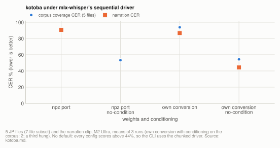
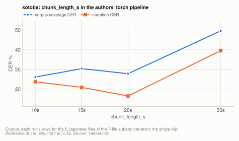
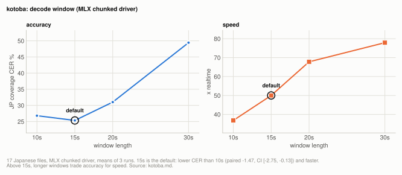

# Engine: kotoba-whisper

kotoba-whisper runs through the MLX chunked driver with 15s windows, where it scores
25.34% coverage CER on the 17 Japanese files at 50.0x (means of 3 runs)[^k3], behind both Voxtral and Whisper
turbo-nocond ([engines.md](../engines.md)). That is 1.47 points[^k3] better than the previous 10s
window (26.81% at 36.8x; paired -1.47, CI [-2.75, -0.13])[^k3]. On the same 17 files the authors'
transformers pipeline ties it at 15s (26.09%; MLX minus pipeline -0.75, CI [-3.71, +2.35])[^k5],
and at its own best window, 10s, scores 24.48%, also a tie (paired -0.86, CI [-2.29, +0.73])[^k6]
at 0.4x the speed (21.8x)[^k6]. The driver matters more than the weights: the
same checkpoint under mlx-whisper's sequential driver scores 93.83%[^k9] on the 5 Japanese files
of the [7-file subset](../reference/corpus.md#the-7-file-subset) (two runs, 92.13%[^k9] and
95.53%; a third run did not finish one file in 5 hours and was stopped)[^k9], because a
2-layer distil decoder cannot carry state across windows. Window length is this engine's largest
setting: on the 17 files it spans 24.1 points through the MLX driver[^k5]
and 21.0 through the pipeline[^k5], and its optimum depends on the material. The registry uses
v2.0, converted to MLX on first use, since its ASR weights are bit-identical to v2.2.

| setting | default | why |
|---|---|---|
| kotoba driver | chunked, 15s windows (MLX) | 25.34% against 26.81% at 10s (paired -1.47, CI [-2.75, -0.13]), 31.02% at 20s and 49.42% at 30s, and faster than 10s (50.0x against 36.8x); the sequential driver scores 93.83% (on 5 files, 2 runs; a third hung) |
| kotoba checkpoint | v2.0, converted on first use | bit-identical ASR weights to v2.2 |

Source: [ultra-kotoba-windows.json](../../../benchmarks/results/2026-10/ultra-kotoba-windows.json) runs `pk_kotoba_c10_s1`, `pk_kotoba_c10_s2`, `pk_kotoba_c10_s3`, `kw_kotoba_c20`, `kw_kotoba_c20_r2`, `kw_kotoba_c20_r3`, `kw_kotoba_c30`, `kw_kotoba_c30_r2`, `kw_kotoba_c30_r3`; [ultra-kotoba-engines.json](../../../benchmarks/results/2026-10/ultra-kotoba-engines.json) runs `k20_mlx_c15_r1`, `k20_mlx_c15_r2`, `k20_mlx_c15_r3`; [ultra-kotoba-sequential.json](../../../benchmarks/results/2026-10/ultra-kotoba-sequential.json) runs `kseq_off_cond_r1`, `kseq_off_cond_r2` (means of 3 runs, paired over the 17 files on the per-file means; the sequential figure is the mean of 2 runs)

**Setup:** the 17 Japanese files of the [20-file corpus](../reference/corpus.md#the-20-file-corpus) for the MLX chunked driver and the authors' pipeline, the 5 Japanese files of the [7-file subset](../reference/corpus.md#the-7-file-subset) for the sequential driver and the first pipeline sweep, plus the narration on [the single clip](../reference/corpus.md#the-single-clip) for the runner and window comparisons; M2 Ultra, scored by coverage CER at `min_cut` 30 ([metrics.md](../reference/metrics.md)).

## Experiment: kotoba runner and chunk length

**Basis:** the 5 Japanese files of the [7-file subset](../reference/corpus.md#the-7-file-subset) (the whole corpus at the time) and the narration on [one clip](../reference/corpus.md#the-single-clip), M2 Ultra, kotoba-whisper under mlx-whisper's sequential driver and the authors' chunked pipeline. Every "corpus" figure in this section's tables is a 5-file aggregate; the 17-file comparison of windows is cited from the next experiment's runs.

Under `mlx-whisper`'s sequential driver this Japanese-finetuned distil model scores 91.31%[^k10]
coverage CER (the third-party npz port, mean of 3 runs, 89.54% to 93.24%)[^k10]. That figure
reflects our harness rather than the model: `mlx-whisper`'s long-form algorithm is a poor
match for a distil checkpoint. Running it through a chunked driver, as its authors document,
recovers most of the difference: on the same 5 Japanese files, the sequential driver with the
mlx_asr conversion (93.83%, 2 runs) is 63.9 points[^k11] behind the MLX chunked driver at 10s
(29.97%, 3 runs; paired CI [+63.11, +64.99])[^k11] and 67.7 points behind the authors' pipeline at
10s (26.15%; CI [+62.46, +70.17])[^k11]. Recorded here because
the same mistake is easy to make with any model whose published recipe differs from your
preferred runtime.

<picture>
  <source media="(prefers-color-scheme: dark)" srcset="../img/kotoba-sequential-dark.svg">
  
</picture>

**Table:** kotoba-whisper under mlx-whisper's sequential driver, by weight source and `condition_on_previous_text`; corpus CER on 5 Japanese files, plus the narration clip (means of 3 runs; the own conversion with conditioning on the corpus, 2 runs).

| what was run | corpus coverage CER | narration | extra_ratio | engine |
|---|---|---|---|---|
| third-party npz port | 91.31% | 90.58% | 0.11 | mlx-whisper (sequential) |
| same, `--no-condition` | 53.26% | - | 1.07 | mlx-whisper |
| official weights, own MLX conversion | 93.83% | 86.69% | 0.09 | mlx-whisper |
| same, `--no-condition` | 54.32% | 44.31% | 1.07 | mlx-whisper |

Source: [ultra-kotoba-sequential.json](../../../benchmarks/results/2026-10/ultra-kotoba-sequential.json) runs `kseq_npz_cond_r1`, `kseq_npz_cond_r2`, `kseq_npz_cond_r3`, `kseq_npz_nocond_r1`, `kseq_npz_nocond_r2`, `kseq_npz_nocond_r3`, `kseq_off_cond_r1`, `kseq_off_cond_r2`, `kseq_off_nocond_r1`, `kseq_off_nocond_r2`, `kseq_off_nocond_r3`, `kseqclip_npz_cond_r1`, `kseqclip_npz_cond_r2`, `kseqclip_npz_cond_r3`, `kseqclip_off_cond_r1`, `kseqclip_off_cond_r2`, `kseqclip_off_cond_r3`, `kseqclip_off_nocond_r1`, `kseqclip_off_nocond_r2`, `kseqclip_off_nocond_r3` (extra_ratio: the corpus run's hypothesis characters over its reference characters, summed over the 5 files, mean of the runs)

With conditioning the runs vary widely, as sampling on fallback makes them: on the corpus
89.54% to 93.24% for the npz port and 92.13% to 95.53% for the own conversion[^k9], on the clip
85.59% to 98.12% and 80.02% to 95.77%; without conditioning 50.09% to 56.57% on the corpus[^k9]
and 43.90% to 44.64% on the clip[^k9]. A third corpus run of the own conversion with
conditioning did not finish one file in 5 hours and was stopped, so it is not saved;
under this driver, with conditioning, a run can fail to terminate.

<picture>
  <source media="(prefers-color-scheme: dark)" srcset="../img/engines-kotoba-authors-chunk-dark.svg">
  
</picture>

**Table:** kotoba-whisper through the authors' chunked transformers pipeline at four `chunk_length_s` values; corpus CER on the same 5 Japanese files, plus the narration clip.

| what was run | corpus coverage CER | narration | extra_ratio | engine |
|---|---|---|---|---|
| official pipeline, `chunk_length_s=30` | 49.57% | 39.52% | 1.29 | transformers (chunked) |
| official pipeline, `chunk_length_s=20` | 27.82% | **16.55%** | 1.35 | transformers |
| official pipeline, `chunk_length_s=15` | 30.40% | 20.88% | 1.37 | transformers |
| official pipeline, `chunk_length_s=10` | **26.15%** | 23.71% | 1.40 | transformers |

Source: [ultra-kotoba-engines.json](../../../benchmarks/results/2026-10/ultra-kotoba-engines.json) runs `k20_hf22_c10_r1`, `k20_hf22_c15_r1`, `k20_hf22_c15_r2`, `k20_hf22_c15_r3`, `k20_hf22_c20_r1`, `k20_hf22_c30_r1`; [ultra-kotoba-engines-clip.json](../../../benchmarks/results/2026-10/ultra-kotoba-engines-clip.json) runs `kclip_hf22_c10_r1`, `kclip_hf22_c10_r2`, `kclip_hf22_c10_r3`, `kclip_hf22_c15_r1`, `kclip_hf22_c15_r2`, `kclip_hf22_c15_r3`, `kclip_hf22_c20_r1`, `kclip_hf22_c20_r2`, `kclip_hf22_c20_r3`, `kclip_hf22_c30_r1`, `kclip_hf22_c30_r2`, `kclip_hf22_c30_r3` (corpus columns over the 5 Japanese files of the 7-file subset; at 15s the mean of 3 identical runs)

This is the authors' torch pipeline, used as a reference; the CLI runs kotoba through the MLX chunked driver below.

**The cause is the long-form algorithm rather than the weights.** `mlx-whisper` implements
Whisper's *sequential* 30s-window algorithm, which leans on the decoder to carry state
across windows. Distil models keep 2 decoder layers instead of 32 and cannot do that. The
model card uses transformers' *chunked* pipeline, which decodes independent windows.

Evidence it is under-transcribing rather than terminating early: on a probe slice of one
file, in an earlier session with no saved run, the MLX sequential run reached the final
second of audio but emitted fewer characters than turbo, with many zero-duration and empty
segments, while the official chunked pipeline emitted close to turbo's count on the same
slice. The saved sequential runs with conditioning emit about a tenth of the reference's
characters (extra_ratio 0.09 to 0.11)[^k9].

Same weights, three runners: on the 5 files the sequential driver is **63.9 points**[^k11] behind
the MLX chunked driver and 67.7 behind the authors' pipeline[^k11], none of it attributable to
the checkpoint. The chunk-length sensitivity is the signature of the same cause, and the
optimum is material-dependent: in this pipeline 10s is lowest on the 5 spontaneous files and 20s on clean narration[^k2]. On all 17 Japanese files 10s, 15s and 20s are within each
other's intervals: 10s against 15s is -1.61, CI [-5.40, +2.46][^k6],
and against 20s -0.96, CI [-3.11, +0.99][^k6]; 30s is far behind. The model card's 15s is therefore inside the interval of the
best window on the corpus, and 4.3 points behind the best on the clip[^k2]. The window spans
23 points on the clip (16.55% to 39.52%)[^k2], so sweep it on your own audio.

## Experiment: kotoba chunked long-form on MLX

**Basis:** the 17 Japanese files of the [20-file corpus](../reference/corpus.md#the-20-file-corpus) and the narration on [one clip](../reference/corpus.md#the-single-clip), M2 Ultra, kotoba-whisper v2.0 through `mlx_asr/chunked.py` and v2.2 through the authors' transformers pipeline (bit-identical ASR weights, see below) at 10, 15, 20 and 30s windows, with the sequential driver as a 5-file reference row from the experiment above.

That conclusion was half-applied at first: kotoba was left running on torch/MPS with its
throughput marked "not comparable". But slicing audio, decoding each window independently
and offsetting timestamps requires nothing from torch, so chunked long-form is a property
of the driver rather than the framework. `mlx_asr/chunked.py` is that driver on MLX. Same
weights, same 17 Japanese files and the same clip for both chunked drivers; only the
sequential row is a 5-file result:

<picture>
  <source media="(prefers-color-scheme: dark)" srcset="../img/engines-kotoba-window-dark.svg">
  
</picture>

**Table:** kotoba-whisper through the MLX chunked driver and the authors' transformers pipeline at four window lengths: Japanese coverage CER and speed on the 17 files, and CER on the narration clip; mlx-whisper's sequential driver as a reference row.

| driver | runtime | JP coverage CER, 17 files | x realtime, 17 files | narration CER |
|---|---|---|---|---|
| chunked, 10s windows | MLX | 26.81% | 36.8x | 18.64% |
| chunked, 15s windows | **MLX** | 25.34% | 50.0x | 18.98% |
| chunked, 20s windows | MLX | 31.02% | 67.8x | 22.05% |
| chunked, 30s windows | MLX | 49.42% | **77.9x** | 41.43% |
| authors' pipeline, 10s | torch/MPS | **24.48%** | 21.8x | 23.71% |
| authors' pipeline, 15s | torch/MPS | 26.09% | 27.4x | 20.88% |
| authors' pipeline, 20s | torch/MPS | 25.45% | 32.0x | **16.55%** |
| authors' pipeline, 30s | torch/MPS | 45.52% | 40.4x | 39.52% |
| sequential 30s (mlx-whisper) | MLX | 93.83% (5 files) | 85.7x (5 files) | - |

Source: [ultra-kotoba-windows.json](../../../benchmarks/results/2026-10/ultra-kotoba-windows.json) runs `pk_kotoba_c10_s1`, `pk_kotoba_c10_s2`, `pk_kotoba_c10_s3`, `kw_kotoba_c20`, `kw_kotoba_c20_r2`, `kw_kotoba_c20_r3`, `kw_kotoba_c30`, `kw_kotoba_c30_r2`, `kw_kotoba_c30_r3`; [ultra-kotoba-engines.json](../../../benchmarks/results/2026-10/ultra-kotoba-engines.json) runs `k20_mlx_c15_r1`, `k20_mlx_c15_r2`, `k20_mlx_c15_r3`, `k20_hf22_c10_r1`, `k20_hf22_c15_r1`, `k20_hf22_c15_r2`, `k20_hf22_c15_r3`, `k20_hf22_c20_r1`, `k20_hf22_c30_r1`; [ultra-kotoba-engines-clip.json](../../../benchmarks/results/2026-10/ultra-kotoba-engines-clip.json) runs `kclip_mlx_c10_r1`, `kclip_mlx_c10_r2`, `kclip_mlx_c10_r3`, `kclip_mlx_c15_r1`, `kclip_mlx_c15_r2`, `kclip_mlx_c15_r3`, `kclip_mlx_c20_r1`, `kclip_mlx_c20_r2`, `kclip_mlx_c20_r3`, `kclip_mlx_c30_r1`, `kclip_mlx_c30_r2`, `kclip_mlx_c30_r3`, `kclip_hf22_c10_r1`, `kclip_hf22_c10_r2`, `kclip_hf22_c10_r3`, `kclip_hf22_c15_r1`, `kclip_hf22_c15_r2`, `kclip_hf22_c15_r3`, `kclip_hf22_c20_r1`, `kclip_hf22_c20_r2`, `kclip_hf22_c20_r3`, `kclip_hf22_c30_r1`, `kclip_hf22_c30_r2`, `kclip_hf22_c30_r3`; [ultra-kotoba-sequential.json](../../../benchmarks/results/2026-10/ultra-kotoba-sequential.json) runs `kseq_off_cond_r1`, `kseq_off_cond_r2` (means of 3 runs, except the pipeline's 10, 20 and 30s cells on the 17 files, one run each; the sequential row is the mean of 2 runs, 74.4x and 97.0x, a third having hung)

**Accuracy by window, paired over the 17 files (MLX minus pipeline):**
+2.33 at 10s (CI [+0.17, +4.33])[^k6],
-0.75 at 15s (CI [-3.71, +2.35])[^k6],
+5.57 at 20s (CI [+3.82, +7.07])[^k6] and
+3.90 at 30s (CI [+1.94, +5.60])[^k6]. The pipeline is ahead at three of the four windows; at
15s the two tie. Taking each driver's best window, pipeline 10s against MLX 15s is -0.86
(CI [-2.29, +0.73])[^k6], a tie. On the clip the best windows differ: 20s for the pipeline
(16.55%) and 10s for the MLX driver (18.64%)[^k7]. Both drivers lose most at 30s; below that
the ordering of windows differs between them, so the MLX curve is not a copy of the
pipeline's.

**Speed:** at the same window the MLX driver has 1.7 to 2.1x the pipeline's throughput on the 17 files[^k6], and 2.0 to 2.6x on the clip[^k7], and it needs no torch. Throughput rises with
window length in both, since fewer windows means less per-window overhead.

**Reproducibility:** the pipeline reproduced exactly. Its three runs at 15s on the 17 files all scored 26.09%[^k6], and its three runs at each window on the clip were identical[^k7]. The
MLX driver did not: on the 17 files its three runs ranged 26.58% to 26.99% at 10s[^k6]
and 25.09% to 25.75% at 15s[^k6]; on the clip they ranged 40.55% to 42.19% at 30s[^k7],
while its clip runs at 10, 15 and 20s were identical[^k7]. A single MLX kotoba run is a draw, as with Whisper
([determinism.md](../reference/determinism.md)).

Generalising, because this is the reusable part: **any distil-derived Whisper checkpoint
(2-4 decoder layers) is a poor match for a sequential driver** and should be routed to a
chunked one. `models.infer_backend` sends both `kotoba` and `distil` repo ids to
`mlx-chunked` for that reason.

Run as its authors intend, kotoba scores 24.5-26.1% on the 17 files through the authors'
pipeline at 10 to 20s, and 25.3-31.0% through the MLX driver[^k6], behind both Voxtral and
turbo-nocond. That comparison measures a 2-layer distil model against full-size decoders
on spontaneous multi-speaker audio with editorial references, which is not the setting its
published numbers describe. Its appeal is throughput, and there it is competitive (50.0x[^k3]
through our MLX chunked driver at 15s).

## Experiment: v2.0 against v2.2

**Basis:** the `model.safetensors` of both checkpoints, every tensor differenced; plus one pipeline run of each at 15s on the 17 Japanese files and on the clip. <!-- not-measured: window lengths are configuration values -->

Measured rather than assumed from version numbers. Loading both checkpoints'
`model.safetensors` and differencing every tensor: 539 tensors each, identical keys, **max
absolute difference exactly 0.0**[^k12]. The files differ only in container metadata and stored
dtype. On audio the authors' pipeline agrees: v2.0 and v2.2 at 15s both score 26.09% on the 17 files and 20.88% on the clip[^k8].

v2.2's own model card agrees, describing itself as v2.0 plus speaker diarization
(`diarizers`) and punctuation (`punctuators`), both separate post-processing models loaded
by its custom pipeline, and `punctuators` needs torch. So v2.2's additions are not weights.
The registry uses v2.0 and converts it to MLX on first use, which gives up nothing
reachable and avoids a torch dependency.

An earlier version of this project's notes claimed v2.2 superseded v2.0 on weights. That
was inferred from the version numbers rather than checked, and it was wrong.

## Related

- [engines.md](../engines.md): kotoba beside the other engines, including on clean narration
- [whisper.md](whisper.md): the Whisper sizes, and `condition_on_previous_text=False`, which also moves kotoba under the sequential driver
- [chunking.md](../chunking.md): `--chunk-seconds`, which sets kotoba's window length
- [determinism.md](../reference/determinism.md): the MLX driver's kotoba runs vary like Whisper's; the authors' pipeline reproduced exactly
- [corpus.md](../reference/corpus.md) and [metrics.md](../reference/metrics.md): the material and the scorers

[^k3]: [ultra-kotoba-engines.json](../../../benchmarks/results/2026-10/ultra-kotoba-engines.json) runs `k20_mlx_c15_r1`, `k20_mlx_c15_r2`, `k20_mlx_c15_r3`; [ultra-kotoba-windows.json](../../../benchmarks/results/2026-10/ultra-kotoba-windows.json) runs `pk_kotoba_c10_s1`, `pk_kotoba_c10_s2`, `pk_kotoba_c10_s3` (means of 3 runs, paired over the 17 files on per-file means)
[^k2]: [ultra-kotoba-engines.json](../../../benchmarks/results/2026-10/ultra-kotoba-engines.json) runs `k20_hf22_c10_r1`, `k20_hf22_c15_r1`, `k20_hf22_c15_r2`, `k20_hf22_c15_r3`, `k20_hf22_c20_r1`, `k20_hf22_c30_r1`; [ultra-kotoba-engines-clip.json](../../../benchmarks/results/2026-10/ultra-kotoba-engines-clip.json) runs `kclip_hf22_c10_r1`, `kclip_hf22_c10_r2`, `kclip_hf22_c10_r3`, `kclip_hf22_c15_r1`, `kclip_hf22_c15_r2`, `kclip_hf22_c15_r3`, `kclip_hf22_c20_r1`, `kclip_hf22_c20_r2`, `kclip_hf22_c20_r3`, `kclip_hf22_c30_r1`, `kclip_hf22_c30_r2`, `kclip_hf22_c30_r3`
[^k5]: [ultra-kotoba-windows.json](../../../benchmarks/results/2026-10/ultra-kotoba-windows.json) runs `pk_kotoba_c10_s1`, `pk_kotoba_c10_s2`, `pk_kotoba_c10_s3`, `kw_kotoba_c30`, `kw_kotoba_c30_r2`, `kw_kotoba_c30_r3`; [ultra-kotoba-engines.json](../../../benchmarks/results/2026-10/ultra-kotoba-engines.json) runs `k20_mlx_c15_r1`, `k20_mlx_c15_r2`, `k20_mlx_c15_r3`, `k20_hf22_c10_r1`, `k20_hf22_c15_r1`, `k20_hf22_c15_r2`, `k20_hf22_c15_r3`, `k20_hf22_c30_r1` (paired over the 17 files on per-file means of each config's runs)
[^k6]: [ultra-kotoba-windows.json](../../../benchmarks/results/2026-10/ultra-kotoba-windows.json) runs `pk_kotoba_c10_s1`, `pk_kotoba_c10_s2`, `pk_kotoba_c10_s3`, `kw_kotoba_c20`, `kw_kotoba_c20_r2`, `kw_kotoba_c20_r3`, `kw_kotoba_c30`, `kw_kotoba_c30_r2`, `kw_kotoba_c30_r3`; [ultra-kotoba-engines.json](../../../benchmarks/results/2026-10/ultra-kotoba-engines.json) runs `k20_mlx_c15_r1`, `k20_mlx_c15_r2`, `k20_mlx_c15_r3`, `k20_hf22_c10_r1`, `k20_hf22_c15_r1`, `k20_hf22_c15_r2`, `k20_hf22_c15_r3`, `k20_hf22_c20_r1`, `k20_hf22_c30_r1` (paired over the 17 files on per-file means of each config's runs)
[^k7]: [ultra-kotoba-engines-clip.json](../../../benchmarks/results/2026-10/ultra-kotoba-engines-clip.json) runs `kclip_mlx_c10_r1`, `kclip_mlx_c10_r2`, `kclip_mlx_c10_r3`, `kclip_mlx_c15_r1`, `kclip_mlx_c15_r2`, `kclip_mlx_c15_r3`, `kclip_mlx_c20_r1`, `kclip_mlx_c20_r2`, `kclip_mlx_c20_r3`, `kclip_mlx_c30_r1`, `kclip_mlx_c30_r2`, `kclip_mlx_c30_r3`, `kclip_hf22_c10_r1`, `kclip_hf22_c10_r2`, `kclip_hf22_c10_r3`, `kclip_hf22_c15_r1`, `kclip_hf22_c15_r2`, `kclip_hf22_c15_r3`, `kclip_hf22_c20_r1`, `kclip_hf22_c20_r2`, `kclip_hf22_c20_r3`, `kclip_hf22_c30_r1`, `kclip_hf22_c30_r2`, `kclip_hf22_c30_r3`
[^k8]: [ultra-kotoba-engines.json](../../../benchmarks/results/2026-10/ultra-kotoba-engines.json) runs `k20_hf20_c15_r1`, `k20_hf22_c15_r1`; [ultra-kotoba-engines-clip.json](../../../benchmarks/results/2026-10/ultra-kotoba-engines-clip.json) runs `kclip_hf20_c15_r1`, `kclip_hf22_c15_r1`
[^k9]: [ultra-kotoba-sequential.json](../../../benchmarks/results/2026-10/ultra-kotoba-sequential.json) runs `kseq_npz_cond_r1`, `kseq_npz_cond_r2`, `kseq_npz_cond_r3`, `kseq_npz_nocond_r1`, `kseq_npz_nocond_r2`, `kseq_npz_nocond_r3`, `kseq_off_cond_r1`, `kseq_off_cond_r2`, `kseq_off_nocond_r1`, `kseq_off_nocond_r2`, `kseq_off_nocond_r3`, `kseqclip_npz_cond_r1`, `kseqclip_npz_cond_r2`, `kseqclip_npz_cond_r3`, `kseqclip_off_cond_r1`, `kseqclip_off_cond_r2`, `kseqclip_off_cond_r3`, `kseqclip_off_nocond_r1`, `kseqclip_off_nocond_r2`, `kseqclip_off_nocond_r3` (the group's note records the stopped run)
[^k10]: [ultra-kotoba-sequential.json](../../../benchmarks/results/2026-10/ultra-kotoba-sequential.json) runs `kseq_npz_cond_r1`, `kseq_npz_cond_r2`, `kseq_npz_cond_r3`
[^k11]: [ultra-kotoba-sequential.json](../../../benchmarks/results/2026-10/ultra-kotoba-sequential.json) runs `kseq_off_cond_r1`, `kseq_off_cond_r2`; [ultra-kotoba-engines.json](../../../benchmarks/results/2026-10/ultra-kotoba-engines.json) runs `k20_hf22_c10_r1`; [ultra-picker-speed.json](../../../benchmarks/results/2026-10/ultra-picker-speed.json) runs `pk_kotoba_c10_s1`, `pk_kotoba_c10_s2`, `pk_kotoba_c10_s3` (each run's rows for the 5 Japanese files of the 7-file subset; paired over those files, each side the per-file mean of its runs)
[^k12]: [ultra-kotoba-conversion.json](../../../benchmarks/results/2026-10/ultra-kotoba-conversion.json) runs `kotoba_tensor_diff`
