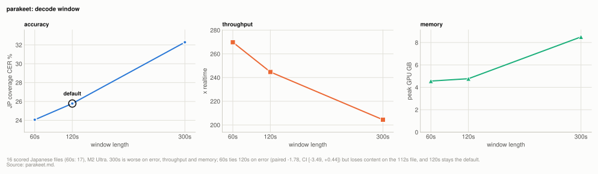

# Engine: parakeet

Parakeet does not change the default. It scores 25.68% coverage CER on the 17 Japanese[^p1]
files against turbo-nocond's 14.17%, losing on 16 of 17 files[^p1]
([engines.md](../engines.md#experiment-the-japanese-only-engines-against-the-multilingual-defaults)).
Parakeet is the fastest engine measured in this project: 261.8x realtime (mean of 3 runs)[^p1],
3.3x the next fastest configuration (reazon-k2 int8 at 79.9x)[^p3] and 4.9x reazon's fp32
default (52.9x)[^p3], at 4.77GB of peak GPU memory[^p1]. If throughput matters more than
accuracy, it is the fastest option measured here. Its window defaults to 120s: 300s is worse
at corpus scale; 60s ties 120s over the corpus (paired -1.78, CI [-3.49, +0.44])[^p2] but
loses content on the 112s file. <!-- not-measured: 60s is a window length -->

| setting | default | why |
|---|---|---|
| `parakeet --chunk-seconds` | `120` | 300s is 6.50 points worse on average over 16 files and nearly doubles peak memory; 60s ties 120s over 16 files (paired -1.78, CI [-3.49, +0.44]) but loses content on the 112s file (299 against 379 characters) |

Source: [ultra-parakeet-window.json](../../../benchmarks/results/2026-10/ultra-parakeet-window.json) runs `parakeet_c120`, `parakeet_c300`, `parakeet_c60`

**Setup:** the 17 Japanese files of the [20-file corpus](../reference/corpus.md#the-20-file-corpus) (6.85h[^p0]), M2 Ultra, scored by coverage CER at `min_cut` 30 ([metrics.md](../reference/metrics.md)). The engine decodes greedily.

## Experiment: parakeet window length

**Basis:** the 17 Japanese files of the [20-file corpus](../reference/corpus.md#the-20-file-corpus), M2 Ultra, `mlx-community/parakeet-tdt_ctc-0.6b-ja` at 60s, 120s and 300s windows.

On one file, the 112s one, 120s and 300s tied (379 characters each[^p2]) while 60s lost
content (299 characters of a 422-character reference, 31.04% CER against 12.09%)[^p2], so <!-- not-measured: 120s, 300s and 60s are window lengths -->
300s looked free and 60s looked worse. At corpus scale neither holds: <!-- not-measured: 300s and 60s are window lengths -->

<picture>
  <source media="(prefers-color-scheme: dark)" srcset="../img/parakeet-window-dark.svg">
  
</picture>

**Table:** parakeet accuracy, throughput and peak GPU memory at 60s, 120s and 300s windows over the 17 Japanese files (120s and 300s: 16 scored, the 17th ran on a copy since superseded; 60s, run later, scored all 17).

| window | JP coverage CER | x realtime | peak GPU |
|---|---|---|---|
| 60s | 24.06% | 269.8x | 4.56GB |
| **120s** | 25.78% | 244.7x | 4.77GB |
| 300s | 32.28% | 204.4x | 8.5GB |

Source: [ultra-parakeet-window.json](../../../benchmarks/results/2026-10/ultra-parakeet-window.json) runs `parakeet_c120`, `parakeet_c300`, `parakeet_c60` (60s over the 16 files the other two scored: 24.00%)

Paired over 16 files, 300s is +6.50 points worse on average and loses on 10[^p2], with the
damage concentrated where windows are longest relative to speech density (one file
goes 32.6% to 50.3%[^p2]). The one-file tie was the corpus-size trap this project has
documented before: several single-clip findings here reversed sign when a real corpus
arrived ([corpus.md](../reference/corpus.md)). The same trap applied to 60s: over the 16 <!-- not-measured: 60s is a window length -->
files it is not worse than 120s, paired -1.78 points (CI [-3.49, +0.44])[^p2], winning on 9 <!-- not-measured: 120s is a window length -->
and losing on 7[^p2], so the two tie. The content loss on the 112s file is real but is not the
corpus-wide shape. 120s remains the default; the saved runs do not separate it from 60s on <!-- not-measured: 120s and 60s are window lengths -->
accuracy. 60s is nominally faster and lighter: 269.8x and 4.56GB against 244.7x and 4.77GB[^p2].

## How it works

**Chunk length interacts with model training the opposite way to Whisper.** For
kotoba down to 15s, and for qwen3 down to the shortest window swept, shorter windows were neutral-to-better. Parakeet loses content at <!-- not-measured: 15s is a window length -->
60s on one file against 120s, though the two tie over the corpus, and reazon needs windows
at all. A model trained on
short independent segments degrades when asked for more context than it saw; a model
trained to carry state across windows degrades when denied it. Chunking advice does
not transfer between models; each needs its own sweep.

**Parakeet is deterministic.** Three decodes through the CLI code path give
byte-identical text and cues, so every single-run figure above is a score rather than
a draw.

## Reproducing

`scripts/benchmarks/run_parakeet.py` drives the exact function the CLI runs
(`backends.parakeet_decode`), loads once outside the timing loop, and reports
kana/lenient CER beside coverage CER. Result file: `benchmarks/parakeet_c120.json`.

## Related

- [engines.md](../engines.md): parakeet and reazon against the multilingual engines, and the Whisper rows compared here
- [reazon.md](reazon.md): the other Japanese-only engine
- [corpus.md](../reference/corpus.md): the corpus, and the single-clip findings that reversed at corpus scale
- [metrics.md](../reference/metrics.md): coverage CER and `min_cut`

[^p0]: [corpus.json](../../../benchmarks/results/corpus.json)
[^p1]: [ultra-picker-speed.json](../../../benchmarks/results/2026-10/ultra-picker-speed.json) runs `pk_parakeet_default_s1`, `pk_parakeet_default_s2`, `pk_parakeet_default_s3`; [ultra-whisper-sizes.json](../../../benchmarks/results/2026-10/ultra-whisper-sizes.json) runs `whisper_turbo_nocond`, `whisper_turbo_nocond_r2`, `whisper_turbo_nocond_r3`, `whisper_turbo_nocond_r4`, `whisper_turbo_nocond_r5`, `whisper_turbo_nocond_r6`
[^p2]: [ultra-parakeet-window.json](../../../benchmarks/results/2026-10/ultra-parakeet-window.json) runs `parakeet_c120`, `parakeet_c300`, `parakeet_c60`
[^p3]: [ultra-picker-speed.json](../../../benchmarks/results/2026-10/ultra-picker-speed.json) runs `pk_parakeet_default_s1`, `pk_parakeet_default_s2`, `pk_parakeet_default_s3`, `pk_reazon_fp32_default_s1`, `pk_reazon_fp32_default_s2`, `pk_reazon_fp32_default_s3`; [ultra-engines-jp-only.json](../../../benchmarks/results/2026-10/ultra-engines-jp-only.json) runs `jp_reazon_int8_c30_r1`, `jp_reazon_int8_c30_r2`, `jp_reazon_int8_c30_r3`
