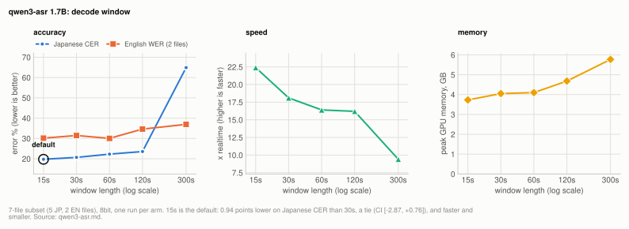
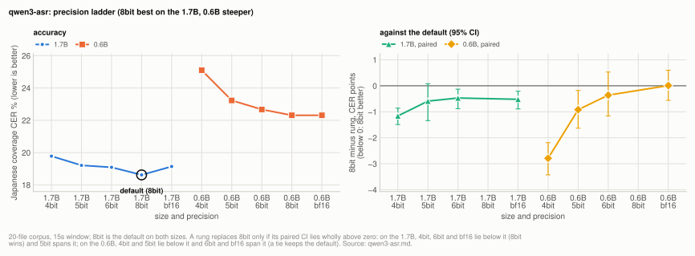
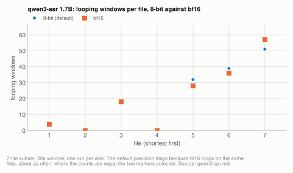
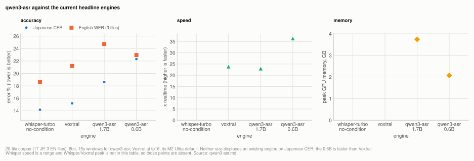
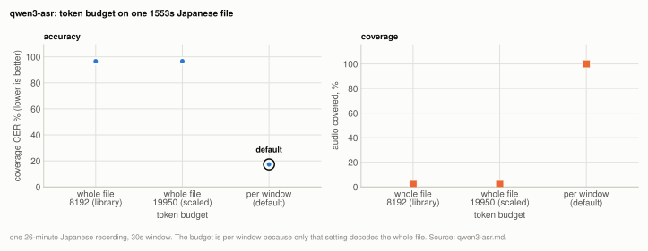

# Engine: Qwen3-ASR

Qwen3-ASR is available as two sizes and neither becomes the default engine: on the 20-file
corpus at its 15s window the 1.7B scores 18.62% Japanese coverage CER at 23.0x realtime[^q1], behind Voxtral
at its M2 Ultra default, fp16 (15.20%, 23.86x, mean of 3 runs), and Whisper turbo-nocond (14.17%, mean of 6 runs)[^q2], so it is last of the three on accuracy
and about as fast as Voxtral. Within the family the default size is the 1.7B, 3.7 points ahead[^q1]
of the 0.6B (22.31%; paired 3.69, CI [+2.89, +4.43])[^q1]; the 0.6B runs at 36.4x in 2.07GB[^q1],
faster than Voxtral's 23.86x[^q2] and in a fraction of its memory. The default precision is 8bit, which no
rung beats on either size[^q4]. The default window is 15s for both sizes: in the window sweep on the 7-file subset it
ties 30s on Japanese CER (paired -0.94, CI [-2.87, +0.76]) and is faster and lighter[^q3], and on the
20-file corpus it ties 30s on both sizes (1.7B paired -0.57, CI [-1.73, +0.39]; 0.6B -0.56, CI [-1.47, +0.32])[^q14].

| setting | default | why |
|---|---|---|
| size (`--size`) | `1.7B` | 18.62% against 22.31% Japanese coverage CER on the 20-file corpus, paired 3.69 points, CI [+2.89, +4.43]. The `0.6B` is the speed option: 36.4x in 2.07GB |
| precision (`--quantization`) | `8bit` | no rung beats 8bit on either size. On the 1.7B, 4bit (1.16 points), 6bit (0.47) and bf16 (0.52) are resolved worse and 5bit ties; on the 0.6B, 4bit (2.79) and 5bit (0.92) are resolved worse and 6bit and bf16 tie, so bf16 runs where it fits, a tie going to the larger build |
| window (`--chunk-seconds`) | `15` | shorter is better on Japanese CER, speed and memory across the sweep; 15s ties 30s on Japanese CER (19.73% against 20.67%, paired -0.94, CI [-2.87, +0.76]) and is faster (22.4x against 18.1x) and lighter (3.73GB against 4.05GB), and only kana CER favours 30s. 15s is the shortest window swept, on the 1.7B only. On the 20-file corpus 15s ties 30s on Japanese CER for both sizes (paired -0.57 on the 1.7B, -0.56 on the 0.6B, both intervals spanning zero). The library default of 1200s was not swept |
| output format (`-f`) | `txt` or `json` only | its timestamps are decode-window boundaries, so `srt`, `vtt` and `all` exit 2 |
| language (`--language`) | forced to English when not passed | the upstream autodetect path leaks a prompt prefix into the transcript from the second window onward |
| `--max-batch` | refused | swept, and batching loses monotonically ([qwen3-batch.md](../qwen3-batch.md)) |

Source: [ultra-qwen3-precision-c15.json](../../../benchmarks/results/2026-10/ultra-qwen3-precision-c15.json) runs `qwen3_1.7B_4bit_c15`, `qwen3_1.7B_5bit_c15`, `qwen3_1.7B_6bit_c15`, `qwen3_1.7B_8bit_c15`, `qwen3_1.7B_bf16_c15`, `qwen3_0.6B_4bit_c15`, `qwen3_0.6B_5bit_c15`, `qwen3_0.6B_6bit_c15`, `qwen3_0.6B_8bit_c15`, `qwen3_0.6B_bf16_c15`; [ultra-qwen3-precision.json](../../../benchmarks/results/2026-10/ultra-qwen3-precision.json) runs `qwen3_1.7B_8bit_c30`, `qwen3_0.6B_8bit_c30`; [ultra-qwen3-window.json](../../../benchmarks/results/2026-10/ultra-qwen3-window.json) runs `qwen3w7_1.7B_8bit_c15`, `qwen3w7_1.7B_8bit_c30`, `qwen3w7_1.7B_8bit_c60`, `qwen3w7_1.7B_8bit_c120`, `qwen3w7_1.7B_8bit_c300`

**Setup:** the [20-file corpus](../reference/corpus.md#the-20-file-corpus), and the
[7-file subset](../reference/corpus.md#the-7-file-subset) for the window sweep, on an M2 Ultra
128GB (Mac14,14), scored by coverage CER/WER at `min_cut` 30/6 plus coverage kana and
lenient CER ([metrics.md](../reference/metrics.md)). The engine is greedy and deterministic, so each
figure is one run.

## Experiment: the decode window

**Basis:** the [7-file subset](../reference/corpus.md#the-7-file-subset), M2 Ultra 128GB (Mac14,14), 1.7B at 8bit, windows of 15/30/60/120/300s.

One run per arm, run sequentially:
`scripts/benchmarks/sweep_qwen3_chunk.py`.

The library's 1200s was not included in this sweep, so it is unmeasured. At that length <!-- not-measured: window lengths are configuration values -->
the 7 files would split into 1 to 5 windows each.

<picture>
  <source media="(prefers-color-scheme: dark)" srcset="../img/qwen3-asr-window-dark.svg">
  
</picture>

**Table:** Qwen3-ASR 1.7B accuracy, speed, segment count and peak memory for each decode window.

| window | JP coverage CER | kana CER | lenient CER | EN coverage WER | x realtime | segments | peak GB |
|---|---|---|---|---|---|---|---|
| **15s** | **19.73%** | 23.21% | **19.47%** | 30.15% | **22.4x** | 1236 | **3.73** |
| 30s | 20.67% | **21.72%** | 20.42% | 31.45% | 18.1x | 622 | 4.05 |
| 60s | 22.27% | 22.27% | 22.07% | **30.04%** | 16.4x | 315 | 4.10 |
| 120s | 23.55% | 23.93% | 23.33% | 34.62% | 16.2x | 158 | 4.68 |
| 300s | 64.89% | 78.95% | 64.79% | 36.94% | 9.4x | 66 | 5.77 |

Source: [ultra-qwen3-window.json](../../../benchmarks/results/2026-10/ultra-qwen3-window.json) runs `qwen3w7_1.7B_8bit_c15`, `qwen3w7_1.7B_8bit_c30`, `qwen3w7_1.7B_8bit_c60`, `qwen3w7_1.7B_8bit_c120`, `qwen3w7_1.7B_8bit_c300`

**Shorter is better on Japanese CER, speed and memory at once, across the whole sweep**, which is unusual here and is the <!-- not-measured: window lengths are configuration values -->
opposite of the shape Voxtral shows (where 30s versus 60s is a non-effect and longer <!-- not-measured: window lengths are configuration values -->
chunks are faster). Japanese accuracy, throughput and peak memory all improve as the
window shrinks, so above 30s there is no trade to make. Kana CER is the exception, lowest at
30s, and English WER is lowest at 60s on two files. 300s is catastrophic rather than <!-- not-measured: window lengths are configuration values -->
merely worse: one file scored **148.15%** coverage CER[^q3], and the aggregate more than
doubles.

15s was added after the fact, because the first four arms were monotonic and a <!-- not-measured: window lengths are configuration values -->
sweep whose best value sits at its own boundary has not found an optimum. It continued the
trend on Japanese CER rather than reversing it: 19.73% against 20.67% (lenient 19.47% against 20.42%), paired -0.94 points, CI [-2.87, +0.76][^q3], a tie on 5 Japanese files. Throughput
and memory keep improving too (22.4x, 3.73GB)[^q3]. So the sweep does not show 30s ahead on
any Japanese metric except kana CER (21.72% against 23.21%)[^q3], and 15s is again the boundary of
the sweep: shorter windows are unmeasured. 15s is the default for both sizes on this
evidence. <!-- not-measured: window lengths are configuration values -->

The mechanism is visible in the per-file rows. Repetition loops get more likely and more
expensive as the window grows, because a loop runs until its window's token budget is
exhausted and that budget scales with window length. At 30s, 5 of 7 files contained at
least one looping window; at 120s and 300s, 7 of 7 did. A loop in a 300s window destroys
five minutes of transcript, and it also costs the decode time to emit thousands of junk
tokens, which is why throughput falls with window length instead of rising.

That the loop rate rises with window length is also why the memory figure moves: it is
not the audio encoder alone but the KV cache of runaway generations.

**The default is 15s.** The sweep was run before the corpus comparison because the <!-- not-measured: window lengths are configuration values -->
library's unmeasured 1200s would otherwise have set the window. The corpus comparison and the <!-- not-measured: window lengths are configuration values -->
precision ladder below were first measured at 30s, the default at the time, and rerun at 15s; the <!-- not-measured: window lengths are configuration values -->
figures below are the 15s runs. On the 20-file corpus 15s ties 30s on Japanese CER for both sizes, <!-- not-measured: window lengths are configuration values -->
18.62% against 19.19% on the 1.7B (paired -0.57, CI [-1.73, +0.39])[^q14] and 22.31% against 22.87% on
the 0.6B (paired -0.56, CI [-1.47, +0.32])[^q14], and is faster and lighter on both: 23.0x against 21.1x[^q14]
and 3.74GB against 4.05GB on the 1.7B, 36.4x against 32.7x and 2.07GB against 2.36GB on the 0.6B[^q14].

## Experiment: precision ladder

**Basis:** the [20-file corpus](../reference/corpus.md#the-20-file-corpus), M2 Ultra 128GB (Mac14,14), both sizes at 4bit/5bit/6bit/8bit/bf16, window fixed at 15s (the default).

Every rung, both sizes, 20 files, window fixed at 15s, one harness, M2 Ultra. Only
the weights change. This closes the gap where the lower rungs were exposed with no
accuracy figure at all.

<picture>
  <source media="(prefers-color-scheme: dark)" srcset="../img/qwen3-asr-precision-dark.svg">
  
</picture>

**Table:** Japanese CER, the per-file paired difference against 8bit with its 95% CI, speed and peak memory for every precision rung of both sizes. <!-- not-measured: 95% is the confidence level -->

| size | quant | JP coverage CER | paired against 8bit | x realtime | peak |
|---|---|---|---|---|---|
| 1.7B | 4bit | 19.78% | **-1.16**, CI [-1.49, -0.86] | **26.2x** | **2.88GB** |
| 1.7B | 5bit | 19.21% | -0.59, CI [-1.34, +0.08] | 23.4x | 3.09GB |
| 1.7B | 6bit | 19.09% | **-0.47**, CI [-0.88, -0.13] | 25.7x | 3.31GB |
| 1.7B | **8bit (default)** | 18.62% | | 23.0x | 3.74GB |
| 1.7B | bf16 | 19.14% | **-0.52**, CI [-0.89, -0.21] | 19.5x | 5.35GB |
| 0.6B | 4bit | 25.10% | **-2.79**, CI [-3.43, -2.19] | 31.4x | **1.77GB** |
| 0.6B | 5bit | 23.23% | **-0.92**, CI [-1.63, -0.18] | 34.5x | 1.85GB |
| 0.6B | 6bit | 22.67% | -0.36, CI [-1.16, +0.53] | **36.7x** | 1.92GB |
| 0.6B | **8bit** | 22.31% | | 36.4x | 2.07GB |
| 0.6B | bf16 | 22.31% | +0.01, CI [-0.56, +0.60] | 30.4x | 2.63GB |

Source: [ultra-qwen3-precision-c15.json](../../../benchmarks/results/2026-10/ultra-qwen3-precision-c15.json) runs `qwen3_1.7B_4bit_c15`, `qwen3_1.7B_5bit_c15`, `qwen3_1.7B_6bit_c15`, `qwen3_1.7B_8bit_c15`, `qwen3_1.7B_bf16_c15`, `qwen3_0.6B_4bit_c15`, `qwen3_0.6B_5bit_c15`, `qwen3_0.6B_6bit_c15`, `qwen3_0.6B_8bit_c15`, `qwen3_0.6B_bf16_c15`

**On the 1.7B, 8bit is the best rung.** It is ahead of 4bit by 1.16 points[^q4], of bf16 by 0.52
and of 6bit by 0.47[^q4], all three intervals clear of zero; 5bit (-0.59, CI [-1.34, +0.08])
does not resolve. 4bit is still the fastest and lightest rung, 14% more throughput and 0.86GB[^q4]
less peak than the default[^q4], but on this size that now comes with a measured accuracy cost.

**The 0.6B cares more.** 8bit beats 4bit by **2.79 points**[^q4] and 5bit by 0.92, both
intervals clear of zero; 6bit (-0.36) and bf16 (+0.01) do not resolve. Same architecture,
same corpus, same harness, same window.

At 30s the same ladder looked different: every 1.7B rung tied 8bit, and the 0.6B's 4bit cost <!-- not-measured: window lengths are configuration values -->
5.02 points[^q15]. So the shape of this ladder depends on the window as well as on the
checkpoint, and it cannot be read off one configuration and applied to another. At 15s 4bit <!-- not-measured: window lengths are configuration values -->
is last on both sizes, as it is on Voxtral's monotonic ladder
([quantization.md](../quantization.md)); the 0.6B improves at every rung up to 8bit and bf16
matches it, while the 1.7B's bf16 is resolved behind its 8bit.

**Which precision runs.** No rung beats 8bit on either size. On the 1.7B three of the
four other rungs are resolved worse and 5bit ties; on the 0.6B two are resolved worse and
6bit and bf16 tie. A tie goes to the larger build where it fits
([how a variant is chosen](../../DEFAULTS.md#how-a-variant-is-chosen)), so the 1.7B runs
8bit, and the 0.6B runs bf16 wherever its 2.63GB peak fits, at 30.4x against 8bit's 36.4x.[^q4]
4bit is documented as the speed option. The intermediate rungs are no longer "a
memory choice made blind".

Both sizes are now adjudicated on accuracy, so `--quantization` no longer offers rungs whose
cost is unknown. What remains unmeasured is whether these figures hold on material unlike
this corpus, which is true of everything here.

On the cost side, peak memory tracks weight bytes on both sizes, and bf16 is the slowest
rung on both, as the bandwidth model predicts and as the Voxtral fp16 measurement found
([quantization.md](../quantization.md)). Below 8bit throughput does not follow bit width:
the 0.6B's 4bit (31.4x) is slower than its 8bit (36.4x)[^q4].

## Experiment: repetition loops by precision

**Basis:** the [7-file subset](../reference/corpus.md#the-7-file-subset), M2 Ultra 128GB (Mac14,14), 1.7B at 8-bit and bf16, window fixed at 30s.

Quantization does not cause the repetition loops. Worth checking, because it was a live hypothesis: repetition is a decoder degeneracy, and
quantization noise perturbs exactly the near-tie logits that sustain one, so unlike a
fractional CER difference a loop-rate change would be large enough for this corpus to see.

Per-file looping-window counts, 1.7B at 30s on the 7-file subset, in corpus order:

<picture>
  <source media="(prefers-color-scheme: dark)" srcset="../img/qwen3-asr-loops-dark.svg">
  
</picture>

**Table:** looping-window count per file and the number of files affected, 8-bit against bf16.

| precision | per-file loop counts (shortest file first) | files affected |
|---|---|---|
| 8-bit | 3, 0, 18, 0, 32, 39, 51 | 5 of 7 |
| bf16 | 4, 0, 18, 0, 28, 36, 57 | 5 of 7 |

Source: [ultra-qwen3-window.json](../../../benchmarks/results/2026-10/ultra-qwen3-window.json) runs `qwen3w7_1.7B_8bit_c30`; [ultra-qwen3-loops.json](../../../benchmarks/results/2026-10/ultra-qwen3-loops.json) runs `qwen3loop7_1.7B_bf16_c30` (looping windows are each row's runaway_segments count)

Effectively identical, including which files are affected and which are clean. So the
loops are a property of these weights on this material, not an artifact of the default
precision, and running bf16 is not a workaround for them.

## Experiment: against the current headline

**Basis:** the [20-file corpus](../reference/corpus.md#the-20-file-corpus), M2 Ultra 128GB (Mac14,14), both sizes at 8bit with 15s windows.

Full 20-file corpus (8.01h)[^qc], one run per size since both are greedy, on the same
M2 Ultra 128GB with the same scorers and the same cached audio as the rows above them.

<picture>
  <source media="(prefers-color-scheme: dark)" srcset="../img/qwen3-asr-headline-dark.svg">
  
</picture>

**Table:** Japanese CER, English WER, speed and peak memory for both Qwen3-ASR sizes beside the two existing engines.

| engine | JP coverage CER | EN coverage WER | x realtime | peak GB |
|---|---|---|---|---|
| whisper-turbo, no-condition | **14.17%** ±0.28 | **18.65%** ±0.49 | 18.5-23.2x | |
| voxtral (default on 128GB, fp16) | 15.20% | 21.21% | 23.9x | |
| qwen3-asr (1.7B) | 18.62% | 24.72% | 23.0x | 3.74 |
| qwen3-asr-small (0.6B) | 22.31% | **22.95%** | **36.4x** | **2.07** |

Source: [ultra-whisper-sizes.json](../../../benchmarks/results/2026-10/ultra-whisper-sizes.json) runs `whisper_turbo_nocond`, `whisper_turbo_nocond_r2`, `whisper_turbo_nocond_r3`, `whisper_turbo_nocond_r4`, `whisper_turbo_nocond_r5`, `whisper_turbo_nocond_r6` (mean ± sample standard deviation over 6 runs, speed range); [ultra-voxtral-precision-default.json](../../../benchmarks/results/2026-10/ultra-voxtral-precision-default.json) runs `vox_wfp16_c30b128_kv8`, `vox_wfp16_c30b128_kv8_r2`, `vox_wfp16_c30b128_kv8_r3` (speed is their mean); [ultra-qwen3-precision-c15.json](../../../benchmarks/results/2026-10/ultra-qwen3-precision-c15.json) runs `qwen3_1.7B_8bit_c15`, `qwen3_0.6B_8bit_c15`

Both runs: 20 files, complete, at the 15s window shipped since 2026-10-27, with the same flags <!-- not-measured: window length is a configuration value -->
as the earlier 30s runs. The Whisper default has <!-- not-measured: window lengths are configuration values -->
since moved to large-v3, which scores 14.51% / 18.59% (mean of 6 runs)[^q5] on the same corpus
([engines.md](../engines.md)); the comparison below is unchanged by that.

**Neither size displaces either default on Japanese.** The 1.7B is 3.4 points behind[^q2]
Voxtral and 4.5 behind Whisper; the 0.6B is 7.1 and 8.1 behind. Nothing in this table
recommends the 1.7B as an engine: it is third of three on accuracy and no faster than Voxtral.

The 0.6B is the more useful row, and only on two axes it was not being judged on. It runs
at 36.4x[^q1], faster than Voxtral's 23.86x at fp16[^q2] (its three speed-spread runs, 33.8x to 36.5x,
are all above Voxtral's three[^q16]), in **2.07GB**, and its English WER (22.95%) beats the 1.7B's (24.72%)[^q1] while using a
third of the weights. That is a narrow niche (a 16GB machine, English, speed over <!-- not-measured: machine memory size -->
accuracy), and the English side of this corpus is n=3, so the ordering of two engines
1.8 points apart[^q1] there should not be quoted as a fact.

Its kana CER (18.19% for the 1.7B) sits **0.4 points below**[^q1] its coverage CER. That is
not the largest such gap in this project: the Japanese-only engines show 2.89 (parakeet) and
2.77 (reazon)[^q9]. For this engine it is the inverse-text-normalisation confound appearing as
predicted: it formats numbers differently from the reference typist and plain CER charges
each difference. The Voxtral and Whisper rows have **not** been rescored on the kana
metric, so 18.19% is not a like-for-like figure against 15.20%[^q2] and must not be quoted as
one. What it does is bound how much of the 3.4-point gap[^q2] could be orthographic, and the
bound (0.4) is well under the gap.

The per-file spread says something the aggregate hides. On the five Japanese files outside
the interview material the 1.7B does better (12.44%, 13.30%, 15.62%, 17.94%, 19.88% coverage CER)[^q1]
with **zero repetition loops**; on the close-mic interview material it does worse, and the
four files that loop most (17 to 62 looping windows each) are interview recordings, the same
four that looped most at 30s[^q15]. At 15s loops also appear on five Japanese files that were
clean at 30s, four of them on one or two windows: 13 of 20 files contained at least one looping window on the 1.7B, and 10 of 20
on the 0.6B[^q1], against 8 and 9 at 30s[^q15]. So the aggregate is partly a measure of how often this engine breaks down on
this specific material rather than of its transcription quality, and a different corpus
could move it in either direction.

## How it works

Two aliases, both on the `mlx-qwen3` backend, selected as `--model qwen3-asr` with
`--size`:

**Table:** the two aliases, their repositories and weight sizes.

| alias | repo | weights |
|---|---|---|
| `qwen3-asr` | `mlx-community/Qwen3-ASR-1.7B-8bit` | 2.47GB |
| `qwen3-asr-small` | `mlx-community/Qwen3-ASR-0.6B-8bit` | 1.01GB |
<!-- not-measured: weights are hub file sizes -->

Both deterministic, both multilingual, both windowed at **15s** rather than the library's
1200s, and both refusing `-f srt`/`-f vtt`. Zero new dependencies: mlx-audio has had a <!-- not-measured: window lengths are configuration values -->
first-class `qwen3_asr` loader in its dispatch table since 0.3.1, so this is the same `load`
the Voxtral path calls on a different repo id.

`--max-batch` is refused, and it is the one refusal in this project whose reason is not "the
knob does not exist". `generate(batch_size=)` does batch whole windows. It was refused as
unmeasured at first; it has since been swept and it loses, monotonically and by a wide
margin, so it stays refused on evidence: [qwen3-batch.md](../qwen3-batch.md).

Four properties of the engine are structural rather than statistical, and they shaped the
integration more than the scores did:

1. **Its timestamps are decode-window boundaries, not speech boundaries.** `-f srt` and
   `-f vtt` are a hard error (exit 2). No variant of these weights has finer times.
2. **The library's whole-file token budget silently truncates long audio**, so this
   project drives the chunk loop itself with a per-window budget. Cost of not doing so,
   measured: 96.67% coverage CER[^q6] on a 26-minute file, 98% of whose audio was simply
   absent from the output with nothing saying so.
3. **`chunk_duration=1200.0`, the library default, is unusable.** At 20 minutes per
   window any ordinary recording is a single window: one segment, and the upstream batched
   path can never engage because it needs more than one chunk. The default is **15s**, the
   best arm of the window sweep above.
4. **Repetition loops are frequent on this material**, on 13 of 20 files for the 1.7B and 10 for the 0.6B[^q1],
   and they are a property of the weights. They are now capped at one window each and
   counted, rather than being allowed to eat the rest of the file.

### Harness and metrics

`scripts/benchmarks/run_qwen3.py`, scoring with the *same* functions `run_corpus.py` and
`run_whisper.py` use, on the *same* cached 16kHz mono files, so a row here sits beside a
Voxtral or Whisper row without an asterisk. Model load is outside the timing loop, matching
both other runners.

The engine decodes greedily (`temperature=0.0` becomes `mx.argmax`, no fallback ladder), so
one run is its score, as with Voxtral and unlike Whisper. `--repeat` exists to verify that
rather than to build a distribution.

Language is set per file from the reference script, by the same `is_space_delimited` test
that picks the scoring unit, so a language-ID failure is never scored as an ASR error and
the two choices cannot disagree. This matches `run_whisper.py` and for the same reason.

Three metrics are reported per file:

**Table:** the three per-file metrics and what each one charges as an error.

| metric | what it charges |
|---|---|
| coverage CER | every differing character, with long insertion runs excused as omitted-from-reference audio |
| coverage kana CER | the same, on hiragana readings, so kanji/kana/digit variants that share a reading cost nothing |
| coverage lenient CER | the same, forgiving edit regions whose two sides are the same word respelled |

The reading-based pair exists because this model's Japanese finetune advertises inverse
text normalisation: it prefers `2018年` where a reference typist may have written the
reading out. Plain coverage CER charges each such difference as a misrecognition, and the
gap between the figures is the size of that confound.

`scripts/metrics/eval_coverage_kana.py` composes the two ideas. It also fixes a gap in the
existing kana metric: **pykakasi does not read numerals**, converting `2018年` to `2018ねん`
rather than `にせんじゅうはちねん`, so kana CER as previously written left the largest
orthographic difference on this material entirely uncollapsed. On two spellings of one
sentence, kana CER read 55% before and 0% after. The number reader is opt-in <!-- not-measured: a worked example of the scorer on one constructed sentence pair -->
(`read_digits`), so every figure already published from `eval_cer_kana.py` keeps its
meaning.

### The blocker: no speech-level timestamps

Each segment upstream is:

```python
"start": offset_sec,
"end":   offset_sec + len(chunk_audio) / sample_rate,
```

Those are the boundaries of the decode window, not of the speech inside it. A subtitle file
built from them would carry cues that do not correspond to anything a viewer hears, and at
the library's own default window it would be a single cue holding the entire transcript.

No variant of these weights has finer times. The streaming path is worse rather than better:
its per-token times are a fraction of the 8192-token *budget* rather than of elapsed time,
so at 300 generated tokens every timestamp lands in the first 4% of the chunk. <!-- not-measured: arithmetic, 300 of 8192 tokens -->

So `-f srt`, `-f vtt` and `-f all` exit 2 with a message naming the reason and the way out;
`txt` and `json` work normally. Refusing beats writing a plausible-looking file, which is the
same rule this CLI applies to unsupported flags.

Every result file from this engine also carries `cue_source: "chunk_boundaries"`, so a
break-F1 or timing-drift figure computed from these cues can never be put beside Voxtral's
or Whisper's by mistake.

The only route to word times is `Qwen3-ForcedAligner-0.6B` (80ms resolution, single <!-- not-measured: the aligner's stated resolution -->
forward pass, MLX conversion exists), but Japanese alignment there needs `nagisa` plus
DyNet, so it belongs behind a research script rather than in the CLI.

### The truncation bug, and why the chunk loop moved

This is the finding that cost the most run time, and it is worth stating precisely because
the failure produces a **well-formed transcript** rather than an error.

Upstream, `max_tokens` (default 8192) is a budget for the whole file:

```python
remaining_tokens = max_tokens
for chunk_audio, offset_sec in chunk_iter:
    if remaining_tokens <= 0:
        break                       # no exception, no warning
    ...
    remaining_tokens -= gen_toks
```

Measured on one 1553s Japanese recording at a 30s window:

<picture>
  <source media="(prefers-color-scheme: dark)" srcset="../img/qwen3-asr-truncation-dark.svg">
  
</picture>

**Table:** segments, audio covered and coverage CER for three token-budget configurations on one file.

| configuration | segments | audio covered | coverage CER |
|---|---|---|---|
| library default, whole-file budget of 8192 | 1 | 2.1% | **96.67%** |
| whole-file budget scaled to duration (19950) | 1 | 2.1% | **96.71%** |
| **per-window budget (default)** | **52** | **100%** | **17.29%** |

Source: [ultra-qwen3-loops.json](../../../benchmarks/results/2026-10/ultra-qwen3-loops.json) runs `q3budget_wholefile_8192`, `q3budget_wholefile_19950`, `q3trunc_perwindow_1.7B_8bit_c30` (audio covered: the whole-file rows' audio_covered_s over duration_s, 33.3 of 1553.0s for both)

The first window entered a repetition loop (one short phrase repeated until the budget ran
out), spent the file's entire budget, and the loop `break`ed. 1519.7 of 1553.0 seconds[^q13]
were never decoded, and nothing in the output said so.

Raising the budget does not fix this: scaled to the file's duration (the middle row), it
still returns one segment and scores 96.71%[^q6]. The budget has to be per window, so a degenerate window costs one window. That is why
`mlx_asr/backends.py` drives the chunk loop itself rather than handing the whole recording to
`generate`. Nothing else is reimplemented: the cut points still come from upstream's own
`split_audio_into_chunks`, and each window goes through the same `generate` one at a time,
which is the path a `batch_size=1` call takes anyway.

Two things are now recorded per file so this class of failure cannot hide again:

* `audio_coverage`, the fraction of the audio the returned segments span. Below 0.99 prints
  a warning saying the rest of the file is missing.
* `runaway_segments`, windows emitting text faster than 25 chars/s.
  The Japanese references run 1.5 to 5.4 characters per second of audio[^qc], well under
  that threshold.

**Repetition loops still happen** and are a property of the weights, not of this adapter:
18 of 52 windows on the file above, 32 of 102 on another[^q7]. They are now capped at one window
each and counted rather than passed off as a transcript. Their cost to the aggregate is part
of what the window sweep measures.

### Language must be passed explicitly

Two silent upstream behaviours, either of which produces worse output with no error:

**An unmapped string is interpolated verbatim.** `_build_prompt` looks the value up in the
checkpoint's own `support_languages` case-insensitively and, on a miss, uses it as given, so
`--language ja` yields the prefix `language ja<asr_text>` and a token sequence the model
never saw in training. `mlx_asr/languages.py` maps every spelling to the English *name* this
engine wants, and an unmappable value is exit 2 before the audio is read.

**Passing nothing is worse than passing the wrong thing.** On the autodetect path
`generate` reassigns its own `language` variable inside the chunk loop from the first
chunk's detection. From chunk two onward `extract_language` therefore no longer strips the
prefix, and `language X<asr_text>` stays embedded in the transcript text. So this engine
never autodetects here: with no `--language` it is forced to English and says so.

That is a loss, because it is the only engine compared here that reports the language it
identified. It is not usable until
the reassignment is fixed upstream.

### Determinism: confirmed

7 files, decoded twice each in one process, 30s windows, 1.7B 8-bit.
**7 of 7 byte-identical**[^q10]. So one run is this engine's score, as with Voxtral and unlike
Whisper, and the aggregates above need no distribution. Wall clock varied by at most 3.5%[^q10]
between the two passes (17.6x and 17.0x on one file; the other six within 0.6%)[^q10], which
is scheduling noise, not output variation.

This was worth checking rather than inferring: the claim rests on `temperature=0.0`
resolving to `mx.argmax` upstream, and a sampler that silently kept a nonzero floor would
have made every single-run figure in this document a draw from an unmeasured distribution.

## Superseded

### 8bit against bf16 on the 7-file subset

The first precision comparison, before the full ladder above replaced it on the 20-file
corpus: 7-file subset, window fixed at 30s, one run per arm. Only the weights change.

**Table:** 8-bit against bf16 for both sizes on the 7-file subset: accuracy, speed, peak memory and weight size.

| model | precision | JP coverage CER | kana CER | EN coverage WER | x realtime | peak GB | weights |
|---|---|---|---|---|---|---|---|
| 1.7B | **8-bit** | **20.67%** | **21.72%** | 31.45% | **18.1x** | **4.05** | **2.47GB** |
| 1.7B | bf16 | 20.86% | 22.97% | 31.48% | 13.8x | 5.66 | 4.08GB |
| 0.6B | **8-bit** | **25.14%** | 26.67% | 29.25% | **27.5x** | **2.36** | **1.01GB** |
| 0.6B | bf16 | 25.51% | **26.44%** | **29.23%** | 21.1x | 2.92 | 1.57GB |

Source: [ultra-qwen3-window.json](../../../benchmarks/results/2026-10/ultra-qwen3-window.json) runs `qwen3w7_1.7B_8bit_c30`; [ultra-qwen3-loops.json](../../../benchmarks/results/2026-10/ultra-qwen3-loops.json) runs `qwen3loop7_1.7B_bf16_c30`; [ultra-qwen3-precision.json](../../../benchmarks/results/2026-10/ultra-qwen3-precision.json) runs `qwen3_0.6B_8bit_c30`, `qwen3_0.6B_bf16_c30` (the 0.6B rows are those runs' rows for the 7 subset files: speed is their audio over their summed wall clock, peak their maximum). The weights column is hub file sizes, not a run. <!-- not-measured: the weights column is hub file sizes -->

The 0.6B 8-bit row is its 7-file entry at the same window and config as the others.

**bf16 bought nothing here and cost about a quarter of the throughput.** On the 1.7B it is +0.19
points[^q8], which against this corpus's resolution at n=7 (a 95% half-width of 2.04 points)[^q11] is a tie, for **1.31x the wall
clock** and **1.4x the peak memory**[^q8]. On the 0.6B it is nominally behind, 0.37 points[^q8],
and 1.30x slower[^q8]: it would drop that model from 27.5x to 21.1x[^q8],
which would remove the main reason to offer it at all.

That +0.19 and the 0.6B's -0.37 are both inside noise individually; what is not noise is
the cost, which tracks weight bytes exactly as the bandwidth model predicts and as the
Voxtral fp16 measurement found ([quantization.md](../quantization.md)).

On *kana* CER the 1.7B's 8-bit is lower than its bf16 (21.72% against 22.97%)[^q8], and on the
0.6B bf16 is lower (26.44% against 26.67%)[^q8]. Neither difference is outside the noise band,
so kana CER gives no reason to prefer either precision.

## Not settled

Settled on this page, for contrast: that windows above 30s cost accuracy (swept
15/30/60/120/300 on 7 files; 15s and 30s tie); determinism (7/7 byte-identical[^q10], so one run per config); that neither size is <!-- not-measured: window lengths are configuration values -->
more accurate than the two existing engines on this corpus, on a 20-file margin of 2.8
points[^q2], which is above this corpus's resolution at n=20 (a 95% half-width of 1.20
points) and at n=7 (2.04)[^q11]; and
that the timestamp limitation is structural and not a tuning problem, which is why
`-f srt` is refused whatever the CER.

*The English ordering.* `qwen3-asr-small` beating `qwen3-asr` on English WER (22.95%[^q1]
against 24.72%)[^q1] rests on **three recordings**. Do not quote it as a fact about the two
model sizes.

*Whether the loops are the material or the model.* At 30s every looping file was a close-mic <!-- not-measured: window lengths are configuration values -->
interview recording (none of the corpus was recorded for this project) and the other files
produced none[^q15]; at 15s the files that loop most are still those recordings, but loops,
mostly of one or two windows, also reach five files that were clean at 30s[^q1]. That is
suggestive, not established, and it means this corpus may be unusually hard for this
engine specifically. A second corpus would resolve it, and would be worth more than any
further tuning here.

*How much of the gap is orthographic.* The kana metric bounds it at 0.4 points[^q1] of the 2.8[^q2],
but the Voxtral and Whisper rows have not been rescored on that metric, so no like-for-like
kana comparison exists. Running one is cheap (the hypotheses are on disk) and has not been
done.

*The 0.6B window.* The sweep was run on the 1.7B only. The 0.6B has two points, 15s and 30s
on the 20-file corpus, where 15s ties on Japanese CER and is faster and lighter[^q14]; windows
above 30s and below 15s are unmeasured on it. <!-- not-measured: window lengths are configuration values -->

**Deliberately not open.** Batch size, now settled by measurement rather than left
unexamined ([qwen3-batch.md](../qwen3-batch.md)), and `--repeat` beyond the determinism check,
because greedy decoding makes further runs information-free.

## Related

* [engines.md](../engines.md): every engine on the 20-file corpus.
* [quantization.md](../quantization.md): the Voxtral precision ladder, for the contrast with
  both sizes here.
* [qwen3-batch.md](../qwen3-batch.md): why `--max-batch` stays refused.
* [corpus.md](../reference/corpus.md) and [metrics.md](../reference/metrics.md): the material and the scorers.
* [../DEFAULTS.md](../../DEFAULTS.md): the rationale for every default, this engine's included.

[^q1]: [ultra-qwen3-precision-c15.json](../../../benchmarks/results/2026-10/ultra-qwen3-precision-c15.json) runs `qwen3_1.7B_8bit_c15`, `qwen3_0.6B_8bit_c15` (kana CER: kana_coverage_cer weighted by kana_ref_chars over the 17 Japanese files; looping files: rows with runaway_segments above zero)
[^q2]: [ultra-qwen3-precision-c15.json](../../../benchmarks/results/2026-10/ultra-qwen3-precision-c15.json) runs `qwen3_1.7B_8bit_c15`, `qwen3_0.6B_8bit_c15`; [ultra-voxtral-precision-default.json](../../../benchmarks/results/2026-10/ultra-voxtral-precision-default.json) runs `vox_wfp16_c30b128_kv8`, `vox_wfp16_c30b128_kv8_r2`, `vox_wfp16_c30b128_kv8_r3`; [ultra-whisper-sizes.json](../../../benchmarks/results/2026-10/ultra-whisper-sizes.json) runs `whisper_turbo_nocond`, `whisper_turbo_nocond_r2`, `whisper_turbo_nocond_r3`, `whisper_turbo_nocond_r4`, `whisper_turbo_nocond_r5`, `whisper_turbo_nocond_r6`
[^q3]: [ultra-qwen3-window.json](../../../benchmarks/results/2026-10/ultra-qwen3-window.json) runs `qwen3w7_1.7B_8bit_c15`, `qwen3w7_1.7B_8bit_c30`, `qwen3w7_1.7B_8bit_c300`
[^q4]: [ultra-qwen3-precision-c15.json](../../../benchmarks/results/2026-10/ultra-qwen3-precision-c15.json) runs `qwen3_1.7B_4bit_c15`, `qwen3_1.7B_5bit_c15`, `qwen3_1.7B_6bit_c15`, `qwen3_1.7B_8bit_c15`, `qwen3_1.7B_bf16_c15`, `qwen3_0.6B_4bit_c15`, `qwen3_0.6B_5bit_c15`, `qwen3_0.6B_6bit_c15`, `qwen3_0.6B_8bit_c15`, `qwen3_0.6B_bf16_c15`
[^q5]: [ultra-whisper-sizes.json](../../../benchmarks/results/2026-10/ultra-whisper-sizes.json) runs `whisper_large-v3_nocond`, `whisper_large-v3_nocond_r2`, `whisper_large-v3_nocond_r3`, `whisper_large-v3_nocond_r4`, `whisper_large-v3_nocond_r5`, `whisper_large-v3_nocond_r6`
[^q6]: [ultra-qwen3-loops.json](../../../benchmarks/results/2026-10/ultra-qwen3-loops.json) runs `q3budget_wholefile_8192`
[^q7]: [ultra-qwen3-loops.json](../../../benchmarks/results/2026-10/ultra-qwen3-loops.json) runs `q3trunc_perwindow_1.7B_8bit_c30`; [ultra-qwen3-window.json](../../../benchmarks/results/2026-10/ultra-qwen3-window.json) runs `qwen3w7_1.7B_8bit_c30`
[^q8]: [ultra-qwen3-window.json](../../../benchmarks/results/2026-10/ultra-qwen3-window.json) runs `qwen3w7_1.7B_8bit_c30`; [ultra-qwen3-loops.json](../../../benchmarks/results/2026-10/ultra-qwen3-loops.json) runs `qwen3loop7_1.7B_bf16_c30`; [ultra-qwen3-precision.json](../../../benchmarks/results/2026-10/ultra-qwen3-precision.json) runs `qwen3_0.6B_8bit_c30`, `qwen3_0.6B_bf16_c30` (their rows for the 7 subset files)
[^qc]: [corpus.json](../../../benchmarks/results/corpus.json)
[^q9]: [ultra-picker-speed.json](../../../benchmarks/results/2026-10/ultra-picker-speed.json) runs `pk_parakeet_default_s1`, `pk_parakeet_default_s2`, `pk_parakeet_default_s3`, `pk_reazon_fp32_default_s1`, `pk_reazon_fp32_default_s2`, `pk_reazon_fp32_default_s3` (coverage CER minus coverage kana CER over the 17 Japanese files)
[^q10]: [ultra-qwen3-determinism.json](../../../benchmarks/results/2026-10/ultra-qwen3-determinism.json) runs `q3det7_1.7B_8bit_c30` (the per-file repeat_identical and repeat_x_realtime fields)
[^q11]: [ultra-resolution-floor.json](../../../benchmarks/results/2026-10/ultra-resolution-floor.json) runs `resolution_floor` (per-file SD 2.75 of the paired Japanese differences, Voxtral at 4bit, the default then, against Whisper turbo-nocond over 17 files; 95% half-width 1.96 SD / sqrt(n)), computed from [ultra-voxtral-headline.json](../../../benchmarks/results/2026-10/ultra-voxtral-headline.json) runs `vox_default_c30b128_kv8`, `vox_default_c30b128_kv8_r2`, `vox_default_c30b128_kv8_r3`; [ultra-whisper-sizes.json](../../../benchmarks/results/2026-10/ultra-whisper-sizes.json) runs `whisper_turbo_nocond`, `whisper_turbo_nocond_r2`, `whisper_turbo_nocond_r3`, `whisper_turbo_nocond_r4`, `whisper_turbo_nocond_r5`, `whisper_turbo_nocond_r6`
[^q14]: [ultra-qwen3-precision-c15.json](../../../benchmarks/results/2026-10/ultra-qwen3-precision-c15.json) runs `qwen3_1.7B_8bit_c15`, `qwen3_0.6B_8bit_c15`; [ultra-qwen3-precision.json](../../../benchmarks/results/2026-10/ultra-qwen3-precision.json) runs `qwen3_1.7B_8bit_c30`, `qwen3_0.6B_8bit_c30` (paired over the 17 Japanese files)
[^q15]: [ultra-qwen3-precision.json](../../../benchmarks/results/2026-10/ultra-qwen3-precision.json) runs `qwen3_1.7B_4bit_c30`, `qwen3_1.7B_5bit_c30`, `qwen3_1.7B_6bit_c30`, `qwen3_1.7B_8bit_c30`, `qwen3_1.7B_bf16_c30`, `qwen3_0.6B_4bit_c30`, `qwen3_0.6B_5bit_c30`, `qwen3_0.6B_6bit_c30`, `qwen3_0.6B_8bit_c30`, `qwen3_0.6B_bf16_c30` (the 30s ladder; looping files: rows with runaway_segments above zero)
[^q16]: [ultra-picker-speed.json](../../../benchmarks/results/2026-10/ultra-picker-speed.json) runs `pk_qwen3_0.6B_8bit_c15_s1`, `pk_qwen3_0.6B_8bit_c15_s2`, `pk_qwen3_0.6B_8bit_c15_s3`; [ultra-voxtral-precision-default.json](../../../benchmarks/results/2026-10/ultra-voxtral-precision-default.json) runs `vox_wfp16_c30b128_kv8`, `vox_wfp16_c30b128_kv8_r2`, `vox_wfp16_c30b128_kv8_r3`
[^q13]: [ultra-qwen3-loops.json](../../../benchmarks/results/2026-10/ultra-qwen3-loops.json) runs `q3budget_wholefile_8192`, `q3budget_wholefile_19950` (duration_s minus audio_covered_s)
