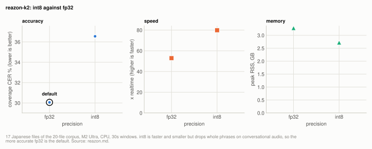

# Engine: reazon-k2

reazon-k2 does not change the default. At fp32 it scores 30.06% coverage CER on the 17[^r1]
Japanese files at 52.9x on CPU (mean of 3 runs), against turbo-nocond's 14.17% and parakeet's 25.68%[^r1]
([engines.md](../engines.md#experiment-the-japanese-only-engines-against-the-multilingual-defaults)).
On spontaneous, code-switching studio audio, training-domain match does not beat
Whisper's breadth. Decoded as one window, a 112s file loses content (305 characters
against 376 with 30s windows)[^r3], so the CLI decodes in 30s windows, and int8 drops whole
phrases on this corpus, so fp32 is the default.

| setting | default | why |
|---|---|---|
| `reazon --chunk-seconds` | `30` | not a sweep: one window over the 112s file returned 305 characters of a 422-character reference against 376 with 30s windows (31.52% against 15.64% CER), so windows are needed; 30s energy-minima windows hold the front end constant with the Voxtral rows |
| `reazon` precision | fp32 | int8 drops whole phrases mid-file on this corpus (36.55% against 30.06%); a test guards the default |

Source: [ultra-picker-speed.json](../../../benchmarks/results/2026-10/ultra-picker-speed.json) runs `pk_reazon_fp32_default_s1`, `pk_reazon_fp32_default_s2`, `pk_reazon_fp32_default_s3`; [ultra-engines-jp-only.json](../../../benchmarks/results/2026-10/ultra-engines-jp-only.json) runs `jp_reazon_int8_c30_r1`, `jp_reazon_int8_c30_r2`, `jp_reazon_int8_c30_r3`; [ultra-reazon-window.json](../../../benchmarks/results/2026-10/ultra-reazon-window.json) runs `reazon_fp32_whole_r112`

**Setup:** the 17 Japanese files of the [20-file corpus](../reference/corpus.md#the-20-file-corpus) (6.85h[^r0]), M2 Ultra, scored by coverage CER at `min_cut` 30 ([metrics.md](../reference/metrics.md)). The engine decodes greedily.

## Experiment: reazon-k2 int8 against fp32

**Basis:** the 17 Japanese files of the [20-file corpus](../reference/corpus.md#the-20-file-corpus), M2 Ultra, the authors' ONNX at fp32 and int8, 30s energy-minima windows.

<picture>
  <source media="(prefers-color-scheme: dark)" srcset="../img/reazon-precision-dark.svg">
  
</picture>

**Table:** reazon-k2 at fp32 and int8 on the 17 Japanese files (means of 3 runs each): accuracy, CPU throughput and peak resident memory (rows from [engines.md](../engines.md#experiment-the-japanese-only-engines-against-the-multilingual-defaults)).

| precision | JP coverage CER | kana CER | x realtime | peak |
|---|---|---|---|---|
| **fp32 (default)** | 30.06% | 27.29% | 52.9x | 3.28GB RSS |
| int8 | 36.55% | - | 79.9x | 2.72GB RSS |

Source: [ultra-picker-speed.json](../../../benchmarks/results/2026-10/ultra-picker-speed.json) runs `pk_reazon_fp32_default_s1`, `pk_reazon_fp32_default_s2`, `pk_reazon_fp32_default_s3`; [ultra-engines-jp-only.json](../../../benchmarks/results/2026-10/ultra-engines-jp-only.json) runs `jp_reazon_int8_c30_r1`, `jp_reazon_int8_c30_r2`, `jp_reazon_int8_c30_r3`, `jp_reazon_fp32_c30_rss` (the separate fp32 RSS run peaked at 3.08GB)

Reazon's release notes put int8 within ~0.3 CER of fp32 on JSUT, Common Voice and
TEDxJP-10K. On this corpus int8 drops whole phrases mid-file: 296 against 376
characters on one 112s recording[^r2], and 36.55% against 30.06%[^r2] over the corpus
([results table](../engines.md#experiment-the-japanese-only-engines-against-the-multilingual-defaults)).
Read-speech benchmarks and conversational material disagree about what
int8 costs; this corpus is the closer match to what the CLI is for, so fp32 is the
default and a test guards it.

## How it works

**reazon-k2 loses content when decoded whole-file.** Fed a 112s[^r0] file as one 120s
window it returned 305 characters of a 422-character reference, 31.52% CER[^r3], against 376
characters and 15.64% with 30s windows[^r3]. It is trained on short VAD segments and skips
outside that distribution, which is why its own recipe segments by VAD. Every figure here uses 30s <!-- not-measured: 30s is the window length -->
windows cut at energy minima, the same front end the Voxtral rows use. Parakeet shows the
opposite dependence on window length ([parakeet.md](parakeet.md#how-it-works)).

**reazon-k2 is deterministic.** Three decodes through the CLI code path give
byte-identical text and cues, so every single-run figure above is a score rather than
a draw.

## Reproducing

`scripts/benchmarks/run_reazon.py` drives the exact function the CLI runs
(`backends.reazon_k2_decode`), loads once outside the timing loop, and reports
kana/lenient CER beside coverage CER. Result files: `benchmarks/reazon_fp32_c30.json`,
`benchmarks/reazon_int8_c30.json`.

## Related

- [engines.md](../engines.md): reazon and parakeet against the multilingual engines, and the Whisper rows compared here
- [parakeet.md](parakeet.md): the other Japanese-only engine
- [corpus.md](../reference/corpus.md): the corpus
- [metrics.md](../reference/metrics.md): coverage CER and `min_cut`

[^r0]: [corpus.json](../../../benchmarks/results/corpus.json)
[^r1]: [ultra-picker-speed.json](../../../benchmarks/results/2026-10/ultra-picker-speed.json) runs `pk_reazon_fp32_default_s1`, `pk_reazon_fp32_default_s2`, `pk_reazon_fp32_default_s3`; [ultra-whisper-sizes.json](../../../benchmarks/results/2026-10/ultra-whisper-sizes.json) runs `whisper_turbo_nocond`, `whisper_turbo_nocond_r2`, `whisper_turbo_nocond_r3`, `whisper_turbo_nocond_r4`, `whisper_turbo_nocond_r5`, `whisper_turbo_nocond_r6`; [ultra-picker-speed.json](../../../benchmarks/results/2026-10/ultra-picker-speed.json) runs `pk_parakeet_default_s1`, `pk_parakeet_default_s2`, `pk_parakeet_default_s3`
[^r2]: [ultra-picker-speed.json](../../../benchmarks/results/2026-10/ultra-picker-speed.json) runs `pk_reazon_fp32_default_s1`, `pk_reazon_fp32_default_s2`, `pk_reazon_fp32_default_s3`; [ultra-engines-jp-only.json](../../../benchmarks/results/2026-10/ultra-engines-jp-only.json) runs `jp_reazon_int8_c30_r1`, `jp_reazon_int8_c30_r2`, `jp_reazon_int8_c30_r3`
[^r3]: [ultra-reazon-window.json](../../../benchmarks/results/2026-10/ultra-reazon-window.json) runs `reazon_fp32_whole_r112`; [ultra-picker-speed.json](../../../benchmarks/results/2026-10/ultra-picker-speed.json) runs `pk_reazon_fp32_default_s1`, `pk_reazon_fp32_default_s2`, `pk_reazon_fp32_default_s3`
