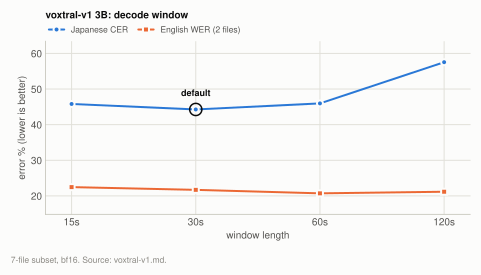
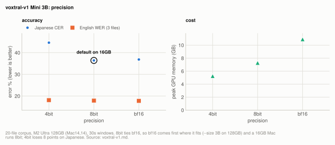
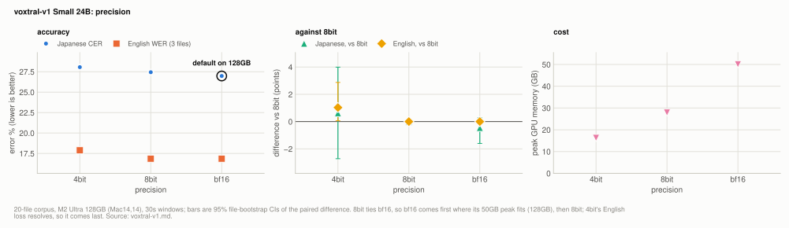
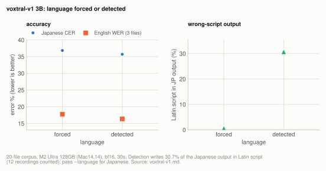

# Engine: Voxtral v1 (Mini 3B and Small 24B, 2507)

`--model voxtral-v1` adds two sizes and changes no default engine. Its size and precision
are chosen by memory ([How a variant is chosen](../../DEFAULTS.md#how-a-variant-is-chosen)),
and its windows are 30s. On the M2 Ultra 128GB that is the 24B at bf16, which scores 26.98%[^v1s]
Japanese coverage CER and 16.86% English coverage WER at 2.4x realtime in 50.08GB (one run)[^v1s];
on a 16GB Mac it is the 3B at 8bit, which scores 36.14% and 17.86% at 14.1x in 7.11 to 7.27GB[^v1a]
(each the mean of 3 runs on the M2 Ultra)[^v1a]. On Japanese both are behind every
other multilingual engine here (voxtral 15.20% at its M2 Ultra default, fp16[^v1b]; whisper turbo 14.17%[^v1b]; qwen3-asr 1.7B
18.62%)[^v1b]; on English the 24B's 16.86%[^v1s] is the lowest figure measured in this project with
the language given, against 18.65% for whisper turbo and 21.21% for voxtral at fp16[^v1b], but that is
three files, and the 24B at bf16 costs 50GB and runs at 2.4x[^v1s].

| setting | default | why |
|---|---|---|
| `--size` | by memory: `24B` where it fits, else `3B` | The 24B is better on Japanese by 8.97 points at 8bit (24B minus 3B -8.97, CI [-10.50, -7.48]), so it comes first. Its smallest peak, 16.27GB at 4bit, does not fit a 16GB Mac, where the 3B at 8bit (7.28GB) does. |
| `--quantization`, 3B | by memory: `bf16`, else `8bit` | bf16 ties 8bit (8bit minus bf16 -0.42 points on Japanese, CI [-1.23, +0.50]), so the larger build comes first where its 10.91GB peak fits: on a 128GB Mac with `--size 3B` pinned. A 16GB Mac runs 8bit. 4bit costs +8.18 points and comes last. |
| `--quantization`, 24B | by memory: `bf16`, else `8bit`, else `4bit` | 8bit ties bf16 (+0.46 on Japanese, CI [-0.27, +1.60]; an exact tie on English), so bf16 comes first where its 50.08GB peak fits, then 8bit at 27.92GB. 4bit costs about a point on English (+1.03, CI [+0.06, +2.87]) and comes last. |
| decode window | 30s | Lowest Japanese CER in the sweep, though 15s and 60s are not resolved against it; Japanese collapses at 120s. English prefers 60s by about a point (two files), which is not enough to move a default chosen on Japanese. |
| `--language` | as given; detected when omitted | Detection switches whole Japanese windows into other languages, so pass it for Japanese. |

Source: [ultra-voxtral-v1.json](../../../benchmarks/results/2026-10/ultra-voxtral-v1.json) runs `3b_4bit_c30`, `3b_8bit_c30`, `3b_bf16_c30`, `24b_4bit_c30`, `24b_8bit_c30`, `24b_bf16_c30`; [ultra-voxtral-v1-window.json](../../../benchmarks/results/2026-10/ultra-voxtral-v1-window.json) runs `sweep_3b_bf16_c60`.

**Setup:** the [7-file subset](../reference/corpus.md#the-7-file-subset) (5 Japanese, 2 English,
5.18h[^v1c]) for the window sweep and the [20-file corpus](../reference/corpus.md#the-20-file-corpus) (17
Japanese, 3 English, 7.95h with the superseded copy of one file[^v1h]) for everything else, on the M2 Ultra 128GB (Mac14,14),
2026-09-24/25, scored by
coverage CER/WER at `min_cut` 30/6 ([metrics.md](../reference/metrics.md)). Runner and measurement
details are under [How the runs were made](#how-the-runs-were-made).

## Experiment: the decode window

**Basis:** the [7-file subset](../reference/corpus.md#the-7-file-subset), M2 Ultra 128GB (Mac14,14), 2026-09-24/25; 3B, bf16.

<picture>
  <source media="(prefers-color-scheme: dark)" srcset="../img/voxtral-v1-window-dark.svg">
  
</picture>

**Table:** error, speed and peak memory of the 3B at bf16 by decode window.

| window | JP coverage CER | EN coverage WER | x realtime | peak |
|---|---|---|---|---|
| 15s | 45.81% | 22.47% | 10.5x | 10.86GB |
| **30s (default)** | **44.27%** | 21.70% | 10.0x | 10.91GB |
| 60s | 45.97% | **20.72%** | 6.4x | 10.91GB |
| 120s | 57.54% | 21.17% | 4.6x | 11.13GB |

Source: [ultra-voxtral-v1-window.json](../../../benchmarks/results/2026-10/ultra-voxtral-v1-window.json) runs `sweep_3b_bf16_c15`, `sweep_3b_bf16_c60`, `sweep_3b_bf16_c120`; [ultra-voxtral-v1.json](../../../benchmarks/results/2026-10/ultra-voxtral-v1.json) runs `3b_bf16_c30` (the 30s row: its rows for the 7 subset files; speed and peak are that 20-file run's)

Japanese is nominally best at 30s and collapses at 120s (+13.27, CI [+7.70, +17.15])[^v1w]. Paired over files, 60s against 30s is <!-- not-measured: window lengths are configuration values -->
+1.70 points, CI [-0.13, +3.87][^v1w], 30s winning 4 of 5 files; 15s against 30s is not
resolvable either (+1.54, CI [-7.74, +10.72])[^v1w] and swings by more than 11 points[^v1w] on single
files in both directions, which is what loops do to a per-file score. English prefers 60s <!-- not-measured: window lengths are configuration values -->
by about a point (-0.98, CI [-1.52, -0.75], both files)[^v1w]. Neither window's Japanese
difference against 30s resolves, so the default rests on 30s's nominal Japanese lead. (The <!-- not-measured: window lengths are configuration values -->
30s speed in the table is from the 20-file run, so it is not comparable with the other rows.) <!-- not-measured: window lengths are configuration values -->
A 300s arm was stopped after the trend was clear. <!-- not-measured: window lengths are configuration values -->

The mechanism is Qwen3-ASR's: each window's token budget scales with its length, so a
repetition loop in a longer window writes more text before it is cut off.

## Experiment: precision, 3B

**Basis:** the [20-file corpus](../reference/corpus.md#the-20-file-corpus), M2 Ultra 128GB (Mac14,14), 2026-09-24/25; 3B, 30s windows.

<picture>
  <source media="(prefers-color-scheme: dark)" srcset="../img/voxtral-v1-precision-3b-dark.svg">
  
</picture>

**Table:** error, speed, peak memory and weight size of the 3B by precision.

| precision | JP coverage CER | kana CER | EN coverage WER | x realtime | peak | weights |
|---|---|---|---|---|---|---|
| 4bit | 44.60% | 50.62% | 18.08% | 14.0x | 5.25GB | 3.55GB |
| **8bit (default on 16GB)** | **36.41%** | **39.23%** | 17.86% | 12.9x | 7.28GB | 5.57GB |
| **bf16 (default with `--size 3B` on 128GB)** | 36.84% | 39.98% | **17.77%** | 10.0x | 10.91GB | 9.37GB |

Source: [ultra-voxtral-v1.json](../../../benchmarks/results/2026-10/ultra-voxtral-v1.json) runs `3b_4bit_c30`, `3b_8bit_c30`, `3b_bf16_c30` (16 valid Japanese files). The weights column is the on-disk size of each build, not a run. <!-- not-measured: the weights column is on-disk build sizes -->

8bit ties bf16: -0.42 points on Japanese, CI [-1.23, +0.50], and +0.09 on English, CI[^v1p]
[-0.06, +0.19][^v1p]. 4bit does not tie 8bit: **+8.18 points on Japanese, CI [+4.87, +11.99],
worse on 15 of 16 files**[^v1p] (English +0.21, not resolvable). Qwen3-ASR at its 15s window also
loses at 4bit, by less (+2.79 on the 0.6B, +1.16 on the 1.7B)[^v1q], and the 24B below does
not resolve, so among the models measured here 4bit costs most on this 3B. With 8bit and bf16
tied, bf16 comes first wherever its 10.91GB peak fits[^v1p], because a tie goes to the larger
build; a 16GB Mac, where it does not fit, runs 8bit at 7.28GB[^v1p].

## Experiment: Small 24B

**Basis:** the [20-file corpus](../reference/corpus.md#the-20-file-corpus), M2 Ultra 128GB (Mac14,14), 2026-09-24/25; 24B, 30s windows (the window was swept on the 3B only).

<picture>
  <source media="(prefers-color-scheme: dark)" srcset="../img/voxtral-v1-precision-24b-dark.svg">
  
</picture>

**Table:** error, speed, peak memory and weight size of the 24B by precision, with each build's paired difference against 8bit (points, 95% file-bootstrap CI). <!-- not-measured: 95% is the confidence level -->

| precision | JP coverage CER | kana CER | EN coverage WER | JP vs 8bit | EN vs 8bit | x realtime | peak | weights |
|---|---|---|---|---|---|---|---|---|
| 4bit | 28.06% | 32.05% | 17.89% | +0.62 [-2.72, +3.99] | +1.03 [+0.06, +2.87] | **4.3x** | **16.27GB** | 14.7GB |
| 8bit | 27.44% | 28.82% | **16.86%** | 0.00 | 0.00 | 3.1x | 27.92GB | 26.4GB |
| **bf16 (default on 128GB)** | **26.98%** | 28.91% | **16.86%** | -0.46 [-1.60, +0.27] | 0.00 (exact tie) | 2.4x | 50.08GB | 48.5GB |

Source: [ultra-voxtral-v1.json](../../../benchmarks/results/2026-10/ultra-voxtral-v1.json) runs `24b_4bit_c30`, `24b_8bit_c30`, `24b_bf16_c30` (16 valid Japanese files). The weights column is the on-disk size of each build, not a run. <!-- not-measured: the weights column is on-disk build sizes -->

**Size is worth far more than precision here.** bf16 24B against the 3B at 8bit, the 16GB default, is -9.43 <!-- not-measured: machine memory size -->
points on Japanese, CI [-11.07, -7.92], better on all 16 files, and -1.01 on English, CI[^v1s]
[-3.15, -0.10], all three files[^v1s]. It still loops, on 9 to 13 of the 16 Japanese files
depending on precision, so the loops are a property of the family rather than of the small
model.

Within the size the ladder is flat: the three Japanese figures span about one point.
8bit against bf16 is +0.46 on Japanese, CI [-0.27, +1.60], and an exact tie on English,[^v1t]
at 56% of the memory[^v1t]. bf16 is ahead on 12 of 15 Japanese files by small margins (sign
test p=0.035), so it is the better choice where 50GB is free[^v1t], but the aggregate does not
resolve it. 4bit against 8bit is not resolvable on Japanese (+0.62, CI [-2.72, +3.99])[^v1t]
and costs about a point on English (+1.03, CI [+0.06, +2.87], all three files)[^v1t].

bf16 is the default where its 50.08GB peak[^v1t] fits, as on the M2 Ultra 128GB: it ties 8bit, and
a tie goes to the larger build. 8bit is next, at 22GB less[^v1t]; a 16GB Mac fits no 24B build
and runs the 3B.

The 8bit build here was produced by `scripts/benchmarks/convert_drop_source.py` rather than
by the first-use conversion, because the host could not hold the 48.5GB of shards and the <!-- not-measured: hub file sizes -->
27GB output at once. <!-- not-measured: on-disk size of the 8bit build --> It runs the same mlx-audio calls in the same order and deletes the
shards before saving; on the 3B its 8bit output was checked against a normal conversion
and all 1190 tensors and the config were bit-identical[^v1k].

## Experiment: leaving the language to the model

**Basis:** the [20-file corpus](../reference/corpus.md#the-20-file-corpus), M2 Ultra 128GB (Mac14,14), 2026-09-24/25; 3B, bf16, 30s windows, with and without the `lang:` prefix.

<picture>
  <source media="(prefers-color-scheme: dark)" srcset="../img/voxtral-v1-language-dark.svg">
  
</picture>

**Table:** error, Latin-script share of the Japanese output and loop count of the 3B at bf16, with the language forced from the reference or detected by the model.

| language | JP coverage CER | EN coverage WER | Latin-script share of JP output | files with loops |
|---|---|---|---|---|
| forced from the reference | 36.84% | 17.77% | 0.6% | 13 |
| detected by the model | 35.70% | **16.36%** | **30.7%** | 10 |

Source: [ultra-voxtral-v1.json](../../../benchmarks/results/2026-10/ultra-voxtral-v1.json) runs `3b_bf16_c30`, `3b_bf16_c30_auto` (loops counted over the 16 valid Japanese files); [ultra-derived-measures.json](../../../benchmarks/results/2026-10/ultra-derived-measures.json) runs `derive_v1latin` (Latin-script share: half- and full-width Latin letters over non-whitespace characters of the hypothesis, pooled over the 12 Japanese recordings whose references are transcripts, as counted by the run's derive_text_stats.py; the other files are not counted)

On English, detection is better on all three files (-1.42, CI [-2.70, -0.06])[^v1l], and its
output contains no other script. On Japanese the aggregate moves by -1.14 (CI [-3.18,
+1.27])[^v1l], but the output is different in kind: on 9 of the 12 Japanese recordings
counted, 13.6% to 44.1% of the characters are Latin script[^v1x] (the other three 0.0% to 5.2%,
and 0.0% to 0.99% per file with the language forced)[^v1x], whole windows transcribed or
translated as English or Turkish. The share is counted as half- and full-width Latin
letters over non-whitespace characters, the definition of the derive script recorded with the saved count. Those recordings contain side conversation in other languages that the
references omit, and coverage CER excuses text absent from the reference by design, so a
window emitted in the wrong language costs little on this metric while being useless to a
reader. The other files, which have no such chatter, barely changed in an earlier
count that has no saved data; the saved count covers only the recordings.

So `--language` is honoured when given and the model detects when it is not, and for
Japanese the flag should be passed.

## Experiment: repeat decodes

**Basis:** the 7 shortest files of the [20-file corpus](../reference/corpus.md#the-20-file-corpus), M2 Ultra 128GB (Mac14,14), 2026-09-24/25; 3B at 8bit and 24B at 4bit, each file decoded twice.

The 7 shortest files, each decoded twice: 7/7 byte-identical for the 3B at 8bit[^v1d] and 7/7
for the 24B at 4bit, as greedy decoding predicts. So one run per configuration is its
score.

## How it works

**Japanese is outside what these weights claim.** The model card lists English, Spanish,
French, Portuguese, Hindi, German, Dutch and Italian. On this corpus's Japanese the 3B
falls into greedy repetition loops in most long files, and those loops decide its
Japanese score more than anything tunable does.

mlx-asr uses mlx-audio's model classes for the forward pass and nothing else from its
Voxtral v1 path (`mlx_asr/voxtral_v1.py`). mlx-audio's own entry point is not used, for
three reasons that each fail quietly:

- **The prompt needs torch and soundfile upstream.** `Model.generate` builds its input with
  transformers' `VoxtralProcessor.apply_transcription_request`, which accepts no
  `return_tensors` other than `"pt"`, and mistral_common's `Audio` asserts that soundfile
  is installed before it will hold an array. Neither is a dependency of this project. The
  prompt, `[BOS][INST][BEGIN_AUDIO][AUDIO]x n[/INST]lang:xx[TRANSCRIBE]`, is assembled from
  mistral_common's own pieces instead, and `tests/test_voxtral_v1.py` checks it against
  `encode_transcription` token for token.
- **`max_tokens` defaults to 128 per call**, about a minute of speech, and exhausting it
  ends the transcript without an error. The window loop and its per-window budget are the
  ones Qwen3-ASR uses, for the same reason ([qwen3-asr.md](qwen3-asr.md)).
- **The authors' repos hold every weight twice**, as `consolidated.safetensors` in
  Mistral's native key layout beside the HF-format shards, and mlx-audio's loader prefers
  the consolidated file, whose keys this model's `sanitize` does not map. Only the shards
  are downloaded (48.5GB rather than 97GB for Small 24B). <!-- not-measured: hub file sizes -->

Weights come from `mistralai/` only. bf16 loads from their shards directly; 8bit and 4bit
are converted once on first use into the Hugging Face cache, by mlx-audio's own converter,
which leaves the audio encoder unquantized.

Parity against the upstream path was checked once, on 30s windows of a Japanese and an
English file: prompt token ids identical, maximum feature difference 0.0, decoded text
identical, on all 7 windows, including one that loops. That check needs torch, soundfile
and librosa, which is exactly what this path exists to avoid, so it is not kept as a
script; the token-level prompt test in `tests/test_voxtral_v1.py` is what guards the
equivalence from here on.

### How the runs were made

`scripts/benchmarks/run_qwen3.py`, which drives both windowed text-only engines through
the same loop in `mlx_asr/backends.py` (same splitter, same per-window token budget, same
decode-health checks) and scores with the same functions as every other runner, on the
same cached 16kHz mono files. Model load is outside the timing loop. Language is set per
file from the reference script, as in `run_whisper.py`, except in the one arm that tests
leaving it out.

Decoding is greedy (the card recommends `temperature=0.0` for transcription), so one run
is its score. Peak memory is the maximum of `mx.get_peak_memory()` over the corpus,
including the load, which is the figure a CLI run with `--stats-json` reports. Throughput
is the run's own.

### What it does not do

- **No subtitles.** `-f srt`, `-f vtt` and `-f all` exit 2. The weights emit text and no
  times, and the cue boundaries would be decode windows.
- **No batching.** `--max-batch` exits 2. Windows are decoded one at a time.
- **Every Voxtral Realtime flag is refused**, as on the other non-Voxtral engines:
  `--prompt`, `--delay-ms`, `--vad`, `--compact-silence`, the KV flags and the cue flags.

## Not settled

- **15s against 30s**, and 60s against 30s on Japanese, do not resolve on the 7-file <!-- not-measured: window lengths are configuration values -->
  subset; 30s is the default because it is lowest in aggregate, wins 4 of 5 files[^v1w] <!-- not-measured: window lengths are configuration values -->
  against 60s. <!-- not-measured: window lengths are configuration values -->
- **bf16 against 8bit on the 24B**: bf16 is ahead on 12 of 15 Japanese files, but the
  aggregate CI spans zero.
- **The window was swept on the 3B only**; the 24B uses the same 30s.
- **English is three files** (two in the window sweep), so every English difference
  here rests on very few recordings.

## Related

- [qwen3-asr.md](qwen3-asr.md): the other windowed text-only engine, which shares this
  engine's window loop and token budget.
- [engines.md](../engines.md): the Voxtral and Whisper comparison the Japanese and English
  figures above are set against.
- [metrics.md](../reference/metrics.md): coverage CER/WER and the paired comparisons.
- [corpus.md](../reference/corpus.md): the 20-file corpus and the 7-file subset.
- [peak-memory.md](../reference/peak-memory.md): how the peak figures are measured across engines.
- [RESULTS.md](../../../RESULTS.md): the headline rows for both sizes.

[^v1a]: [ultra-picker-speed.json](../../../benchmarks/results/2026-10/ultra-picker-speed.json) runs `pk_v1_3B_8bit_c30_s1`, `pk_v1_3B_8bit_c30_s2`, `pk_v1_3B_8bit_c30_s3`; [ultra-picker-speed-24b.json](../../../benchmarks/results/2026-10/ultra-picker-speed-24b.json) runs `pk_v1_24B_8bit_c30_s1`, `pk_v1_24B_8bit_c30_s2`, `pk_v1_24B_8bit_c30_s3`
[^v1b]: [ultra-voxtral-precision-default.json](../../../benchmarks/results/2026-10/ultra-voxtral-precision-default.json) runs `vox_wfp16_c30b128_kv8`, `vox_wfp16_c30b128_kv8_r2`, `vox_wfp16_c30b128_kv8_r3`; [ultra-whisper-sizes.json](../../../benchmarks/results/2026-10/ultra-whisper-sizes.json) runs `whisper_turbo_nocond`, `whisper_turbo_nocond_r2`, `whisper_turbo_nocond_r3`, `whisper_turbo_nocond_r4`, `whisper_turbo_nocond_r5`, `whisper_turbo_nocond_r6`; [ultra-picker-speed.json](../../../benchmarks/results/2026-10/ultra-picker-speed.json) runs `pk_qwen3_1.7B_8bit_c15_s1`, `pk_qwen3_1.7B_8bit_c15_s2`, `pk_qwen3_1.7B_8bit_c15_s3`
[^v1w]: [ultra-voxtral-v1-window.json](../../../benchmarks/results/2026-10/ultra-voxtral-v1-window.json) runs `sweep_3b_bf16_c15`, `sweep_3b_bf16_c60`, `sweep_3b_bf16_c120`; [ultra-voxtral-v1.json](../../../benchmarks/results/2026-10/ultra-voxtral-v1.json) runs `3b_bf16_c30` (its rows for the 7 subset files)
[^v1p]: [ultra-voxtral-v1.json](../../../benchmarks/results/2026-10/ultra-voxtral-v1.json) runs `3b_4bit_c30`, `3b_8bit_c30`, `3b_bf16_c30`
[^v1q]: [ultra-qwen3-precision-c15.json](../../../benchmarks/results/2026-10/ultra-qwen3-precision-c15.json) runs `qwen3_0.6B_4bit_c15`, `qwen3_0.6B_8bit_c15`, `qwen3_1.7B_4bit_c15`, `qwen3_1.7B_8bit_c15`
[^v1s]: [ultra-voxtral-v1.json](../../../benchmarks/results/2026-10/ultra-voxtral-v1.json) runs `24b_bf16_c30`, `3b_8bit_c30`
[^v1t]: [ultra-voxtral-v1.json](../../../benchmarks/results/2026-10/ultra-voxtral-v1.json) runs `24b_4bit_c30`, `24b_8bit_c30`, `24b_bf16_c30`
[^v1l]: [ultra-voxtral-v1.json](../../../benchmarks/results/2026-10/ultra-voxtral-v1.json) runs `3b_bf16_c30`, `3b_bf16_c30_auto`
[^v1c]: [corpus.json](../../../benchmarks/results/corpus.json); [revisions.json](../../../benchmarks/results/revisions.json) (the runs used the previous 558.2s copy of `71bb5eba3baa`)
[^v1h]: [ultra-voxtral-v1.json](../../../benchmarks/results/2026-10/ultra-voxtral-v1.json) runs `3b_8bit_c30` (sum of the rows' duration_s, which include the previous 558.2s copy of file 71bb5eba3baa); [revisions.json](../../../benchmarks/results/revisions.json)
[^v1d]: [ultra-voxtral-v1-window.json](../../../benchmarks/results/2026-10/ultra-voxtral-v1-window.json) runs `det_3b_8bit`
[^v1x]: [ultra-derived-measures.json](../../../benchmarks/results/2026-10/ultra-derived-measures.json) runs `derive_v1latin` (arms v1:voxtral-v1-3b_bf16_c30_auto and v1:voxtral-v1-3b_bf16_c30; Latin-script share: half- and full-width Latin letters over non-whitespace characters of the hypothesis, pooled over the 12 Japanese recordings whose references are transcripts, as counted by the run's derive_text_stats.py; the other files are not counted)
[^v1k]: [ultra-voxtral-v1-conversion.json](../../../benchmarks/results/2026-10/ultra-voxtral-v1-conversion.json) runs `v1_conv_normal_3b_8bit`, `v1_conv_dropsrc_cmp_3b_8bit` (3B 8-bit, first-use conversion against convert_drop_source.py: keys 1190 against 1190, 0 tensors differing, config.json identical)
