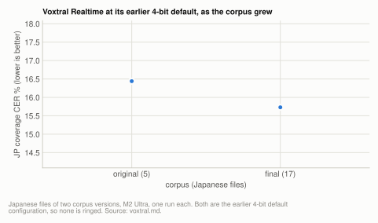

# Engine: Voxtral Realtime

`--model voxtral` (Voxtral Mini 4B Realtime, 2602) is the default engine. Its weights depend
on the machine: the CLI loads fp16 where it fits and 8-bit on 16GB Macs
([how a variant is chosen](../../DEFAULTS.md#how-a-variant-is-chosen)). On the 20-file corpus
the M2 Ultra 128GB default (fp16, 30s, batch 128) scores 15.20%[^vx1] Japanese coverage CER and
21.21% English WER at 23.9x realtime[^vx1] (mean of 3 runs), and the M4 16GB default (8-bit,
30s, batch 32) 15.12% and 21.17% at 6.67x[^vx6]. On the Ultra that ties Whisper
turbo-nocond (mean of 6 runs) on Japanese over files, +1.03 points with CI [-0.11, +2.25][^vx2],
at 1.02-1.30x its speed[^vx2] ([engines.md](../engines.md#experiment-voxtral-against-whisper)). It needs
no language hint and no long-form-stability flag, and greedy decoding reproduces
byte-identically on one machine, so one run is a score rather than a draw. Most of its
settings are levers with their own page, linked from the table below; several of those
flags exist only on this engine and the others refuse them.

| setting | default | why |
|---|---|---|
| `--delay-ms` | `2400` | the largest accuracy lever measured, at no throughput cost ([delay.md](../delay.md)) |
| `--chunk-seconds` and batch | chunk per chip (30s on M2 Ultra and M4, and 30s on chips with no profile); batch from memory (128 on M2 Ultra 128GB; 32 on M4 16GB, where the profile caps it) | 30s and 60s are indistinguishable on accuracy on the 20-file corpus, so throughput decides, and 30s/B32 is faster than 60s/B16 on both machines measured (M4 at 4-bit: 6.37x, the mean of 3 runs, against 4.66x); the M4 batch is capped at 32 because B64 on a worst-case padded file at 60s peaked at 11.87GB, 93% of its 12.7GB working set ([chunking.md](../chunking.md), [decode-throughput.md](../decode-throughput.md)) |
| `--overlap-seconds` | 0 | won on one clip at 30s chunks, reversed sign on the 7-file corpus ([chunking.md](../chunking.md)) |
| `--quantization` | per machine, the first that fits: `fp16` (M2 Ultra 128GB), then `8bit` converted on first use (M4 16GB), then `4bit` | at 30s/B128 fp16 ties 8-bit (+0.11 points, CI [-0.01, +0.25]) and both beat 4-bit, which is last of five; the tie goes to the larger build where it fits. On the M4, 8-bit is 0.57 Japanese points below 4-bit (CI [-1.16, -0.13]) ([quantization.md](../quantization.md), [how a variant is chosen](../../DEFAULTS.md#how-a-variant-is-chosen)) |
| `--kv-bits` | `8` | ties unquantized KV on the corpus and reads half the cache bytes per step ([quantization.md](../quantization.md)) |
| `--gain` | `auto` | quiet input costs accuracy; `auto` lifts only quiet files and leaves the rest byte-identical ([input-level.md](../input-level.md)) |
| `--prompt` | empty | costs English 2.0 to 75.9 WER points in every arm tested, with no measurable vocabulary recall ([prompt.md](../prompt.md)) |
| `--gap-seconds`, `--max-chars` | `1.2`, `28` | deliberately not the sweep optimum, since every timed reference is by one editor ([cue-layout.md](../cue-layout.md)) |

Source: [ultra-voxtral-precision.json](../../../benchmarks/results/2026-10/ultra-voxtral-precision.json) runs `vox_w4bit_c60b16_kv8`, `vox_w8bit_c60b16_kv8`, `vox_wfp16_c60b16_kv8`, `vox_wmxfp8_c60b16_kv8`, `vox_wnvfp4_c60b16_kv8`; [ultra-voxtral-prompt.json](../../../benchmarks/results/2026-10/ultra-voxtral-prompt.json) runs `prompt20_c30b32_kv8#none -`; [ultra-voxtral-prompt-derived.json](../../../benchmarks/results/2026-10/ultra-voxtral-prompt-derived.json) runs `prompt20_derived_names#terms en`, `prompt20_derived_freq#topic en` (the prompt range is the paired English difference against no prompt); [m4-voxtral-chunking.json](../../../benchmarks/results/2026-10/m4-voxtral-chunking.json) runs `c30b32`, `c30b32_r2`, `c30b32_r3`, `c60b16`; [m4-voxtral-worstcase.json](../../../benchmarks/results/2026-10/m4-voxtral-worstcase.json) runs `worst64_c60b64`; [m4-synthetic-decode.json](../../../benchmarks/results/2026-10/m4-synthetic-decode.json) runs `synth_nvfp4_r1` (the recorded GPU working set); [ultra-voxtral-precision-default.json](../../../benchmarks/results/2026-10/ultra-voxtral-precision-default.json) runs `vox_wfp16_c30b128_kv8`, `vox_w8bit_c30b128_kv8`, `vox_default_c30b128_kv8`; [m4-voxtral-8bit.json](../../../benchmarks/results/2026-10/m4-voxtral-8bit.json) runs `m4_c30b32_w8bit_r1`, `m4_c30b32_w8bit_r2`, `m4_c30b32_w8bit_r3`

**Setup:** each lever page states its own material and machine; the figures on this page are from the [20-file corpus](../reference/corpus.md#the-20-file-corpus) (17 Japanese, 3 English, 8.01h[^vxc]) and its earlier, smaller versions, M2 Ultra, scored by coverage CER/WER at `min_cut` 30/6 ([metrics.md](../reference/metrics.md)).

## Experiment: the shipped default on each machine

**Basis:** the [20-file corpus](../reference/corpus.md#the-20-file-corpus), the default configuration on each profiled machine, 3 runs each: M2 Ultra 128GB (fp16, `--chunk-seconds 30 --max-batch 128 --kv-bits 8 --delay-ms 2400`) and M4 16GB (8-bit, the same at `--max-batch 32`).

**Table:** Voxtral Realtime at its shipped default on each machine: weights, Japanese CER, English WER, speed and peak GPU memory.

| machine | weights | JP coverage CER | EN coverage WER | x realtime | peak |
|---|---|---|---|---|---|
| M2 Ultra 128GB | fp16 | 15.20% | 21.21% | 23.9x (23.7 to 24.0x) | 17.14GB |
| M4 16GB | 8-bit, converted on first use | 15.12% | 21.17% | 6.67x (6.61 to 6.76x) | 6.78GB |

Source: [ultra-voxtral-precision-default.json](../../../benchmarks/results/2026-10/ultra-voxtral-precision-default.json) runs `vox_wfp16_c30b128_kv8`, `vox_wfp16_c30b128_kv8_r2`, `vox_wfp16_c30b128_kv8_r3`; [m4-voxtral-8bit.json](../../../benchmarks/results/2026-10/m4-voxtral-8bit.json) runs `m4_c30b32_w8bit_r1`, `m4_c30b32_w8bit_r2`, `m4_c30b32_w8bit_r3`

Both replace 4-bit weights, which were the default on every machine before the variant
selector. Paired on the same machine, fp16 is 0.60 Japanese points below 4-bit on the Ultra
(CI [-1.07, -0.25]) and 8-bit 0.57 below it on the M4 (CI [-1.16, -0.13])[^vx7]; on English
neither difference is resolved[^vx7]. The cost differs by machine: on the Ultra fp16 runs at
23.9x against 4-bit's 33.6x and peaks at 17.14GB against 11.33GB[^vx7], while on the M4 8-bit
is not slower than 4-bit (6.67x against 6.37x)[^vx7].

## Experiment: the 4-bit default as the corpus grew

**Basis:** the Japanese files of the [7-file subset](../reference/corpus.md#the-7-file-subset) (5) and the [20-file corpus](../reference/corpus.md#the-20-file-corpus) (17, plus 3 English), M2 Ultra (2026-08-06 for the 20-file run, English re-scored 2026-08-19), `--chunk-seconds 30 --max-batch 32 --kv-bits 8 --delay-ms 2400`, 4-bit weights (the default at the time), one deterministic run per corpus; the Voxtral rows of [Voxtral against Whisper](../engines.md#experiment-voxtral-against-whisper) and [the Whisper margin as the corpus grew](../engines.md#experiment-the-whisper-margin-as-the-corpus-grew).

<picture>
  <source media="(prefers-color-scheme: dark)" srcset="../img/voxtral-corpus-growth-dark.svg">
  
</picture>

**Table:** Voxtral Realtime at its earlier 4-bit default on each corpus version: Japanese CER, English WER and speed where measured.

| corpus | JP files | JP coverage CER | EN coverage WER | x realtime |
|---|---|---|---|---|
| original | 5 | 16.44% | - | - |
| final | 17 | 15.73% | 21.50% | 28.9x |

Source: [ultra-voxtral-prompt-trap.json](../../../benchmarks/results/2026-10/ultra-voxtral-prompt-trap.json) runs `prompt_trap7_none` (the 5 Japanese files); [ultra-voxtral-batch.json](../../../benchmarks/results/2026-10/ultra-voxtral-batch.json) runs `c30b32`, `c30b32_r2`, `c30b32_r3`; [ultra-voxtral-headline.json](../../../benchmarks/results/2026-10/ultra-voxtral-headline.json) runs `vox_default_c30b32_kv8` (speed is the mean of the four).

Voxtral's own number barely moved (16.44 -> 15.73)[^vx5] while the corpus more than
tripled. Its Japanese accuracy reproduced the earlier session exactly (15.73% over the valid rows; 16.22% as recorded, with the superseded copy of one file)[^vx3], across
three separate sessions and two reference-loader versions. The English figure is the one
after the 2026-08-19 reference-loader fix, which lowered the Voxtral English aggregate to
21.50%[^vx3] ([metrics.md](../reference/metrics.md)).

Against the other engines on the same files, Whisper turbo-nocond was ahead of this 4-bit
arm on both languages and slower; at the fp16 default its Japanese lead is no longer
resolved over files. Every other engine family is behind on Japanese
([engines.md](../engines.md)). On the single narration clip, where the reference is
complete, Voxtral scores 7.28% plain CER, ahead of turbo-nocond's 10.42%[^vx4]
([clean narration](../engines.md#experiment-clean-narration)).

## Related

- [engines.md](../engines.md): Voxtral against Whisper and the other engines, and why it is the default
- [delay.md](../delay.md): `--delay-ms`, Voxtral only
- [chunking.md](../chunking.md): chunk length, overlap and cut points
- [decode-throughput.md](../decode-throughput.md): batch size, Voxtral only
- [quantization.md](../quantization.md): weight and KV-cache precision
- [input-level.md](../input-level.md): `--gain`, Voxtral only
- [prompt.md](../prompt.md): `--prompt`, Voxtral only
- [cue-layout.md](../cue-layout.md): subtitle cue grouping, Voxtral only
- [timestamps.md](../timestamps.md): Voxtral's timestamps against Whisper's
- [determinism.md](../reference/determinism.md): why one run is a score
- [voxtral-v1.md](voxtral-v1.md): the earlier, non-realtime Voxtral models, a separate engine family

[^vx1]: [ultra-voxtral-precision-default.json](../../../benchmarks/results/2026-10/ultra-voxtral-precision-default.json) runs `vox_wfp16_c30b128_kv8`, `vox_wfp16_c30b128_kv8_r2`, `vox_wfp16_c30b128_kv8_r3`
[^vx2]: [ultra-voxtral-precision-default.json](../../../benchmarks/results/2026-10/ultra-voxtral-precision-default.json) runs `vox_wfp16_c30b128_kv8`, `vox_wfp16_c30b128_kv8_r2`, `vox_wfp16_c30b128_kv8_r3`; [ultra-whisper-sizes.json](../../../benchmarks/results/2026-10/ultra-whisper-sizes.json) runs `whisper_turbo_nocond`, `whisper_turbo_nocond_r2`, `whisper_turbo_nocond_r3`, `whisper_turbo_nocond_r4`, `whisper_turbo_nocond_r5`, `whisper_turbo_nocond_r6` (paired on the per-file mean of each side's runs, bootstrap over the 17 Japanese files; speed ratio range: slowest Voxtral run over fastest Whisper run, and fastest over slowest)
[^vx3]: [ultra-voxtral-batch.json](../../../benchmarks/results/2026-10/ultra-voxtral-batch.json) runs `c30b32`, `c30b32_r2`, `c30b32_r3`; [ultra-voxtral-headline.json](../../../benchmarks/results/2026-10/ultra-voxtral-headline.json) runs `vox_default_c30b32_kv8`
[^vx4]: [ultra-engines-narration.json](../../../benchmarks/results/2026-10/ultra-engines-narration.json) runs `clip_vox_c60b16_kv8_r1`, `clip_vox_c60b16_kv8_r2`, `clip_vox_c60b16_kv8_r3`, `clip_whisper_turbo_nocond_r1`, `clip_whisper_turbo_nocond_r2`, `clip_whisper_turbo_nocond_r3`
[^vxc]: [corpus.json](../../../benchmarks/results/corpus.json)
[^vx5]: [ultra-voxtral-prompt-trap.json](../../../benchmarks/results/2026-10/ultra-voxtral-prompt-trap.json) runs `prompt_trap7_none`; [ultra-voxtral-batch.json](../../../benchmarks/results/2026-10/ultra-voxtral-batch.json) runs `c30b32`, `c30b32_r2`, `c30b32_r3`; [ultra-voxtral-headline.json](../../../benchmarks/results/2026-10/ultra-voxtral-headline.json) runs `vox_default_c30b32_kv8`
[^vx6]: [m4-voxtral-8bit.json](../../../benchmarks/results/2026-10/m4-voxtral-8bit.json) runs `m4_c30b32_w8bit_r1`, `m4_c30b32_w8bit_r2`, `m4_c30b32_w8bit_r3`
[^vx7]: [ultra-voxtral-precision-default.json](../../../benchmarks/results/2026-10/ultra-voxtral-precision-default.json) runs `vox_wfp16_c30b128_kv8`, `vox_wfp16_c30b128_kv8_r2`, `vox_wfp16_c30b128_kv8_r3`; [ultra-voxtral-headline.json](../../../benchmarks/results/2026-10/ultra-voxtral-headline.json) runs `vox_default_c30b128_kv8`, `vox_default_c30b128_kv8_r2`, `vox_default_c30b128_kv8_r3`; [m4-voxtral-8bit.json](../../../benchmarks/results/2026-10/m4-voxtral-8bit.json) runs `m4_c30b32_w8bit_r1`, `m4_c30b32_w8bit_r2`, `m4_c30b32_w8bit_r3`; [m4-voxtral-chunking.json](../../../benchmarks/results/2026-10/m4-voxtral-chunking.json) runs `c30b32`, `c30b32_r2`, `c30b32_r3` (paired against `c30b32`; speeds are means of 3 runs)
