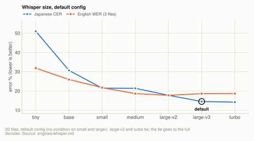
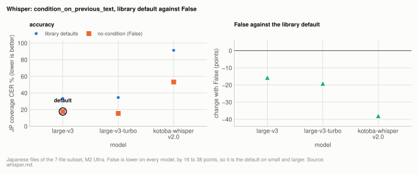
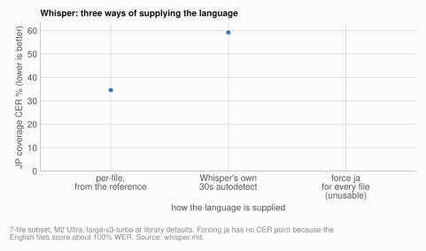
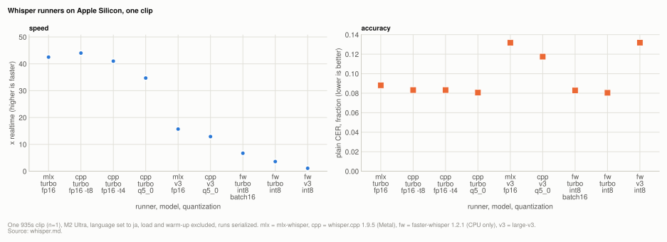

# Engine: Whisper

`large-v3` is Whisper's default size (since 2026-10-06). It ties `turbo` on the 20-file
corpus (14.51% against 14.17% Japanese coverage CER, 18.59% against 18.65% English WER,[^w1]
means of 6 runs; paired, large-v3 minus turbo is +0.34, CI [-0.54, +1.29])[^w1], and the tie went
to capacity, with `turbo` kept as the speed option at 1.8x the throughput[^w1]
and 1.5GB less memory[^w1]. The largest Whisper lever measured is
`condition_on_previous_text=False`, worth 6 to 19 Japanese CER points on the 7-file subset[^w6],
which the CLI sets on `small` and larger. The language is best supplied per file: Whisper's own 30s <!-- not-measured: 30s is the length of Whisper's language-detection window -->
autodetect cost 25 points[^w3] on the 7-file subset. Among Apple Silicon runners, whisper.cpp is
nominally ahead of mlx-whisper on both speed and CER on one clip, by margins inside that
clip's noise band, and faster-whisper has no GPU path here. How
Whisper compares with the other engines is on [engines.md](../engines.md).

| setting | default | why |
|---|---|---|
| Whisper `--size` | `large-v3` | ties `turbo` at n=20 (14.51% vs 14.17% JP); the tie goes to capacity, turbo stays the speed option |
| Whisper `condition_on_previous_text` | `False` on `small` and larger | worth 6 to 19 JP CER points on the 7-file subset; library defaults on `tiny` and `base` |

Source: [ultra-whisper-sizes.json](../../../benchmarks/results/2026-10/ultra-whisper-sizes.json) runs `whisper_large-v3_nocond`, `whisper_large-v3_nocond_r2`, `whisper_large-v3_nocond_r3`, `whisper_large-v3_nocond_r4`, `whisper_large-v3_nocond_r5`, `whisper_large-v3_nocond_r6`, `whisper_turbo_nocond`, `whisper_turbo_nocond_r2`, `whisper_turbo_nocond_r3`, `whisper_turbo_nocond_r4`, `whisper_turbo_nocond_r5`, `whisper_turbo_nocond_r6`; [ultra-whisper-sizes-7file.json](../../../benchmarks/results/2026-10/ultra-whisper-sizes-7file.json) runs `w7_small_libdef_r1`, `w7_small_libdef_r2`, `w7_small_libdef_r3`, `w7_large-v2_libdef_r1`, `w7_large-v2_libdef_r2`, `w7_large-v2_libdef_r3`; [ultra-mincut-inputs.json](../../../benchmarks/results/2026-10/ultra-mincut-inputs.json) runs `mincut7_whisper_medium_libdef`, `mincut7_whisper_large-v3_libdef`, `mincut7_whisper_turbo_libdef`; [ultra-whisper-condition.json](../../../benchmarks/results/2026-10/ultra-whisper-condition.json) runs `cond7_whisper_large-v3_libdef_r2`, `cond7_whisper_large-v3_libdef_r3`, `cond7_whisper_turbo_libdef_r2`, `cond7_whisper_turbo_libdef_r3`; [ultra-whisper-sizes.json](../../../benchmarks/results/2026-10/ultra-whisper-sizes.json) runs `whisper_small_nocond`, `whisper_small_nocond_r2`, `whisper_small_nocond_r3`, `whisper_medium_nocond`, `whisper_medium_nocond_r2`, `whisper_medium_nocond_r3`, `whisper_large-v2_nocond`, `whisper_large-v2_nocond_r2`, `whisper_large-v2_nocond_r3`, `whisper_large-v3_nocond`, `whisper_large-v3_nocond_r2`, `whisper_large-v3_nocond_r3`, `whisper_large-v3_nocond_r4`, `whisper_large-v3_nocond_r5`, `whisper_large-v3_nocond_r6`, `whisper_turbo_nocond`, `whisper_turbo_nocond_r2`, `whisper_turbo_nocond_r3`, `whisper_turbo_nocond_r4`, `whisper_turbo_nocond_r5`, `whisper_turbo_nocond_r6` (library defaults minus no-condition per size, the no-condition side from the 20-file runs' rows of the 5 Japanese files)

**Setup:** the [20-file corpus](../reference/corpus.md#the-20-file-corpus) (17 Japanese, 3 English, 8.01h[^w0]) for the size sweep, the [7-file subset](../reference/corpus.md#the-7-file-subset) for the `condition_on_previous_text`, language and superseded tables, and [the single clip](../reference/corpus.md#the-single-clip) for the runner comparison; M2 Ultra, scored by coverage CER/WER at `min_cut` 30/6 ([metrics.md](../reference/metrics.md)).

## Experiment: every Whisper size at its default config

**Basis:** the [20-file corpus](../reference/corpus.md#the-20-file-corpus), M2 Ultra, each size at its default config.

20 files, 8.01h[^w0], M2 Ultra, `--no-condition` on `small` and larger and library defaults
on `tiny` and `base`, which is each size's default config. Peak GPU memory from
`mx.get_peak_memory()`, reset per file. An independent re-run reproduced the peaks here
and found that Whisper's figure grows with audio length rather than being a
property of the size ([peak-memory.md](../reference/peak-memory.md)). The last column is the superseded
7-file measurement at library defaults (see [Superseded](#superseded)), kept beside the new
one because the gap between them is a finding.

<picture>
  <source media="(prefers-color-scheme: dark)" srcset="../img/whisper-sizes-dark.svg">
  
</picture>

**Table:** every Whisper size at its default config on the 20-file corpus (means of 3 runs, 6 for `large-v3` and `turbo`): accuracy, throughput, peak GPU memory, and the superseded 7-file figure; `large-v3` ties `turbo` and the tie goes to capacity, so `large-v3` is the default.

| size | JP coverage CER | EN coverage WER | x realtime | peak GPU | old table, library defaults |
|---|---|---|---|---|---|
| `tiny` | 51.00% | 31.84% | **51.1x** | **3.98GB** | 51.80% |
| `base` | 30.67% | 25.93% | 32.0x | 4.07GB | 33.68% |
| `small` | 21.45% | 21.71% | 24.3x | 4.37GB | 30.07% |
| `medium` | 21.37% | 18.62% | 22.3x | 5.43GB | 34.43% |
| `large-v2` | 17.74% | 17.72% | 14.1x | 6.97GB | 39.49% |
| `large-v3` **(default)** | **14.51%** | 18.59% | 11.5x | 7.00GB | 33.40% |
| `turbo` | 14.17% | 18.65% | 21.0x | 5.53GB | 34.56% |

Source: [ultra-whisper-sizes.json](../../../benchmarks/results/2026-10/ultra-whisper-sizes.json) runs `whisper_tiny_libdef`, `whisper_tiny_libdef_r2`, `whisper_tiny_libdef_r3`, `whisper_base_libdef`, `whisper_base_libdef_r2`, `whisper_base_libdef_r3`, `whisper_small_nocond`, `whisper_small_nocond_r2`, `whisper_small_nocond_r3`, `whisper_medium_nocond`, `whisper_medium_nocond_r2`, `whisper_medium_nocond_r3`, `whisper_large-v2_nocond`, `whisper_large-v2_nocond_r2`, `whisper_large-v2_nocond_r3`, `whisper_large-v3_nocond`, `whisper_large-v3_nocond_r2`, `whisper_large-v3_nocond_r3`, `whisper_large-v3_nocond_r4`, `whisper_large-v3_nocond_r5`, `whisper_large-v3_nocond_r6`, `whisper_turbo_nocond`, `whisper_turbo_nocond_r2`, `whisper_turbo_nocond_r3`, `whisper_turbo_nocond_r4`, `whisper_turbo_nocond_r5`, `whisper_turbo_nocond_r6`; [ultra-mincut-inputs.json](../../../benchmarks/results/2026-10/ultra-mincut-inputs.json) runs `mincut7_whisper_large-v3_libdef`, `mincut7_whisper_turbo_libdef`, `mincut7_whisper_medium_libdef`; [ultra-whisper-condition.json](../../../benchmarks/results/2026-10/ultra-whisper-condition.json) runs `cond7_whisper_large-v3_libdef_r2`, `cond7_whisper_large-v3_libdef_r3`, `cond7_whisper_turbo_libdef_r2`, `cond7_whisper_turbo_libdef_r3`; [ultra-whisper-sizes-7file.json](../../../benchmarks/results/2026-10/ultra-whisper-sizes-7file.json) runs `w7_tiny_libdef_r1`, `w7_tiny_libdef_r2`, `w7_tiny_libdef_r3`, `w7_base_libdef_r1`, `w7_base_libdef_r2`, `w7_base_libdef_r3`, `w7_small_libdef_r1`, `w7_small_libdef_r2`, `w7_small_libdef_r3`, `w7_large-v2_libdef_r1`, `w7_large-v2_libdef_r2`, `w7_large-v2_libdef_r3` (old-table column, mean where several runs)

**`turbo` and `large-v3` tie**: 14.17% against 14.51% on Japanese, a 0.34-point gap[^w1] whose
paired interval over the 17 files, [-0.54, +1.29][^w1], contains zero, with turbo nominally ahead;
and 18.65% against 18.59% on English[^w1]. The earlier 7-file
table appeared to show turbo winning outright; at n=20 with both at their default config
the honest statement is that the corpus cannot separate them. Turbo is **1.8x faster**[^w1] and
uses 1.5GB less memory[^w1]. The default was turbo on that basis until 2026-10-06, and is now
**`large-v3`**: a tie on 20 files from a few sources is not evidence that turbo's 4-layer
decoder holds up on material the corpus does not cover, so the tie was broken toward
capacity, and turbo stays available as the speed option.

**The old measurement understated the three largest models the most.** `large-v2` read
39.49% at library defaults[^w7] against 17.74% at its default config[^w4], `turbo` 34.56%[^w2]
against 14.17%[^w1], and `large-v3` 33.40%[^w2] against 14.51%[^w1]: gaps of 19 to 22 points,
against cross-window repetition loops that `condition_on_previous_text=False` prevents.
`large-v2`'s three library-default runs spread from 27.78% to 56.79%[^w7], so a single draw
of that config says little. Anyone reading the old table would have concluded these models
were broken.

**Peak memory barely tracks download size.** `tiny` downloads 0.07GB <!-- not-measured: hub file size --> and peaks at 3.98GB[^w4],
because the working set is the 30s mel window and decoder activations rather than the
weights. So the whole size ladder fits in 4 to 7GB[^w4], and picking `tiny` to save memory buys
almost nothing while costing 36 points[^w4].

## Experiment: `condition_on_previous_text=False`

**Basis:** the Japanese files of the [7-file subset](../reference/corpus.md#the-7-file-subset), M2 Ultra, mlx-whisper library defaults against `condition_on_previous_text=False`.

Whisper's *library defaults* are worth 6 to 19 CER points on this material[^w6], all of it
cross-window repetition loops, so any Whisper figure taken without
`condition_on_previous_text=False` describes the defaults rather than the model. The CLI
sets that flag by default on `small` and larger. It is the single largest Whisper lever
here:

<picture>
  <source media="(prefers-color-scheme: dark)" srcset="../img/whisper-condition-dark.svg">
  
</picture>

**Table:** Japanese coverage CER per model at library defaults and with `condition_on_previous_text=False`, and the change (Whisper rows: means of 3 runs).

| model | defaults | no-condition | change |
|---|---|---|---|
| large-v3 | 33.40% | 17.73% | **-15.7 points** |
| large-v3-turbo | 34.56% | 15.46% | **-19.1 points** |
| kotoba-whisper v2.0 | 91.31% | 53.26% | -38.0 points |

Source: [ultra-mincut-inputs.json](../../../benchmarks/results/2026-10/ultra-mincut-inputs.json) runs `mincut7_whisper_large-v3_libdef`, `mincut7_whisper_large-v3_nocond`, `mincut7_whisper_turbo_libdef`, `mincut7_whisper_turbo_nocond`; [ultra-whisper-condition.json](../../../benchmarks/results/2026-10/ultra-whisper-condition.json) runs `cond7_whisper_large-v3_libdef_r2`, `cond7_whisper_large-v3_libdef_r3`, `cond7_whisper_large-v3_nocond_r2`, `cond7_whisper_large-v3_nocond_r3`, `cond7_whisper_turbo_libdef_r2`, `cond7_whisper_turbo_libdef_r3`, `cond7_whisper_turbo_nocond_r2`, `cond7_whisper_turbo_nocond_r3`; [ultra-kotoba-sequential.json](../../../benchmarks/results/2026-10/ultra-kotoba-sequential.json) runs `kseq_npz_cond_r1`, `kseq_npz_cond_r2`, `kseq_npz_cond_r3`, `kseq_npz_nocond_r1`, `kseq_npz_nocond_r2`, `kseq_npz_nocond_r3` (kotoba: the npz port through mlx-whisper's sequential driver, 3 runs each; library defaults 89.54% to 93.24%, no-condition 50.09% to 55.14%)

The mechanism is the known Whisper failure mode: conditioning each 30s window on the
previous window's text lets a repetition loop, once started, feed itself across windows.
Per-file on large-v3 (means of 3 runs), the 26-minute file goes 59.6% -> 17.8%[^w2], the 52-minute file 27.2%
-> 24.3%, and the 13-minute file 16.1% -> 11.8%.[^w2] The change is not ordered by length: the
largest drop is on the 26-minute file, and the 52-minute file moves less than the 13-minute
one.

This also inverts the size ranking: at defaults large-v3 (33.40%)[^w2] is *worse* than small
(30.07%, runs 23.37% to 38.29%)[^w7] on Japanese, purely from loop instability, and turbo (34.56%)[^w2] is worse still. Anyone quoting "large-v3 is the best Whisper" on long-form Japanese
should check this flag first. The registry sets it on `small` and larger; `tiny` and `base` keep the library default.

Voxtral has no equivalent knob and no equivalent failure, because it decodes independent
chunks.

Pure greedy decoding is not a fix for the resulting nondeterminism: `--greedy` collapses
to 84.92% / 93.00%[^w8] (one run), because the fallback ladder is what rescues looping segments.

## Experiment: telling Whisper the language

**Basis:** the [7-file subset](../reference/corpus.md#the-7-file-subset), M2 Ultra, Whisper `large-v3-turbo` at library defaults with three ways of supplying the language.

Voxtral takes no language token. Whisper does, and all three ways of supplying it on a
mixed corpus cost something:

<picture>
  <source media="(prefers-color-scheme: dark)" srcset="../img/whisper-language-dark.svg">
  
</picture>

**Table:** Japanese coverage CER for three ways of supplying the language to Whisper (means of 3 runs).

| approach | JP coverage CER | note |
|---|---|---|
| per-file, from the reference | 34.56% | what the tables above use |
| Whisper's own 30s autodetect | 59.21% | +24.7 points |
| force `ja` for every file | unusable | English files score ~100% WER |

Source: [ultra-mincut-inputs.json](../../../benchmarks/results/2026-10/ultra-mincut-inputs.json) runs `mincut7_whisper_turbo_libdef`; [ultra-whisper-condition.json](../../../benchmarks/results/2026-10/ultra-whisper-condition.json) runs `cond7_whisper_turbo_libdef_r2`, `cond7_whisper_turbo_libdef_r3`; [ultra-whisper-language.json](../../../benchmarks/results/2026-10/ultra-whisper-language.json) runs `lang7_turbo_autodetect_r1`, `lang7_turbo_autodetect_r2`, `lang7_turbo_autodetect_r3`, `lang7_turbo_forceja_en_r1`, `lang7_turbo_forceja_en_r2`, `lang7_turbo_forceja_en_r3`

Autodetect returned **Russian** for four of the five Japanese files, in all three runs[^w3] (and on tiny the same four files, in all three
runs, scoring 99.7% to 109.0% CER with `extra_ratio` 2.71 to 8.85)[^w9]. That is not a random misfire: these recordings genuinely contain
Russian speech at the start, so a 30-second window is a bad sample of a 90-minute file.
Since the harness knows each file's language from its reference, the main tables give
Whisper that information for free; the autodetect row is what a zero-config user gets.
`run_whisper.py` refuses `--language` on a mixed-script set rather than silently producing
the 100% rows.[^w3]

## Experiment: competing Apple Silicon runners

**Basis:** [one clip](../reference/corpus.md#the-single-clip) (935s[^w0], complete reference), M2 Ultra, `--language ja`, model load and warm-up excluded, runs serialized.

Run because the alternative was an unfalsifiable speed claim. Same 935s[^w0] clip, complete
reference so plain CER is valid, `--language ja`, model load and warm-up excluded,
runs serialized.

<picture>
  <source media="(prefers-color-scheme: dark)" srcset="../img/whisper-runners-dark.svg">
  
</picture>

**Table:** throughput and plain CER of each Whisper runner and model config on the single clip (means of 3 runs).

| runner | model / quant | GPU? | x realtime | plain CER |
|---|---|---|---|---|
| mlx-whisper | large-v3-turbo fp16 | yes (MLX) | **42.5x** | 0.0881 |
| whisper.cpp 1.9.5 | large-v3-turbo fp16 (`-t 8`) | yes (Metal) | **44.0x** | **0.0832** |
| whisper.cpp 1.9.5 | large-v3-turbo fp16 (`-t 4`) | yes (Metal) | 41.0x | 0.0832 |
| whisper.cpp 1.9.5 | large-v3-turbo q5_0 | yes (Metal) | 34.7x | 0.0806 |
| mlx-whisper | large-v3 fp16 | yes (MLX) | 15.7x | 0.1317 |
| whisper.cpp 1.9.5 | large-v3 q5_0 | yes (Metal) | 12.9x | 0.1175 |
| faster-whisper 1.2.1 | large-v3-turbo int8, batched 16 | **no, CPU** | 6.7x | 0.0828 |
| faster-whisper 1.2.1 | large-v3-turbo int8 | no, CPU | 3.6x | 0.0804 |
| faster-whisper 1.2.1 | large-v3 int8 | no, CPU | 1.1x | 0.1318 |

Source: [ultra-whisper-runners.json](../../../benchmarks/results/2026-10/ultra-whisper-runners.json) runs `rn_mlx_turbo_r1`, `rn_mlx_turbo_r2`, `rn_mlx_turbo_r3`, `rn_cpp_turbo_fp16_t8_r1`, `rn_cpp_turbo_fp16_t8_r2`, `rn_cpp_turbo_fp16_t8_r3`, `rn_cpp_turbo_fp16_t4_r1`, `rn_cpp_turbo_fp16_t4_r2`, `rn_cpp_turbo_fp16_t4_r3`, `rn_cpp_turbo_q5_0_t4_r1`, `rn_cpp_turbo_q5_0_t4_r2`, `rn_cpp_turbo_q5_0_t4_r3`, `rn_mlx_large-v3_r1`, `rn_mlx_large-v3_r2`, `rn_mlx_large-v3_r3`, `rn_fw_turbo_int8_b16_r1`, `rn_fw_turbo_int8_b16_r2`, `rn_fw_turbo_int8_b16_r3`, `rn_cpp_large-v3_q5_0_t4_r1`, `rn_cpp_large-v3_q5_0_t4_r2`, `rn_cpp_large-v3_q5_0_t4_r3`, `rn_fw_turbo_int8_b1_r1`, `rn_fw_turbo_int8_b1_r2`, `rn_fw_turbo_int8_b1_r3`, `rn_fw_large-v3_int8_b1_r1`, `rn_fw_large-v3_int8_b1_r2`, `rn_fw_large-v3_int8_b1_r3` (faster-whisper large-v3 samples on fallback: its runs read 0.1203 to 0.1467 and 0.93x to 1.27x)

whisper.cpp used the Metal backend, confirmed by its own
`whisper_backend_init_gpu: using MTL0 backend` log line, with flash attention on by
default and no CoreML encoder built.

**No "fastest on Apple Silicon" claim survives this.** whisper.cpp at `-t 8` (44.0x[^w5], CER
0.0832)[^w5] is ahead of mlx-whisper (42.5x, CER 0.0881)[^w5] on both: 3% on throughput and 0.5
CER points, on one clip (n=1). The direction
is consistent, and neither margin is large enough on n=1 to call either runner faster or
more accurate.
whisper.cpp also has far fewer dependencies. What this project contributes is the Voxtral
engine, one interface over several engines, and the measurement harness, rather than a
faster Whisper.

**faster-whisper cannot use the GPU here at all**, which is the most load-bearing finding
for anyone choosing a runner, because it is widely cited as a fast Whisper runner and its
published speedups are measured on CUDA. CTranslate2 4.8.1 has no Metal backend, verified rather than
assumed: `get_cuda_device_count()` returns 0, `get_supported_compute_types("cuda")` raises
`ValueError: This CTranslate2 package was not compiled with CUDA support`, and the CPU
compute types are `{float32, int8, int8_float32}` with **no float16**. During the run it
sat at 416% to 494% CPU[^w10] ((user + sys) / real over the whole process, model load
included) with the 60-core GPU idle. Its accuracy is fine (0.0804 is the best
CER in the table), so the problem is purely throughput and it is structural.

**Quantization costs speed on the GPU**: at `-t 4`, q5_0 is 15% slower than fp16 (34.7x[^w5]
against 41.0x)[^w5], consistent with dequantization being work an fp16 matmul does not do. Its CER
is 0.26 points lower (0.0806 against 0.0832)[^w5], inside the clip's noise band, so this clip
shows no accuracy cost. Quantize when memory-bound rather than for speed. Thread count
matters a little: `-t 8` is 7% faster than `-t 4` (44.0x against 41.0x) at the same CER[^w5].

large-v3 is less accurate than turbo in every runner that ran both: 0.1175 (whisper.cpp
q5_0, 12.9x), 0.1317 (mlx-whisper fp16) and 0.1318 (faster-whisper int8)[^w11][^w5], against
0.0804 to 0.0881 for the turbo rows[^w5][^w11]. On one clip this is consistent with the
pattern above, where the 32-layer decoder is the less stable one on long audio, but does not
establish it.

Not measured: whisperX (its ASR stage is faster-whisper, so its throughput is bounded above
by the CPU-only rows), and whisper.cpp with a CoreML encoder (the Homebrew bottle is built
`COREML = 0`).

## Superseded

### The 7-file size and engine table

Replaced by the [20-file size sweep](#experiment-every-whisper-size-at-its-default-config)
for the size ranking and by the [20-file comparison](../engines.md#experiment-voxtral-against-whisper)
for the engine verdict. This table ran `large-v2`, `medium` and `small` at mlx-whisper's
library defaults, while the CLI's default for those three is
`condition_on_previous_text=False`, so its rows described configs this CLI does not run
and understated them by 6 to 18 points[^w6]. Library defaults except where a row says otherwise,
so the `large-v2`, `medium`, `small`, `base`, `tiny` and plain `large-v3`/`turbo` rows do
not describe anything the CLI runs. 7 recordings (5 Japanese, 2 English).

**Table:** the superseded 7-file accuracy and throughput of Whisper configs and two Voxtral configs (Whisper rows with several saved runs: their mean, with the range of the runs where it is given).

| engine / config | JP coverage CER | EN coverage WER | x realtime |
|---|---|---|---|
| whisper large-v3-turbo, no-condition (mean of 3 runs) | **15.46%** ±0.73 | **22.57%** ±0.68 | 14.9x |
| **voxtral 30s b32 kv8** | 16.44% | 26.55% | **31.5x** |
| whisper large-v3, no-condition | 17.73% | 22.45% | 9.3x |
| voxtral 60s b16 kv8 | 18.21% | 27.75% | 18.5x |
| whisper large-v3-turbo | 34.56% | 23.77% | 22.3x |
| whisper large-v2 | 39.49% (27.78 to 56.79) | 26.62% | 17.5x |
| whisper small | 30.07% (23.37 to 38.29) | 25.80% | 23.9x |
| whisper medium | 34.43% | 25.19% | 21.4x |
| whisper base | 33.68% (33.23 to 34.36) | 32.02% | 26.8x |
| whisper large-v3 | 33.40% | 28.89% | 8.7x |
| whisper large-v3-turbo, autodetect | 59.21% | 22.78% | 23.7x |
| whisper tiny | 51.80% (48.92 to 55.11) | 40.67% | 38.7x |
| whisper large-v3-turbo, greedy (1 run) | 84.92% | 93.00% | 84.2x |

Source: [ultra-mincut-inputs.json](../../../benchmarks/results/2026-10/ultra-mincut-inputs.json) runs `mincut7_vox_c30b32_kv8`, `mincut7_vox_c60b16_kv8`, `mincut7_whisper_turbo_nocond`, `mincut7_whisper_large-v3_nocond`, `mincut7_whisper_turbo_libdef`, `mincut7_whisper_medium_libdef`, `mincut7_whisper_large-v3_libdef`; [ultra-whisper-condition.json](../../../benchmarks/results/2026-10/ultra-whisper-condition.json) runs `cond7_whisper_turbo_nocond_r2`, `cond7_whisper_turbo_nocond_r3`, `cond7_whisper_large-v3_nocond_r2`, `cond7_whisper_large-v3_nocond_r3`, `cond7_whisper_turbo_libdef_r2`, `cond7_whisper_turbo_libdef_r3`, `cond7_whisper_large-v3_libdef_r2`, `cond7_whisper_large-v3_libdef_r3`; [ultra-whisper-language.json](../../../benchmarks/results/2026-10/ultra-whisper-language.json) runs `lang7_turbo_autodetect_r1`, `lang7_turbo_autodetect_r2`, `lang7_turbo_autodetect_r3`; [ultra-whisper-sizes-7file.json](../../../benchmarks/results/2026-10/ultra-whisper-sizes-7file.json) runs `w7_large-v2_libdef_r1`, `w7_large-v2_libdef_r2`, `w7_large-v2_libdef_r3`, `w7_small_libdef_r1`, `w7_small_libdef_r2`, `w7_small_libdef_r3`, `w7_base_libdef_r1`, `w7_base_libdef_r2`, `w7_base_libdef_r3`, `w7_tiny_libdef_r1`, `w7_tiny_libdef_r2`, `w7_tiny_libdef_r3`, `w7_turbo_greedy_r1`

## Not settled

The competing-runner table is n=1. Whisper's own chunking/VAD front-ends (faster-whisper,
whisperX) are untested and would likely help turbo further.

## Related

- [engines.md](../engines.md): Whisper against Voxtral and the other engines on the 20-file corpus
- [kotoba.md](kotoba.md): kotoba-whisper, a Japanese distil checkpoint that needs a chunked driver
- [peak-memory.md](../reference/peak-memory.md): the peak GPU column
- [determinism.md](../reference/determinism.md): why Whisper needs 3 runs
- [timestamps.md](../timestamps.md): timestamp behaviour by engine
- [corpus.md](../reference/corpus.md) and [metrics.md](../reference/metrics.md): the material and the scorers

[^w0]: [corpus.json](../../../benchmarks/results/corpus.json)
[^w1]: [ultra-whisper-sizes.json](../../../benchmarks/results/2026-10/ultra-whisper-sizes.json) runs `whisper_large-v3_nocond`, `whisper_large-v3_nocond_r2`, `whisper_large-v3_nocond_r3`, `whisper_large-v3_nocond_r4`, `whisper_large-v3_nocond_r5`, `whisper_large-v3_nocond_r6`, `whisper_turbo_nocond`, `whisper_turbo_nocond_r2`, `whisper_turbo_nocond_r3`, `whisper_turbo_nocond_r4`, `whisper_turbo_nocond_r5`, `whisper_turbo_nocond_r6`
[^w2]: [ultra-mincut-inputs.json](../../../benchmarks/results/2026-10/ultra-mincut-inputs.json) runs `mincut7_whisper_large-v3_libdef`, `mincut7_whisper_large-v3_nocond`, `mincut7_whisper_turbo_libdef`, `mincut7_whisper_turbo_nocond`; [ultra-whisper-condition.json](../../../benchmarks/results/2026-10/ultra-whisper-condition.json) runs `cond7_whisper_large-v3_libdef_r2`, `cond7_whisper_large-v3_libdef_r3`, `cond7_whisper_large-v3_nocond_r2`, `cond7_whisper_large-v3_nocond_r3`, `cond7_whisper_turbo_libdef_r2`, `cond7_whisper_turbo_libdef_r3`, `cond7_whisper_turbo_nocond_r2`, `cond7_whisper_turbo_nocond_r3`
[^w3]: [ultra-mincut-inputs.json](../../../benchmarks/results/2026-10/ultra-mincut-inputs.json) runs `mincut7_whisper_turbo_libdef`; [ultra-whisper-condition.json](../../../benchmarks/results/2026-10/ultra-whisper-condition.json) runs `cond7_whisper_turbo_libdef_r2`, `cond7_whisper_turbo_libdef_r3`; [ultra-whisper-language.json](../../../benchmarks/results/2026-10/ultra-whisper-language.json) runs `lang7_turbo_autodetect_r1`, `lang7_turbo_autodetect_r2`, `lang7_turbo_autodetect_r3`, `lang7_turbo_forceja_en_r1`, `lang7_turbo_forceja_en_r2`, `lang7_turbo_forceja_en_r3`
[^w4]: [ultra-whisper-sizes.json](../../../benchmarks/results/2026-10/ultra-whisper-sizes.json) runs `whisper_tiny_libdef`, `whisper_tiny_libdef_r2`, `whisper_tiny_libdef_r3`, `whisper_base_libdef`, `whisper_base_libdef_r2`, `whisper_base_libdef_r3`, `whisper_small_nocond`, `whisper_small_nocond_r2`, `whisper_small_nocond_r3`, `whisper_medium_nocond`, `whisper_medium_nocond_r2`, `whisper_medium_nocond_r3`, `whisper_large-v2_nocond`, `whisper_large-v2_nocond_r2`, `whisper_large-v2_nocond_r3`, `whisper_large-v3_nocond`, `whisper_large-v3_nocond_r2`, `whisper_large-v3_nocond_r3`, `whisper_large-v3_nocond_r4`, `whisper_large-v3_nocond_r5`, `whisper_large-v3_nocond_r6`, `whisper_turbo_nocond`, `whisper_turbo_nocond_r2`, `whisper_turbo_nocond_r3`, `whisper_turbo_nocond_r4`, `whisper_turbo_nocond_r5`, `whisper_turbo_nocond_r6`
[^w5]: [ultra-whisper-runners.json](../../../benchmarks/results/2026-10/ultra-whisper-runners.json) runs `rn_mlx_turbo_r1`, `rn_mlx_turbo_r2`, `rn_mlx_turbo_r3`, `rn_cpp_turbo_fp16_t8_r1`, `rn_cpp_turbo_fp16_t8_r2`, `rn_cpp_turbo_fp16_t8_r3`, `rn_cpp_turbo_fp16_t4_r1`, `rn_cpp_turbo_fp16_t4_r2`, `rn_cpp_turbo_fp16_t4_r3`, `rn_cpp_turbo_q5_0_t4_r1`, `rn_cpp_turbo_q5_0_t4_r2`, `rn_cpp_turbo_q5_0_t4_r3`, `rn_mlx_large-v3_r1`, `rn_mlx_large-v3_r2`, `rn_mlx_large-v3_r3`, `rn_fw_turbo_int8_b16_r1`, `rn_fw_turbo_int8_b16_r2`, `rn_fw_turbo_int8_b16_r3`
[^w6]: [ultra-whisper-sizes-7file.json](../../../benchmarks/results/2026-10/ultra-whisper-sizes-7file.json) runs `w7_small_libdef_r1`, `w7_small_libdef_r2`, `w7_small_libdef_r3`, `w7_large-v2_libdef_r1`, `w7_large-v2_libdef_r2`, `w7_large-v2_libdef_r3`; [ultra-mincut-inputs.json](../../../benchmarks/results/2026-10/ultra-mincut-inputs.json) runs `mincut7_whisper_medium_libdef`, `mincut7_whisper_large-v3_libdef`, `mincut7_whisper_turbo_libdef`; [ultra-whisper-condition.json](../../../benchmarks/results/2026-10/ultra-whisper-condition.json) runs `cond7_whisper_large-v3_libdef_r2`, `cond7_whisper_large-v3_libdef_r3`, `cond7_whisper_turbo_libdef_r2`, `cond7_whisper_turbo_libdef_r3`; [ultra-whisper-sizes.json](../../../benchmarks/results/2026-10/ultra-whisper-sizes.json) runs `whisper_small_nocond`, `whisper_small_nocond_r2`, `whisper_small_nocond_r3`, `whisper_medium_nocond`, `whisper_medium_nocond_r2`, `whisper_medium_nocond_r3`, `whisper_large-v2_nocond`, `whisper_large-v2_nocond_r2`, `whisper_large-v2_nocond_r3`, `whisper_large-v3_nocond`, `whisper_large-v3_nocond_r2`, `whisper_large-v3_nocond_r3`, `whisper_large-v3_nocond_r4`, `whisper_large-v3_nocond_r5`, `whisper_large-v3_nocond_r6`, `whisper_turbo_nocond`, `whisper_turbo_nocond_r2`, `whisper_turbo_nocond_r3`, `whisper_turbo_nocond_r4`, `whisper_turbo_nocond_r5`, `whisper_turbo_nocond_r6` (library defaults minus no-condition per size, the no-condition side from the 20-file runs' rows of the 5 Japanese files)
[^w7]: [ultra-whisper-sizes-7file.json](../../../benchmarks/results/2026-10/ultra-whisper-sizes-7file.json) runs `w7_tiny_libdef_r1`, `w7_tiny_libdef_r2`, `w7_tiny_libdef_r3`, `w7_base_libdef_r1`, `w7_base_libdef_r2`, `w7_base_libdef_r3`, `w7_small_libdef_r1`, `w7_small_libdef_r2`, `w7_small_libdef_r3`, `w7_large-v2_libdef_r1`, `w7_large-v2_libdef_r2`, `w7_large-v2_libdef_r3`
[^w8]: [ultra-whisper-sizes-7file.json](../../../benchmarks/results/2026-10/ultra-whisper-sizes-7file.json) runs `w7_turbo_greedy_r1`
[^w9]: [ultra-whisper-sizes-7file.json](../../../benchmarks/results/2026-10/ultra-whisper-sizes-7file.json) runs `w7_tiny_autodetect_r1`, `w7_tiny_autodetect_r2`, `w7_tiny_autodetect_r3`
[^w10]: [ultra-whisper-runners-cpu.json](../../../benchmarks/results/2026-10/ultra-whisper-runners-cpu.json) runs `rn_fw_large-v3_int8_b1_r1`, `rn_fw_large-v3_int8_b1_r2`, `rn_fw_large-v3_int8_b1_r3`, `rn_fw_turbo_int8_b1_r1`, `rn_fw_turbo_int8_b1_r2`, `rn_fw_turbo_int8_b1_r3` ((user + sys) / real from each run's time -p log)
[^w11]: [ultra-whisper-runners.json](../../../benchmarks/results/2026-10/ultra-whisper-runners.json) runs `rn_cpp_large-v3_q5_0_t4_r1`, `rn_cpp_large-v3_q5_0_t4_r2`, `rn_cpp_large-v3_q5_0_t4_r3`, `rn_fw_turbo_int8_b1_r1`, `rn_fw_turbo_int8_b1_r2`, `rn_fw_turbo_int8_b1_r3`, `rn_fw_large-v3_int8_b1_r1`, `rn_fw_large-v3_int8_b1_r2`, `rn_fw_large-v3_int8_b1_r3`
