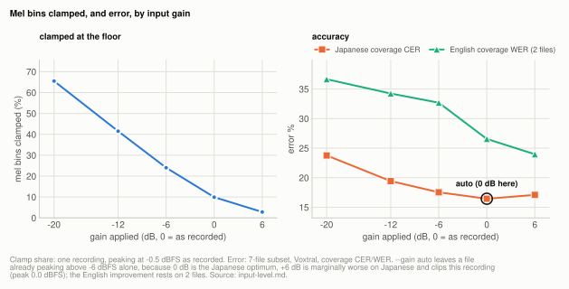
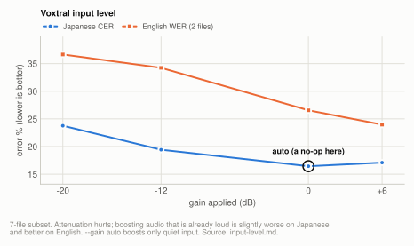
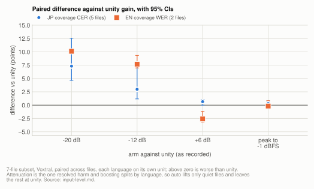

# Lever: input level (`--gain`)

The default is `--gain auto`: boost a file whose peak is below -6 dBFS up to -1 dBFS,
never attenuate, never clip. Quiet input is damaging and fails silently: attenuating the
corpus by 12 dB cost 2.97 points of Japanese CER and 7.69 points of English WER[^g1] with no
other symptom, while amplifying audio that was already healthy was close to a wash. `auto` encodes that asymmetry, is a
byte-identical no-op on well-recorded material, and recovered essentially all of a 2.21-point
loss on a clip attenuated by 14 dB.[^g3]

**Voxtral only** as a flag, though the underlying mel floor is Whisper's too: both use the
same front end, so quiet input is likely to cost accuracy on either. Only the Voxtral path
applies gain, so `--gain` is rejected on the other engines and this was measured on Voxtral.

| setting | default | why |
|---|---|---|
| `--gain` | `auto` | quiet input costs accuracy through an absolute mel floor; `auto` lifts only quiet files and leaves the rest byte-identical |

**Setup:** [7-file subset](reference/corpus.md#the-7-file-subset) for the gain sweep (recorded at
-0.5 to -5.3 dBFS peak), Voxtral at 4-bit, 30s chunks, batch 32, kv8, `scripts/benchmarks/sweep_gain.py`,
scored by [coverage CER/WER](reference/metrics.md#coverage-cer-and-why-it-had-to-exist). The
recovery check uses [one clip](reference/corpus.md#the-single-clip), scored by plain CER.

## Experiment: mel bins clamped by input level

**Basis:** one recording, mel front end only, share of mel bins at the floor at five gain settings; error columns from the [7-file subset](reference/corpus.md#the-7-file-subset) gain sweep below, at the same gains.

The mel front end flattens anything with `log10(power)` below `global_log_mel_max - 8.0`.
That threshold is **absolute**, not relative to the utterance, so quiet input has its
low-level detail destroyed before the encoder ever sees it. Measured share of mel bins
sitting exactly at the floor, one recording:

<picture>
  <source media="(prefers-color-scheme: dark)" srcset="img/input-level-clamp-dark.svg">
  
</picture>

**Table:** share of mel bins at the floor on one recording at each gain, next to the 7-file subset's error at the same gain.

| gain | peak dBFS | % mel bins clamped | JP coverage CER (7-file subset) | EN coverage WER (7-file subset) |
|---|---|---|---|---|
| -20dB | -20.5 | 65.5% | 23.76% | 36.65% |
| -12dB | -12.5 | 41.5% | 19.42% | 34.23% |
| -6dB | -6.5 | 24.0% | 17.53% | 32.68% |
| unity | -0.5 | 9.9% | 16.44% | 26.55% |
| +6dB | 0.0 | 2.8% | 17.09% | 23.96% |

Source: [ultra-input-gain.json](../../benchmarks/results/2026-10/ultra-input-gain.json) runs `gain7_asrecorded_c30b32_kv8#mode 0`, `gain7_m12db_c30b32_kv8#mode -12`, `gain7_m20db_c30b32_kv8#mode -20`, `gain7_p6db_c30b32_kv8#mode +6`; [ultra-input-gain-extra.json](../../benchmarks/results/2026-10/ultra-input-gain-extra.json) runs `gain7_m6db_c30b32_kv8#mode -6` (peak and clamp columns: the per-file rows of recording 57d841fe39b5; error columns weighted by reference lengths from [corpus.json](../../benchmarks/results/corpus.json))

This is a question of level rather than bit depth. The runs read 16-bit PCM copies of the
recordings (their original bit depth is not recorded, see
[corpus.json](../../benchmarks/results/corpus.json) `processing`), and gain is applied after
decoding to float32 and hard-clipped at full scale, so apart from clipping it adds no
quantization of its own; what matters is where the signal sits relative to the model's
fixed floor.

Fewer clamped bins is not the target in itself. Past unity the clamp share keeps falling,
but Japanese error rises, and since this recording peaks at -0.5 dBFS as recorded, +6 dB
clips it (its peak after gain is 0.0 dBFS in the table above).[^g2] `--gain auto` therefore leaves a file already peaking above
-6 dBFS alone and lifts only quieter ones.

## Experiment: error by input gain

**Basis:** [7-file subset](reference/corpus.md#the-7-file-subset), Voxtral at 4-bit, 30s chunks, batch 32, kv8, coverage CER/WER.

The 7-file subset needed no normalization, and unity gain was already near-optimal.

<picture>
  <source media="(prefers-color-scheme: dark)" srcset="img/gain-dark.svg">
  
</picture>

**Table:** Japanese and English coverage error on the 7-file subset at each gain mode.

| mode | JP coverage CER | EN coverage WER |
|---|---|---|
| -20 dB | 23.76% | 36.65% |
| -12 dB | 19.42% | 34.23% |
| **unity (as recorded)** | **16.44%** | 26.55% |
| peak to -1 dBFS | 16.74% | 26.38% |
| +6 dB | 17.09% | **23.96%** |
| rms to -23 dBFS | 17.09% | **23.93%** |

Source: [ultra-input-gain.json](../../benchmarks/results/2026-10/ultra-input-gain.json) runs `gain7_asrecorded_c30b32_kv8#mode 0`, `gain7_m12db_c30b32_kv8#mode -12`, `gain7_m20db_c30b32_kv8#mode -20`, `gain7_p6db_c30b32_kv8#mode +6`; [ultra-input-gain-extra.json](../../benchmarks/results/2026-10/ultra-input-gain-extra.json) runs `gain7_peak_c30b32_kv8#mode peak`, `gain7_rms_c30b32_kv8#mode rms` (weighted by reference lengths from [corpus.json](../../benchmarks/results/corpus.json))

Paired across files, against unity:

<picture>
  <source media="(prefers-color-scheme: dark)" srcset="img/input-level-paired-dark.svg">
  
</picture>

**Table:** paired difference against unity gain, Japanese coverage CER (5 files) and English coverage WER (2 files) kept separate, with 95% CIs; positive means worse than unity. <!-- not-measured: CI confidence level -->

| comparison | JP diff | JP 95% CI | EN diff | EN 95% CI | verdict |
|---|---|---|---|---|---|
| -20dB vs unity | +7.32 | [+4.64, +12.56] | +10.10 | [+10.10, +10.12] | **attenuation hurts badly** |
| -12dB vs unity | +2.97 | [+1.17, +7.71] | +7.69 | [+6.98, +9.33] | **attenuation hurts** |
| +6dB vs unity | +0.65 | [+0.00, +1.09] | **-2.59** | [-3.19, -1.18] | marginal harm on JP, **helps EN** |
| peak-normalize vs unity | +0.30 | [-0.11, +0.77] | -0.17 | [-0.60, +0.84] | not resolvable |

Source: [ultra-input-gain.json](../../benchmarks/results/2026-10/ultra-input-gain.json) runs `gain7_asrecorded_c30b32_kv8#mode 0`, `gain7_m12db_c30b32_kv8#mode -12`, `gain7_m20db_c30b32_kv8#mode -20`, `gain7_p6db_c30b32_kv8#mode +6`; [ultra-input-gain-extra.json](../../benchmarks/results/2026-10/ultra-input-gain-extra.json) runs `gain7_peak_c30b32_kv8#mode peak` (weighted by reference lengths from [corpus.json](../../benchmarks/results/corpus.json))

Each language is aggregated on its own unit and never pooled. With 2 English files the
English intervals are close to meaningless (issue #12). The peak-normalize arm's interval
comes from the per-file rows of its saved run, like the others. The +6 dB Japanese
interval excludes zero only just: its lower bound rounds to +0.00, so "marginal harm" is the
most it supports.

Two readings, one solid and one a lead:

- **Attenuation is significantly harmful**, and the clamping measurement above explains why.
- **Amplifying healthy audio splits by content.** The two English multi-speaker recordings
  improved by 2.6 points[^g1] while the five Japanese ones got marginally worse. Plausibly the
  English files have quieter off-mic speakers whose detail was being clamped, whereas the
  Japanese ones are close-mic single-speaker where amplification mostly lifts the noise
  floor. **n=2 on the English side, so treat that as a lead rather than a result.**

## Experiment: recovery of an attenuated clip

**Basis:** [one clip](reference/corpus.md#the-single-clip), M2 Ultra 128GB, Voxtral at 30s chunks, batch 32, kv8, plain CER.

Attenuating a clip by 14 dB and transcribing it three ways:

**Table:** plain CER on one clip at its original level and attenuated by 14 dB, with and without `auto`.

| condition | CER |
|---|---|
| original level | 8.63% |
| attenuated -14 dB, `--gain none` | 10.84% |
| attenuated -14 dB, `--gain auto` | **8.61%** |

Source: [ultra-voxtral-clip-cli.json](../../benchmarks/results/2026-10/ultra-voxtral-clip-cli.json) runs `hk_c30b32_kv8`, `hk_attn14_gainnone`, `hk_attn14_gainauto`, `score_clip`

`auto` recovers essentially all of the 2.21-point loss,[^g3] which is what makes it safe as the
default: inert on well-recorded material, and it repairs quiet material almost exactly.

## How it works

The two findings give an asymmetric rule rather than a loudness target: quiet audio must be
lifted, loud audio must be left alone.

**Table:** the gain `auto` applies to a file at each peak level, and the resulting peak.

| peak dBFS | gain applied | result |
|---|---|---|
| -0.5 to -5.3 (this corpus) | 0.0 dB | byte-identical, no-op |
| -7.4 | +6.4 dB | -1.0 dBFS |
| -13.3 | +12.3 dB | -1.0 dBFS |
| -21.3 | +20.3 dB | -1.0 dBFS |
| -41.3 | +40.3 dB | -1.0 dBFS |

Source: [ultra-input-gain.json](../../benchmarks/results/2026-10/ultra-input-gain.json) runs `gain7_asrecorded_c30b32_kv8#mode 0` (the corpus peaks) <!-- not-measured: rows below the first apply the auto rule, gain = -1 dBFS minus peak and never negative -->

Gain is never negative and the target sits below full scale, so `auto` cannot clip.
Verified as a no-op on all 7 corpus files and on the narration clip: it computes 0.0 dB for
all eight inputs, and on the clip the subtitles with and without it are byte-identical.[^g4]

**One scalar for the whole file.** `auto` decides from the file peak and applies a single
scalar before chunking, so relative dynamics are preserved exactly. It deliberately does
not adapt per chunk. Most chunks of a normal recording sit well below the file peak (84.8%[^g5] of
the 653 30s chunks of the 7-file subset and the clip peak under -6 dBFS, and chunk peaks inside
one file spread by 10.3 to 70.0 dB),[^g5] measured over 30s chunks, which may not be the chunking
behind the share first published here; so a
per-chunk normalizer would apply tens of dB of differential gain and flatten the loud/quiet
structure the model uses. `mlx_asr.audio.per_chunk_gain_db` exists so that can be
evaluated, not because it is recommended.

**Other modes.** Besides the default, `--gain` accepts a number of dB, `peak` (targets
-1 dBFS rather than 0, since clipping is the one irreversible loss), `rms` (targets
speech-active frames only, so a recording with long pauses is not pushed up by its
silence), and `none`. The CLI reports the clipped-sample percentage whenever gain is
applied.

## Superseded

The older advice in this project was to leave levels alone. That is still right for audio
already peaking near full scale, which is exactly what `auto` declines to touch.

## Related

- [corpus.md](reference/corpus.md): the recordings and the narration clip
- [metrics.md](reference/metrics.md): coverage CER/WER and the paired comparison
- [delay.md](delay.md): the other Voxtral-only lever, measured on the same config

[^g1]: [ultra-input-gain.json](../../benchmarks/results/2026-10/ultra-input-gain.json) runs `gain7_asrecorded_c30b32_kv8#mode 0`, `gain7_m12db_c30b32_kv8#mode -12`, `gain7_m20db_c30b32_kv8#mode -20`, `gain7_p6db_c30b32_kv8#mode +6` (weighted by reference lengths from [corpus.json](../../benchmarks/results/corpus.json))
[^g2]: [ultra-input-gain.json](../../benchmarks/results/2026-10/ultra-input-gain.json) runs `gain7_asrecorded_c30b32_kv8#mode 0`, `gain7_p6db_c30b32_kv8#mode +6` (the peak column of the recording in the clamp table)
[^g3]: [ultra-voxtral-clip-cli.json](../../benchmarks/results/2026-10/ultra-voxtral-clip-cli.json) runs `hk_c30b32_kv8`, `hk_attn14_gainnone`, `hk_attn14_gainauto`, `score_clip`
[^g4]: [ultra-derived-measures.json](../../benchmarks/results/2026-10/ultra-derived-measures.json) runs `derive_gain`; [ultra-voxtral-clip-recheck.json](../../benchmarks/results/2026-10/ultra-voxtral-clip-recheck.json) runs `noop_clip_auto_sha256` (cmp exit 0, identical SHA-256)
[^g5]: [ultra-derived-measures.json](../../benchmarks/results/2026-10/ultra-derived-measures.json) runs `derive_gain`
