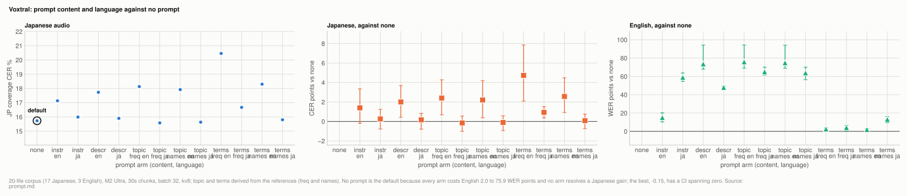
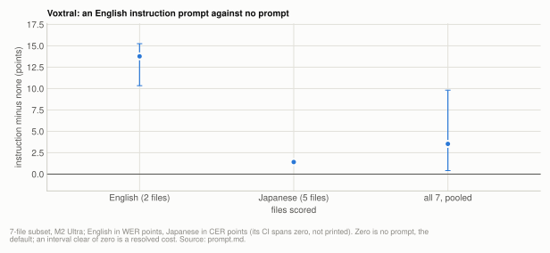
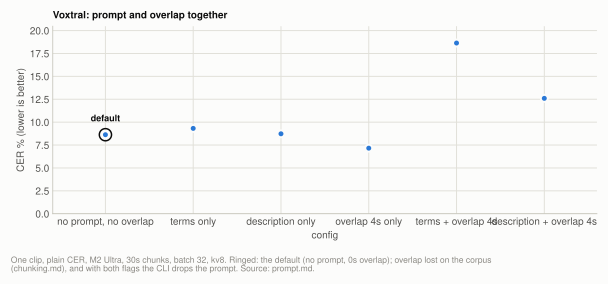

# Lever: the `--prompt` field (Voxtral only)

The default is an empty prompt. No prompt arm tested on the 20-file corpus resolved a gain on
either language. On English audio every one of twelve arms cost WER, from +2.0 points[^pr1] for the
derived English term lists to +75.9 for a topic sentence[^pr1], with every interval clear of
zero; the sentence-shaped prompts suppress word spacing. On Japanese audio the best arms, a
Japanese topic sentence, scored -0.15 and -0.10 points[^pr4] against no prompt with intervals that
span zero, the frequency-derived Japanese term list was a resolved cost of +0.94 points[^pr4]
[+0.36, +1.53][^pr4], and every English-language arm scored 1.40 to 4.73 points[^pr9] worse, five of
the six with intervals clear of zero. A term prompt
barely moved emission of the prompted terms in the original term arm, so it does not
recall vocabulary. Putting an instruction there costs about 6 CER points[^pr10] on Japanese on a
single clip and 15 WER points on English at n=20[^pr2], and combined with `--overlap-seconds` it
sends the decoder into repetition loops.

**Applies to `--model voxtral` (Voxtral Realtime) only.** The field is an architectural
feature of that model: it writes into its decoder left-pad region. Every other engine,
including `voxtral-v1`, refuses `--prompt` with exit 2. Whisper has its own
`initial_prompt` concept with different semantics, which this project has not measured, so
nothing here transfers to it.

| setting | default | why |
|---|---|---|
| `--prompt` | empty | costs English 2.0 to 75.9 WER points in every arm tested; on Japanese no arm resolves a gain, the frequency-derived Japanese term list costs 0.94, and English-language prompts score 1.40 to 4.73 worse (five of six resolved); no measurable vocabulary recall |
| `--prompt` with `--overlap-seconds` | prompt ignored, overlap kept | the two together scored 18.64% CER with a term-list prompt (12.60% with the short description prompt) against 7.16% for overlap alone |

Source: [ultra-voxtral-prompt.json](../../benchmarks/results/2026-10/ultra-voxtral-prompt.json) runs `prompt20_c30b32_kv8#none -`, `prompt20_c30b32_kv8#instruction en`, `prompt20_c30b32_kv8#instruction ja`, `prompt20_c30b32_kv8#description en`, `prompt20_c30b32_kv8#description ja`; [ultra-voxtral-clip.json](../../benchmarks/results/2026-10/ultra-voxtral-clip.json) runs `ov30_4s#overlap 4`; [ultra-voxtral-prompt-derived.json](../../benchmarks/results/2026-10/ultra-voxtral-prompt-derived.json) runs `prompt20_derived_freq`, `prompt20_derived_names`; [ultra-voxtral-prompt-overlap-corpus.json](../../benchmarks/results/2026-10/ultra-voxtral-prompt-overlap-corpus.json) runs `po_terms_ov4`, `po_desc_ov4`, `po_none_ov4`

**Setup:** [20-file corpus](reference/corpus.md#the-20-file-corpus) (17 Japanese, 3 English) for the
crossed language experiment, [7-file subset](reference/corpus.md#the-7-file-subset) for the first
corpus test, and [one clip](reference/corpus.md#the-single-clip) (the 935s narration and its 180s[^prc]
excerpt) for the earlier sweeps. M2 Ultra 128GB throughout, plus an M4 16GB for one
comparison. Corpus runs are scored by
[coverage CER/WER](reference/metrics.md#coverage-cer-and-why-it-had-to-exist); single-clip runs by
plain CER, since those references are verbatim. Scripts: `scripts/benchmarks/ab_prompt.py`,
`scripts/benchmarks/sweep_prompt_language.py`, `scripts/benchmarks/run_corpus.py`.

## Experiment: prompt content crossed with prompt language

**Basis:** [20-file corpus](reference/corpus.md#the-20-file-corpus), M2 Ultra 128GB, 4-bit, 30s chunks, batch 32, kv8, delay 2400.

The earlier corpus test had one prompt, written in English, on a corpus that is mostly
Japanese, so "an instruction is harmful" and "an English prompt on Japanese audio is
harmful" were the same measurement. This crosses four content shapes against both
languages, all 20 files, one prompt per arm applied to every file, so each arm yields an
audio-Japanese and an audio-English row. The topic and terms prompts were derived
mechanically from the references by `scripts/benchmarks/derive_prompt_terms.py` (tokens in
at least two reference files), in two variants, `freq` and `names`, so there are twelve
prompted arms; the saved results keep their lengths, not their texts. `scripts/benchmarks/sweep_prompt_language.py`,
30s chunks, batch 32, kv8, delay 2400, M2 Ultra 128GB. The no-prompt row reproduced the
4-bit corpus run at the same config exactly (15.73% / 21.50%)[^pr3], which is the check that this script decodes the same
way `run_corpus.py` does.

<picture>
  <source media="(prefers-color-scheme: dark)" srcset="img/prompt-language-dark.svg">
  
</picture>

**Table:** each prompt arm (content shape, derivation variant and language) against no prompt, Japanese CER and English WER, with paired 95% CIs. <!-- not-measured: 95% is the confidence level -->

| prompt content | lang | tokens | JP coverage CER (17 files) | vs none | 95% CI | EN coverage WER (3 files) | vs none | 95% CI |
|---|---|---|---|---|---|---|---|---|
| none | - | 0 | 15.73% | - | - | 21.50% | - | - |
| instruction | en | 6 | 17.13% | +1.40 | [-0.19, +3.35] | 36.68% | +15.18 | [+10.34, +20.26] |
| instruction | ja | 12 | 15.99% | +0.26 | [-0.77, +1.24] | 80.53% | +59.03 | [+54.69, +63.82] |
| description | en | 12 | 17.73% | +2.00 | [+0.43, +3.69] | 95.21% | +73.71 | [+67.87, +94.14] |
| description | ja | 13 | 15.90% | +0.17 | [-0.79, +0.83] | 69.50% | +48.00 | [+45.58, +49.36] |
| topic, freq | en | 9 | 18.13% | +2.40 | [+0.68, +4.28] | 97.45% | +75.94 | [+69.03, +94.26] |
| topic, freq | ja | 12 | 15.58% | -0.15 | [-1.01, +0.55] | 86.66% | +65.16 | [+61.61, +70.04] |
| topic, names | en | 12 | 17.92% | +2.20 | [+0.37, +4.20] | 96.44% | +74.94 | [+68.92, +94.02] |
| topic, names | ja | 14 | 15.63% | -0.10 | [-0.94, +0.58] | 85.44% | +63.94 | [+56.44, +70.04] |
| terms, freq | en | 61 (31 kept) | 20.46% | +4.73 | [+2.09, +7.85] | 24.10% | +2.59 | [+0.06, +3.89] |
| terms, freq | ja | 96 (31 kept) | 16.67% | +0.94 | [+0.36, +1.53] | 25.72% | +4.22 | [+0.12, +6.57] |
| terms, names | en | 30 | 18.30% | +2.57 | [+0.92, +4.48] | 23.54% | +2.04 | [+0.12, +3.14] |
| terms, names | ja | 119 (31 kept) | 15.80% | +0.08 | [-0.74, +0.76] | 34.66% | +13.15 | [+9.40, +16.12] |

Source: [ultra-voxtral-prompt.json](../../benchmarks/results/2026-10/ultra-voxtral-prompt.json) runs `prompt20_c30b32_kv8#none -`, `prompt20_c30b32_kv8#instruction en`, `prompt20_c30b32_kv8#instruction ja`, `prompt20_c30b32_kv8#description en`, `prompt20_c30b32_kv8#description ja`; [ultra-voxtral-prompt-derived.json](../../benchmarks/results/2026-10/ultra-voxtral-prompt-derived.json) runs `prompt20_derived_freq#topic en`, `prompt20_derived_freq#topic ja`, `prompt20_derived_freq#terms en`, `prompt20_derived_freq#terms ja`, `prompt20_derived_names#topic en`, `prompt20_derived_names#topic ja`, `prompt20_derived_names#terms en`, `prompt20_derived_names#terms ja` (differences paired over files against the none row, 20000 bootstrap resamples, seed 0)

The instruction, description and topic arms fit the 31-token window. Three of the four
derived term lists do not (61, 96 and 119 tokens), so the model saw only their last 31
tokens, which is where the derivation puts the highest-ranked terms. Instruction and
description texts were written natively in each language; the topic and term texts came
from the derivation, so they could not be chosen to flatter the result, and the arms are
reproducible from the corpus without publishing anyone's word list. The first run of this
experiment published topic and terms rows whose prompt texts were not recorded; these
derived arms replace them.

**Three results, in order of how much they change the guidance.**

**1. The English collapse is a spacing artifact, not lost transcription.** The eight
sentence-shaped arms (instruction, description, topic) cost English between 15.18 and 75.94
WER points[^pr1], which reads as near-total failure. Inspecting the transcripts of the first run
shows it is not. **All of them but the English instruction suppress space emission on English audio**, and word error
rate charges every word of a space-free transcript as wrong. The derived term lists cost
much less on English, +2.04 to +13.15 points, each interval still clear of zero[^pr5], and
they keep their spacing (below).

**Table:** space emission on one English recording, by prompt arm (first run).

| arm | spaces per character | word count | character count |
|---|---|---|---|
| none | 0.19 | 4016 | 20921 |
| description ja | 0.07 | 1167 | 16632 |
| description en | 0.01 | 186 | 15494 |

Source: [ultra-derived-measures.json](../../benchmarks/results/2026-10/ultra-derived-measures.json) runs `derive_prompt` (the first-run none, description ja and description en arms, file 0c193bf7ced2; character count includes spaces)

One recording whose reference has 4172 words: without a prompt the model emits 4016 spaces,
with the English description it emits **185**, producing a 15494-character string in which
the words mostly run together. Without spaces the transcript shrinks by under 10%[^pr7] (16906 to
15309 characters),[^pr7] so most of the words are still there. On the two English files the
derivation covers, unprompted output carries 0.19 spaces per character; seven of the eight
sentence-shaped arms carry 0.00 to 0.07, the English instruction 0.16 and 0.18, and the
derived term lists 0.16 to 0.19.[^pr7] The derivation reads only plain-text references, so the
third English file is not counted. The two original term arms, which emitted almost no spaces
on this recording, have no saved run and are not shown.

Rescoring the English files at character level with whitespace stripped from both sides
collapses the difference:

**Table:** per English file, the range of scores across arms, by word and by whitespace-free character.

| file | covWER span across arms | covCER span, no whitespace |
|---|---|---|
| A | 25.92% to 97.58% | 71.17% to 75.25% |
| B | 27.99% to 97.02% | 81.90% to 85.89% |
| C | 3.29% to 97.56% | not derived |

Source: [ultra-voxtral-prompt.json](../../benchmarks/results/2026-10/ultra-voxtral-prompt.json) runs `prompt20_c30b32_kv8`; [ultra-voxtral-prompt-derived.json](../../benchmarks/results/2026-10/ultra-voxtral-prompt-derived.json) runs `prompt20_derived_freq`, `prompt20_derived_names` (covWER, the 13 arms of each English file); [ultra-derived-measures.json](../../benchmarks/results/2026-10/ultra-derived-measures.json) runs `derive_prompt` (whitespace-free coverage CER, files A and B only; the derivation reads plain-text references, and C's is a subtitle track)

So the honest statement is narrower than the aggregate suggested: **a sentence-shaped prompt degrades
English word segmentation badly, and leaves the transcribed content roughly intact.** That
still makes the field unusable on English if you want readable output or a word-level
score, which is why the default stands, but the earlier reading of these numbers as
"catastrophic transcription failure" was wrong and is corrected here.

Japanese is unaffected by this mechanism because Japanese is not space-delimited, which is
also why its scores move so little. That is the real asymmetry: not that Japanese audio
resists prompting, but that the damage a prompt does is invisible to a character metric on
a language without word spaces. The deciding factor is therefore the language of the
*audio*, not whether the prompt language matches it, which is the opposite of what this
project concluded from the 7-file subset. Note n=3 for English, so treat magnitudes as
directional.

**2. On Japanese, a prompt in Japanese is at best a tie, and one derived term list is a
resolved cost.** Five of the six Japanese-language arms land between -0.15 and +0.26 points[^pr4]
of no prompt with intervals that span zero; the two Japanese topic sentences are the only
arms below it (-0.15 and -0.10). The frequency-derived Japanese term list costs +0.94
[+0.36, +1.53][^pr4]. Per file the Japanese-language arms improve 7 to 12 of the 17 Japanese
files[^pr6]. All six English-language arms score 1.40 to 4.73 points worse, five of them with
intervals clear of zero, and hurt 11 to 13 of 17[^pr6].
That asymmetry is the one thing here a user can act on, and it is consistent with the
mechanism: the model treats the prompt as its own prior output, so text in the wrong script
is a register the model then has to escape.

Having found that CER missed the English spacing collapse entirely, the Japanese arms of the
first run were checked for the equivalent blind spot, and there is none. Across the 12
Japanese files with plain-text references, pooled, punctuation density stays at 8.8 to 11.9
marks per 1000 non-space characters and the Latin fraction at 1.54 to 2.16%[^pr7] in every arm,
against 31.0 marks and 4.45% Latin[^pr7] in the references; total character counts vary by under
5%.[^pr7] These shares come from a text-statistics script written for the rerun, whose
punctuation and Latin classes may differ from the first count. So no arm is quietly degrading
readability the way the English ones do; the small CER differences are the whole story on
Japanese.

That check does surface something unrelated to prompting: **the model emits Japanese
punctuation at roughly a third of the reference rate in every condition, prompted or not.**
The prompt-driven spread is 3.1 marks per 1000 against a 19.1 gap from the highest arm to
the reference,[^pr7] so this
is a property of the model rather than of this lever. Coverage CER barely sees it because
`。` and `、` are single characters in a 4300-character transcript. It matters for anyone
reading the output rather than scoring it, and it is not something a prompt fixes.

**3. Term lists do not help Japanese, and vocabulary recall is not the mechanism.** The
frequency-derived Japanese term list is the only Japanese-language arm with a resolved
difference, a cost of +0.94 [+0.36, +1.53];[^pr4] the names-derived list is a tie at +0.08
[-0.74, +0.76][^pr4]. The best Japanese cells are the topic sentences at -0.15 and -0.10, both
ties, which matches the single-clip result that a topic sentence did as well as a term list.

The original term arm settles the *mechanism*, because its transcripts were kept
(`--keep-hyp`) and the prompted terms can be counted directly. Across the Japanese files,
**prompted terms were emitted about as often with the prompt as without, and more often
than in the references**: the model was already over-producing these terms unprompted, and
one prompted term never appeared at all, in any condition.

So the field is not performing vocabulary recall on this material, and the earlier
conclusion from the single clip stands, now for a stronger reason. It also means a term
prompt cannot fix a rare-word miss here: the words are not being missed, they are being
over-produced, which is a different failure that a bias prompt makes marginally worse.

**Content shape matters on English and little on Japanese.** An imperative, a
scene-setting description of the recording and a topic sentence behave alike within a
language: same sign, same rough magnitude. The derived term lists are the exception on
English audio, costing 2.04 to 13.15 WER points against 15.18 to 75.94 for the
sentence-shaped arms[^pr1][^pr5]. On Japanese audio the language of the prompt separates the arms
more than its shape does. Whatever the field does, it is not reading the prompt as an
instruction or a description. It is conditioning register.

## Experiment: the instruction trap

**Basis:** [7-file subset](reference/corpus.md#the-7-file-subset), M2 Ultra 128GB, one English instruction prompt against no prompt.

The single clip could not show that the instruction effect is language-dependent. The
subset can. Putting "Transcribe the audio accurately." in the prompt field:

<picture>
  <source media="(prefers-color-scheme: dark)" srcset="img/prompt-instruction-dark.svg">
  
</picture>

**Table:** an English instruction prompt minus no prompt, by audio language, with paired 95% CIs. <!-- not-measured: 95% is the confidence level -->

| files | diff | 95% CI |
|---|---|---|
| English (2 files) | **+13.77 WER points** | [+10.34, +15.25] |
| Japanese (5 files) | +1.41 CER points | CI spans zero |
| all 7, pooled | +3.53 | [+0.41, +9.81] |

Source: [ultra-voxtral-prompt-trap.json](../../benchmarks/results/2026-10/ultra-voxtral-prompt-trap.json) runs `prompt_trap7_instruction`, `prompt_trap7_none` (paired over files, 20000 bootstrap resamples, seed 0; the Japanese CI is [-0.07, +6.13]; the pooled row weights all 7 files by reference length)

That fits the mechanism exactly. An English instruction is English text the decoder
believes it just emitted, so it pulls English output badly off-register while barely
perturbing Japanese.

The reading at the time was "the magnitude depends on whether the prompt language matches
the audio". The 20-file crossed experiment above tests that directly and **it is wrong**:
what predicts the damage is the *audio* language, not the match between prompt and audio.

## Experiment: prompt plus overlap

**Basis:** [one clip](reference/corpus.md#the-single-clip), M2 Ultra 128GB, 30s chunks, batch 32, kv8.

Found while re-running the config matrix. M2 Ultra 128GB, 30s chunks, batch 32, kv8:

<picture>
  <source media="(prefers-color-scheme: dark)" srcset="img/prompt-overlap-dark.svg">
  
</picture>

**Table:** CER on one clip with and without a prompt and a 4s overlap, for a derived term-list prompt and for the fixed description prompt (run through `run_corpus.py`, which passes the prompt to the decoder; the CLI drops `--prompt` when overlap is on).

| config | CER |
|---|---|
| no prompt, no overlap | 8.63% |
| prompt only (term list) | 9.32% |
| prompt only (description) | 8.73% |
| overlap 4s only | 7.16% |
| **prompt + overlap 4s** (term list) | **18.64%** |
| prompt + overlap 4s (description) | 12.60% |

Source: [ultra-voxtral-prompt-overlap-corpus.json](../../benchmarks/results/2026-10/ultra-voxtral-prompt-overlap-corpus.json) runs `po_none_ov0`, `po_terms_ov0`, `po_desc_ov0`, `po_none_ov4`, `po_terms_ov4`, `po_desc_ov4`

The output degenerates into repetition loops, with a short phrase repeated a dozen times
and 148 characters of duplicated text. Both knobs work by handing the decoder text it
should treat as already-emitted, and stacking them over-conditions it. The positions do
not collide (the prompt occupies decoder positions 0-62, the warm-up region follows), so
this is a behavioural interaction rather than an indexing bug.

The CLI ignores `--prompt` when overlap is active and says so, keeping overlap because it
is by far the stronger effect. Benchmarks pass no prompt, so the overlap rows in
[chunking.md](chunking.md) are clean.

## How it works

Voxtral Realtime's decoder input is `audio_embed + embed(prev_token)`, and the architecture
puts a 32-token left-pad region before the audio. Prompt text is injected there, so **the
model reads it as text it has already emitted** during the leading silence, not as a
directive. That is why the field behaves the way it does, and why none of this generalises
to an engine with a different long-form design.

Two consequences follow directly and both were confirmed by measurement:

- An imperative makes the model *continue* in the register of the imperative. "Transcribe
  the audio accurately." is English, so it pulls output toward English.
- Only the last 31 tokens survive (`n_left_pad_tokens - 1`). Earlier tokens are dropped.
  The CLI now warns when it truncates; it used to do so silently.

The CLI help says "domain keywords" explicitly and warns on truncation. With
`--overlap-seconds` above 0 the prompt is logged as ignored and the run continues with the
overlap; on any engine without the field, `--prompt` exits 2.

### If you set it anyway

- **On English audio, leave it empty.** Every arm tested at n=20 cost WER, from 2.0 to
  75.9 points[^pr1]. This is the strongest guidance on this page, and it does not depend on what the
  prompt says.
- **Never put an instruction there**, in any language. A short topic sentence in the
  language of the audio is the only shape that scored below no prompt on Japanese, and
  only as a tie; the frequency-derived Japanese term list was a resolved cost.
- **Write the prompt in the language of the audio.** On Japanese audio five of the six
  Japanese-language arms tied with no prompt and the frequency-derived term list cost 0.94
  points[^pr4]; the English-language ones all scored 1.4 to 4.7 points[^pr9] worse.
- On Japanese audio, content shape matters less than language: no shape resolved a gain,
  which is why none of them is recommended over the others on the evidence here.
- **Do not reach for it to fix a missed proper noun.** Term counts barely moved when the
  terms were prompted, and on this material the model over-produces them unprompted
  anyway. If a name comes out wrong, this field is not the fix.
- Put terms you care about **last**, since only the final 31 tokens survive. Though note
  the ordering experiment and the emission counts both suggest this matters less than it
  should.
- If you use it at all, verify on your own audio. The effect is small enough to flip with
  the model or the clip.
- The separator between terms did not resolve on one clip; see [Superseded](#separators-across-two-machines-one-clip).

## Superseded

Both single-clip experiments are kept for the record. Their prompt contents are redacted
because they were real domain vocabulary; the shape of each variant is what matters.

### Style, ordering and separators, one clip

Confirmed at corpus scale: the original 20-file term arm reproduces the absence of
vocabulary recall by counting term emissions directly, and finds the same over-production.

M2 Ultra 128GB, 60s chunks, batch 16, kv8, 935s clip (4205 scored characters), 31-token
window.

**Table:** CER on one clip for the two variants rerun at the same config: no prompt and the generic instruction. The style, ordering and separator variants were not saved and are described below without their figures.

| variant | tokens | kept | CER | vs none |
|---|---|---|---|---|
| **no prompt** | 0 | 0 | 7.28% | - |
| **generic instruction** ("Transcribe the Japanese audio accurately.") | 7 | 7 | **13.17%** | **+5.90** |

Source: [ultra-voxtral-clip-cli.json](../../benchmarks/results/2026-10/ultra-voxtral-clip-cli.json) runs `hk_c60b16_kv8`, `hk_c60b16_kv8_instr`, `score_clip` (rerun at the same configived run)

**Table:** the generic instruction against no prompt, paired, with its 95% CI. <!-- not-measured: 95% is the confidence level -->

| comparison | diff | 95% CI | verdict |
|---|---|---|---|
| generic instruction vs none | 5.90 | [+1.40, +11.64] | **significant** |

Source: [ultra-voxtral-clip-paired.json](../../benchmarks/results/2026-10/ultra-voxtral-clip-paired.json) runs `cmp_instr_v_none`

**The ordering result is the informative one.** Reversing the term list so that
truncation discards the terms you care about scored *identically* to keeping them. If the
small gains were really about specific vocabulary reaching the model, that could not
happen. Whatever the prompt does here, it is not vocabulary recall.

Confirming that from the other direction: none of the variants recovered the rare proper
nouns they targeted. The rarest term was not emitted in any variant, and one mid-frequency term was emitted more
often than the reference contains it, i.e. the prompt caused *over*-production rather than
recall.

### Separators across two machines, one clip

Not re-run at corpus scale. Separator variants (CJK punctuation, Latin commas, bare spaces,
a natural sentence) were tried on the 180s[^prc] excerpt on both machines, and separators did
not resolve on one clip. The 20-file result supersedes it: the only resolved Japanese-language
arm is a cost (+0.94 points[^pr4]) and no arm resolved a gain.

## Related

[chunking.md](chunking.md) for the overlap side of the conflict.

[^pr1]: [ultra-voxtral-prompt.json](../../benchmarks/results/2026-10/ultra-voxtral-prompt.json) runs `prompt20_c30b32_kv8#none -`, `prompt20_c30b32_kv8#instruction en`, `prompt20_c30b32_kv8#instruction ja`, `prompt20_c30b32_kv8#description en`, `prompt20_c30b32_kv8#description ja`; [ultra-voxtral-prompt-derived.json](../../benchmarks/results/2026-10/ultra-voxtral-prompt-derived.json) runs `prompt20_derived_freq#topic en`, `prompt20_derived_names#topic en`, `prompt20_derived_freq#topic ja`, `prompt20_derived_names#terms en` (word unit, paired against the none row)
[^pr2]: [ultra-voxtral-prompt.json](../../benchmarks/results/2026-10/ultra-voxtral-prompt.json) runs `prompt20_c30b32_kv8#none -`, `prompt20_c30b32_kv8#instruction en`
[^pr3]: [ultra-voxtral-prompt.json](../../benchmarks/results/2026-10/ultra-voxtral-prompt.json) runs `prompt20_c30b32_kv8#none -`; [ultra-voxtral-headline.json](../../benchmarks/results/2026-10/ultra-voxtral-headline.json) runs `vox_default_c30b32_kv8`
[^pr4]: [ultra-voxtral-prompt.json](../../benchmarks/results/2026-10/ultra-voxtral-prompt.json) runs `prompt20_c30b32_kv8#none -`, `prompt20_c30b32_kv8#instruction en`, `prompt20_c30b32_kv8#instruction ja`, `prompt20_c30b32_kv8#description ja`; [ultra-voxtral-prompt-derived.json](../../benchmarks/results/2026-10/ultra-voxtral-prompt-derived.json) runs `prompt20_derived_freq#topic ja`, `prompt20_derived_names#topic ja`, `prompt20_derived_freq#terms en`, `prompt20_derived_freq#terms ja`, `prompt20_derived_names#terms ja` (char unit, paired against the none row)
[^pr5]: [ultra-voxtral-prompt.json](../../benchmarks/results/2026-10/ultra-voxtral-prompt.json) runs `prompt20_c30b32_kv8#none -`; [ultra-voxtral-prompt-derived.json](../../benchmarks/results/2026-10/ultra-voxtral-prompt-derived.json) runs `prompt20_derived_freq#terms en`, `prompt20_derived_freq#terms ja`, `prompt20_derived_names#terms en`, `prompt20_derived_names#terms ja` (word unit, paired against the none row)
[^pr6]: [ultra-voxtral-prompt.json](../../benchmarks/results/2026-10/ultra-voxtral-prompt.json) runs `prompt20_c30b32_kv8`; [ultra-voxtral-prompt-derived.json](../../benchmarks/results/2026-10/ultra-voxtral-prompt-derived.json) runs `prompt20_derived_freq`, `prompt20_derived_names` (per-file char rows against the none row)
[^prc]: [corpus.json](../../benchmarks/results/corpus.json) (the clip, and `clip180` under `derived`)
[^pr7]: [ultra-derived-measures.json](../../benchmarks/results/2026-10/ultra-derived-measures.json) runs `derive_prompt`
[^pr9]: [ultra-voxtral-prompt.json](../../benchmarks/results/2026-10/ultra-voxtral-prompt.json) runs `prompt20_c30b32_kv8#none -`, `prompt20_c30b32_kv8#instruction en`, `prompt20_c30b32_kv8#description en`; [ultra-voxtral-prompt-derived.json](../../benchmarks/results/2026-10/ultra-voxtral-prompt-derived.json) runs `prompt20_derived_freq#topic en`, `prompt20_derived_freq#terms en`, `prompt20_derived_names#topic en`, `prompt20_derived_names#terms en` (char unit, Japanese files, paired against the none row)
[^pr10]: [ultra-voxtral-clip-paired.json](../../benchmarks/results/2026-10/ultra-voxtral-clip-paired.json) runs `cmp_instr_v_none`
