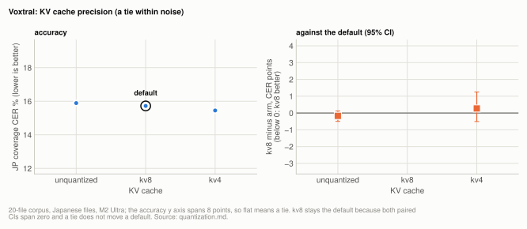

# Lever: weight and KV-cache precision

On Voxtral, 4-bit weights are last of the five precisions on the 20-file corpus, 1.09 points[^p1]
behind fp16 and 0.94 behind 8-bit, so its precision is chosen by memory: fp16 where it fits
(the M2 Ultra 128GB), 8-bit converted on first use where fp16's 13GB[^p1] peak does not (16GB
Macs), and 4-bit only where neither fits. At the shipped 30s/B128,[^p6] fp16 ties 8-bit and both
beat 4-bit[^p6]. On Qwen3-ASR no rung beats
8bit: at 4bit the 1.7B loses 1.16 points and the 0.6B 2.79,[^p2] so both default to 8bit. Voxtral-v1 at 8bit ties
bf16, and the 3B at 4bit loses 8 points,[^p3] so 8bit is its default. `--kv-bits 8` ties
unquantized KV on the corpus and is on by default.

| setting | default | why |
|---|---|---|
| `--quantization` on `voxtral` | per machine, the first that fits: `fp16`, then `8bit` (converted on first use), then `4bit` | 4-bit is last of five on the corpus; at 30s/B128 fp16 ties 8-bit (+0.11 points, CI [-0.01, +0.25]) and both beat 4-bit (-0.60 and -0.71), and the tie goes to the larger build. fp16 fits on the M2 Ultra 128GB, and 16GB Macs get 8-bit ([how a variant is chosen](../DEFAULTS.md#how-a-variant-is-chosen)) |
| `--quantization` on `qwen3-asr` 1.7B | `8bit` | no rung beats it: 4bit is 1.16 points worse, 6bit 0.47 and bf16 0.52, all resolved; 5bit (-0.59) does not resolve ([qwen3-asr.md](engines/qwen3-asr.md)) |
| `--quantization` on `qwen3-asr` 0.6B | `bf16`, else `8bit` | 4bit is 2.79 points worse and 5bit 0.92, both resolved; 6bit (-0.36) and bf16 (+0.01) tie, so bf16 runs where it fits, a tie going to the larger build ([qwen3-asr.md](engines/qwen3-asr.md)) |
| `--quantization` on `voxtral-v1` | `8bit` | ties bf16 on both sizes; the 3B at 4bit loses 8.18 points ([voxtral-v1.md](engines/voxtral-v1.md)) |
| `--quantization` on `whisper`, `kotoba` | fp16 | one build each, so the flag errors |
| `--quantization` on `parakeet` | its one build | one published build, so the flag errors |
| `reazon` precision | fp32 | not a `--quantization` choice; int8 drops whole phrases (36.61% against 29.98%), an engine decision ([reazon.md](engines/reazon.md)) |
| `--kv-bits` (Voxtral only) | `8` | ties unquantized KV on the corpus and on the clip, and reads half the cache bytes per step |

Source: [ultra-voxtral-precision.json](../../benchmarks/results/2026-10/ultra-voxtral-precision.json) runs `vox_w4bit_c60b16_kv8`, `vox_w8bit_c60b16_kv8`, `vox_wfp16_c60b16_kv8`, `vox_wmxfp8_c60b16_kv8`, `vox_wnvfp4_c60b16_kv8`; [ultra-qwen3-precision-c15.json](../../benchmarks/results/2026-10/ultra-qwen3-precision-c15.json) runs `qwen3_1.7B_4bit_c15`, `qwen3_1.7B_5bit_c15`, `qwen3_1.7B_6bit_c15`, `qwen3_1.7B_8bit_c15`, `qwen3_1.7B_bf16_c15`, `qwen3_0.6B_4bit_c15`, `qwen3_0.6B_5bit_c15`, `qwen3_0.6B_6bit_c15`, `qwen3_0.6B_8bit_c15`, `qwen3_0.6B_bf16_c15`; [ultra-voxtral-v1.json](../../benchmarks/results/2026-10/ultra-voxtral-v1.json) runs `3b_4bit_c30`, `3b_8bit_c30`, `3b_bf16_c30`, `24b_4bit_c30`, `24b_8bit_c30`, `24b_bf16_c30`; [ultra-reazon-precision.json](../../benchmarks/results/2026-10/ultra-reazon-precision.json) runs `reazon_fp32_c30`, `reazon_int8_c30`; [ultra-voxtral-kv.json](../../benchmarks/results/2026-10/ultra-voxtral-kv.json) runs `vox_kv0_c60b16_w4bit`, `vox_kv8_c60b16_w4bit`, `vox_kv4_c60b16_w4bit`; [ultra-voxtral-precision-default.json](../../benchmarks/results/2026-10/ultra-voxtral-precision-default.json) runs `vox_wfp16_c30b128_kv8`, `vox_wfp16_c30b128_kv8_r2`, `vox_wfp16_c30b128_kv8_r3`, `vox_w8bit_c30b128_kv8`, `vox_default_c30b128_kv8`, `vox_default_c30b128_kv8_r2`, `vox_default_c30b128_kv8_r3`; [m4-voxtral-8bit.json](../../benchmarks/results/2026-10/m4-voxtral-8bit.json) runs `m4_c30b32_w8bit_r1`, `m4_c30b32_w8bit_r2`, `m4_c30b32_w8bit_r3`; [m4-voxtral-chunking.json](../../benchmarks/results/2026-10/m4-voxtral-chunking.json) runs `c30b32`

**Setup:** the [20-file corpus](reference/corpus.md#the-20-file-corpus), plus [one clip](reference/corpus.md#the-single-clip)
for the superseded ladder, M2 Ultra 128GB, scored by coverage CER ([metrics.md](reference/metrics.md)).

## Experiment: the weight-precision ladder

**Basis:** the [20-file corpus](reference/corpus.md#the-20-file-corpus), M2 Ultra 128GB. Voxtral at 60s chunks, batch 16, kv8, delay 2400ms; `qwen3-asr` (Mac14,14) with 15s windows, its default since 2026-10-27; `voxtral-v1` on 2026-09-24/25, 30s windows. <!-- not-measured: config: chunk, batch, delay and window settings -->

Voxtral: five precisions, one config. Every arm through `run_corpus.py`, paired with
`compare_engines.py`. This overturns the clip result in
[Superseded](#the-single-clip-ladder).

<picture>
  <source media="(prefers-color-scheme: dark)" srcset="img/precision-dark.svg">
  
</picture>

**Table:** every model that offers `--quantization`, each rung's Japanese coverage CER on the 20-file corpus (16 Japanese files for the `voxtral-v1` rows, whose runs hold no valid row for 71bb5eba3baa), its paired difference against that model's default where the source page prints one (for `voxtral`, against 4-bit, the default when this ladder ran), throughput, peak GPU memory and weight size. Positive means the rung scored better than the default, except the two `voxtral-v1` 4bit cells, which print 4bit minus 8bit as their source does. Bold marks the best value within one model's ladder, as on the source pages. `voxtral` rows are from this page; the `qwen3-asr` rows from [qwen3-asr.md](engines/qwen3-asr.md#experiment-precision-ladder) and the `voxtral-v1` rows from [voxtral-v1.md](engines/voxtral-v1.md), where the paired cells are quoted from its prose. Weights are on disk for `voxtral` and as printed on [voxtral-v1.md](engines/voxtral-v1.md); [qwen3-asr.md](engines/qwen3-asr.md) does not print them.

| model | size | precision | JP coverage CER | paired against the default | x realtime | peak GPU | weights |
|---|---|---|---|---|---|---|---|
| `voxtral` | 4B | fp16 (default where it fits) | **14.63%** | +1.09, CI [+0.32, +2.07] | 11.6x | 12.98GB | 8.9GB |
| `voxtral` | 4B | **8-bit** (local conversion; default on 16GB Macs) | **14.78%** | +0.94, CI [+0.02, +2.05] | 20.0x | 7.29GB | 4.7GB |
| `voxtral` | 4B | mxfp8 | 15.36% | +0.36, CI [-0.57, +1.33] | 19.9x | 7.14GB | 4.6GB |
| `voxtral` | 4B | nvfp4 | 15.58% | +0.14, CI [-0.61, +1.09] | **20.1x** | **5.09GB** | 2.5GB |
| `voxtral` | 4B | 4-bit (former default) | 15.72% | | 19.6x | 6.77GB | 2.9GB |
| `qwen3-asr` | 1.7B | 4bit | 19.78% | **-1.16**, CI [-1.49, -0.86] | **26.2x** | **2.88GB** | |
| `qwen3-asr` | 1.7B | 5bit | 19.21% | -0.59, CI [-1.34, +0.08] | 23.4x | 3.09GB | |
| `qwen3-asr` | 1.7B | 6bit | 19.09% | **-0.47**, CI [-0.88, -0.13] | 25.7x | 3.31GB | |
| `qwen3-asr` | 1.7B | **8bit (default)** | 18.62% | | 23.0x | 3.74GB | |
| `qwen3-asr` | 1.7B | bf16 | 19.14% | **-0.52**, CI [-0.89, -0.21] | 19.5x | 5.35GB | |
| `qwen3-asr` | 0.6B | 4bit | 25.10% | **-2.79**, CI [-3.43, -2.19] | 31.4x | **1.77GB** | |
| `qwen3-asr` | 0.6B | 5bit | 23.23% | **-0.92**, CI [-1.63, -0.18] | 34.5x | 1.85GB | |
| `qwen3-asr` | 0.6B | 6bit | 22.67% | -0.36, CI [-1.16, +0.53] | **36.7x** | 1.92GB | |
| `qwen3-asr` | 0.6B | **8bit** | 22.31% | | 36.4x | 2.07GB | |
| `qwen3-asr` | 0.6B | bf16 | 22.31% | +0.01, CI [-0.56, +0.60] | 30.4x | 2.63GB | |
| `voxtral-v1` | 3B | 4bit | 44.60% | +8.18, CI [+4.87, +11.99] (4bit minus 8bit) | 14.0x | 5.25GB | 3.55GB |
| `voxtral-v1` | 3B | **8bit (default)** | **36.41%** | | 12.9x | 7.28GB | 5.57GB |
| `voxtral-v1` | 3B | bf16 | 36.84% | -0.42, CI [-1.23, +0.50] | 10.0x | 10.91GB | 9.37GB |
| `voxtral-v1` | 24B | 4bit | 28.06% | +0.62, CI [-2.72, +3.99] (4bit minus 8bit) | **4.3x** | **16.27GB** | 14.7GB |
| `voxtral-v1` | 24B | **8bit (default)** | 27.44% | | 3.1x | 27.92GB | 26.4GB |
| `voxtral-v1` | 24B | bf16 | **26.98%** | +0.46, CI [-0.27, +1.60] | 2.4x | 50.08GB | 48.5GB |

Source: [ultra-voxtral-precision.json](../../benchmarks/results/2026-10/ultra-voxtral-precision.json) runs `vox_w4bit_c60b16_kv8`, `vox_w8bit_c60b16_kv8`, `vox_wfp16_c60b16_kv8`, `vox_wmxfp8_c60b16_kv8`, `vox_wnvfp4_c60b16_kv8`; [ultra-qwen3-precision-c15.json](../../benchmarks/results/2026-10/ultra-qwen3-precision-c15.json) runs `qwen3_1.7B_4bit_c15`, `qwen3_1.7B_5bit_c15`, `qwen3_1.7B_6bit_c15`, `qwen3_1.7B_8bit_c15`, `qwen3_1.7B_bf16_c15`, `qwen3_0.6B_4bit_c15`, `qwen3_0.6B_5bit_c15`, `qwen3_0.6B_6bit_c15`, `qwen3_0.6B_8bit_c15`, `qwen3_0.6B_bf16_c15`; [ultra-voxtral-v1.json](../../benchmarks/results/2026-10/ultra-voxtral-v1.json) runs `3b_4bit_c30`, `3b_8bit_c30`, `3b_bf16_c30`, `24b_4bit_c30`, `24b_8bit_c30`, `24b_bf16_c30` (each row is one run; the voxtral 4-bit row is vox_w4bit_c60b16_kv8) <!-- not-measured: the weight sizes are the file sizes of the published or converted builds -->

`whisper`, `kotoba` and `parakeet` publish one build each, so they have no precision choice
and `--quantization` errors on them. `reazon` has no `--quantization` either: it runs the
authors' fp32 ONNX, and int8 is measured and rejected as an engine decision in
[reazon.md](engines/reazon.md#experiment-reazon-k2-int8-against-fp32).

The ordering is monotonic in bit width **on this model**, which is what one would naively
expect and what the clip sweep denied. Two comparisons clear significance against 4-bit
(fp16 and 8-bit); mxfp8 and nvfp4 land inside the resolution floor. Nothing here has been
carried over to `qwen3-asr`, whose ladder is measured separately and behaves differently
([qwen3-asr.md](engines/qwen3-asr.md)). The two models share nothing but a `--quantization` flag,
so neither ladder says anything about the other.

**8-bit is the interesting result.** Against fp16 it is a tie (+0.15 points, CI [-0.19, +0.63]),[^p1]
so it captures the full accuracy of unquantized weights while running at 4-bit's
speed (20.0x against 19.6x) and 7.29GB instead of 12.98GB.[^p1] It also beats nvfp4 (+0.80, CI
[+0.05, +1.66]).[^p1]

**The result is not a metric artifact.** For the fp16/4-bit pair, fp16 leads on all three
error types counted separately, and coverage excusal moves the wrong way to manufacture the
result:

**Table:** Voxtral fp16 and 4-bit error counts by type, summed over the Japanese files of the 20-file corpus.

| | substitutions | deletions | insertions counted |
|---|---|---|---|
| 4-bit | 5,689 | 3,111 | 2,270 |
| fp16 | **5,200** | **2,915** | **2,186** |

Source: [ultra-voxtral-precision.json](../../benchmarks/results/2026-10/ultra-voxtral-precision.json) runs `vox_w4bit_c60b16_kv8`, `vox_wfp16_c60b16_kv8`

The result also survives dropping the largest contributors one at a time and both together
(+0.80, +0.82, +0.49; every CI still clear of zero),[^p4] so it is not one outlier file. Both
material types agree (spontaneous +1.28, subtitled +0.73).[^p4]

**The default is now chosen per machine.** Two things held 4-bit in place, and both are
settled:

- **8-bit is not on the hub in a loadable form.** The two repos that advertise it ship raw
  Mistral `config.json` with no `model_type` and crash the loader (see
  [How it works](#two-published-voxtral-quants-are-absent)), so 8-bit is converted locally
  from the fp16 build on first use.
- **These are per-machine trades rather than one ranking.** On a 16GB machine fp16 does not <!-- not-measured: 16GB is a machine RAM size -->
  fit, and on a 128GB machine it does. A single global default cannot express that, so the
  CLI loads the most accurate precision that fits
  ([how a variant is chosen](../DEFAULTS.md#how-a-variant-is-chosen)).

The ordering was re-checked at the shipped 30s/B128 on the M2 Ultra: fp16 15.20%,[^p6] 8-bit
15.09%, 4-bit 15.79% Japanese coverage CER[^p6]. fp16 minus 8-bit is +0.11 points (CI [-0.01,
+0.25]), a tie; 8-bit minus 4-bit is -0.71 (CI [-1.27, -0.31])[^p6] and fp16 minus 4-bit -0.60 (CI
[-1.07, -0.25])[^p6]. The tie goes to the larger build, so the Ultra loads fp16, at 23.9x and
17.14GB peak, where 8-bit runs at 33.5x and 11.38GB[^p6]. A 16GB M4 loads 8-bit: 15.12% at
6.67x, 8-bit minus 4-bit -0.57 points there (CI [-1.16, -0.13])[^p7].

## Experiment: KV cache precision

**Basis:** the [20-file corpus](reference/corpus.md#the-20-file-corpus) on M2 Ultra 128GB at batch 16 (first table), and the [single clip](reference/corpus.md#the-single-clip) on M4 16GB and M2 Ultra 128GB at the configs in the second table.

`--kv-bits 8` halves the cache bytes read per step, which matters because at batch 16 and
838 positions the cache is 1.43GB per step against 2.5GB of weights. <!-- not-measured: the cache size is computed from the decoder shape, and 2.5GB is the weight footprint mlx_asr assumes for 4-bit -->

<picture>
  <source media="(prefers-color-scheme: dark)" srcset="img/quantization-kv-dark.svg">
  
</picture>

**Table:** Voxtral with unquantized, 8-bit and 4-bit KV cache on the 20-file corpus at batch 16: Japanese coverage CER, the paired difference kv8 minus that arm (negative means kv8 is better) with its 95% CI, and throughput. <!-- not-measured: 95% is the confidence level -->

| | JP coverage CER | kv8 minus this arm | x realtime |
|---|---|---|---|
| unquantized KV | 15.89% | -0.17, CI [-0.50, +0.12] | 20.5x |
| **kv8 (default)** | 15.72% | | 20.6x |
| kv4 | 15.45% | +0.27, CI [-0.51, +1.25] | 19.6x |

Source: [ultra-voxtral-kv.json](../../benchmarks/results/2026-10/ultra-voxtral-kv.json) runs `vox_kv0_c60b16_w4bit`, `vox_kv8_c60b16_w4bit`, `vox_kv4_c60b16_w4bit`

    kv8 vs unquantized: -0.17 points, CI [-0.50, +0.12]  -> tie [^kv]
    kv8 vs kv4:         +0.27 points, CI [-0.51, +1.25]  -> tie [^kv]

All three tie, so quantizing the cache is free in the sense that matters, and kv8 keeps the
default on its memory saving. kv4 is nominally best of the three, which is worth *not*
over-reading: it is well inside the interval, and the same trap as 4-bit weights ranking
nominally best on the narration clip. What kv4 does offer is a further halving of cache
bytes, unmeasured for memory here.

The default was set earlier on the clip, before the corpus existed:

**Table:** the earlier single-clip check of `--kv-bits 8`, per machine and config: CER and decode seconds without and with it.

| config | CER without | CER with kv8 | decode s without | decode s with |
|---|---|---|---|---|
| M4 16GB, nvfp4, 60s/B16 | 7.75% | 7.73% | 78.8 | 72.6 |
| M4 16GB, 4-bit, 60s/B16 | 7.40% | 7.44% | 112.5 | 104.7 |
| M2 Ultra 128GB, 4-bit, 60s/B16 | 7.40% | 7.28% | 30.1 | 31.5 |
| M2 Ultra 128GB, 4-bit, 30s/B32 | 8.66% | 8.63% | 16.0 | 17.1 |

Source: [m4-voxtral-clip-cli.json](../../benchmarks/results/2026-10/m4-voxtral-clip-cli.json) runs `m4_hk_c60b16_kv0_nvfp4`, `m4_hk_c60b16_kv8_nvfp4`, `m4_hk_c60b16_kv0_4bit`, `m4_hk_c60b16_kv8_4bit`, `m4_score_clip` (the two M4 rows: CER from m4_score_clip, decode seconds from each run's stats); [ultra-voxtral-clip-cli.json](../../benchmarks/results/2026-10/ultra-voxtral-clip-cli.json) runs `hk_c60b16_kv0_4bit`, `hk_c60b16_kv8`, `hk_c30b32_kv0`, `hk_c30b32_kv8`, `score_clip` (the two M2 Ultra rows: CER from score_clip, decode seconds from each run's own timing); one run per cell

No less accurate: every pair is within 0.12 points.[^kc][^km] On speed the machines differ. On
the M4 kv8 cut decode time by 6.3 seconds on nvfp4 and 7.7 seconds on 4-bit, 7 to 8%,[^km] while on
the M2 Ultra it spent slightly more time in decode than unquantized KV at both configs, by 1.2
to 1.4 seconds;[^kc] single runs each.
Paired at 60s/B16, kv8 minus unquantized KV is -0.12 points with CI [-0.40, +0.05],[^kp] and **37
of 40 scored regions tie** (kv8 lower on 2, unquantized on 1),[^kp] which is the strongest form
of "free" on accuracy available from this method. On by default in both hardware profiles,
on the corpus tie above and the halved cache bytes per step, with a measured clip speedup on
the M4 only.

## How it works

**`--kv-bits` is Voxtral only**, since it applies to our own batched decoder.
**`--quantization` works on any model that publishes more than one build**, currently
`voxtral`, `qwen3-asr` and `voxtral-v1`; the `whisper` sizes point at fp16 MLX conversions
with no quantized builds in use here, so it errors there, as it does on `kotoba`,
`parakeet` and `reazon`. whisper.cpp quantization is
covered in [whisper.md](engines/whisper.md#experiment-competing-apple-silicon-runners), where it costs speed rather than accuracy.

### One measured default per model

Each model has **one default precision, chosen by measurement where a choice exists**, and
`--quantization` exposes the rest where the converters published more than one build. The
default is picked by this rule, in this order:

1. **Rank the precisions by measured accuracy, the larger first within a tie, and load the
   first that fits the machine's memory** ([how a variant is chosen](../DEFAULTS.md#how-a-variant-is-chosen)).
   On Voxtral that is fp16, then 8-bit, then 4-bit: 4-bit gives up ~0.9 points[^p1] against 8-bit
   and ~1.1 against fp16,[^p1] and fp16 needs more memory than a 16GB[^p1] machine has, so the
   M2 Ultra runs fp16 and a 16GB Mac 8-bit.
2. **Where only one build exists, use that.** Nothing to choose.

**Table:** the default precision of every model family, the other builds `--quantization` accepts, and why that default was chosen.

| model | default | other options | why that default |
|---|---|---|---|
| `voxtral` | per machine: fp16 where it fits, else 8-bit, else 4-bit | `fp16`, `8bit`, `4bit` | fp16 is 8.9GB of weights, 12.98GB peak and 1.69x the wall clock on the corpus, where it is 1.09 points better and 4-bit is last of five. At 30s/B128 fp16 ties 8-bit, and the tie goes to fp16 where it fits. Measured above |
| `whisper-*` | fp16 | none | 0.08-3.1GB; no quantized MLX builds in use here |
| `kotoba` | fp16 | none | 1.6GB, converted on first use |
| `parakeet` | its one build | none | one published MLX build |
| `reazon` | fp32 | none through `--quantization` | int8 drops whole phrases on this corpus (36.61% against 29.98%); see [reazon.md](engines/reazon.md) |
| `qwen3-asr` | **8-bit** | 4bit, 5bit, 6bit, bf16 | best of the five on accuracy: 4bit (1.16 points), 6bit (0.47) and bf16 (0.52) are resolved worse and 5bit ties; bf16 (19.14% vs 18.62%) also costs **1.18x the wall clock** (19.5x vs 23.0x) and **1.43x the peak memory** (5.35 vs 3.74GB) |
| `qwen3-asr-small` | **8-bit** | 4bit, 5bit, 6bit, bf16 | 4bit (2.79 points) and 5bit (0.92) are resolved worse and 6bit ties; bf16 ties (22.31% vs 22.31%) at **1.20x the wall clock** (30.4x vs 36.4x) and 1.27x the peak memory (2.63 vs 2.07GB), which would cut into the only reason this model is offered |
| `voxtral-v1` | **8bit** | 4bit, bf16 | ties bf16 on both sizes at a fraction of the memory; the 3B at 4bit is 8.18 points worse. See [voxtral-v1.md](engines/voxtral-v1.md) |

Source: [ultra-voxtral-precision.json](../../benchmarks/results/2026-10/ultra-voxtral-precision.json) runs `vox_w4bit_c60b16_kv8`, `vox_w8bit_c60b16_kv8`, `vox_wfp16_c60b16_kv8`, `vox_wmxfp8_c60b16_kv8`, `vox_wnvfp4_c60b16_kv8`; [ultra-qwen3-precision-c15.json](../../benchmarks/results/2026-10/ultra-qwen3-precision-c15.json) runs `qwen3_1.7B_4bit_c15`, `qwen3_1.7B_5bit_c15`, `qwen3_1.7B_6bit_c15`, `qwen3_1.7B_8bit_c15`, `qwen3_1.7B_bf16_c15`, `qwen3_0.6B_4bit_c15`, `qwen3_0.6B_5bit_c15`, `qwen3_0.6B_6bit_c15`, `qwen3_0.6B_8bit_c15`, `qwen3_0.6B_bf16_c15`; [ultra-reazon-precision.json](../../benchmarks/results/2026-10/ultra-reazon-precision.json) runs `reazon_fp32_c30`, `reazon_int8_c30`; [ultra-voxtral-v1.json](../../benchmarks/results/2026-10/ultra-voxtral-v1.json) runs `3b_4bit_c30`, `3b_8bit_c30`, `3b_bf16_c30`, `24b_4bit_c30`, `24b_8bit_c30`, `24b_bf16_c30`; [ultra-voxtral-precision-default.json](../../benchmarks/results/2026-10/ultra-voxtral-precision-default.json) runs `vox_wfp16_c30b128_kv8`, `vox_wfp16_c30b128_kv8_r2`, `vox_wfp16_c30b128_kv8_r3`, `vox_w8bit_c30b128_kv8`, `vox_default_c30b128_kv8`, `vox_default_c30b128_kv8_r2`, `vox_default_c30b128_kv8_r3` <!-- not-measured: the whisper, kotoba and voxtral weight sizes are file sizes of the published builds -->

The two `qwen3-asr` rows quote the five-rung ladder in
[qwen3-asr.md](engines/qwen3-asr.md#experiment-precision-ladder) (re-measured at the 15s window shipped since 2026-10-27), and
`qwen3-asr-small` is now `--model qwen3-asr --size 0.6B`.

So the shorthand is a precision name rather than a repo id: <!-- not-measured: 1.61GB in the block below is the hub file size of the 4bit repo -->

```bash
mlx-asr jp.wav --model qwen3-asr --language ja -f txt                      # 8-bit
mlx-asr jp.wav --model qwen3-asr --language ja -f txt --quantization 4bit  # 1.61GB
mlx-asr jp.wav --model qwen3-asr --language ja -f txt --quantization none  # bf16
```

### A lookup, with no runtime conversion

`--quantization` is a **lookup from (model, precision) to a published repo id**, so only
precisions that exist are accepted, and an unpublished one is an error naming what does
exist rather than a 404 mid-download. It therefore does not combine with a repo id passed to
`--model`, which already names its own precision, and it errors on models that have a single
build. `--list-models` prints the options per model.

`none` resolves to whichever unquantized build a model publishes, which is not the same
name everywhere: bf16 for Qwen3-ASR and Voxtral-v1, fp16 for Voxtral. Both spellings work on
either.

On `voxtral` the flag also moves the **weight footprint used to size the batch**. That
matters: `derive_batch` subtracts it from the GPU budget, so on a 16GB <!-- not-measured: 16GB is a machine RAM size -->
machine at 30s chunks 4-bit derives batch 64 (held at 32 on the M4 16GB by its profile's cap) and fp16 derives batch 1. Claiming 4-bit's 2.5GB while <!-- not-measured: the weight footprints mlx_asr assumes per precision -->
loading 8.9GB would plan for memory already spent, <!-- not-measured: the fp16 weight footprint mlx_asr assumes --> and the failure would surface as an OOM
rather than as a bad default.

The default on `voxtral` resolves to `mlx-community/Voxtral-Mini-4B-Realtime-2602-fp16`
where it fits, else to the 8-bit converted from it, else to `...-2602-4bit`, always with
`--kv-bits 8`. The M4 16GB clip rows above are given on nvfp4 and on 4-bit affine; the
4-bit row differs from the M2 Ultra 60s/B16 row only in hardware. <!-- not-measured: 60s/B16 is a config setting --> The chunk and batch runs behind
the M4 profile (30s/B32) are 4-bit affine; its default figures are 8-bit. <!-- not-measured: 30s/B32 is a config setting -->

KV quantization in mlx 0.32 needs mlx-lm's `quantized_scaled_dot_product_attention`,
because `QuantizedKVCache.update_and_fetch` returns triples that the dense
`mx.fast.scaled_dot_product_attention` rejects.

### Two published Voxtral quants are absent

`mlx-community/Voxtral-Mini-4B-Realtime-6bit` and
`ellamind/Voxtral-Mini-4B-Realtime-8bit-mlx` both fail to load with
`TokenizersBackend has no attribute tokenizer`. They ship raw Mistral-format `config.json`
with no `model_type`, so mlx-audio routes them to the non-realtime `voxtral` loader and dies
in `post_load_hook`. That is a repo packaging problem rather than a precision result, and the
locally converted 8-bit row above covers the same point. Listing them would turn a usage
error into a crash after a multi-gigabyte download.

Still true on 2026-08-20, which is why `--quantization 8bit` on `voxtral` converts the fp16
build locally on first use rather than downloading either repo.

### Decoder degeneracy is the check worth repeating per engine

On a new engine the thing worth checking afresh is **decoder degeneracy**, where the effect
size is large rather than fractional. On Qwen3-ASR it made no difference: on the 7-file
subset at 30s windows the same five files looped at 8-bit and at bf16, with similar runaway-segment counts
(3/0/18/0/32/39/51 against 4/0/18/0/28/36/57 per file, in order of length; 143 in total
each),[^ql] so its loops are not a quantization artifact. See [qwen3-asr.md](engines/qwen3-asr.md).

### Adjacent questions that came up and were closed

**Unsloth dynamic quants.** Unsloth publishes no Voxtral repos at all (their audio work is
Whisper-only), so there is nothing of theirs to evaluate. The idea of keeping sensitive
layers at higher precision is sound in general; the headroom it could recover is bounded by
the 1.09-point fp16 gap on the corpus (0.15 points on the clip at the best config),[^p5] and the
locally converted 8-bit already recovers all of it.

**GGUF.** GGUF quants of Voxtral Realtime exist and are popular. They are unusable here for
a structural reason rather than a quality one: GGUF is llama.cpp's format, MLX cannot load
it, and this project's speed result comes entirely from a custom batched MLX decoder.
Adopting llama.cpp's runtime would mean giving up multi-stream batching, which is worth
5.6x end to end on the clip at equal accuracy (29.45x at batch 32 against 5.23x at batch 1,[^kb]
CER 8.63% against 8.68%),[^kb] to chase a quantization difference of at most 1.09 points[^p1] on the corpus, which 8-bit
in MLX already closes. If a GGUF path is ever wanted, `mx.quantize` already supports
affine/mxfp4/mxfp8/nvfp4 locally, which is how the 8-bit, mxfp8 and nvfp4 rows were
produced.

**Quantization on other runners is a different story.** On whisper.cpp, q5_0 is 18%[^w1]
*slower* than fp16 at no CER cost (8.06% against 8.32%),[^w1] because dequantization is work an fp16 matmul does not
do. So on Apple Silicon, quantize when memory-bound rather than for speed. See
[whisper.md](engines/whisper.md#experiment-competing-apple-silicon-runners).

## Superseded

### The single-clip ladder

This is superseded on accuracy by the corpus ladder above and still valid on cost (wall
clock, memory, decode steps/s), which are properties of the weights and the hardware rather
than of the audio, and which the corpus run reproduces.

It produced an earlier "quantization costs nothing measurable". On the single 935s[^c0] Japanese
prepared-narration clip, which has a complete verbatim reference so plain CER is
meaningful, the five precisions span 0.38 points[^c1] and 4-bit ranks nominally best. Both
measurements are sound on their own material and they disagree; the corpus one governs,
because it is the material this project is tuned for.

**Method.** `scripts/benchmarks/sweep_precision.py`. Everything fixed except the weights:
60s chunks, batch 16, delay 2400ms, same prompt. <!-- not-measured: the config's delay setting --> M2 Ultra 128GB, since a 16GB M4 cannot hold
fp16 at all. Differences are checked with a paired test over 40 regions of the same clip
(`scripts/benchmarks/compare_configs.py`) rather than by eyeballing two overall CERs.

**Table:** the superseded single-clip Voxtral ladder: five precisions on the 935s[^c0] narration clip, with accuracy, throughput, decode rate and peak memory.

| weights | bytes | CER | kana CER | x realtime | decode steps/s | peak GB |
|---|---|---|---|---|---|---|
| fp16 (unquantized) | 8.9GB | 7.78% | 5.72% | 14.2x | 15.3 | 15.28 |
| 8-bit affine (local convert) | 4.7GB | 7.61% | 5.60% | 22.8x | 28.0 | 9.47 |
| mxfp8 (local convert) | 4.6GB | 7.51% | 5.57% | **23.0x** | 27.9 | 9.26 |
| nvfp4 (local convert) | 2.5GB | 7.75% | 5.85% | 22.6x | 27.2 | 7.18 |
| **4-bit affine (hub)** | 2.9GB | **7.40%** | **5.49%** | 22.7x | 27.1 | 9.36 |

Source: [ultra-voxtral-clip.json](../../benchmarks/results/2026-10/ultra-voxtral-clip.json) runs `ladder_c60b16_kv0_fp16#overlap 0`, `ladder_c60b16_kv0_8bit#overlap 0`, `ladder_c60b16_kv0_mxfp8#overlap 0`, `ladder_c60b16_kv0_nvfp4#overlap 0`, `ladder_c60b16_kv0_4bit#overlap 0` (CER and x realtime columns; bytes are file sizes); [ultra-voxtral-clip-cli.json](../../benchmarks/results/2026-10/ultra-voxtral-clip-cli.json) runs `hk_c60b16_kv0_fp16`, `hk_c60b16_kv0_8bit`, `hk_c60b16_kv0_mxfp8`, `hk_c60b16_kv0_nvfp4`, `hk_c60b16_kv0_4bit`, `score_clip` (a rerun of the same config: kana CER from `score_clip`, decode steps/s as decode steps over decode seconds, and peak GB; its CER matches the first runs on every rung)

The whole spread is 0.38 CER points.[^c1] The fp16 and 4-bit hypotheses differ by 86 characters
against the 4205-character reference (2.0%),[^ke] and fp16's 16 extra errors are 15 more
substitutions and 7 more insertions against 6 fewer deletions,[^ke] counted by an edit-distance
script written for the rerun whose normalization may differ from the original count:

**Table:** fp16 and 4-bit error counts by type on the single clip.

| weights | sub | ins | del | total |
|---|---|---|---|---|
| fp16 | 164 | 61 | 102 | 327 |
| 4bit | 149 | 54 | 108 | 311 |

Source: [ultra-voxtral-clip-paired.json](../../benchmarks/results/2026-10/ultra-voxtral-clip-paired.json) runs `errs_prec`

Paired, fp16 minus 4-bit is +0.38 points with CI [-0.19, +0.95],[^kf] 4-bit lower on 13 regions and
fp16 on 9 with 18 ties.[^kf] **On this clip, treat all
five as tied.** That does not generalise: fp16 beats 4-bit by 1.09 points[^p1] on the 20-file
corpus, significantly, and all five precisions have since been run there.

What is *not* noise is the cost. Decode steps/s tracks weight bytes the way the bandwidth
model predicts (15.3 steps/s for 8.9GB against 27.1 to 28.0 for the 2.5-4.7GB variants),[^kl] which is the same
bandwidth story as [decode-throughput.md](decode-throughput.md).

Two confounds were ruled out explicitly:

- **The KV cache.** Repeating the comparison with `--kv-bits 8`: fp16 7.78% at 14.4x, 4-bit[^c2]
  7.28% at 22.0x. Identical conclusion.[^c2]
- **An untuned baseline.** Re-run at the best config found later (30s chunks, batch 32,
  kv8, 8s overlap), in case fp16 only pulls ahead once everything else is optimal: fp16
  7.28% at 17.1x versus 4-bit 7.13% at 27.3x. Still a tie, still 1.6x the cost.[^p5]

One nuance checked rather than hidden: at that tuned config fp16 is nominally lower on *kana*
CER, 5.47% against 5.51%,[^kk] a 0.04-point gap too small to read as fp16's errors being more
phonetically faithful.

### The power calculation it fed

The clip sweep answered the general question once (is quantization silently costing
quality?) with "no", and every later model inherited that answer instead of being measured.
The corpus result shows the inheritance was unsound for at least one pair: fp16 versus 4-bit
is a tie on the clip and a significant 1.09 points[^p1] on the corpus.

The mechanism of the mistake is worth naming, because the sample size alone does not
explain it. A **power calculation was fed an effect size measured on unrepresentative
material**. At n=7 the corpus resolves about 2.04 points[^rf] (the 95% half-width from the
per-file Japanese spread of Voxtral at 4-bit against Whisper turbo-nocond over 6 runs),[^rf] and
the clip effects fed to the calculation were fractions of a point, so the estimate said
8-bit, fp16 and kv8 against their baselines would each need corpora far larger than this
project could run; running the sweep across the corpus was skipped as GPU time spent on
numbers inside the noise floor. Twenty files resolved fp16 cleanly, so the input to that
calculation was far too small, and any other number it produced is equally untrustworthy. A power calculation inherits the
validity of its effect size, and an effect size from one recording of prepared narration
does not describe spontaneous multi-speaker audio.

### The cross-machine check it leaned on

The same config (30s/B32, kv8) on an M4 16GB (nvfp4) and an M2 Ultra 128GB (4-bit affine) <!-- not-measured: 30s/B32 is a config setting -->
agreed to within 0.8 points on 4 of the 7 files of the subset[^kq] and differed by 1.17 to 1.34
points on the other 3.[^kq] That comparison cannot by itself separate quantization from hardware,
because the two machines do not produce byte-identical output even at identical weights
(see [determinism.md](reference/determinism.md)).

That confound was later bounded. The same 7 files at 4-bit on both machines agree within
0.04 points on every file, 4 of them at *identical* coverage CER,[^kq] and one identical 4-bit
config on both machines over 20 files put 8 of them at identical coverage CER and 18 within
0.16 points[^kx] (the largest gap 0.52).[^kx] The hardware term in that check is therefore close
to zero, and what separated the nvfp4 and 4-bit rows is mostly the weights. At the time this
was read as strengthening the conclusion that precision is a non-factor; the corpus ladder
has since overturned that conclusion for Voxtral.

## Not settled

**Why the clip and the corpus disagree.** The clip put fp16 minus 4-bit at +0.38 points,[^kf] CI
[-0.19, +0.95], on 40 paired regions,[^kf] and ranked 4-bit nominally best of five. The corpus
reverses the ranking and resolves it. Both tests are sound on their own material. Material
type alone does not explain it, since both kinds of corpus audio favour the higher
precisions. Untested candidates: reference style (verbatim against editorial), and that a
935s[^c0] single-speaker recording may simply not exercise whatever quantization degrades. Not
resolvable without a second corpus.

**A full ladder is not swept per model, and that policy is on notice.** The corpus result
shows that inheriting the clip's answer was unsound for Voxtral. The `qwen3-asr` and
`voxtral-v1` rungs have since been measured on the corpus too
([qwen3-asr.md](engines/qwen3-asr.md), [voxtral-v1.md](engines/voxtral-v1.md)).

**kv4's memory saving** is a further halving of cache bytes, unmeasured here.

## Related

[decode-throughput.md](decode-throughput.md) for why bytes-per-step sets the speed.
[metrics.md](reference/metrics.md) for why kana CER is reported but not trusted as the fair number.
[qwen3-asr.md](engines/qwen3-asr.md) and [voxtral-v1.md](engines/voxtral-v1.md) for the other two ladders.

[^p1]: [ultra-voxtral-precision.json](../../benchmarks/results/2026-10/ultra-voxtral-precision.json) runs `vox_w4bit_c60b16_kv8`, `vox_w8bit_c60b16_kv8`, `vox_wfp16_c60b16_kv8`, `vox_wmxfp8_c60b16_kv8`, `vox_wnvfp4_c60b16_kv8`
[^p2]: [ultra-qwen3-precision-c15.json](../../benchmarks/results/2026-10/ultra-qwen3-precision-c15.json) runs `qwen3_1.7B_4bit_c15`, `qwen3_1.7B_8bit_c15`, `qwen3_0.6B_4bit_c15`, `qwen3_0.6B_8bit_c15`
[^p3]: [ultra-voxtral-v1.json](../../benchmarks/results/2026-10/ultra-voxtral-v1.json) runs `3b_4bit_c30`, `3b_8bit_c30`
[^p4]: [ultra-voxtral-precision.json](../../benchmarks/results/2026-10/ultra-voxtral-precision.json) runs `vox_w4bit_c60b16_kv8`, `vox_wfp16_c60b16_kv8` (paired difference, dropping the files with the largest share of it, and split by material type: subtitled is the five Japanese files [ultra-timestamps.json](../../benchmarks/results/2026-10/ultra-timestamps.json) scores other than the clip, spontaneous the other twelve Japanese files)
[^p5]: [ultra-voxtral-clip.json](../../benchmarks/results/2026-10/ultra-voxtral-clip.json) runs `ladder_c30b32_kv8_ov8_fp16#overlap 8`, `ov30_8s#overlap 8`
[^p6]: [ultra-voxtral-precision-default.json](../../benchmarks/results/2026-10/ultra-voxtral-precision-default.json) runs `vox_wfp16_c30b128_kv8`, `vox_wfp16_c30b128_kv8_r2`, `vox_wfp16_c30b128_kv8_r3`, `vox_w8bit_c30b128_kv8`, `vox_default_c30b128_kv8`, `vox_default_c30b128_kv8_r2`, `vox_default_c30b128_kv8_r3`
[^p7]: [m4-voxtral-8bit.json](../../benchmarks/results/2026-10/m4-voxtral-8bit.json) runs `m4_c30b32_w8bit_r1`, `m4_c30b32_w8bit_r2`, `m4_c30b32_w8bit_r3`; [m4-voxtral-chunking.json](../../benchmarks/results/2026-10/m4-voxtral-chunking.json) runs `c30b32` (paired against it)
[^kv]: [ultra-voxtral-kv.json](../../benchmarks/results/2026-10/ultra-voxtral-kv.json) runs `vox_kv0_c60b16_w4bit`, `vox_kv8_c60b16_w4bit`, `vox_kv4_c60b16_w4bit`
[^w1]: [ultra-whisper-runners.json](../../benchmarks/results/2026-10/ultra-whisper-runners.json) runs `rn_cpp_turbo_fp16_t4_r1`, `rn_cpp_turbo_fp16_t4_r2`, `rn_cpp_turbo_fp16_t4_r3`, `rn_cpp_turbo_q5_0_t4_r1`, `rn_cpp_turbo_q5_0_t4_r2`, `rn_cpp_turbo_q5_0_t4_r3`
[^c0]: [corpus.json](../../benchmarks/results/corpus.json)
[^c1]: [ultra-voxtral-clip.json](../../benchmarks/results/2026-10/ultra-voxtral-clip.json) runs `ladder_c60b16_kv0_fp16#overlap 0`, `ladder_c60b16_kv0_8bit#overlap 0`, `ladder_c60b16_kv0_mxfp8#overlap 0`, `ladder_c60b16_kv0_nvfp4#overlap 0`, `ladder_c60b16_kv0_4bit#overlap 0`
[^c2]: [ultra-voxtral-clip.json](../../benchmarks/results/2026-10/ultra-voxtral-clip.json) runs `ladder_c60b16_kv8_fp16#overlap 0`, `ov60_0s#overlap 0`
[^kc]: [ultra-voxtral-clip-cli.json](../../benchmarks/results/2026-10/ultra-voxtral-clip-cli.json) runs `hk_c60b16_kv0_4bit`, `hk_c60b16_kv8`, `hk_c30b32_kv0`, `hk_c30b32_kv8`
[^kp]: [ultra-voxtral-clip-paired.json](../../benchmarks/results/2026-10/ultra-voxtral-clip-paired.json) runs `cmp_kv_8v0`
[^ke]: [ultra-voxtral-clip-paired.json](../../benchmarks/results/2026-10/ultra-voxtral-clip-paired.json) runs `errs_prec`
[^kf]: [ultra-voxtral-clip-paired.json](../../benchmarks/results/2026-10/ultra-voxtral-clip-paired.json) runs `cmp_prec_fp16v4`
[^kl]: [ultra-voxtral-clip-cli.json](../../benchmarks/results/2026-10/ultra-voxtral-clip-cli.json) runs `hk_c60b16_kv0_fp16`, `hk_c60b16_kv0_8bit`, `hk_c60b16_kv0_mxfp8`, `hk_c60b16_kv0_nvfp4`, `hk_c60b16_kv0_4bit` (decode steps over decode seconds)
[^kk]: [ultra-voxtral-clip-cli.json](../../benchmarks/results/2026-10/ultra-voxtral-clip-cli.json) runs `hk_c30b32_kv8_ov8_fp16`, `hk_c30b32_kv8_ov8`, `score_clip`
[^rf]: [ultra-resolution-floor.json](../../benchmarks/results/2026-10/ultra-resolution-floor.json) runs `resolution_floor`
[^kb]: [ultra-voxtral-clip-batch1.json](../../benchmarks/results/2026-10/ultra-voxtral-clip-batch1.json) runs `hk_c30b32_kv8_r2`, `hk_c30b1_kv8`, `score_batch1`
[^ql]: [ultra-qwen3-window.json](../../benchmarks/results/2026-10/ultra-qwen3-window.json) runs `qwen3w7_1.7B_8bit_c30`; [ultra-qwen3-loops.json](../../benchmarks/results/2026-10/ultra-qwen3-loops.json) runs `qwen3loop7_1.7B_bf16_c30` (per-file runaway segment counts)
[^kx]: [m4-voxtral-batch.json](../../benchmarks/results/2026-10/m4-voxtral-batch.json) runs `c60b16`; [ultra-voxtral-precision.json](../../benchmarks/results/2026-10/ultra-voxtral-precision.json) runs `vox_w4bit_c60b16_kv8` (per-file coverage error, both units, valid rows)
[^km]: [m4-voxtral-clip-cli.json](../../benchmarks/results/2026-10/m4-voxtral-clip-cli.json) runs `m4_hk_c60b16_kv0_nvfp4`, `m4_hk_c60b16_kv8_nvfp4`, `m4_hk_c60b16_kv0_4bit`, `m4_hk_c60b16_kv8_4bit`, `m4_score_clip`
[^kq]: [m4-cross-machine-7file.json](../../benchmarks/results/2026-10/m4-cross-machine-7file.json) runs `m4_mincut7_vox_c30b32_kv8_nvfp4`, `m4_mincut7_vox_c30b32_kv8_4bit`; [ultra-mincut-inputs.json](../../benchmarks/results/2026-10/ultra-mincut-inputs.json) runs `mincut7_vox_c30b32_kv8` (per-file coverage error, the unit each file is scored in)
