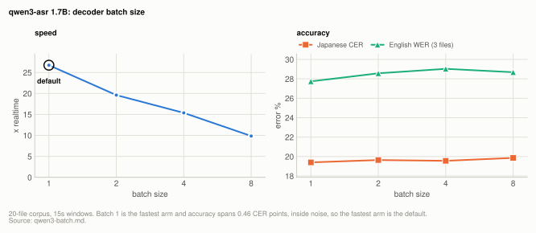
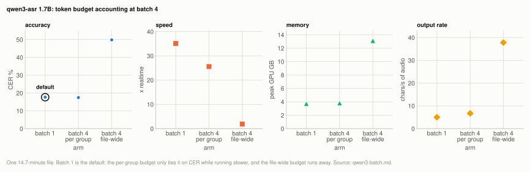

# Lever: batching the Qwen3-ASR decoder

Batch 1 is the default and `--max-batch` stays refused on `qwen3-asr`. On the 20-file
corpus, throughput falls monotonically with batch size (2.7x slower by batch 8)[^b1] while
accuracy stays within 0.46 CER points, inside this corpus's noise.[^b1] This closes
[#1](https://github.com/prog893/mlx-asr/issues/1).

| setting | default | why |
|---|---|---|
| decoder batch size | 1 | fastest arm at every size tested, with no accuracy cost; `--max-batch` is refused |

**Setup:** [20-file corpus](reference/corpus.md#the-20-file-corpus) (8.01h)[^b2], `Qwen3-ASR-1.7B-8bit`,
`--language ja`, 15s windows, M2 Ultra, scored by coverage CER/WER <!-- not-measured: 15s is the window length setting -->
([metrics.md](reference/metrics.md)).

## Experiment: batch size

**Basis:** [20-file corpus](reference/corpus.md#the-20-file-corpus), M2 Ultra, `Qwen3-ASR-1.7B-8bit` with `--language ja` and 15s windows, batch 1, 2, 4 and 8.

<picture>
  <source media="(prefers-color-scheme: dark)" srcset="img/qwen3-batch-batch-dark.svg">
  
</picture>

**Table:** throughput, accuracy and peak GPU memory at each decoder batch size on the 20-file corpus.

| batch | x realtime | JP coverage CER | EN coverage WER | peak GPU |
|---|---|---|---|---|
| **1 (default)** | **26.74x** | **19.40%** | **27.74%** | 3.73GB |
| 2 | 19.61x | 19.64% | 28.57% | 3.77GB |
| 4 | 15.37x | 19.56% | 29.03% | 3.82GB |
| 8 | 9.85x | 19.86% | 28.68% | 6.01GB |

Source: [ultra-qwen3-batch.json](../../benchmarks/results/2026-10/ultra-qwen3-batch.json) runs `qwen3batch_1.7B_8bit_c15_b1#batch 1`, `qwen3batch_1.7B_8bit_c15_b2#batch 2`, `qwen3batch_1.7B_8bit_c15_b4#batch 4`, `qwen3batch_1.7B_8bit_c15_b8#batch 8`

Batch 1 is fastest, and by a widening margin: 2.7x faster than batch 8.[^b1] Accuracy across
the four arms spans 0.46 CER points,[^b1] which is inside this corpus's noise, so there is no
accuracy case for batching either.

Batch 16 was killed by memory pressure partway through and is not in the table.

This table uses the per-group token budget described under
[the shared token budget](#the-shared-token-budget-which-is-a-separate-bug), which is the
fairest version of batching available. Batching loses even then.

**Method.** `scripts/benchmarks/sweep_qwen3_batch.py`. The batch-1 arm calls
`qwen3_decode`, the default code path, so the baseline is not a reimplementation. Batch > 1
has to call upstream's `generate(batch_size=)` directly because `mlx_asr`'s loop is
per-chunk by construction; that asymmetry is the thing being measured.

15s windows, chosen when the default was still 30s so that a file yields enough chunks to fill
several groups at batch 8 and 16. 15s is now the shipped window, having tied 30s on accuracy <!-- not-measured: 15s and 30s are window length settings -->
([qwen3-asr.md](engines/qwen3-asr.md)), so the batch-1 arm is the shipped configuration apart
from `--language ja` and the sweep harness. Its Japanese CER is not the engine page's figure:
the shipped-config run scores 18.62%[^b4] on the same 17 Japanese files, 0.78 points lower[^b4], CI
[-1.35, -0.18][^b4]. The cause of that offset has not been isolated; every arm here shares
the harness, so it does not bear on the batch comparison.

**Two things make the conclusion hold beyond the throughput column:**

- Accuracy does not depend on machine state, because decode is greedy. The paired per-file
  comparison shows batch 2 **worse on 16 of 20 files**,[^b1] which is the robust signal.
- The slowdown is monotonic and large (2.7x by batch 8).[^b1]

## How it works

### Why batching loses here, when it wins on Voxtral

Voxtral batches **decode steps**: rows share one weight read per step, which is the whole
point on a bandwidth-bound decoder. The Qwen3-ASR path batches **whole chunks**, and two
things in that design cancel the benefit.

**Padding.** Chunks in a group are zero-padded to the longest member before the encoder
runs (`pad_to = max(len(c[0]) for c in group)`). A group holding a 15s chunk and a 2s tail
chunk pays 15s of encoder cost on both. The encoder is a real share of wall clock here, so <!-- not-measured: 15s and 2s are an illustrative example of chunk lengths -->
this is not a rounding error.

**Whole-group lockstep.** The group decodes until every member hits EOS or the budget runs
out. A batch finishes when its *slowest* member finishes, so one long chunk holds the other
rows' slots open while they emit nothing.

Batch 1 has neither cost, and the decode it does is the same decode; there is no weight
read to amortize across chunks because each chunk's decode is already sequential over its
own tokens.

### The shared token budget, which is a separate bug

Upstream's batched path decrements one budget across the whole file
(`remaining_tokens -= group_tokens` in `_transcribe_batched`), so the per-window cap that
`mlx_asr`'s own chunk loop exists to enforce does not survive batching. One runaway chunk
can then spend the budget its batch-mates needed.

Measured on one 14.7-minute file at batch 4, with upstream's accounting against a
per-group budget:

<picture>
  <source media="(prefers-color-scheme: dark)" srcset="img/qwen3-batch-budget-dark.svg">
  
</picture>

**Table:** output length, CER, speed and peak memory on one 14.7-minute file for batch 1 and for batch 4 under each token budget accounting.

| | chars emitted | chars/s of audio | CER | x realtime | peak |
|---|---|---|---|---|---|
| batch 1 (default) | 4,408 | 5.0 | 17.65% | 35.1x | 3.73GB |
| batch 4, budget per group | 5,945 | 6.7 | 17.43% | 25.6x | 3.82GB |
| batch 4, upstream's file-wide budget | 33,396 | **37.8** | **49.83%** | 1.9x | 13.12GB |

Source: [ultra-qwen3-batch.json](../../benchmarks/results/2026-10/ultra-qwen3-batch.json) runs `qwen3batch_1.7B_8bit_c15_b1#batch 1`, `qwen3batch_1.7B_8bit_c15_b4#batch 4` (the 883s file's row; peak is the run's peak); [ultra-qwen3-batch-budget.json](../../benchmarks/results/2026-10/ultra-qwen3-batch-budget.json) runs `qwen3batch_wholefilebudget_b4_q883#batch 4` (the file-wide budget row)

`RUNAWAY_CHARS_PER_S` is 25, so 37.8 chars/s is <!-- not-measured: 25 is the runaway threshold constant -->
a repetition loop running unchecked: 32 CER points worse and about 19x[^b3] slower than batch 1, with
peak memory at 13.12GB against 3.73GB.[^b3] The per-group arm sits at 6.7 chars/s, well below
that threshold.

Had the sweep used upstream's accounting alone, the result would have looked like a
catastrophe caused by batching rather than by budget accounting, and the two are worth
separating.

## Not settled

A repeat of each arm would tighten the x-realtime column. It would not change the
decision, which is to keep refusing the flag.

## Related

- [qwen3-asr.md](engines/qwen3-asr.md): the engine page, including the 15s and 30s window comparison.
- [Issue #1](https://github.com/prog893/mlx-asr/issues/1): the request this page closes.
- [metrics.md](reference/metrics.md): coverage CER/WER.

[^b1]: [ultra-qwen3-batch.json](../../benchmarks/results/2026-10/ultra-qwen3-batch.json) runs `qwen3batch_1.7B_8bit_c15_b1#batch 1`, `qwen3batch_1.7B_8bit_c15_b2#batch 2`, `qwen3batch_1.7B_8bit_c15_b4#batch 4`, `qwen3batch_1.7B_8bit_c15_b8#batch 8`
[^b2]: [corpus.json](../../benchmarks/results/corpus.json)
[^b4]: [ultra-qwen3-precision-c15.json](../../benchmarks/results/2026-10/ultra-qwen3-precision-c15.json) runs `qwen3_1.7B_8bit_c15`; [ultra-qwen3-batch.json](../../benchmarks/results/2026-10/ultra-qwen3-batch.json) runs `qwen3batch_1.7B_8bit_c15_b1#batch 1` (paired over the 17 Japanese files)
[^b3]: [ultra-qwen3-batch.json](../../benchmarks/results/2026-10/ultra-qwen3-batch.json) runs `qwen3batch_1.7B_8bit_c15_b1#batch 1`; [ultra-qwen3-batch-budget.json](../../benchmarks/results/2026-10/ultra-qwen3-batch-budget.json) runs `qwen3batch_wholefilebudget_b4_q883#batch 4`
