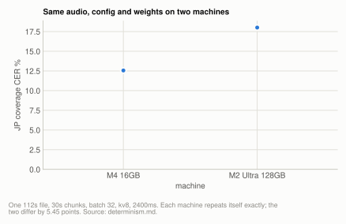
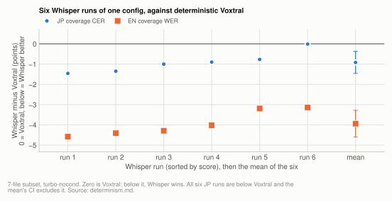

# Reference: determinism

Voxtral is byte-identical across reruns **on one machine** and **not** across machines:
the same audio, config and weight file give different output on an M4 16GB and an M2
Ultra 128GB. Whisper is not reliably reproducible, because its temperature fallback
samples whenever a segment trips a threshold, and `kotoba` through the MLX driver inherits
that ladder (its authors' transformers pipeline reproduced exactly). So one
Voxtral run is its score, reruns add no information, a config comparison must stay on a
single machine, and a Whisper figure needs a run distribution.

**Setup:** the [7-file subset](corpus.md#the-7-file-subset) for reruns and the Whisper
repeat runs, the full
[20-file corpus](corpus.md#the-20-file-corpus) for the cross-machine
comparison, and one 112s file[^d1] of the corpus for the first cross-machine check and the
`kotoba` runs. Machines: M4 16GB and M2 Ultra 128GB.

## Voxtral: deterministic on a machine

The pipeline samples with `mx.argmax` alone: no temperature, no top-p, no top-k. Verified
rather than asserted:

- Same file, 3 consecutive runs: byte-identical, same md5.
- Batch 4 versus 6 versus 16 on the same audio: byte-identical, 0 characters differing.
  Non-associative GPU reductions could in principle perturb argmax ties across batch
  shapes, but do not.
- Full 7-file corpus, independent rerun of one config: all 7 files byte-identical,
  aggregate reproducing exactly at 16.44%.[^d2]
- Two installs of the same commit (pip and Homebrew): byte-identical SRT.

## Voxtral: not deterministic across machines

Measured 2026-08-06, and it corrects a claim this project used to make without
qualification.

Identical audio, identical config (30s chunks, batch 32, kv8, 2400ms), identical weight <!-- not-measured: config values -->
file (`model.safetensors` md5 matching on both hosts):

<picture>
  <source media="(prefers-color-scheme: dark)" srcset="../img/determinism-machines-dark.svg">
  
</picture>

**Table:** coverage CER of one 112s file[^d1] on each machine with identical audio, config and weights, and whether each machine repeats itself.

| | M4 16GB | M2 Ultra 128GB |
|---|---|---|
| coverage CER on one 112s file | **12.56%** | **18.01%** |
| output | differs from the first sentence | |
| repeat run on the same host | byte-identical | byte-identical |

Source: [m4-voxtral-chunking.json](../../../benchmarks/results/2026-10/m4-voxtral-chunking.json) runs `c30b32`; [ultra-voxtral-batch.json](../../../benchmarks/results/2026-10/ultra-voxtral-batch.json) runs `c30b32`, `c30b32_r2`, `c30b32_r3`

These are accuracy figures; no speed number from that session was kept.

The two diverge early and stay diverged, which is what one flipped token does: everything
after it is conditioned differently.

**Cause.** Different GPU geometry means different reduction order in the matmuls, which
changes the last bits of the logits, which flips argmax ties. That is the same effect the
batch-shape check above looked for and did not find *within* a machine. Determinism holds
where the reduction order is fixed and fails where it is not.

**Consequences.**

- A hypothesis file cannot be validated by re-decoding it elsewhere.
- A config comparison must be run on one machine. Comparing an M4 16GB row against an
  Ultra row measures hardware plus config rather than config alone.
- The cross-machine agreement check in this project (M4 16GB nvfp4 versus Ultra 4-bit on
  the 7-file subset, within 0.8 points on 4 of 7 files and 1.17 to 1.34 points[^d9] apart on the
  other 3)[^d9] cannot by itself separate quantization from hardware. It was set up as a
  quantization comparison and is not one. Run at 4-bit on both machines, the same 7 files
  agree within 0.04 points, 4 of them identically,[^d9] so the hardware term there is small,
  but the clean quantization evidence is the single-machine precision sweep in
  [quantization.md](../quantization.md).

## Voxtral: size of the cross-machine effect

The 112s file[^d1] above was the only file compared when this was first measured, and the
"roughly 1 point per file" floor once stated here was an extrapolation from it. Running the <!-- not-measured: names the withdrawn claim -->
identical config on all 20 files of the corpus on both machines shows that extrapolation
was wrong:

**Table:** how many of the 20 corpus files score the same on the M4 16GB and the M2 Ultra 128GB with the same config, and the gap on the 112s file.[^d1]

| agreement between M4 16GB and M2 Ultra 128GB, same config | files |
|---|---|
| coverage CER identical to 2 decimal places | 11 of 20 |
| within 0.16 points | 18 of 20 |
| the 112s file | 5.45 points apart (12.56% against 18.01%) |

Source: [m4-voxtral-chunking.json](../../../benchmarks/results/2026-10/m4-voxtral-chunking.json) runs `c30b32`; [ultra-voxtral-batch.json](../../../benchmarks/results/2026-10/ultra-voxtral-batch.json) runs `c30b32`, `c30b32_r2`, `c30b32_r3`; [corpus.json](../../../benchmarks/results/corpus.json)

So divergence is not a per-file floor that applies everywhere. Most files decode to the
same score on both chips, several byte-identically, and the aggregate difference is small.
The 112s file[^d1] shows the *worst case* rather than the typical one, and it is the shortest
file in the corpus: 422 reference characters, so a single flipped token moves the
percentage several points, where the same flip in a 9830-character file moves it by
hundredths.

Cross-machine divergence is real, it is caused by reduction order, and it cannot be
predicted or averaged away on any individual file. Its *magnitude* scales inversely with
how much text the file contains, which means:

- **Still true:** a config comparison must stay on one machine, and a hypothesis file
  cannot be validated by re-decoding it elsewhere. One flipped token is unbounded in
  principle.
- **Corrected:** there is no ~1 point floor. <!-- not-measured: names the withdrawn claim --> Expect near-exact agreement on files of
  substantial length and volatility on short ones, so a short-clip comparison across
  machines is the dangerous case rather than the representative one.
- **Consequence for method:** this is another reason single-clip results in this project
  reversed on a corpus. A 112s clip[^d1] cannot distinguish a config effect from a
  reduction-order coin flip.

## Whisper: samples, so it needs a run distribution

Three `--size base` runs on identical audio and identical flags produced three
different transcripts. Use `voxtral` or `qwen3-asr` when a repeatable transcript
matters, or when benchmarking anything.

Whisper's temperature-fallback ladder samples whenever a segment trips the
compression-ratio or logprob threshold, so one run is a draw. Six repeat runs of the
identical `turbo-nocond` config on identical audio, 7-file corpus:

<picture>
  <source media="(prefers-color-scheme: dark)" srcset="../img/determinism-whisper-runs-dark.svg">
  
</picture>

**Table:** six repeat runs of Whisper `turbo-nocond` on the 7-file subset, their mean, spread and 95% t-interval, Voxtral's single deterministic score, and each run's difference from Voxtral. <!-- not-measured: CI confidence level -->

| | JP coverage CER | EN coverage WER |
|---|---|---|
| the 6 runs | 14.98, 15.09, 15.44, 15.54, 15.67, 16.43% | 21.97, 22.14, 22.25, 22.52, 23.35, 23.40% |
| mean, SD | 15.53%, SD 0.52 | 22.61%, SD 0.62 |
| 95% t-interval on the mean | [14.99%, 16.07%] | [21.95%, 23.26%] |
| Voxtral (deterministic) | 16.44% | 26.55% |
| runs beating Voxtral | 6 of 6 | 6 of 6 |
| Whisper run minus Voxtral (points) | -1.46, -1.35, -1.00, -0.90, -0.77, -0.01 | -4.58, -4.41, -4.29, -4.02, -3.19, -3.14 |
| mean minus Voxtral, 95% t-interval (points) | -0.92 [-1.46, -0.37] | -3.94 [-4.60, -3.28] |

Source: [ultra-whisper-sizes.json](../../../benchmarks/results/2026-10/ultra-whisper-sizes.json) runs `whisper_turbo_nocond`, `whisper_turbo_nocond_r2`, `whisper_turbo_nocond_r3`, `whisper_turbo_nocond_r4`, `whisper_turbo_nocond_r5`, `whisper_turbo_nocond_r6` (rows of the 7-file subset); [ultra-mincut-inputs.json](../../../benchmarks/results/2026-10/ultra-mincut-inputs.json) runs `mincut7_vox_c30b32_kv8`

The right test here is one-sample: only one side has sampling error, so the Whisper mean
gets a t-interval and Voxtral enters as a constant. Bootstrapping over files answers a
different question ("would this hold on other audio").

**The variance is not uniform across files.** Whisper wins all 6 runs on two files and
loses all 6 on two others; the other three change sign between runs.[^d4] On one file it
produced the identical 11.91% in all six runs,[^d4] i.e. that file never triggers fallback.
So the per-file ordering is fixed on four files and decided by sampling on three.

That file is why the summary says "not reliably" rather than "not at all": a file that
never trips fallback decodes greedily and does repeat exactly. That is a property of the
audio and no guarantee from the engine, so it cannot be relied on in advance.

Two further observations:

- **SD collapses as the corpus grows**, from 0.52 at 7 files to 0.28 at 20.[^d5] More files
  means each file's sampling luck matters less to the aggregate. That is a reason to
  distrust small-corpus repeatability figures, and no evidence that Whisper became
  deterministic.
- **Greedy decoding is not a fix.** `--greedy` (temperature 0.0, no ladder) collapses to
  84.92% / 93.00% on the 7-file subset (one run)[^d7], because the fallback is what rescues segments that enter a repetition
  loop. The ladder is load-bearing and the nondeterminism comes with it.

A live example of the cost, from a run made while writing these documents: one 26-minute
file hit a repetition loop (one short phrase repeated hundreds of times) and collapsed its
output. That single file moved the run's Japanese aggregate by **several points**, from a
small share of the reference characters. A one-run Whisper figure can be wrong by that much
in either direction.

## kotoba: inherits Whisper's sampling

`kotoba` runs on mlx-whisper's `transcribe` and does not override the sampling ladder, so
it is not reproducible either. Five runs of one 112s clip[^d1] on identical audio and flags, through
the MLX chunked driver at 10s windows, gave five distinct transcripts of 378 to 397
characters (381, 397, 378, 385 and 389), scoring 29.15% to 33.41% CER[^d8], agreeing through
the body and diverging at the tail. On the 17 Japanese files of the corpus, three MLX runs at 10s windows scored
26.58% to 26.99% and three at 15s 25.09% to 25.75%[^d6]; the authors' transformers pipeline,
three runs at 15s on the same files, scored 26.09% every time.[^d6]

Worth stating explicitly because the model is a *distil* checkpoint reached through this
project's own chunked driver, which makes it easy to assume the driver decides the
sampling. It does not: the driver fixes `condition_on_previous_text=False` and leaves
temperature alone.

So `voxtral`, `voxtral-v1`, `qwen3-asr`, `parakeet` and `reazon` reproduce on one machine
by construction (greedy decoding, each verified byte-identical on repeat decodes; see
[voxtral-v1.md](../engines/voxtral-v1.md#experiment-repeat-decodes), [qwen3-asr.md](../engines/qwen3-asr.md),
[parakeet.md](../engines/parakeet.md#how-it-works) and [reazon.md](../engines/reazon.md#how-it-works)), while `whisper` and `kotoba` reproduce only on audio
that happens never to trip fallback, which is not knowable before the run.

## Practical rules

- Report Voxtral from one run, and say which machine. It needs no error bars from
  repetition; statistical power comes only from more audio, which is why the method
  bootstraps over files.
- Report Whisper from at least 3 runs, with mean and spread, and never from one. The
  run-to-run range on the 7-file subset is 1.45 points on Japanese,[^d4] larger than the
  0.92-point mean gap to Voxtral on the same files,[^d4] and 0.77 points on the 20-file
  corpus,[^d5] so a single run can misstate a sub-point effect.
- Never compare across machines and attribute the difference to a config.
- If a hypothesis file needs checking, re-run it on the machine that produced it.

## Related

[metrics.md](metrics.md) for the comparison methods that build on this.
[engines.md](../engines.md) for the Voxtral-versus-Whisper result these caveats apply to.

[^d1]: [corpus.json](../../../benchmarks/results/corpus.json)
[^d2]: [ultra-mincut-inputs.json](../../../benchmarks/results/2026-10/ultra-mincut-inputs.json) runs `mincut7_vox_c30b32_kv8`; [ultra-voxtral-prompt-trap.json](../../../benchmarks/results/2026-10/ultra-voxtral-prompt-trap.json) runs `prompt_trap7_none`
[^d3]: [m4-voxtral-chunking.json](../../../benchmarks/results/2026-10/m4-voxtral-chunking.json) runs `c30b32`; [ultra-voxtral-batch.json](../../../benchmarks/results/2026-10/ultra-voxtral-batch.json) runs `c30b32`, `c30b32_r2`, `c30b32_r3`
[^d4]: [ultra-whisper-sizes.json](../../../benchmarks/results/2026-10/ultra-whisper-sizes.json) runs `whisper_turbo_nocond`, `whisper_turbo_nocond_r2`, `whisper_turbo_nocond_r3`, `whisper_turbo_nocond_r4`, `whisper_turbo_nocond_r5`, `whisper_turbo_nocond_r6` (rows of the 7-file subset); [ultra-mincut-inputs.json](../../../benchmarks/results/2026-10/ultra-mincut-inputs.json) runs `mincut7_vox_c30b32_kv8`
[^d5]: [ultra-whisper-sizes.json](../../../benchmarks/results/2026-10/ultra-whisper-sizes.json) runs `whisper_turbo_nocond`, `whisper_turbo_nocond_r2`, `whisper_turbo_nocond_r3`, `whisper_turbo_nocond_r4`, `whisper_turbo_nocond_r5`, `whisper_turbo_nocond_r6`
[^d6]: [ultra-kotoba-windows.json](../../../benchmarks/results/2026-10/ultra-kotoba-windows.json) runs `pk_kotoba_c10_s1`, `pk_kotoba_c10_s2`, `pk_kotoba_c10_s3`; [ultra-kotoba-engines.json](../../../benchmarks/results/2026-10/ultra-kotoba-engines.json) runs `k20_mlx_c15_r1`, `k20_mlx_c15_r2`, `k20_mlx_c15_r3`, `k20_hf22_c15_r1`, `k20_hf22_c15_r2`, `k20_hf22_c15_r3`
[^d7]: [ultra-whisper-sizes-7file.json](../../../benchmarks/results/2026-10/ultra-whisper-sizes-7file.json) runs `w7_turbo_greedy_r1`
[^d8]: [ultra-kotoba-determinism.json](../../../benchmarks/results/2026-10/ultra-kotoba-determinism.json) runs `kdet112_r1`, `kdet112_r2`, `kdet112_r3`, `kdet112_r4`, `kdet112_r5`
[^d9]: [m4-cross-machine-7file.json](../../../benchmarks/results/2026-10/m4-cross-machine-7file.json) runs `m4_mincut7_vox_c30b32_kv8_nvfp4`, `m4_mincut7_vox_c30b32_kv8_4bit`; [ultra-mincut-inputs.json](../../../benchmarks/results/2026-10/ultra-mincut-inputs.json) runs `mincut7_vox_c30b32_kv8` (per-file coverage error, the unit each file is scored in)
