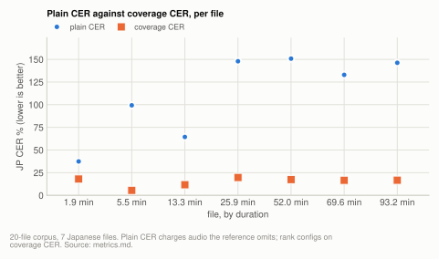
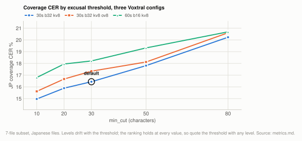
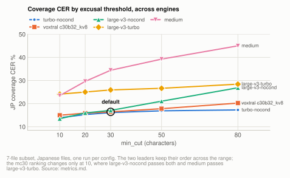

# Reference: metrics

Use coverage CER/WER for editorial references, plain CER only for verbatim ones, and
lenient CER as the fair Japanese number. Plain CER fails on most of this material because
the references deliberately omit audio, so it counts correct transcription of that audio
as error: four corpus files read over 100% plain CER while scoring 15-20%[^m1] on coverage
CER. Kana CER is reported but should not be quoted as "the" figure: it over-forgives,
and until 2026-08-19 it also under-forgave, because pykakasi never read numerals (see
below).

**Setup:** the [20-file corpus](corpus.md#the-20-file-corpus), its
[7-file subset](corpus.md#the-7-file-subset), and [one clip](corpus.md#the-single-clip)
with a verbatim reference. The text above each table names which one it uses.

## The metrics, and when each is wrong

**Table:** each metric, what it forgives, and when it gives the right answer.

| metric | forgives | correct when |
|---|---|---|
| `eval_cer` | nothing | the reference is verbatim |
| `eval_coverage` | long insertion runs, as omitted-from-reference audio | the reference is editorial |
| `eval_cer_lenient` | kana/kanji respelling of the **same** word | you want the fair Japanese number |
| `eval_cer_kana` | anything sharing a reading | almost never; see below |
| `eval_coverage_kana` | both of the above at once | an editorial reference *and* a model that reformats numbers |
| `eval_timing` | n/a, scores timestamps | you have a timed reference |

All are NFKC-normalized with punctuation and whitespace stripped. Scoring unit is chosen
per file from the reference script: character-level for CJK, word-level for
space-delimited text. The two are aggregated separately and **never averaged**, because
one substituted word is one word-level error but only a fraction of the characters in a
CJK sentence. That is also why English and Japanese always appear in separate columns
here.

### What stripping punctuation and whitespace hides

Two defects are invisible to every metric above, and both were found only by reading the
transcripts rather than the scores:

- **Word spacing on space-delimited output.** Because whitespace is deleted before
  scoring, a hypothesis can lose almost all its spaces and still score normally on
  character coverage. Conversely, word-level coverage over-punishes it: one arm of the
  prompt experiment emitted 1 space where the unprompted run emitted 4016, which read as
  97.58% coverage WER while the whitespace-free character CER was within 1.4 points[^m12] of
  baseline. See
  [prompt.md](../prompt.md).
- **Punctuation density.** Voxtral emits Japanese `。` and `、` at roughly a third of the
  rate the references use (8.8 to 13.6 marks per 1000 non-space characters across the
  prompt arms, against 31.0 in the references, on the 12 Japanese recordings whose
  references are transcripts, as the saved count's derive script defines it)[^m8], in
  every prompt configuration counted. Since punctuation is stripped, no number in these documents
  reflects it, and it does not appear as a regression anywhere.

Neither is a scoring bug: both metrics do what they are specified to do, and stripping is
what makes the kanji/kana leniency rule and the editorial references workable. But a
config that only damages spacing or punctuation can score clean here, so **read a sample of
the actual output before concluding a config is harmless.**

## Coverage CER, and why it had to exist

The references for the spontaneous recordings were written for readability, not for ASR
evaluation: off-topic passages, side conversation in another language, and non-speech
segments were cut. The audio still contains that material, so a *correct* transcription
legitimately includes text the reference lacks.

Plain CER counted all of it as insertions. On the seven Japanese files below it reads
37.4% to 150.8%[^m1], and above 130% on the four longest[^m1]. On the 20-file corpus:

<picture>
  <source media="(prefers-color-scheme: dark)" srcset="../img/metrics-plain-vs-coverage-dark.svg">
  
</picture>

**Table:** per-file coverage, coverage CER and plain CER for seven Japanese files of the 20-file corpus, with the characters excused and the hypothesis-to-reference length ratio.

| file | duration | coverage | coverage CER | plain CER | chars excused | extra_ratio |
|---|---|---|---|---|---|---|
| c18b2f5aa2a2 | 52.0 min | 86.6% | **17.4%** | 150.8% | 8461 | 2.32 |
| cbeb19543902 | 25.9 min | 83.4% | **19.7%** | 147.9% | 2966 | 2.22 |
| 9aefd8f2352e | 93.2 min | 86.9% | **16.7%** | 146.2% | 12734 | 2.29 |
| c29657df52e9 | 69.6 min | 89.4% | **16.6%** | 132.9% | 8719 | 2.19 |
| b88caf8c0924 | 5.5 min | 98.1% | **5.5%** | 99.3% | 1002 | 1.97 |
| 07fd66556725 | 13.3 min | 90.3% | **11.7%** | 64.4% | 1337 | 1.50 |
| bb5cf5d5b247 | 1.9 min | 82.2% | **18.0%** | 37.4% | 82 | 1.18 |

Source: [ultra-voxtral-headline.json](../../../benchmarks/results/2026-10/ultra-voxtral-headline.json) runs `vox_default_c30b128_kv8`, `vox_default_c30b128_kv8_r2`, `vox_default_c30b128_kv8_r3`; [corpus.json](../../../benchmarks/results/corpus.json)

`b88caf8c0924` is the sharpest case: 99.3% plain against 5.5% coverage, with 98.1%[^m1] of reference
characters found correctly. An evaluation of this corpus on plain CER would rank configs
by **how much real speech they skip**, which is the opposite of what anyone wants.

`extra_ratio` (hypothesis length / reference length) is the tell. Near 1.0 means the pair
is comparable and plain CER can be trusted; well above 1 means the reference is
editorial.

### How it works

`scripts/metrics/eval_coverage.py` treats the reference as a *subsequence to locate* rather than
the whole truth. Using Levenshtein opcodes, it charges substitutions and deletions and
*short* insertions, but excuses insertion runs longer than `min_cut` as
omitted-from-reference audio. So hallucination and repetition loops still count (they
produce short, scattered insertions inside matched text) while correct transcription of
cut material does not.

It also strips speaker-label lines (`Name:` alone on a line), which are diarization
metadata the models never emit.

## The threshold has to be quoted with any absolute number

`scripts/benchmarks/sweep_min_cut.py`, varying `min_cut` over saved hypotheses. Japanese
coverage CER on the [7-file subset](corpus.md#the-7-file-subset) (its 5 Japanese files),
from the 7-file runs (the Whisper rows from the 2026-07-29 baseline):

<picture>
  <source media="(prefers-color-scheme: dark)" srcset="../img/metrics-mincut-configs-dark.svg">
  
</picture>

**Table:** Japanese coverage CER of three Voxtral configs at five `min_cut` thresholds (mc10 to mc80, in characters).[^m2]

| config | mc10 | mc20 | mc30 | mc50 | mc80 |
|---|---|---|---|---|---|
| 30s b32 kv8 | 14.97% | 15.89% | **16.44%** | 17.81% | 20.23% |
| 30s b32 kv8 ov8 | 15.62% | 16.67% | 17.34% | 18.12% | 20.61% |
| 60s b16 kv8 | 16.80% | 17.95% | 18.21% | 19.32% | 20.69% |

Source: [ultra-mincut-inputs.json](../../../benchmarks/results/2026-10/ultra-mincut-inputs.json) runs `mincut7_vox_c30b32_kv8`, `mincut7_vox_c30b32_kv8_ov8`, `mincut7_vox_c60b16_kv8` (mc30); [ultra-derived-measures.json](../../../benchmarks/results/2026-10/ultra-derived-measures.json) runs `mincut_sweep` (every threshold, rescoring the same hypotheses; its mc30 column reproduces the saved runs)

Absolute levels drift about 5 points[^m9] across that range (5.26 on characters and 5.17 on
words for the first config)[^m9]. But the **ranking is identical at
every threshold**, on both units, which is the property the tuning conclusions actually
depend on. Every figure in these documents uses 30 characters / 6 words.

### It is not flattering one engine

The obvious worry is that excusing insertions helps whichever engine inserts more.
On the 5 Japanese files of the 7-file subset, the mean per-file `extra_ratio` is 2.1 for
Voxtral and 1.66 to 2.02 for large-v3, medium and turbo at library defaults and for
large-v3-nocond; only turbo-nocond inserts more than Voxtral, at 2.75[^m7]. That is the one
comparison where the threshold could in principle favour Whisper. Across engines:

<picture>
  <source media="(prefers-color-scheme: dark)" srcset="../img/metrics-mincut-engines-dark.svg">
  
</picture>

**Table:** Japanese coverage CER of five engine configs at five `min_cut` thresholds (mc10 to mc80, in characters).

| config | mc10 | mc20 | mc30 | mc50 | mc80 |
|---|---|---|---|---|---|
| turbo-nocond | 13.89% | 15.26% | 16.12% | 16.88% | 17.27% |
| voxtral c30b32_kv8 | 14.97% | 15.89% | 16.44% | 17.81% | 20.23% |
| large-v3-nocond | 13.48% | 15.98% | 17.07% | 21.05% | 26.85% |
| large-v3-turbo | 24.09% | 25.01% | 25.92% | 26.62% | 28.42% |
| medium | 23.47% | 29.61% | 34.43% | 39.24% | 44.99% |

Source: [ultra-mincut-inputs.json](../../../benchmarks/results/2026-10/ultra-mincut-inputs.json) runs `mincut7_whisper_turbo_nocond`, `mincut7_vox_c30b32_kv8`, `mincut7_whisper_large-v3_nocond`, `mincut7_whisper_turbo_libdef`, `mincut7_whisper_medium_libdef` (mc30); [ultra-derived-measures.json](../../../benchmarks/results/2026-10/ultra-derived-measures.json) runs `mincut_sweep` (every threshold; one run per config)

The two leaders keep their order across the whole range. Voxtral's disadvantage against
turbo-nocond is 1.08 points[^m9] at mc10, 0.63 at mc20, 0.32 at mc30, 0.93 at mc50 and 2.96 at
mc80[^m9]: smallest at the default and largest at mc80, where the least is excused, and not
monotonic in the threshold, so the excusal rule does not systematically favour Voxtral. The
ranking at mc30 holds at mc20, mc50 and mc80; it changes only at mc10, with three swaps:
large-v3-nocond passes both turbo-nocond and Voxtral, and medium passes large-v3-turbo[^m9].
The table is one run per config, so the swaps have not been tested for resolution.

## How much of Japanese CER is just spelling

Japanese has no fixed orthography, so a reference typist's choice of kanji versus kana is
not a model error. Three metrics on the best run of the narration clip ([single clip](corpus.md#the-single-clip)):

**Table:** plain, lenient and kana CER on the best run of the narration clip, and what each forgives.

| metric | value | forgives |
|---|---|---|
| CER | 7.13% | nothing |
| lenient CER | 6.92% | script changes of the *same* word |
| kana CER | 5.51% | anything sharing a reading |

Source: [ultra-text-vs-srt.json](../../../benchmarks/results/2026-10/ultra-text-vs-srt.json) runs `tvs_ultra_score` (config 30s, b32, kv8, ov8, token text: the lowest CER of the six)

**Use lenient CER as the fair number.** Kana CER over-forgives: collapsing everything to
readings also excuses genuine homophone errors, where a different word sharing the same
reading is substituted. A reader notices that; kana CER scores it free.

This corrects an earlier claim in this project that ~1.6 CER points[^m3] were orthographic.
That figure came from the kana measure. The honest number is about 3% of edits,[^m3] i.e.
**~0.2 CER points**, so the vast majority of remaining error is real misrecognition.

Lenient CER changes no ranking on either machine, sitting uniformly 0.2-0.3 points[^m5] below
plain CER. That is a useful negative result: the refinement was worth doing to correct
the magnitude claim, but it does not alter any decision. Kana CER, by contrast, does
occasionally reorder configs (fp16 leads on kana but not on CER or lenient), which is a
second reason to prefer lenient.

### Kana CER never forgave digits, which is most of the confound

Found while integrating Qwen3-ASR, and it qualifies every kana figure above:
**pykakasi does not read numerals.** It converts `2018年` to `2018ねん`, not to
`にせんじゅうはちねん`, so the digits-versus-spelled-out difference, the largest
orthographic class on this material, was charged in full by the very metric meant to
forgive it. On two spellings of one sentence (`答えは1500でした` against
`こたえはせんごひゃくでした`, nothing misheard) kana CER read **55%** where the corrected <!-- not-measured: worked example on two constructed strings -->
figure is 0%. <!-- not-measured: same worked example -->

`eval_cer_lenient.read_number` fills the gap, and `eval_coverage_kana` uses it by
default. It is **opt-in** in the older plain scripts (`--read-digits`), so every kana
figure already published in this repo keeps the meaning it had; those figures still
understate leniency wherever the material contains numbers. This matters most for a model
doing inverse text normalisation, which is why it surfaced with Qwen3-ASR rather than
earlier.

Stated limits: counter-specific readings are not modelled (`4年` reads as よんねん here,
not よねん), and a digit string a speaker would read one digit at a time is read as a
quantity unless it is longer than 20 digits or carries a leading zero. Each leaves a small
residual charge, so this narrows the confound rather than erasing it.

## Text and subtitle output score identically

Cue segmentation is underdetermined: many groupings of the same tokens are equally valid,
and the choice shifts characters between lines. Scoring a concatenated SRT therefore
risks measuring the cue heuristics rather than the transcription.

That concern also uncovered a real bug. Cue text used to be assembled by appending raw
token *bytes* and decoding at each flush. The tokenizer is a byte-level BPE, so a flush
landing mid-character split it and both halves decoded to U+FFFD. **Stray replacement
characters existed across the saved SRTs**, each an unearned CER error. Fixing it (break
only on complete-character boundaries) removed an unearned CER error per stray character.

With that fixed, text-only CER equals SRT-joined CER **to four decimals across all 12
configs on both machines** (plain CER on the [single clip](corpus.md#the-single-clip)):

**Table:** plain CER on the single clip from the text output and from the joined SRT cues, per config, on two machines, 4-bit weights on both.[^m6]

| config | M2 Ultra 128GB text | M2 Ultra 128GB srt | M4 16GB text | M4 16GB srt |
|---|---|---|---|---|
| 60s, b16 | 7.40% | 7.40% | 7.40% | 7.40% |
| 60s, b16, kv8 | 7.28% | 7.28% | 7.44% | 7.44% |
| 30s, b32, kv8 | 8.63% | 8.63% | 8.63% | 8.63% |
| 30s, b32, kv8, ov4 | 7.16% | 7.16% | 7.11% | 7.11% |
| 30s, b32, kv8, ov8 | 7.13% | 7.13% | 7.13% | 7.13% |
| 60s, b16, kv8, compact | 8.30% | 8.30% | 8.32% | 8.32% |

Source: [ultra-text-vs-srt.json](../../../benchmarks/results/2026-10/ultra-text-vs-srt.json) runs `tvs_ultra_score` (the M2 Ultra columns); [m4-text-vs-srt.json](../../../benchmarks/results/2026-10/m4-text-vs-srt.json) runs `tvs_m4_score` (the M4 16GB columns)

So cue grouping does not distort the metric: the only text-changing step was a per-cue
`.strip()`, and cue boundaries land in gaps rather than inside words. `mlx_asr/text.py`
decodes each chunk's token stream in one call for the plain-text path, and
`scripts/benchmarks/run_matrix.sh` writes every format per run so both views are always
available.

## How to compare two configs

Not by eyeballing two aggregates. Two methods, for two different questions.

**"Is A better than B on this clip?"** Paired test over regions of the same audio
(`scripts/benchmarks/compare_configs.py`): split the reference into 40 regions, compute per-region
error for each config, bootstrap the per-region differences. Shared difficulty cancels
instead of inflating both intervals. Sign convention in the output is `diff = a - b`, so
**positive means A is worse**.

**"Would this hold on other audio?"** Bootstrap over *files*, length-weighted
(`scripts/benchmarks/compare_engines.py`). This is the only method that speaks to
generalization, and it is much stricter: the per-file paired difference between two real
configs (Voxtral at 4-bit, the default then, against Whisper turbo-nocond, 6 runs, over 17 Japanese files)
has SD 2.75 points[^m10], so a 95% interval on the mean has a half-width of about **2.04 points at
n=7 and 1.20 at n=20**[^m10]. Most lever docs here are n=7; check which the experiment used before
reading "not resolvable" as "small".

That gap between the two is why several single-clip results in this project reversed on a
corpus. A significant paired result on one clip means "real on this clip", not "real".

### Never size a corpus experiment from a single-clip effect size

The reverse mistake is the expensive one, and this project made it. A clip result was used
as the input to a power calculation, which then said the corpus experiment was not worth
running:

**Table:** fp16 against 4-bit on the clip that sized the corpus experiment, its saved rerun, and the corpus result.

| basis | fp16 vs 4-bit | verdict |
|---|---|---|
| clip | a fraction of a point | unresolved, so "needs far more files than exist" |
| clip, saved rerun | +0.38 points, CI [-0.19, +0.95] | unresolved |
| corpus | 1.09 points, CI [+0.32, +2.07] | resolved at n=20 |

Source: [ultra-voxtral-clip-paired.json](../../../benchmarks/results/2026-10/ultra-voxtral-clip-paired.json) runs `cmp_prec_fp16v4`; [ultra-voxtral-precision.json](../../../benchmarks/results/2026-10/ultra-voxtral-precision.json) runs `vox_w4bit_c60b16_kv8`, `vox_wfp16_c60b16_kv8`

The sample-size estimate was wrong by orders of magnitude, and the conclusion it licensed ("precision costs
nothing measurable") stood in seven places for weeks
([quantization.md](../quantization.md)).

The error is not sampling noise; it is that a power calculation inherits the validity of
whatever effect size it is given. A clip that shows no effect yields an arbitrarily large
sample-size estimate, and that estimate then forbids the very experiment that would reveal
the effect. **A null on one clip is not evidence of a small effect, so it cannot justify
skipping a corpus run.** If a lever is cheap enough to sweep, sweep it; if it is not, record
it as unmeasured rather than as too-small-to-matter.

### The English bootstrap is n=3, and that is worse than it sounds

A bootstrap resamples files with replacement, so the number of *distinct* resamples it can
ever draw is the number of multisets of size n from n items, `C(2n-1, n)`:

**Table:** how many distinct bootstrap resamples a set of n files allows, `C(2n-1, n)`.

| files | distinct resamples possible |
|---|---|
| 3 | **10** |
| 7 | 1,716 |
| 17 | 1.17e9 |
| 20 | 6.89e10 |
<!-- not-measured: arithmetic, C(2n-1, n) for each n -->

At n=3 there are ten possible resamples no matter how many are requested, so the resulting
histogram is a handful of spikes and the 2.5th and 97.5th percentiles land on specific
compositions rather than on a smooth tail. `plot_evidence.py bootstrap` makes this visible
immediately: the Japanese panel is a smooth distribution centred near zero, and the English
panel next to it is five bars.

The consequence is not that the English numbers are wrong, but that **a 95% interval is the <!-- not-measured: CI confidence level -->
wrong summary for them**. Two English comparisons can both be reported as "not resolvable"
while one has every resample on the same side of zero and the other is split evenly. Read
the per-file numbers and the direction for English, not the interval. Anything that rests
on the English side is a direction with n=3 behind it, which is why those conclusions are
labelled as directional throughout these documents.

**Do not use repeat runs for statistical power.** Voxtral decodes greedily, so a rerun is
byte-identical on the same machine and adds no information; only more audio adds power.
Whisper does sample, so it genuinely needs a run distribution: see
[determinism.md](determinism.md).

## Reproducing

```bash
cd scripts        # metrics is a package here, so -m needs it on the path
uv run python -m metrics.eval_coverage REFERENCE HYPOTHESIS [--verbose]
uv run python -m metrics.eval_cer REFERENCE HYPOTHESIS
uv run python -m metrics.eval_cer_lenient REFERENCE HYPOTHESIS [--read-digits]
uv run python -m metrics.eval_coverage_kana REFERENCE HYPOTHESIS
uv run python -m metrics.eval_timing REF.srt HYP.srt
```

`--verbose` on the coverage scorer prints the longest excused runs with their text, which
is how to check that the excusal rule is catching cut material rather than hallucination.

Needs the `eval` extra: `uv sync --extra eval`.

## Related

- [corpus.md](corpus.md): the recordings, the clip, and why the references are editorial
- [determinism.md](determinism.md): run-to-run and cross-machine variation, and why Whisper
  needs a run distribution
- [quantization.md](../quantization.md): the corpus result the single-clip power calculation
  wrongly ruled out
- [prompt.md](../prompt.md): the word-spacing defect that stripping whitespace hides
- [engines.md](../engines.md): the cross-engine comparison the `min_cut` sweep checks
- [README.md](../README.md): index of every lever page

[^m1]: [ultra-voxtral-headline.json](../../../benchmarks/results/2026-10/ultra-voxtral-headline.json) runs `vox_default_c30b128_kv8`, `vox_default_c30b128_kv8_r2`, `vox_default_c30b128_kv8_r3`
[^m2]: [ultra-mincut-inputs.json](../../../benchmarks/results/2026-10/ultra-mincut-inputs.json) runs `mincut7_vox_c30b32_kv8`, `mincut7_vox_c30b32_kv8_ov8`, `mincut7_vox_c60b16_kv8` (mc30); [ultra-derived-measures.json](../../../benchmarks/results/2026-10/ultra-derived-measures.json) runs `mincut_sweep` (every threshold, rescoring the saved hypotheses; the hypotheses themselves are not saved)
[^m3]: [ultra-text-vs-srt.json](../../../benchmarks/results/2026-10/ultra-text-vs-srt.json) runs `tvs_ultra_score` (config 30s, b32, kv8, ov8: CER minus kana CER, and CER minus lenient CER over CER)
[^m5]: [ultra-text-vs-srt.json](../../../benchmarks/results/2026-10/ultra-text-vs-srt.json) runs `tvs_ultra_score` (the six M2 Ultra configs); [m4-text-vs-srt.json](../../../benchmarks/results/2026-10/m4-text-vs-srt.json) runs `tvs_m4_score` (the same six configs on the M4 16GB)
[^m6]: [ultra-text-vs-srt.json](../../../benchmarks/results/2026-10/ultra-text-vs-srt.json) runs `tvs_ultra_score` (the M2 Ultra columns); [m4-text-vs-srt.json](../../../benchmarks/results/2026-10/m4-text-vs-srt.json) runs `tvs_m4_score` (the M4 16GB columns)
[^m7]: [ultra-mincut-inputs.json](../../../benchmarks/results/2026-10/ultra-mincut-inputs.json) runs `mincut7_vox_c30b32_kv8`, `mincut7_whisper_large-v3_libdef`, `mincut7_whisper_large-v3_nocond`, `mincut7_whisper_medium_libdef`, `mincut7_whisper_turbo_libdef`, `mincut7_whisper_turbo_nocond` (mean of the per-file extra_ratio over the 5 Japanese files)
[^m8]: [ultra-derived-measures.json](../../../benchmarks/results/2026-10/ultra-derived-measures.json) runs `derive_prompt` (Japanese full stops and commas per 1000 non-whitespace characters, pooled over the 12 Japanese recordings whose references are transcripts; the other files are not counted)
[^m9]: [ultra-derived-measures.json](../../../benchmarks/results/2026-10/ultra-derived-measures.json) runs `mincut_sweep`
[^m10]: [ultra-resolution-floor.json](../../../benchmarks/results/2026-10/ultra-resolution-floor.json) runs `resolution_floor` (95% half-width 1.96 SD / sqrt(n) of the per-file paired Japanese differences), computed from [ultra-voxtral-headline.json](../../../benchmarks/results/2026-10/ultra-voxtral-headline.json) runs `vox_default_c30b128_kv8`, `vox_default_c30b128_kv8_r2`, `vox_default_c30b128_kv8_r3`; [ultra-whisper-sizes.json](../../../benchmarks/results/2026-10/ultra-whisper-sizes.json) runs `whisper_turbo_nocond`, `whisper_turbo_nocond_r2`, `whisper_turbo_nocond_r3`, `whisper_turbo_nocond_r4`, `whisper_turbo_nocond_r5`, `whisper_turbo_nocond_r6`
[^m12]: [ultra-derived-measures.json](../../../benchmarks/results/2026-10/ultra-derived-measures.json) runs `derive_prompt` (its unprompted first-session arm and its frequency-ranked topic English arm, file 0c193bf7ced2: spaces and whitespace-free coverage CER); [ultra-voxtral-prompt-derived.json](../../../benchmarks/results/2026-10/ultra-voxtral-prompt-derived.json) runs `prompt20_derived_freq#topic en`; [ultra-voxtral-prompt.json](../../../benchmarks/results/2026-10/ultra-voxtral-prompt.json) runs `prompt20_c30b32_kv8#none -`
