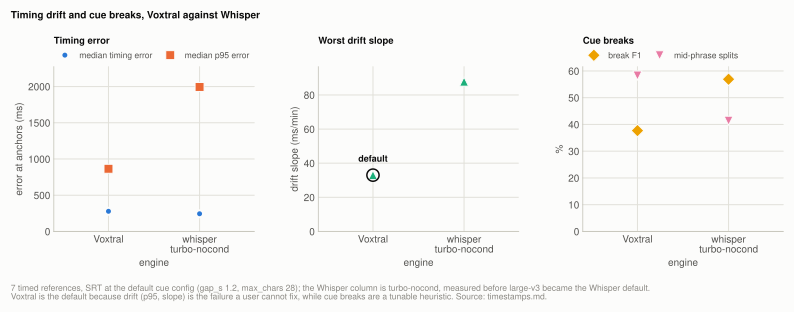

# Lever: timestamp quality

Voxtral and Whisper fail in different directions, and the split is actionable. **Voxtral
holds timing** (worst drift slope 33.0 ms/min against Whisper's 87.8,[^t1] lower p95 error on
6 of 7 files) and **Whisper places cues better** (break F1 56.9% against 37.7%,[^t1] better on 6
of 7 files). Voxtral is better where errors are hard to fix, since timestamps come from the
model, and worse where they are easy, since cue grouping is our own heuristic and
deliberately not fitted to these references. That is why Voxtral is the default for
subtitle output, with the cue knobs exposed so you can fit them to your own references.

| setting | default | why |
|---|---|---|
| `--model` | `voxtral` | lower p95 error on 6 of 7 files and the smallest worst drift slope; drift is the failure that makes a subtitle file unusable |
| `--gap-seconds` | `1.2` | not the sweep optimum; costs 5.4 break-F1 points, see [cue-layout.md](cue-layout.md) |
| `--max-chars` | `28` | paired with `--gap-seconds 1.2`, see [cue-layout.md](cue-layout.md) |

Source: [ultra-timestamps.json](../../benchmarks/results/2026-10/ultra-timestamps.json) runs `ts_0732#engine voxtral`, `ts_default_r1#engine voxtral`, `ts_default_r2#engine voxtral`, `ts_default_r3#engine voxtral`, `ts_default_r1#engine whisper-turbo-nocond`, `ts_default_r2#engine whisper-turbo-nocond`, `ts_default_r3#engine whisper-turbo-nocond`

**Setup:** the 7 [timed references](reference/corpus.md#timed-references) (six subtitled corpus files
and the single clip), on a machine not recorded with this table, scored by drift and cue-break
metrics reported separately by `eval_timing` ([metrics.md](reference/metrics.md)). n=7 is the
smallest sample in the project, because no other recording here has an authored subtitle
track.

## Experiment: Voxtral against Whisper at the default cue config

**Basis:** the 7 [timed references](reference/corpus.md#timed-references), on a machine not recorded with this table, SRT output at the default cue config (`gap_s=1.2, max_chars=28`), Voxtral through the CLI at 30s / B32 with the 4-bit weights it shipped then. <!-- not-measured: config: chunk length and batch --> The Whisper column is turbo-nocond, measured before large-v3 became the Whisper default.

Both engines are asked for SRT output on the same audio and scored by `eval_timing`
(`scripts/benchmarks/run_timing_sweep.py`), at the cue grouping the CLI defaults to
(`gap_s=1.2, max_chars=28`) and with Whisper's language taken per file from its reference.
Both of those were bugs once; see [Superseded](#superseded).

n=7, every row above the 50% anchor-coverage bar (lowest is 76.6%),[^t1] so nothing is
excluded.

<picture>
  <source media="(prefers-color-scheme: dark)" srcset="img/timestamps-engines-dark.svg">
  
</picture>

**Table:** timing and cue-break metrics for Voxtral and Whisper turbo-nocond at the default cue config, n=7; the Whisper column is the mean of 3 runs.

| | Voxtral | whisper turbo-nocond |
|---|---|---|
| median timing error | 278 ms | **244 ms** |
| median p95 error | **865 ms** | 1994 ms |
| worst drift slope | **33.0 ms/min** | 87.8 ms/min (unstable, see below) |
| break F1 | 37.7% | **56.9%** |
| mid-phrase splits | 58.3% | **41.4%** |

Source: [ultra-timestamps.json](../../benchmarks/results/2026-10/ultra-timestamps.json) runs `ts_default_r1#engine voxtral`, `ts_default_r2#engine voxtral`, `ts_default_r3#engine voxtral`, `ts_default_r1#engine whisper-turbo-nocond`, `ts_default_r2#engine whisper-turbo-nocond`, `ts_default_r3#engine whisper-turbo-nocond`

Per-file, Voxtral's p95 error is lower on **6 of 7 files**, and 2.3x lower at the median.[^t1]
Whisper's break F1 is higher on **6 of 7**, the exception being the prepared-narration
clip.

Median error is the one column Whisper nominally wins, and it should not be read as a
Whisper advantage: the median says nothing about the tail, and the p95 and slope columns
are where a subtitle file becomes unusable. Whisper's worst slope, 87.8 ms/min[^t1] as the mean of
its three runs,[^t1] is 0.88s of accumulated drift on a ten-minute file; two of the three runs
(103.1 and 113.4 ms/min)[^t1] exceed a second.

If you need timing accuracy, use Voxtral. If you need cue boundaries that read naturally
and are willing to accept drift, Whisper's are better, or fit `--gap-seconds` to your own
references.

## Experiment: stability of Whisper's worst slope

**Basis:** the one [timed reference](reference/corpus.md#timed-references) that produces Whisper's worst slope, on a machine not recorded with this table, three runs of the identical default config.

Read Whisper's worst slope as an order of magnitude, not a value. Three runs of the identical config gave 46.8,
103.1 and 113.4 ms/min[^t1] on the file that produces it, because Whisper samples: its output on that
file differed between runs, one cue splitting where the other did not. Every other Whisper
row matched exactly across the three runs, so this is one file's instability rather than
general noise. All three are 1.4-3.4x Voxtral's worst,[^t1] so the comparison is unaffected. See
[determinism.md](reference/determinism.md).

## How it works

A subtitle file can fail in two independent ways, and a single number would hide both, so
they are never combined into one score:

- **Drift**: words correct, times wrong. Fatal, and invisible to CER.
- **Cue breaks**: times right, text chopped mid-phrase. Annoying but cosmetically fixable.

`scripts/metrics/eval_timing.py` reports them separately and never averages them.
Plain-text references cannot support either.

**Drift** is measured at *anchors*, not by comparing cue lists. The two texts are aligned
character by character, and every run of at least 8 matched characters becomes an anchor,
sampled at its midpoint. That is what stops cut material from masquerading as drift. It
reports median and p95 absolute error at anchors, plus a least-squares regression of
signed error on time. **Slope is separated from constant offset** because a whole file
shifted 400ms is trivially correctable while error that grows through the file is not. <!-- not-measured: illustrative offset -->

**Cue breaks** are boundary F1 of hypothesis cue ends against the author's, within a 0.5s <!-- not-measured: scorer tolerance setting -->
tolerance, plus the rate of hypothesis cue ends landing strictly inside a reference cue.

`anchor_coverage` is reported alongside: below about 50% the timing estimate is weak and <!-- not-measured: threshold definition -->
the row should be dropped rather than averaged in.

**Why the engines split.** Voxtral's timestamps come from the model: one token per decoder
position, each covering 80ms of audio, <!-- not-measured: model design constant --> so a timestamp is a position count rather than an
estimate. That is why drift is small. The cue knobs still move the measured slope: at
`gap_s=0.7, max_chars=32` Voxtral's worst slope is 16.9 ms/min against 33.0 at the default.[^t2]
Whisper emits segment-level timestamps from a model that was not trained to be precise
about them, but its segments are chosen with more linguistic context than our gap-based
heuristic uses, so its boundaries match a human editor better.

## Superseded

The table used to contain two harness bugs. Both looked like model behaviour and neither
was.

**Voxtral's figure described a config other than the default.** The published figure was
measured at `gap_s=0.7, max_chars=32` (43.1% on the saved rerun of that config);[^t2] the CLI default is `1.2, 28`, which scores
**37.7%**.[^t2] So that config flattered the default a user gets by 5.4 points.[^t2] Root
cause: the cue config was neither settable from the CLI nor recorded in any output, so a
run could not be attributed to one. See [cue-layout.md](cue-layout.md).

**Whisper's language was hardcoded to `ja`.** One corpus file is English audio with an
English reference (it is the English half of a dubbed pair). Transcribed as Japanese it
looped, emitting cues with identical start and end and one cue ending before it began, and
the metric discarded the row as untrustworthy, which read as
Whisper struggling on hard audio rather than the harness asking for the wrong language.
With language detected per file from the reference, that same row reaches **93.1%**[^t1]
coverage and scores 43.5% break F1.[^t1]

Fixing the second one removed a real methodological wart: the table used to need a
paragraph explaining whether to read an "all 7" column that included a broken row or a
"trusted 6" column that dropped it. There is now one n=7 table.

Both corrections pulled in opposite directions, and the ordering survived both. The
magnitudes moved: Whisper's break advantage is 19.2 points,[^t1] larger than published, and
Voxtral's worst slope at the default is 33.0 ms/min,[^t1] smaller than published. The
cue config does not explain the old figure: the saved rerun of the discarded `0.7, 32`
config gives a worst slope of 16.9,[^t2] lower than the default rather than higher.

## Reproducing

```bash
uv run python scripts/benchmarks/run_timing_sweep.py --corpus DIR --json out.json
```

Requires audio paired with same-stem `.srt` or `.vtt`. Add `--gap-seconds` /
`--max-chars` to measure a cue config other than the default, and `--language` to
override per-file detection.

## Related

[cue-layout.md](cue-layout.md) for why the default cue settings are not the sweep optimum.
[determinism.md](reference/determinism.md) for why Whisper needs a distribution.
[metrics.md](reference/metrics.md) for `eval_timing` alongside the text metrics.

[^t1]: [ultra-timestamps.json](../../benchmarks/results/2026-10/ultra-timestamps.json) runs `ts_default_r1#engine voxtral`, `ts_default_r2#engine voxtral`, `ts_default_r3#engine voxtral`, `ts_default_r1#engine whisper-turbo-nocond`, `ts_default_r2#engine whisper-turbo-nocond`, `ts_default_r3#engine whisper-turbo-nocond`
[^t2]: [ultra-timestamps.json](../../benchmarks/results/2026-10/ultra-timestamps.json) runs `ts_0732#engine voxtral`, `ts_default_r1#engine voxtral`, `ts_default_r2#engine voxtral`, `ts_default_r3#engine voxtral`
